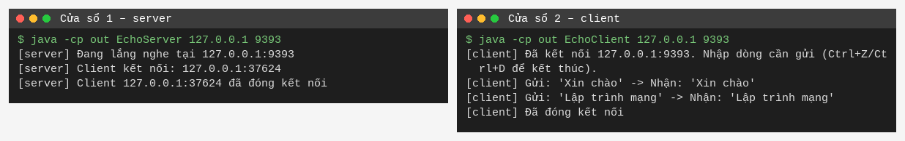

# Bài 3.1 – TCP Echo Server và Echo Client (Java)

| Thông tin | Nội dung |
|---|---|
| Mã giả tương ứng | Mã giả 3.1 (TCP Echo Server tuần tự), Mã giả 3.2 (TCP Echo Client) |
| Mục giáo trình | 3.2.2 Server tuần tự, 3.2.3 Client |
| Kế thừa | Mã giả 2.1 (đọc địa chỉ, cổng), Mã giả 2.2 (kết nối có thời gian chờ), Mã giả 3.3 (SEND_ALL) |
| Thư viện | JDK 21: `java.net.ServerSocket`, `java.net.Socket` |

## Mục tiêu
Minh họa vòng đời socket TCP bằng `ServerSocket` và `Socket`: server `bind` (gộp BIND và LISTEN) – `accept` – `read`/`write` – `close`; client `connect` (có thời gian chờ) – `write` – `read` – `shutdownOutput` – `close`.

## Tệp
- `EchoServer.java` – server tuần tự, gửi trả nguyên văn dữ liệu nhận được.
- `EchoClient.java` – client đọc từng dòng từ bàn phím, gửi và in phản hồi; chứa `safeConnect` (Mã giả 2.2 rút gọn).
- `NetUtil.java` – `parseEndpoint` (Mã giả 2.1) và `sendAll` (Mã giả 3.3).
- `demo.json` – kịch bản chạy minh họa (dùng với `tools/demo.py`).
- `ket_qua.txt`, `ket_qua.png` – kết quả thực thi thật.

## Cách chạy
Biên dịch một lần trong thư mục bài, sau đó mở hai cửa sổ dòng lệnh:
```bash
javac -encoding UTF-8 -d out NetUtil.java EchoServer.java EchoClient.java
# Cửa sổ 1 – server
java -cp out EchoServer 0.0.0.0 9000
# Cửa sổ 2 – client
java -cp out EchoClient 127.0.0.1 9000
```
Nhập vài dòng ở cửa sổ client; nhấn Ctrl+D (Linux/macOS) hoặc Ctrl+Z rồi Enter (Windows) để kết thúc. Dừng server bằng Ctrl+C.

## Kết quả thực thi


Server in địa chỉ client khi kết nối và khi client đóng kết nối; client nhận lại đúng chuỗi đã gửi, kể cả chuỗi tiếng Việt có dấu (UTF-8). Khác bản Python, nhật ký server không có dòng "Dừng server" vì chương trình không bắt Ctrl+C: JVM kết thúc ngay và hệ điều hành giải phóng socket.

## Ghi chú
- Client gọi `read` một lần cho mỗi dòng: chấp nhận được với dòng ngắn, nhưng sai khi thông điệp lớn vì TCP là luồng byte không giữ ranh giới thông điệp (Mục 3.4). Bài 3.2 bổ sung định khung.
- `parseEndpoint` là bản rút gọn của Mã giả 2.1: chỉ đọc biến môi trường `APP_PORT`, chưa đọc `APP_HOST`. `safeConnect` là bản rút gọn của Mã giả 2.2: thử lần lượt các địa chỉ với thời gian chờ 3 000 ms nhưng không phân loại lỗi `REFUSED`/`UNREACHABLE`. Các bài từ 3.2 dùng bản đầy đủ.
- `ServerSocket.bind(addr, 16)` thực hiện cả BIND và LISTEN với backlog 16. `InputStream.read` trả về -1 (thay cho dãy rỗng của mã giả) khi đối tác đã đóng chiều gửi.
- `OutputStream.write` của socket đã lặp bên trong đến khi chuyển hết dữ liệu, nên `sendAll` chỉ gọi `write` rồi `flush` (Mục 3.2.4).
- Khối `FINALLY CLOSE` của mã giả tương ứng với `try-with-resources`.
- Trên Windows, ngữ nghĩa của `REUSEADDR` khác Linux (Mục 3.1.3); khi triển khai thật trên Windows nên cân nhắc bỏ `setReuseAddress(true)`.
- Kiểm thử: Linux, OpenJDK 21.0.12.
