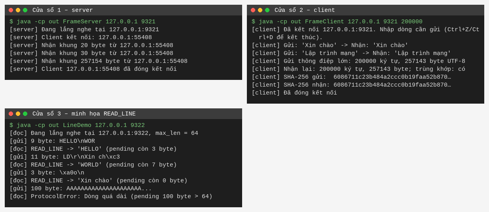

# Bài 3.2 – Thư viện định khung thông điệp (Java)

| Thông tin | Nội dung |
|---|---|
| Mã giả tương ứng | Mã giả 3.3 (SEND_ALL), Mã giả 3.4 (RECV_EXACT), Mã giả 3.5 (READ_LINE), Mã giả 3.6 (SEND_FRAME, RECV_FRAME, SEND_JSON, RECV_JSON) |
| Mục giáo trình | 3.2.4 Gửi và nhận dữ liệu, 3.4.1–3.4.4 Thiết kế giao thức trao đổi |
| Kế thừa | Mã giả 2.1, 2.2 (`NetUtil.java`); khung sườn Mã giả 3.1 (server) và 3.2 (client) |
| Thư viện | JDK 21: `java.net`, `java.nio.ByteBuffer`, `java.security.MessageDigest`; JSON tự cài đặt (`Json.java`) |

## Mục tiêu
Xây dựng thư viện định khung dùng lại ở các bài sau: gửi hết dãy byte, nhận đúng n byte, đọc một dòng kết thúc bằng LF/CRLF, gửi và nhận khung `[4 byte độ dài big-endian][nội dung]` chứa JSON mã hóa UTF-8. Chương trình minh họa cho thấy một thông điệp 200 000 ký tự (257 143 byte UTF-8) được nhận đủ và trùng khớp, trường hợp mà client của Bài 3.1 (một lần `read` 4 096 byte) không xử lý được.

## Tệp
- `Framing.java` – thư viện: `sendAll`, `recvExact`, `Reader`/`readLine`, `sendFrame`, `recvFrame`, `sendJson`, `recvJson`; các lỗi `ConnectionClosed`, `ProtocolError`; hằng `MAX_FRAME` = 1 MiB.
- `Json.java` – bộ mã hóa và phân tích JSON tối giản theo RFC 8259 (Java SE không có thư viện JSON chuẩn); lỗi `Json.JsonError`.
- `NetUtil.java` – `parseEndpoint` (Mã giả 2.1), `safeConnect` (Mã giả 2.2) và lỗi đã phân loại `NetError`.
- `FrameServer.java` – echo server dùng khung JSON: `{"text": …}` → `{"status": 200, "text": …}`; JSON sai hoặc thiếu trường `text` → `status` 400.
- `FrameClient.java` – gửi từng dòng nhập từ bàn phím; tham số thứ ba (tùy chọn) là số ký tự của một thông điệp lớn gửi sau cùng, so sánh nội dung và mã băm SHA-256 hai chiều.
- `LineDemo.java` – minh họa `READ_LINE`: tự mở một kết nối loopback, gửi các mảnh cắt ngang dòng (kể cả cắt giữa hai byte UTF-8 của chữ "à") và một dòng 100 byte vượt `max_len` = 64.
- `demo.json`, `ket_qua.txt`, `ket_qua.png` – kịch bản và kết quả thực thi thật.

## Cách chạy
Biên dịch một lần trong thư mục bài, sau đó mở các cửa sổ dòng lệnh:
```bash
javac -encoding UTF-8 -d out Json.java NetUtil.java Framing.java FrameServer.java FrameClient.java LineDemo.java
# Cửa sổ 1 – server
java -cp out FrameServer 0.0.0.0 9000
# Cửa sổ 2 – client: gửi các dòng nhập, sau đó một thông điệp 200 000 ký tự
java -cp out FrameClient 127.0.0.1 9000 200000
# Cửa sổ 3 – minh họa READ_LINE (một chương trình, tự kết nối tới chính nó)
java -cp out LineDemo 127.0.0.1 9001
```
Kết thúc nhập ở client bằng Ctrl+D (Linux/macOS) hoặc Ctrl+Z rồi Enter (Windows); dừng server bằng Ctrl+C.

## Kết quả thực thi


Server nhận khung 257 154 byte; client nhận lại đủ 200 000 ký tự và mã băm hai chiều trùng nhau. Ở cửa sổ 3, `readLine` lần lượt trả về "HELLO", "WORLD" (đã bỏ CR), "Xin chào" (ghép đúng hai nửa của chữ "à") và giữ phần dư trong `pending`; dòng 100 byte không có LF gây lỗi `ProtocolError: Dòng quá dài`. Kết quả trùng với bản Python và C#.

## Ghi chú
- `FROM_UINT32_BE` phải đọc số không dấu: `ByteBuffer.getInt()` (cũng như `DataInputStream.readInt`) trả về số có dấu, độ dài 0xFFFFFFFF thành -1 và lọt qua phép so sánh với `MAX_FRAME`; bài dùng `getInt() & 0xFFFFFFFFL`.
- `recvExact` tự viết vòng lặp trên `InputStream.read`; `DataInputStream.readFully` có tác dụng tương tự nhưng ném `EOFException` không kèm số byte đã nhận, thông tin cần cho `ConnectionClosed(received)`.
- `OutputStream.write` của socket đã lặp bên trong đến khi chuyển hết dữ liệu, nên `sendAll` chỉ gọi `write` rồi `flush`.
- Giải mã UTF-8 dùng `CharsetDecoder` ở chế độ báo lỗi (mặc định `new String(bytes, UTF_8)` thay byte sai bằng U+FFFD); lỗi này được quy về `Json.JsonError`.
- `Json.java` giữ nguyên chữ tiếng Việt khi mã hóa (chỉ thoát dấu nháy, gạch chéo ngược, ký tự điều khiển), đối tượng ánh xạ sang `LinkedHashMap` để giữ thứ tự khóa, số nguyên sang `Long`. Tệp dài khoảng 175 dòng, vượt mức 150 dòng khuyến nghị vì gồm cả bộ phân tích.
- `FrameServer` gọi `recvFrame` rồi `jsonDecode` (tách hai bước của `RECV_JSON`) chỉ để ghi kích thước khung vào nhật ký.
- Theo đúng mã giả, `readLine` bỏ qua phần dư không có LF khi đối tác đóng kết nối. Giới hạn `maxLen` được kiểm tra cả khi đã tìm thấy LF (dòng 5 của Mã giả 3.5), nên một dòng dài hơn `maxLen` luôn bị từ chối. Nhật ký server không có dòng "Dừng server" vì chương trình không bắt Ctrl+C.
- Kiểm thử: Linux, OpenJDK 21.0.12.
