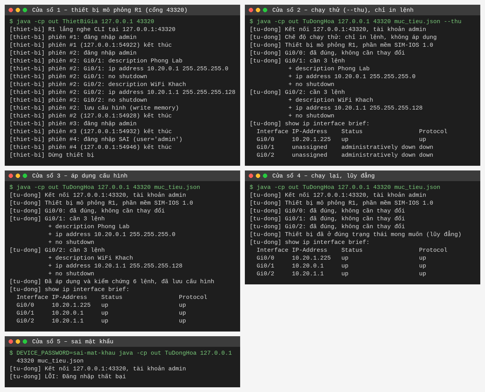

# Bài mở rộng MR3.2 – Tự động hóa cấu hình thiết bị qua CLI (kiểu expect/Netmiko, chỉ dùng socket) (Java)

| Thông tin | Nội dung |
|---|---|
| Loại | **Bài mở rộng** – không có trong giáo trình, không có mã giả tương ứng |
| Liên hệ với giáo trình | Chương 3: Bài 3.2 (định khung – ở đây là đọc tới dấu nhắc), Bài 3.1; Chương 6: Bài 6.1 (server nhiều phiên); Chương 2: Bài 2.1 (bí mật lấy từ biến môi trường); MR1.1 (địa chỉ trong `muc_tieu.json`) |
| Thư viện | JDK 21: `java.net.Socket`, `java.net.ServerSocket`, `java.util.regex`; `Json.java` tự viết; `DiaChi.java` (phép tính địa chỉ IPv4 thay cho `ipaddress`) |
| Bản ngôn ngữ khác | [C#](../../../csharp/Chuong03/BaiMR3.2_TuDongHoaCLI/), [Python](../../../python/Chuong03/BaiMR3.2_TuDongHoaCLI/), [Rust](../../../rust/Chuong03/BaiMR3.2_TuDongHoaCLI/), [Go](../../../go/Chuong03/BaiMR3.2_TuDongHoaCLI/) |

## Mục tiêu
Luyện tự động hóa thiết bị mạng mà không cần thiết bị thật. Thiết bị mô phỏng R1 có CLI kiểu Telnet (đăng nhập, dấu nhắc `R1>` `R1#` `R1(config)#` `R1(config-if)#`, vọng lại lệnh, phân trang `--More--`). Dữ liệu CLI là luồng byte **không có khung thông điệp**, nên client phải *đọc cho tới khi gặp dấu nhắc* (READ_UNTIL bằng biểu thức chính quy) – cùng ý tưởng với `READ_LINE` ở Bài 3.2. Client tự động hóa: đọc cấu hình hiện tại, so với trạng thái mong muốn và **chỉ sinh lệnh cho phần khác biệt** (lũy đẳng – chạy lại không thay đổi gì), có chế độ chạy thử `--thu`, đọc lại để kiểm chứng rồi mới lưu cấu hình.

## Tệp
- `ThietBiGia.java` – thiết bị mô phỏng R1 (server TCP nhiều phiên, trạng thái chung có khóa `synchronized`).
- `TuDongHoa.java` – client: lớp `CliSession` (`readUntil`, `login`, `command`), `parseInterface`, `diffCommands`.
- `DiaChi.java` – đọc địa chỉ IPv4, đổi mặt nạ dạng chấm ↔ độ dài tiền tố.
- `Json.java` – bộ đọc JSON tối giản (chép từ Bài 5.3 bản Java).
- `muc_tieu.json` – trạng thái mong muốn của ba cổng (giống bản Python).
- `demo.json` – kịch bản chạy minh họa (dùng với `tools/demo.py`).
- `ket_qua.txt`, `ket_qua.png` – kết quả thực thi thật.

## Cách chạy
Trong thư mục bài:
```bash
javac -encoding UTF-8 -d out *.java
export DEVICE_USER=admin DEVICE_PASSWORD=lab123
java -cp out ThietBiGia 127.0.0.1 9000                     # cửa sổ 1
java -cp out TuDongHoa 127.0.0.1 9000 muc_tieu.json --thu  # cửa sổ 2: chỉ in lệnh
java -cp out TuDongHoa 127.0.0.1 9000 muc_tieu.json        # áp dụng
java -cp out TuDongHoa 127.0.0.1 9000 muc_tieu.json        # chạy lại: không thay đổi
```
Có thể nối tay vào thiết bị bằng `nc 127.0.0.1 9000` (hoặc `telnet`) để gõ lệnh và thấy phân trang `--More--` khi chưa gõ `terminal length 0`. Trên Windows đặt biến môi trường bằng `set DEVICE_PASSWORD=lab123` (cmd) hoặc `$env:DEVICE_PASSWORD="lab123"` (PowerShell). Thiết bị và client Java chạy chéo được với bản Python, Go (đã thử client Java với thiết bị Python và ngược lại).

Tái lập kết quả từ thư mục gốc của kho: `python3 tools/demo.py java/Chuong03/BaiMR3.2_TuDongHoaCLI`.

## Kết quả thực thi


Lần chạy thử chỉ in 6 lệnh cần cho `Gi0/1`, `Gi0/2` (cổng `Gi0/0` đã đúng) và thiết bị không ghi nhận thay đổi nào. Lần áp dụng gửi đúng 6 lệnh đó, đọc lại để kiểm chứng rồi `write memory`; bảng `show ip interface brief` chuyển hai cổng sang `up`. Lần chạy thứ ba không gửi lệnh cấu hình nào (lũy đẳng). Sai mật khẩu: thiết bị ghi nhận đăng nhập sai, client báo *Đăng nhập thất bại* và thoát với mã 1. Hai bản Python và Go cho kết quả giống nhau.

## Ghi chú
- `readUntil` giữ byte thô trong `ByteArrayOutputStream` và giải mã cả bộ đệm mỗi vòng, nên không bị cắt đôi ký tự UTF-8 nhiều byte (ví dụ chữ có dấu trong lời chào) khi gói tin bị chia.
- `$` trong `java.util.regex` (không bật MULTILINE) khớp ở cuối chuỗi như `re.search` của Python; `\w` của Java mặc định chỉ gồm ký tự ASCII, đủ cho tên thiết bị.
- Dòng "Dừng thiết bị" khi nhấn Ctrl+C được in trong *shutdown hook*.
- Thiết bị mô phỏng gửi mật khẩu dạng rõ như Telnet. Thiết bị thật phải dùng SSH: Python có Paramiko, Netmiko; Java có Apache MINA SSHD, JSch (không thuộc JDK). Logic `readUntil` dấu nhắc, so sánh và sinh lệnh khác biệt giữ nguyên khi thay kênh Telnet bằng SSH.
- Cú pháp lệnh mô phỏng theo kiểu Cisco IOS nhưng tối giản (ba cổng, một vài lệnh); không phải phần mềm của hãng nào.
- Mẫu dấu nhắc chỉ được so ở **cuối** bộ đệm; dòng kết quả nào kết thúc bằng `#` hoặc `>` đúng lúc gói tin bị chia có thể bị nhầm là dấu nhắc – thư viện thật như Netmiko cũng gặp vấn đề này và cho phép chỉ định mẫu dấu nhắc chặt hơn.
- Thiết bị bọc luồng vào bằng `BufferedInputStream` để vừa đọc theo dòng (tự viết `readline`) vừa đọc một byte (`read()`) khi chờ phím ở `--More--`.
- Kiểm thử: Linux, OpenJDK 21.0.12.

## Đọc thêm
- Eric Chou, *Mastering Python Networking*, 4th ed., Packt, 2023, Chương 2 *Low-Level Network Device Interactions* (Pexpect, Paramiko, Netmiko; mục *Idempotent network device interaction*).
- Claus Töpke, *Network Programming and Automation Essentials*, Packt, 2023, Chương 3 *Accessing the Network* (CLI, truy cập từ xa an toàn) và Chương 6 (thư viện truy cập thiết bị qua CLI).

Mã nguồn của bài được viết mới cho kho này; sách trên chỉ là tài liệu tham khảo ý tưởng.
