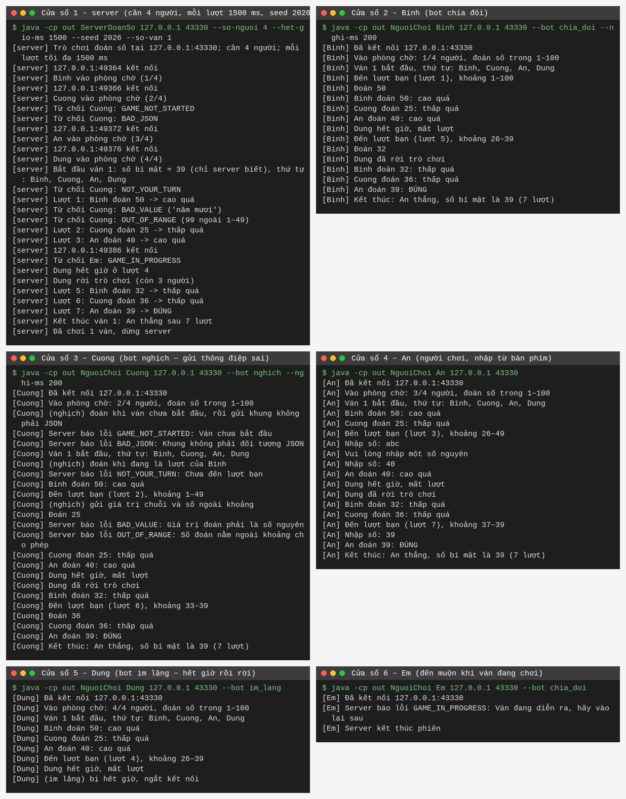

# Bài mở rộng MR3.3 – Trò chơi đoán số nhiều người chơi qua TCP (Java)

| Thông tin | Nội dung |
|---|---|
| Loại | **Bài mở rộng** (mini game) – không có trong giáo trình, không có mã giả tương ứng |
| Liên hệ với giáo trình | Chương 3: Bài 3.2 (định khung JSON có tiền tố độ dài), Bài 3.3 (giao thức yêu cầu/phản hồi); Chương 6: Bài 6.1 (server nhiều client) |
| Thư viện | JDK 21: `java.net.Socket`, `java.net.ServerSocket`, `java.util.concurrent.BlockingQueue` (hàng đợi sự kiện có thời gian chờ), `java.nio.ByteBuffer` (tiêu đề big-endian); `Json.java` tự viết |
| Bản ngôn ngữ khác | [C#](../../../csharp/Chuong03/BaiMR3.3_GameDoanSo/), [Python](../../../python/Chuong03/BaiMR3.3_GameDoanSo/), [Rust](../../../rust/Chuong03/BaiMR3.3_GameDoanSo/), [Go](../../../go/Chuong03/BaiMR3.3_GameDoanSo/) |

## Mục tiêu
Server chọn một số bí mật trong khoảng 1–100; người chơi lần lượt đoán, server trả lời *thấp quá*, *cao quá* hoặc *ĐÚNG*, và thu hẹp khoảng cho người kế tiếp. Trò chơi nhỏ nhưng đủ các vấn đề của một giao thức ứng dụng thật trên TCP:
- **Thiết kế giao thức yêu cầu/phản hồi**: mỗi thông điệp là một đối tượng JSON trong một khung `4 byte độ dài + nội dung` (kế thừa Bài 3.2), có trường `type` và các mã lỗi rõ ràng.
- **Máy trạng thái**: server ở `CHO` (chờ đủ người) → `DANG_CHOI` → kết thúc ván → `CHO`; client ở *chờ* → *đến lượt* → *kết thúc*. Mỗi thông điệp chỉ hợp lệ ở một số trạng thái.
- **Kiểm tra đầu vào ở server**: đúng lượt, giá trị là số nguyên, nằm trong khoảng, khung là JSON hợp lệ. Client cũng kiểm tra để báo sớm cho người dùng, nhưng **server không bao giờ tin client**.
- **Xử lý mất kết nối và hết giờ**: người chơi rời giữa chừng bị loại khỏi vòng lượt; người không trả lời trong thời hạn bị mất lượt.

## Kiến thức chính
- Thông điệp: client → server `hello {name}`, `guess {value}`, `bye`; server → client `welcome`, `start`, `turn {player, lo, hi}`, `result {player, value, hint}`, `timeout`, `left`, `error {code, msg}`, `game_over`, `bye`.
- Mã lỗi: `BAD_JSON`, `NEED_HELLO`, `BAD_NAME`, `NAME_TAKEN`, `GAME_IN_PROGRESS`, `GAME_NOT_STARTED`, `NOT_YOUR_TURN`, `BAD_VALUE`, `OUT_OF_RANGE`, `UNKNOWN_TYPE`. Lỗi không làm mất lượt; người chơi gửi lại được tới khi hết giờ.
- Kiến trúc **vòng lặp sự kiện một luồng**: mỗi kết nối có một luồng đọc chỉ nhận khung và đẩy sự kiện vào `queue.Queue`; một luồng trò chơi duy nhất giữ toàn bộ trạng thái và xử lý tuần tự, nên không cần khóa. Hết giờ của lượt chính là thời gian chờ của `queue.get(timeout=...)`; hạn chót được kiểm tra cả trước khi chờ nên client gửi thông điệp liên tục cũng không “hoãn” được hết giờ.
- `TCP_NODELAY`: tắt thuật toán Nagle để các khung nhỏ đi ngay (Go bật sẵn tùy chọn này cho mọi kết nối TCP).
- Bộ sinh số giả ngẫu nhiên LCG cùng công thức với bản Go: cùng `--seed` cho cùng số bí mật ở hai bản.

## Tệp
- `GiaoThuc.java` – định khung (`recvExact`, `sendFrame`, `recvFrame`, `sendJson`), giới hạn khung 64 KiB, bộ sinh `Lcg`, `repr` (in giá trị như Python).
- `ServerDoanSo.java` – server: luồng chấp nhận, luồng đọc, lớp `Game` (máy trạng thái, kiểm tra, phát tin).
- `NguoiChoi.java` – client: chế độ người chơi (bàn phím) và bốn bot `chia_doi`, `ngau_nhien`, `nghich`, `im_lang`.
- `Json.java` – bộ mã hóa, giải mã JSON tối giản (chép từ Bài 5.3 bản Java).
- `demo.json` – kịch bản chạy minh họa (dùng với `tools/demo.py`).
- `ket_qua.txt`, `ket_qua.png` – kết quả thực thi thật.

## Cách chạy
Trong thư mục bài:
```bash
javac -encoding UTF-8 -d out *.java
java -cp out ServerDoanSo 0.0.0.0 9000 --so-nguoi 2                 # cửa sổ 1
java -cp out NguoiChoi An 127.0.0.1 9000                            # cửa sổ 2: bạn tự chơi
java -cp out NguoiChoi Binh 127.0.0.1 9000 --bot chia_doi           # cửa sổ 3: đấu với bot
```
Khi đến lượt, chương trình in `Nhập số:`; Ctrl+D (Linux) hoặc Ctrl+Z, Enter (Windows) để rời trò chơi. Tùy chọn server: `--het-gio-ms` (mặc định 30000), `--seed`, `--min`, `--max`, `--so-van` (dừng sau số ván, 0 = chơi mãi). Mỗi ván là một phiên: hết ván server đóng mọi kết nối và chờ người chơi mới. Giao thức trên dây giống bản Python, Go nên server và client của các ngôn ngữ chơi chung được (đã thử server Java với một bot Python và một bot Java).

Tái lập kết quả từ thư mục gốc của kho: `python3 tools/demo.py java/Chuong03/BaiMR3.3_GameDoanSo`.

## Kết quả thực thi


Server cần 4 người, mỗi lượt tối đa 1500 ms, `--seed 2026` cho số bí mật 39. Thứ tự lượt theo thứ tự vào phòng: Binh, Cuong, An, Dung.
- Cuong (bot *nghịch*) đoán khi ván chưa bắt đầu (`GAME_NOT_STARTED`), gửi một khung không phải JSON (`BAD_JSON`), đoán khi đang là lượt của Binh (`NOT_YOUR_TURN`), rồi đến lượt mình gửi chuỗi `"năm mươi"` (`BAD_VALUE`) và số 99 ngoài khoảng 1–49 (`OUT_OF_RANGE`) trước khi đoán hợp lệ 25. Các lỗi không làm mất lượt.
- An là người chơi nhập từ bàn phím (trong demo đầu vào lấy từ tệp): dòng `abc` bị chính client từ chối, không gửi đi.
- Dung (bot *im lặng*) không trả lời: sau 1500 ms server báo hết giờ, chuyển lượt; Dung ngắt kết nối và server loại Dung khỏi vòng lượt (còn 3 người).
- Em đến khi ván đang chơi nên bị từ chối (`GAME_IN_PROGRESS`) và đóng phiên.
- Binh tìm kiếm nhị phân (50, 32); khoảng được thu hẹp dần 1–100 → 1–49 → 26–49 → 26–39 → 33–39 → 37–39; An đoán 39 ở lượt 7 và thắng. Hai bản Python và Go cho cùng trình tự sự kiện (chỉ khác cổng nguồn ngẫu nhiên của client).

## Ghi chú
- `sendFrame` ghép tiêu đề và nội dung vào một mảng rồi gọi `write` một lần trong khối `synchronized (s)`: ở chế độ người chơi, luồng nhận và luồng chính cùng dùng một socket, khung của hai luồng không được xen nhau.
- Bản Java khởi động chậm hơn (khởi tạo JVM khoảng 0,3–0,5 s) nên kịch bản `demo.json` đặt thời gian chờ giữa các tiến trình dài hơn bản Python để thứ tự người chơi vào phòng giống nhau; nhật ký trò chơi trùng với bản Python (trừ cổng).
- Dòng "Dừng server" chỉ in khi nhấn Ctrl+C (*shutdown hook*); khi dừng sau `--so-van` ván, server in "Đã chơi … ván, dừng server" như bản Python.
- Gửi thông báo cho mọi người chơi (`broadcast`) được làm ngay trong luồng trò chơi bằng `OutputStream.write`; một client nhận quá chậm có thể làm server chờ. Server thật cần hàng đợi gửi riêng cho từng client (xem Bài 6.4) hoặc đóng kết nối quá chậm.
- Kiểm tra kiểu: JSON `50.0`, `true`, `"50"` đều bị coi là `BAD_VALUE` (bộ đọc `Json.java` trả số nguyên JSON về `Long`, số thực về `Double`, nên chỉ cần kiểm tra `value instanceof Long`).
- Giới hạn khung 64 KiB (thay cho 1 MiB của Bài 3.2) vì thông điệp trò chơi chỉ vài chục byte: giới hạn càng sát nhu cầu, client xấu càng khó làm server tốn bộ nhớ.
- Kiểm thử: Linux, OpenJDK 21.0.12. Chỉ dùng JDK, không cần thư viện ngoài.

## Bài tập gợi ý
1. Thêm lệnh `chat {text}` để người chơi nhắn cho nhau trong ván; server kiểm tra độ dài và phát lại cho mọi người.
2. Đổi luật sang **đua tốc độ**: mọi người đoán cùng lúc, không theo lượt; mỗi người có khoảng riêng; ai đúng trước thắng. Máy trạng thái thay đổi thế nào?
3. Giới hạn tần suất: client gửi quá 5 thông điệp sai trong 10 giây thì bị ngắt kết nối (chống spam).
4. Cho phép người chơi kết nối lại (reconnect) trong 30 giây sau khi mất mạng mà vẫn giữ chỗ trong vòng lượt, dùng một mã phiên (token) server cấp trong `welcome`.
5. Viết bot thắng nhanh nhất trung bình khi chơi cùng bot `ngau_nhien`, đo bằng 100 ván tự động.

## Đọc thêm
- Bài 3.2 (định khung) và Bài 3.3 (giao thức tra cứu) của kho này; Mục 3.4 của giáo trình.
- RFC 9293 – *Transmission Control Protocol (TCP)*, IETF, 2022 (luồng byte, không giữ ranh giới thông điệp).
- RFC 8259 – *The JavaScript Object Notation (JSON) Data Interchange Format*, IETF, 2017.
- RFC 896 – John Nagle, *Congestion Control in IP/TCP Internetworks*, 1984 (thuật toán Nagle, lý do bật `TCP_NODELAY`).
- Tài liệu Python: [`socket`](https://docs.python.org/3/library/socket.html), [`queue`](https://docs.python.org/3/library/queue.html).

Mã nguồn của bài được viết mới cho kho này.
