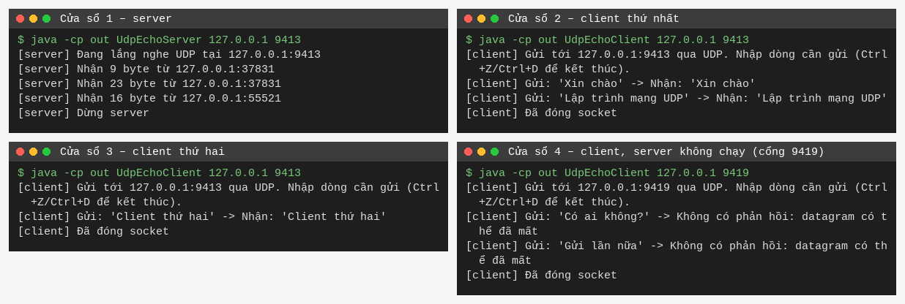

# Bài 4.1 – UDP Echo Server và UDP Echo Client có thời gian chờ (Java)

| Thông tin | Nội dung |
|---|---|
| Mã giả tương ứng | Mã giả 4.1 (UDP Echo Server), Mã giả 4.2 (UDP Echo Client có thời gian chờ) |
| Mục giáo trình | 4.2.1 Lưu đồ và mã giả; 4.2.2 Socket UDP "có kết nối" (xử lý ICMP port unreachable trên Windows) |
| Kế thừa | Mã giả 2.1 (đọc địa chỉ, cổng); vòng đọc dòng của Mã giả 3.2 |
| Thư viện | JDK: `java.net.DatagramSocket`, `DatagramPacket` |

## Mục tiêu
Minh họa chuỗi lời gọi của chương trình UDP: server `SOCKET(DGRAM)` – `BIND` – lặp `RECVFROM`/`SENDTO`, không có `LISTEN`/`ACCEPT`; client `SOCKET` – `SENDTO` – `RECVFROM` có thời gian chờ 2 giây. Một socket server phục vụ mọi client; khi server không chạy, client chỉ nhận biết qua việc hết thời gian chờ.

## Tệp
- `UdpEchoServer.java` – Mã giả 4.1.
- `UdpEchoClient.java` – Mã giả 4.2.
- `NetUtil.java` – `parseEndpoint` (Mã giả 2.1).
- `demo.json` – kịch bản chạy minh họa (dùng với `tools/demo.py`).
- `ket_qua.txt`, `ket_qua.png` – kết quả thực thi thật.

## Cách chạy
Trong thư mục bài (cần JDK 21), biên dịch một lần rồi chạy; lệnh giống nhau trên Windows và Linux:
```bash
javac -encoding UTF-8 -d out *.java
# Cửa sổ 1 – server
java -cp out UdpEchoServer 0.0.0.0 9000
# Cửa sổ 2, 3 – client
java -cp out UdpEchoClient 127.0.0.1 9000
```
Nhập vài dòng ở các cửa sổ client; kết thúc client bằng Ctrl+D (Linux/macOS) hoặc Ctrl+Z rồi Enter (Windows). Để quan sát trường hợp mất phản hồi, dừng server (Ctrl+C) rồi gửi tiếp từ client, hoặc chạy client tới một cổng không có server.

## Kết quả thực thi


Hai client lần lượt được phục vụ bởi cùng một socket server; nhật ký server cho thấy hai cổng nguồn khác nhau. Client ở cửa sổ 4 gửi tới cổng 9419 không có server: mỗi datagram đều hết thời gian chờ 2 giây và client in "Không có phản hồi: datagram có thể đã mất".

## Ghi chú
- Server bắt lỗi `ConnectionReset` (Windows báo gói ICMP port unreachable cho lời gọi nhận kế tiếp, kể cả trên socket chưa kết nối – Mục 4.2.2) rồi tiếp tục vòng lặp; client bắt cả `Timeout` và `ConnectionReset` (dòng 11 của Mã giả 4.2) và coi cả hai là không có phản hồi. Trên Linux, socket chưa kết nối không nhận lỗi này nên client chỉ thấy hết thời gian chờ, như kết quả ở trên.
- Dòng đọc từ bàn phím được bỏ ký tự xuống dòng trước khi gửi; mỗi dòng là đúng một datagram.
- Thông báo "Dừng server" khi nhấn Ctrl+C được thêm để quan sát; mã giả không có bước này.
- Java gộp `SOCKET` và `BIND` trong hàm tạo `new DatagramSocket(new InetSocketAddress(host, port))`. Lỗi ICMP trên Windows tương ứng `PortUnreachableException`.
- Trên Windows, nếu chữ tiếng Việt hiển thị sai trong cửa sổ dòng lệnh, chạy `chcp 65001` trước khi chạy chương trình.
- Kiểm thử: Linux, OpenJDK 21.0.12.1.
