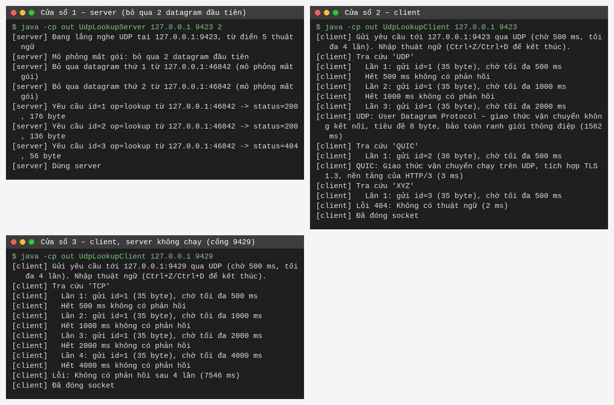

# Bài 4.2 – Dịch vụ tra cứu thuật ngữ trên UDP có gửi lại (Java)

| Thông tin | Nội dung |
|---|---|
| Mã giả tương ứng | Mã giả 4.3 (Server tra cứu thuật ngữ trên UDP), Mã giả 4.4 (UDP_REQUEST – gửi lại có lùi thời gian, ghép mã định danh) |
| Mục giáo trình | 4.3.1 Dịch vụ tra cứu thuật ngữ trên UDP |
| Kế thừa | Mã giả 4.1, 4.2 (vòng RECVFROM/SENDTO, thời gian chờ); `PROCESS_REQUEST`, `DICT` của server tra cứu TCP (Mục 3.5.1); Mã giả 2.1 |
| Thư viện | JDK: `java.net.DatagramSocket`, `DatagramPacket`; `Json.java` (bộ đọc/ghi JSON tối giản tự viết) |

## Mục tiêu
Chuyển dịch vụ tra cứu của Chương 3 sang UDP: mỗi yêu cầu, mỗi phản hồi là một datagram JSON, không cần trường độ dài; yêu cầu mang `id` để ghép phản hồi; client gửi lại tối đa 4 lần với thời gian chờ 500 → 1000 → 2000 → 4000 ms. Server có tham số mô phỏng mất gói (bỏ qua N datagram đầu tiên) để quan sát cơ chế gửi lại.

## Tệp
- `UdpLookupServer.java` – Mã giả 4.3 và `processRequest`.
- `UdpLookupClient.java` – Mã giả 4.4 `udpRequest` và vòng đọc thuật ngữ.
- `Json.java` – đọc/ghi JSON tối giản (JDK không có thư viện JSON chuẩn).
- `NetUtil.java` – `parseEndpoint` (Mã giả 2.1).
- `glossary.json` – từ điển thuật ngữ.
- `demo.json` – kịch bản chạy minh họa (dùng với `tools/demo.py`).
- `ket_qua.txt`, `ket_qua.png` – kết quả thực thi thật.

## Cách chạy
Trong thư mục bài (cần JDK 21), biên dịch một lần rồi chạy; lệnh giống nhau trên Windows và Linux:
```bash
javac -encoding UTF-8 -d out *.java
# Cửa sổ 1 – server, bỏ qua 2 datagram đầu tiên
java -cp out UdpLookupServer 0.0.0.0 9100 2
# Cửa sổ 2 – client
java -cp out UdpLookupClient 127.0.0.1 9100
```
Chạy trong thư mục bài (nơi có `glossary.json`). Nhập tên thuật ngữ ở cửa sổ client (ví dụ `UDP`, `QUIC`, `XYZ`); tham số thứ ba của server là số datagram đầu tiên bị bỏ qua, bỏ trống hoặc 0 để không mô phỏng mất gói.

## Kết quả thực thi


Server bỏ qua hai datagram đầu tiên nên yêu cầu `UDP` (id=1) chỉ thành công ở lần gửi thứ ba, sau hai lần hết thời gian chờ 500 ms và 1000 ms (tổng khoảng 1,5 giây); cả ba lần gửi mang cùng `id`. Các yêu cầu sau thành công ngay lần đầu; `XYZ` nhận mã 404. Cửa sổ 3 gửi tới cổng không có server: sau 4 lần gửi (chờ tổng cộng 0,5 + 1 + 2 + 4 = 7,5 giây), hàm báo lỗi "Không có phản hồi sau 4 lần".

## Ghi chú
- Tham số thứ ba của server (số datagram bị bỏ qua) được thêm để mô phỏng mất gói; mã giả không có tham số này. Bài tập 4.31 yêu cầu mô phỏng mất ngẫu nhiên 30%, có thể sửa điều kiện bỏ qua thành phép thử ngẫu nhiên.
- Các dòng nhật ký `[client]   Lần k: ...`, `Hết ... ms không có phản hồi` trong hàm gửi yêu cầu là nhật ký minh họa, không có trong Mã giả 4.4.
- Ngoại lệ `JsonError` của mã giả gồm cả lỗi giải mã UTF-8 và trường hợp JSON hợp lệ nhưng không phải đối tượng (ví dụ `[1,2]`); server trả `{"status":400,"error":"JSON sai","id":null}`.
- JSON được ghi dạng gọn, giữ nguyên chữ có dấu (không thoát `\uXXXX`) ở cả ba ngôn ngữ nên kích thước datagram giống nhau (ví dụ phản hồi `UDP` dài 176 byte).
- Server bắt lỗi ICMP port unreachable của Windows (Mục 4.2.2) và tiếp tục vòng nhận. Client xử lý lỗi này (`ConnectionReset`) như hết thời gian chờ theo dòng 12–13 của Mã giả 4.4: `BREAK` sang lần thử kế tiếp với thời gian chờ gấp đôi.
- Chưa có phân trang cho thao tác `list`; với từ điển lớn, phản hồi vượt `MAX_DGRAM` = 1200 byte sẽ được thay bằng mã 413 như mã giả.
- JDK 21 không có thư viện JSON chuẩn nên bài kèm `Json.java` (khoảng 110 dòng) đọc JSON thành `Map`/`List`/`String`/`Long`/`Double`/`Boolean`/`null` và ghi ngược lại. Số nguyên JSON được đọc thành `Long`.
- Trên Windows, nếu chữ tiếng Việt hiển thị sai trong cửa sổ dòng lệnh, chạy `chcp 65001` trước khi chạy chương trình.
- Kiểm thử: Linux, OpenJDK 21.0.12.1.
