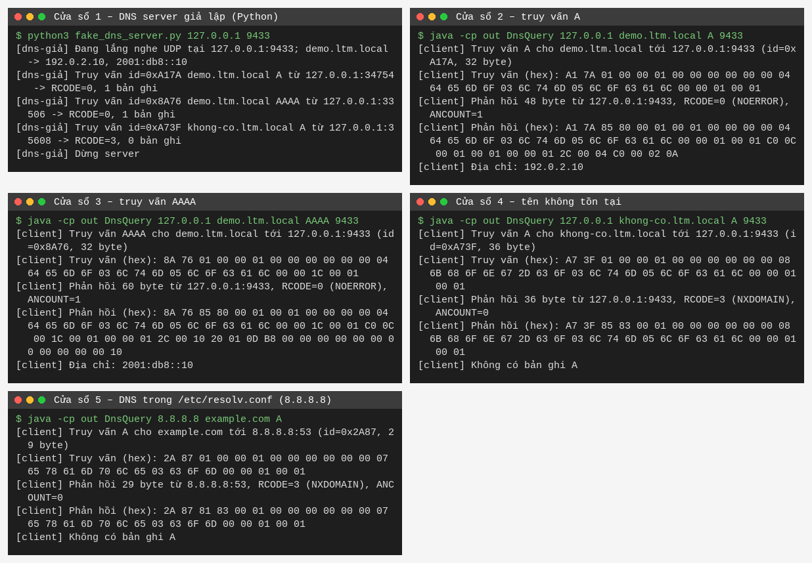

# Bài 4.3 – Tự tạo và phân tích truy vấn DNS qua UDP (Java)

| Thông tin | Nội dung |
|---|---|
| Mã giả tương ứng | Mã giả 4.5 (BUILD_QUERY, SKIP_NAME, DNS_QUERY) |
| Mục giáo trình | 4.3.2 Tự tạo truy vấn DNS theo RFC 1035 |
| Kế thừa | Client tra cứu DNS của Mục 2.5 – thay `RESOLVE` của hệ điều hành bằng truy vấn tự tạo |
| Thư viện | JDK: `java.net.DatagramSocket`, `DatagramPacket`, `java.net.IDN`, `SecureRandom` |

## Mục tiêu
Lập trình một giao thức nhị phân chuẩn: tạo thông điệp truy vấn DNS (tiêu đề 12 byte, QNAME dạng dãy nhãn, QTYPE, QCLASS), gửi qua UDP, kiểm tra địa chỉ nguồn và ID của phản hồi, đọc RCODE, ANCOUNT, nhảy qua tên (kể cả con trỏ nén `C0 0C`) và lấy bản ghi A/AAAA.

## Tệp
- `DnsQuery.java` – Mã giả 4.5.
- `fake_dns_server.py` – DNS server giả lập tối giản (Python, dùng chung cho demo của cả ba ngôn ngữ; không thuộc mã giả): trả lời bản ghi A `192.0.2.10` và AAAA `2001:db8::10` cho đúng tên `demo.ltm.local`, tên khác trả RCODE = 3 (NXDOMAIN). Tệp này có bản sao giống hệt trong thư mục bài của C#, Java, Python.
- `demo.json` – kịch bản chạy minh họa (dùng với `tools/demo.py`).
- `ket_qua.txt`, `ket_qua.png` – kết quả thực thi thật.

## Cách chạy
Trong thư mục bài (cần JDK 21), biên dịch một lần rồi chạy; lệnh giống nhau trên Windows và Linux:
```bash
javac -encoding UTF-8 -d out *.java
# Cửa sổ 1 – DNS server giả lập (Python)
python3 fake_dns_server.py 127.0.0.1 5353
# Cửa sổ 2 – truy vấn tới server giả lập
java -cp out DnsQuery 127.0.0.1 demo.ltm.local A 5353
# Hoặc truy vấn DNS server thật (cổng 53)
java -cp out DnsQuery 8.8.8.8 example.com AAAA
```
Tham số: `<ip_dns_server> <ten_mien> [A|AAAA] [cong]`, mặc định kiểu A, cổng 53. Địa chỉ DNS server của máy có thể xem trong `/etc/resolv.conf` (Linux) hoặc bằng `ipconfig /all` (Windows). Trên Windows dùng `py` (hoặc `python`) thay cho `python3`.

## Kết quả thực thi


Truy vấn `demo.ltm.local` dài 32 byte, tiêu đề `xx xx 01 00 00 01 00 00 00 00 00 00` (cờ RD = 1, QDCOUNT = 1); phản hồi chép lại phần câu hỏi, bản ghi trả lời bắt đầu bằng con trỏ nén `C0 0C`, chương trình in đúng `192.0.2.10` và `2001:db8::10`. Tên không tồn tại cho RCODE = 3 (NXDOMAIN). Cửa sổ 5 gửi truy vấn tới DNS server ghi trong `/etc/resolv.conf` của môi trường biên soạn (8.8.8.8): mạng của môi trường này trả lời NXDOMAIN cho mọi tên (kể cả `example.com`), nên kết quả được ghi lại đúng như nhận được; trên mạng thông thường, lệnh này trả về địa chỉ thật của `example.com`.

## Ghi chú
- Bổ sung so với mã giả, theo đoạn văn ngay sau Mã giả 4.5: kiểm tra mọi chỉ số `pos` không vượt quá độ dài thông điệp (phản hồi sai định dạng báo "Lỗi giao thức" thay vì đọc ngoài vùng nhớ) và kiểm tra cờ TC (bit 0x02 của byte thứ 3) trước khi đọc phần trả lời. `SKIP_NAME` không đi theo con trỏ nén nên không cần giới hạn số lần nhảy.
- Theo Mã giả 4.5, hàm truy vấn nhận `server = (ip, cổng)`: cổng là tham số (mặc định 53 ở dòng lệnh) để chạy thử với DNS server giả lập ở cổng không đặc quyền, và phản hồi chỉ được chấp nhận khi đến từ đúng `(ip, cổng)` đó (dòng 23).
- `DatagramSocket` của Java là socket hai ngăn xếp, gửi được tới máy chủ DNS IPv4 lẫn IPv6 (ví dụ `2001:4860:4860::8888`), tương ứng `SOCKET(FAMILY(server.ip), DGRAM)` ở dòng 19. Môi trường chạy demo không có IPv6 nên kết quả ở trên chỉ có truy vấn qua IPv4. Bản ghi A/AAAA chỉ được nhận khi RDLENGTH đúng 4/16 byte.
- Mã định danh dùng bộ sinh số ngẫu nhiên an toàn mật mã, nên ID thay đổi ở mỗi lần chạy.
- Tên quốc tế được chuyển sang Punycode theo từng nhãn (ví dụ `bücher.de` → `xn--bcher-kva.de`).
- Mã giả chỉ gửi một lần; khi cần, có thể bọc bằng cơ chế gửi lại của Mã giả 4.4.
- `InetAddress.getHostAddress()` của Java in IPv6 dạng đầy đủ (`2001:db8:0:0:0:0:0:10`); hàm `ipv6Text` rút gọn theo RFC 5952 để kết quả giống C#, Python.
- `DatagramSocket` của Java chọn họ địa chỉ tự động; truy vấn vẫn gửi tới địa chỉ IPv4.
- Trên Windows, nếu chữ tiếng Việt hiển thị sai trong cửa sổ dòng lệnh, chạy `chcp 65001` trước khi chạy chương trình.
- Kiểm thử: Linux, OpenJDK 21.0.12.1.
