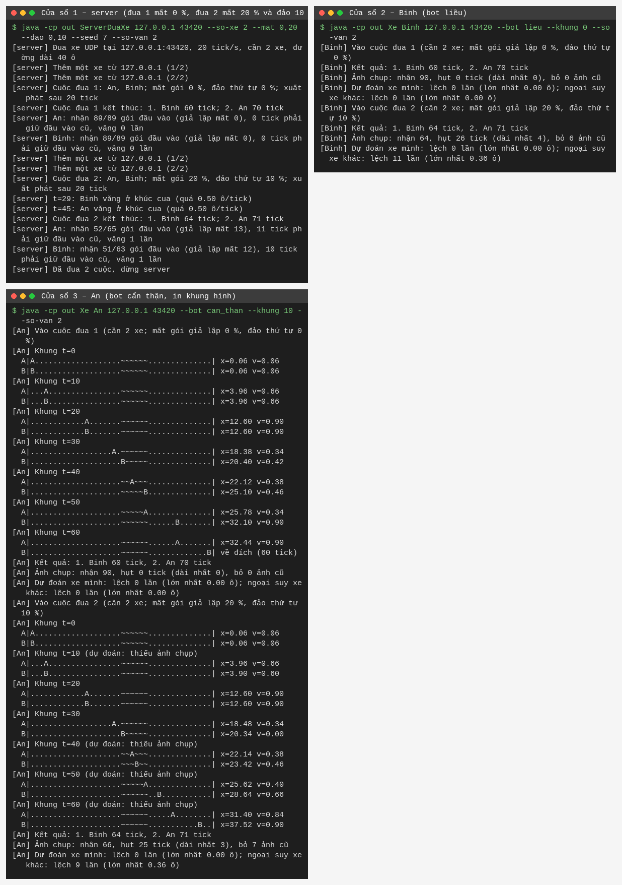

# Bài mở rộng MR4.2 – Đua xe thời gian thực qua UDP: tick có thẩm quyền, ảnh chụp, chịu mất gói (Java)

| Thông tin | Nội dung |
|---|---|
| Loại | **Bài mở rộng** (mini game) – không có trong giáo trình, không có mã giả tương ứng |
| Liên hệ với giáo trình | Chương 4: Bài 4.1, 4.2 (client/server UDP), Bài 4.4 (số thứ tự, mất gói, gửi lại); bài mở rộng MR4.1 (phát hiện mất gói theo số thứ tự) |
| Thư viện | JDK 21: `java.net.DatagramSocket` (`setSoTimeout`), `record`; `Json.java` tự viết |
| Bản ngôn ngữ khác | [C#](../../../csharp/Chuong04/BaiMR4.2_GameDuaXeUDP/), [Python](../../../python/Chuong04/BaiMR4.2_GameDuaXeUDP/), [Rust](../../../rust/Chuong04/BaiMR4.2_GameDuaXeUDP/), [Go](../../../go/Chuong04/BaiMR4.2_GameDuaXeUDP/) |

## Mục tiêu
Trò chơi thời gian thực (đua xe, bắn súng…) không dùng mô hình “hỏi – đáp, mất thì gửi lại” như Bài 4.4: gói đến muộn thì đã vô dụng. Bài xây dựng một trò đua xe nhỏ trên đường đua chữ 40 ô với một khúc cua, theo đúng kiến trúc của trò chơi mạng thật:
- **Server có thẩm quyền, vòng tick cố định 20 Hz**: mỗi 50 ms server lấy đầu vào của từng xe, mô phỏng vật lý, rồi gửi **ảnh chụp trạng thái** (snapshot) tới mọi client. Client không tự quyết định vị trí xe.
- **Đầu vào có số thứ tự**: client gửi ga/nhả/phanh kèm số tick mà đầu vào áp dụng; mỗi gói mang kèm 3 đầu vào gần nhất (**dư thừa**), nên mất một gói vẫn còn bản sao ở gói sau.
- **Chịu mất gói**: thiếu đầu vào thì server **giữ đầu vào cũ**; thiếu ảnh chụp thì client **dự đoán**; ảnh chụp đến muộn (cũ hơn ảnh đang có) bị **bỏ** – ảnh mới nhất thắng.
- **Dự đoán phía client**: xe của mình được tính lại bằng cùng hàm vật lý với các đầu vào của mình; xe khác được ngoại suy theo vận tốc cuối (dead reckoning).
- **So sánh 0 % và 20 % mất gói** bằng bộ giả lập mất gói và đảo thứ tự gói ở server.

## Kiến thức chính
- Gói client → server: `{"t":"join","name"}` (lặp lại mỗi 250 ms tới khi có `welcome` – UDP không bảo đảm đến), `{"t":"in","seq":k,"in":[đầu vào k, k-1, k-2]}`.
- Gói server → client: `welcome`, `busy`, `{"t":"snap","race","tick","phase","names","cars":[[id,x,v,về_đích],…],"rank"}`.
- **Đi trước 2 tick (LEAD = 2)**: khi nhận ảnh chụp tick *k*, client gửi đầu vào cho tick *k+2*. Gói đến server sớm ~100 ms nên còn kịp dù có trễ dao động, và đầu vào tick *t* có hai cơ hội đến kịp (gói *t* và gói *t+1*). Đổi lại, người lái thấy phản hồi chậm 100 ms – đánh đổi kinh điển giữa độ trễ và độ tin cậy.
- **Vật lý bằng số nguyên** (đơn vị 1/100 ô): server, client Python và client Go tính ra cùng kết quả, nên dự đoán phía client trùng khớp tuyệt đối khi không mất gói.
- **Giả lập mất gói tái lập được**: gói có bị “mất” hay không là hàm băm của (hạt giống, hướng, mã xe, số thứ tự), không phụ thuộc thời điểm – cùng `--seed` cho cùng các gói mất ở mọi lần chạy và ở cả hai bản.
- Lịch tick cố định (`next_tick += 50 ms`) thay vì `sleep(50 ms)` để vòng lặp không trôi theo thời gian xử lý.

## Tệp
- `DuaXe.java` – hằng số, hàm vật lý `step`, giả lập mất gói `lossy`, bot (`lieu`, `can_than`), vẽ làn đua.
- `ServerDuaXe.java` – server: nhận join/đầu vào, bộ đệm đầu vào theo tick, vòng tick, gửi ảnh chụp có giả lập mất/đảo thứ tự, thống kê.
- `Xe.java` – client: lớp `RaceView` (nhận ảnh mới nhất, dự đoán, đối chiếu, chọn đầu vào), bot in khung hình, người lái dùng bàn phím.
- `Json.java` – bộ mã hóa, giải mã JSON tối giản (chép từ Bài 5.3 bản Java).
- `demo.json` – kịch bản chạy minh họa (dùng với `tools/demo.py`).
- `ket_qua.txt`, `ket_qua.png` – kết quả thực thi thật.

## Cách chạy
Trong thư mục bài:
```bash
javac -encoding UTF-8 -d out *.java
java -cp out ServerDuaXe 0.0.0.0 9200 --so-xe 2 --mat 20        # cửa sổ 1: giả lập mất 20 % gói
java -cp out Xe An 127.0.0.1 9200                               # cửa sổ 2: bạn tự lái
java -cp out Xe Binh 127.0.0.1 9200 --bot lieu                  # cửa sổ 3: đối thủ là bot
```
Người lái gõ `g` (ga), `n` (nhả ga), `p` (phanh) rồi Enter; đầu vào giữ nguyên tới khi đổi. Màn hình được vẽ lại 10 lần/giây theo dự đoán (cần cửa sổ dòng lệnh hiểu mã ANSI: Linux, macOS, Windows Terminal). Khúc cua là đoạn `~`: vào cua nhanh hơn 0,50 ô/tick thì xe bị văng. Tùy chọn server: `--mat 0,20` và `--dao 0,10` cho tỉ lệ (%) theo từng cuộc đua, `--seed`, `--so-van`; client: `--bot lieu|can_than`, `--khung` (bot in một khung mỗi bao nhiêu tick), `--so-van`. Giao thức trên dây giống bản Python, Go (đã thử server Python với một xe Python và một xe Java: kết quả trùng với lần chạy minh họa).

Tái lập kết quả từ thư mục gốc của kho: `python3 tools/demo.py java/Chuong04/BaiMR4.2_GameDuaXeUDP`.

## Kết quả thực thi


Hai bot đua hai cuộc liên tiếp trên cùng server: cuộc 1 không mất gói; cuộc 2 mất 20 % gói (cả đầu vào lẫn ảnh chụp) và 10 % ảnh chụp bị đảo thứ tự. Binh là bot *liều* (phanh sát khúc cua, vào cua 0,50 ô/tick); An là bot *cẩn thận* (phanh sớm 3 ô, vào cua 0,40 ô/tick).

| | Cuộc 1 – mất 0 % | Cuộc 2 – mất 20 %, đảo 10 % |
|---|---|---|
| Thứ hạng | Binh 60 tick, An 70 tick | Binh 64 tick, An 71 tick |
| Gói đầu vào server nhận | 89/89 mỗi xe | An 52/65, Binh 51/63 |
| Tick server phải giữ đầu vào cũ | 0 | An 11, Binh 10 |
| Văng ở khúc cua | 0 | mỗi xe 1 lần |
| Ảnh chụp client nhận (An) | 90, không hụt | 66, hụt 25 tick (dài nhất 3), bỏ 7 ảnh cũ |
| Ngoại suy xe đối thủ sai (An) | 0 lần | 9 lần, lớn nhất 0,36 ô |

- Cuộc 1: mọi đầu vào đến đúng hạn; khung hình An in ra là ảnh chụp thật; dự đoán xe mình không lệch lần nào.
- Cuộc 2: các khung t = 10, 40, 50, 60 được vẽ bằng dự đoán vì thiếu ảnh chụp đúng tick đó (dòng *“dự đoán: thiếu ảnh chụp”*). Ở t = 10, xe A (của mình, tính lại bằng vật lý đầy đủ) ở x = 3.96 như ở cuộc 1, còn xe B (ngoại suy theo vận tốc cuối) ở x = 3.90, v = 0.60 – dead reckoning bỏ qua gia tốc nên hụt một chút khi xe đang tăng tốc.
- Khi mất liên tiếp vài ảnh chụp, client không kịp ra quyết định mới, server giữ đầu vào cũ (đang ga) nên **cả bot cẩn thận cũng bị văng** – mất gói không chỉ làm hình giật mà còn ảnh hưởng tới lối chơi. Ảnh chụp bị đảo thứ tự đến sau ảnh mới hơn và bị bỏ (`bỏ 7 ảnh cũ`).
- Dự đoán xe mình vẫn không lệch: khi thiếu đầu vào, cả client và server đều “giữ đầu vào cũ” theo cùng quy tắc, nên client tính đúng điều server sẽ làm. Lệch chỉ xảy ra khi client đã chọn đầu vào mới mà mọi bản sao của nó đều mất (hiếm hơn nhiều).
- Hai bản Python và Go cho kết quả giống hệt nhau qua nhiều lần chạy.

## Ghi chú
- Java không có `select` cho `DatagramSocket` cổ điển: vòng lặp server đặt `setSoTimeout` bằng thời gian còn lại tới tick kế tiếp rồi gọi `receive`; nếu đã tới giờ tick thì bỏ qua bước nhận. Lưu ý `setSoTimeout(0)` nghĩa là **chờ mãi** (dùng khi chưa có cuộc đua).
- Hàm băm `lossy` tính bằng `long` rồi giữ 32 bit thấp (`& 0xFFFFFFFFL`, dịch phải không dấu `>>>`) để cho cùng kết quả với số nguyên lớn của Python và `uint32` của Go; nhờ vậy nhật ký bản Java trùng từng dòng với bản Python (trừ cổng).
- Server chỉ chấp nhận đầu vào cho tick chưa mô phỏng; dọn bộ đệm mỗi tick để client xấu không làm phình bộ nhớ. Mã xe được gán theo thứ tự tên (không theo thứ tự đến) để kết quả không phụ thuộc ai vào trước.
- Không có xác thực: bất kỳ ai biết địa chỉ của một client đều có thể giả mạo gói của client đó (UDP dễ giả mạo nguồn – xem Bài 4.5). Trò chơi thật cấp mã phiên bí mật trong `welcome` và kiểm tra ở mỗi gói.
- Tick 50 ms trên một máy cục bộ có dư thời gian rất lớn so với độ trễ; nếu máy quá tải (một tiến trình bị dừng > 50 ms), kết quả có thể lệch một vài tick so với ảnh minh họa.
- Trên Windows, `DatagramSocket.receive` có thể báo lỗi khi client vừa thoát (ICMP *port unreachable*); server bỏ qua lỗi này.
- Kiểm thử: Linux, OpenJDK 21.0.12. Chỉ dùng JDK, không cần thư viện ngoài.

## Bài tập gợi ý
1. Chạy lại demo với `--mat 0,20,40` và `--so-van 3` (cả hai client); lập bảng số tick phải giữ đầu vào cũ theo tỉ lệ mất gói. Đổi `WINDOW` từ 3 về 1 để thấy tác dụng của dư thừa.
2. Thêm **nội suy** cho xe đối thủ: hiển thị trễ 2 tick và nội suy tuyến tính giữa hai ảnh chụp đã có, thay cho ngoại suy; so sánh sai số với dead reckoning.
3. Cho client gửi đầu vào theo **đồng hồ riêng** 20 Hz (ước lượng tick hiện tại của server) thay vì chỉ khi nhận ảnh chụp, để vẫn ra quyết định khi mất ảnh chụp. Bot cẩn thận còn bị văng không?
4. Giảm kích thước gói: mã hóa ảnh chụp dạng nhị phân bằng `ByteBuffer` (như Bài 4.3) và chỉ gửi phần thay đổi so với ảnh client đã xác nhận (delta compression).
5. Thêm trục thứ hai (đổi làn) và va chạm giữa các xe; server vẫn là bên duy nhất quyết định va chạm.

## Đọc thêm
- RFC 768 – *User Datagram Protocol*, 1980; RFC 8085 – *UDP Usage Guidelines*, IETF, 2017 (BCP 145).
- Ilya Grigorik, *High Performance Browser Networking*, O’Reilly, 2013, Chương 3 *Building Blocks of UDP*.
- Glenn Fiedler, *Networked Physics* (loạt bài *Snapshot Interpolation*, *State Synchronization*), gafferongames.com, 2014–2015.
- Gabriel Gambetta, *Fast-Paced Multiplayer* (client-side prediction, server reconciliation, entity interpolation), gabrielgambetta.com.
- Yahn W. Bernier, *Latency Compensating Methods in Client/Server In-game Protocol Design and Optimization*, Game Developers Conference, 2001.

Mã nguồn của bài được viết mới cho kho này; các tài liệu trên chỉ là tài liệu tham khảo ý tưởng.
