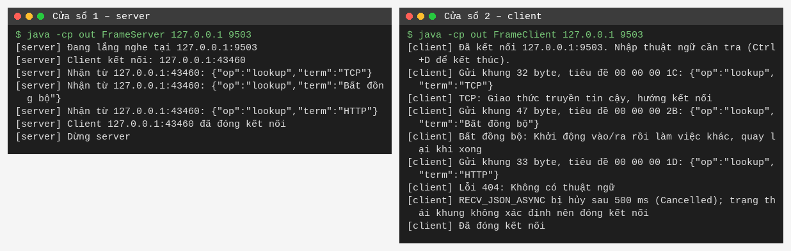

# Bài 5.1 – Các hàm gửi, nhận khung JSON bất đồng bộ (Java)

| Thông tin | Nội dung |
|---|---|
| Mã giả tương ứng | Mã giả 5.1 (Các hàm gửi, nhận khung JSON bất đồng bộ) |
| Mục giáo trình | 5.2.3 Ánh xạ sang các nền tảng; 5.2.4 Các hàm socket bất đồng bộ; 5.4.1 Hủy tác vụ hợp tác |
| Kế thừa | Mã giả 3.3 (SEND_ALL), 3.4 (RECV_EXACT), 3.6 (khung JSON), 3.7 (PROCESS_REQUEST), 3.8 (LOOKUP_CLIENT), 2.1 (PARSE_ENDPOINT), 2.2 (SAFE_CONNECT) |
| Thư viện | JDK 21: `java.net`, `java.util.concurrent` (`CompletableFuture`, luồng ảo); `Json.java` tự viết |

## Mục tiêu
Chuyển các hàm định khung của Mục 3.4 sang bất đồng bộ theo đúng quy tắc của Mục 5.2.4: mỗi lời gọi vào/ra được thay bằng phiên bản bất đồng bộ, logic giữ nguyên. Server tra cứu dùng các hàm này phục vụ mỗi kết nối bằng một tác vụ riêng; client in 4 byte tiêu đề của từng khung để đối chiếu với giải thích bước (6) và minh họa việc hủy một lời gọi nhận đang chờ bằng tín hiệu hủy (Mục 5.4.1).

## Tệp
- `Khung.java` – `recvExact`, `recvJson`, `sendJson`, tín hiệu hủy (`newCancellation`, `cancelAfter`, `linkClose`), `parseEndpoint`, `safeConnect`, các lớp lỗi.
- `Json.java` – bộ mã hóa, giải mã JSON tối giản (JDK không có thư viện JSON chuẩn).
- `FrameServer.java` – server tra cứu, mỗi kết nối một luồng ảo.
- `FrameClient.java` – client tra cứu, in tiêu đề khung và minh họa hủy.
- `demo.json` – kịch bản chạy minh họa (dùng với `tools/demo.py`).
- `ket_qua.txt`, `ket_qua.png` – kết quả thực thi thật.

## Cách chạy
Trong thư mục bài:
```bash
javac -encoding UTF-8 -d out *.java
```
```bash
# Cửa sổ 1 – server
java -cp out FrameServer 0.0.0.0 9100
# Cửa sổ 2 – client
java -cp out FrameClient 127.0.0.1 9100
```
Nhập từng thuật ngữ, kết thúc bằng Ctrl+D (Linux/macOS) hoặc Ctrl+Z rồi Enter (Windows). Dừng server bằng Ctrl+C.

## Kết quả thực thi


Ba khung có độ dài nội dung 28, 43 và 29 byte (tiêu đề `00 00 00 1C`, `00 00 00 2B`, `00 00 00 1D`): chuỗi "Bất đồng bộ" có 11 ký tự nhưng chiếm nhiều byte hơn trong UTF-8, nên độ dài khung luôn tính bằng byte. Thuật ngữ không có trong từ điển nhận mã 404. Lời gọi nhận cuối bị hủy sau 500 ms; client đóng kết nối thay vì dùng tiếp, và server nhận biết client đóng đúng ranh giới khung (`received = 0`) nên kết thúc phiên bình thường.

## Ghi chú
- Theo bảng ánh xạ của Mục 5.2.3, bản Java dùng mã chặn chạy trên luồng ảo (JDK 21) thay cho `ASYNC`/`AWAIT`: khi chờ vào/ra, luồng ảo được tháo khỏi luồng hệ điều hành. Các hàm vì vậy có cùng thân với bản chặn ở Mục 3.4, chỉ thêm tham số `ct`.
- Tín hiệu hủy `ct` là một `CompletableFuture<Void>`: hoàn tất nghĩa là đã hủy; `cancelAfter(ms)` dùng `completeOnTimeout`. Lời gọi `read` chặn không tự kiểm tra tín hiệu, nên `linkClose(ct, s)` đóng socket khi hủy; hàm nhận nhận ra nguyên nhân và ném `CancellationException` (tương ứng `Cancelled`).
- `Json.java` giữ thứ tự khóa (`LinkedHashMap`), không thêm khoảng trắng và giữ nguyên chữ có dấu, nên độ dài khung giống bản C#, Python. Số nguyên được giải mã thành `Long`.
- Server không có trong mã giả 5.1; server dùng lại nghiệp vụ của Mã giả 3.7 với từ điển nhỏ viết sẵn trong mã.
- Kiểm thử: Linux, OpenJDK 21.0.12.1.
