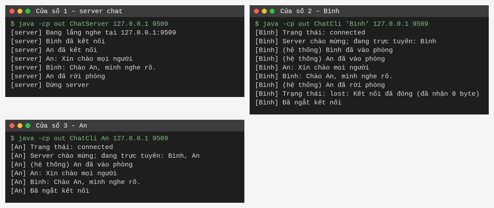

# Bài 5.4 – Lớp dịch vụ ChatClient bất đồng bộ (Java)

| Thông tin | Nội dung |
|---|---|
| Mã giả tương ứng | Mã giả 5.5 (Lớp dịch vụ ChatClient bất đồng bộ) |
| Mục giáo trình | 5.2.3 Ánh xạ sang các nền tảng; 5.3.3 Ví dụ: lớp dịch vụ chat client; 5.4.5 Xử lý ngoại lệ trong tác vụ bất đồng bộ |
| Kế thừa | Mã giả 5.1 (khung JSON bất đồng bộ); SAFE_CONNECT_ASYNC = Mã giả 2.2 + AWAIT; giao thức chat của Mục 6.3.1 (phần `hello`, `msg`, `sys`, `welcome`) |
| Thư viện | JDK 21: `java.net`, `java.util.concurrent` (luồng ảo, `CompletableFuture`, `ReentrantLock`, `ConcurrentHashMap`); `Json.java` tự viết |

## Mục tiêu
Cài đặt lớp `ChatClient` theo cách tiếp cận (3) của Mục 5.3.2: lớp dịch vụ mạng giữ kết nối dài hạn, có vòng nhận chạy nền phát sự kiện `on_message`, thủ tục gửi tuần tự hóa bằng khóa `send_lock`, và thủ tục ngắt kết nối hủy vòng nhận trước khi đóng socket. Tầng giao diện (ở đây là giao diện dòng lệnh) chỉ đăng ký hai sự kiện và gọi các thủ tục của lớp, nên lớp kiểm thử được mà không cần cửa sổ.

## Tệp
- `ChatClient.java` – lớp `ChatClient`: `connect`, `receiveLoop`, `sendMessage`, `disconnect`, sự kiện `onMessage`, `onStatus`.
- `ChatCli.java` – giao diện dòng lệnh dùng `ChatClient`.
- `ChatServer.java` – server chat tối giản đi kèm (mỗi kết nối một luồng ảo).
- `Khung.java`, `Json.java` – khung JSON (Mã giả 5.1), `safeConnect`, bộ JSON tối giản.
- `demo.json` – kịch bản chạy minh họa (dùng với `tools/demo.py`).
- `ket_qua.txt`, `ket_qua.png` – kết quả thực thi thật.

## Cách chạy
```bash
javac -encoding UTF-8 -d out *.java
```
```bash
# Cửa sổ 1 – server chat
java -cp out ChatServer 0.0.0.0 9200
# Cửa sổ 2, 3 – hai người dùng
java -cp out ChatCli Bình 127.0.0.1 9200
java -cp out ChatCli An 127.0.0.1 9200
```
Mỗi dòng nhập được gửi thành một tin; `/quit` để ngắt kết nối; `/cho <giây>` tạm dừng đọc bàn phím (dùng trong kịch bản minh họa).

## Kết quả thực thi


Bình kết nối trước, An kết nối sau; tin của mỗi người được server chuyển tới cả hai (gồm cả người gửi). Khi An gõ `/quit`, `DISCONNECT` hủy vòng nhận trước rồi mới đóng socket, nên phía An kết thúc lặng lẽ (nhánh `Cancelled`), còn Bình nhận thông báo hệ thống "An đã rời phòng". Cuối kịch bản, server bị dừng trước: vòng nhận của Bình gặp kết nối đóng và báo `on_status("lost: ...")` (nhánh lỗi ngoài ý muốn), sau đó Bình được dừng bằng Ctrl+C.

## Ghi chú
- `RUN_BACKGROUND` là `Thread.ofVirtual().start(this::receiveLoop)`; `send_lock` là `ReentrantLock` (khóa chặn dùng với luồng ảo, theo bảng ánh xạ).
- `cts` là `CompletableFuture<Void>`; `Khung.linkClose` đóng socket khi hủy, lời gọi `read` đang chặn kết thúc và `recvJson` ném `CancellationException`, nên vòng nhận đi vào nhánh `Cancelled` thay vì báo nhầm mất kết nối.
- Vòng nhận bắt `IOException` (gồm `NetError`, `ConnectionClosed`, `ProtocolError`) và `IllegalArgumentException` mà `Json.java` ném khi JSON sai (tương ứng `JsonError`), như dòng 23 của Mã giả 5.5. `sendMessage(room, text)` gửi `{"type":"msg","room":…,"text":…}` theo dòng 28–31; giao diện dòng lệnh luôn chọn phòng `chung`, và server tối giản phát lại tin với đúng trường `room` nhận được.
- Ctrl+C được xử lý bằng shutdown hook gọi `disconnect`.
- Server chat đi kèm là bản tối giản viết bằng cùng ngôn ngữ: một phòng chung, chuyển tiếp `msg`, trả lời `ping`, lỗi 409 khi trùng tên. Server dùng một khóa gửi cho mỗi client thay cho hộp thư đi và tác vụ ghi riêng của Chương 6. Bản đầy đủ (nhiều phòng, tin riêng) thuộc Chương 6.
- Kiểm thử: Linux, OpenJDK 21.0.12.1.
