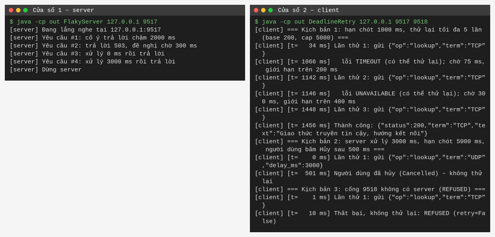

# Bài 5.6 – Hạn chót, hủy và thử lại có lùi thời gian (Java)

| Thông tin | Nội dung |
|---|---|
| Mã giả tương ứng | Mã giả 5.7 (Yêu cầu có hạn chót và hủy), Mã giả 5.8 (Thử lại có lùi theo cấp số nhân và nhiễu ngẫu nhiên) |
| Mục giáo trình | 5.4.1 Hủy tác vụ hợp tác, 5.4.2 Thời gian chờ và hạn chót, 5.4.3 Thử lại có lùi thời gian và nhiễu ngẫu nhiên |
| Kế thừa | Mã giả 5.1 (khung JSON bất đồng bộ), 2.2 (SAFE_CONNECT, `NetError` có trường `retry`), 4.4 (UDP_REQUEST – vòng gửi lại có lùi thời gian) |
| Thư viện | JDK 21: `java.util.concurrent` (`CompletableFuture`, luồng ảo, `ThreadLocalRandom`), `java.net`; `Json.java` tự viết |

## Mục tiêu
Cài đặt `REQUEST_WITH_DEADLINE`, kết hợp tín hiệu hủy của người dùng với tín hiệu tự hủy khi hết hạn và phân biệt hai nguyên nhân, cùng `RETRY_ASYNC` thử lại có lùi theo cấp số nhân với nhiễu ngẫu nhiên, tôn trọng thời gian chờ do server đề nghị. Server đi kèm cố ý trả lời chậm ở yêu cầu thứ nhất và trả lỗi 503 ở yêu cầu thứ hai.

## Tệp
- `DeadlineRetry.java` – `requestWithDeadline` (Mã giả 5.7), `retryAsync` (Mã giả 5.8), hàm tạo `op()` và ba kịch bản.
- `FlakyServer.java` – server tra cứu cố ý trả lời chậm, trả 503.
- `Khung.java`, `Json.java` – khung JSON (Mã giả 5.1), `safeConnect`, `NetError` có `retryAfter`, bộ JSON tối giản.
- `demo.json` – kịch bản chạy minh họa (dùng với `tools/demo.py`).
- `ket_qua.txt`, `ket_qua.png` – kết quả thực thi thật.

## Cách chạy
```bash
javac -encoding UTF-8 -d out *.java
```
```bash
# Cửa sổ 1 – server "khó tính"
java -cp out FlakyServer 0.0.0.0 9100
# Cửa sổ 2 – ba kịch bản; cổng thứ hai là cổng không có server
java -cp out DeadlineRetry 127.0.0.1 9100 9101
```
Server đếm yêu cầu từ lúc khởi động; cần khởi động lại server trước mỗi lần chạy client để lặp lại đúng kịch bản.

## Kết quả thực thi


Kịch bản 1: lần thử 1 hết hạn chót 1000 ms (lỗi `TIMEOUT`, có thể thử lại), chờ một khoảng ngẫu nhiên không quá 200 ms; lần thử 2 nhận 503 kèm đề nghị chờ 300 ms nên thời gian chờ được nâng lên ít nhất 300 ms (giới hạn trên của khoảng ngẫu nhiên lúc này là 400 ms); lần thử 3 thành công. Kịch bản 2: người dùng bấm Hủy sau 500 ms trong khi hạn chót là 5000 ms; kết quả là `Cancelled`, không phải `Timeout`, và không có lần thử lại. Kịch bản 3: kết nối bị từ chối (`REFUSED`, `retry = FALSE`) nên lỗi được báo ngay sau lần thử đầu. Thời gian chờ ngẫu nhiên khác nhau giữa các lần chạy.

## Ghi chú
- Tín hiệu hủy là `CompletableFuture<Void>`: `CANCEL_AFTER` là `completeOnTimeout`, `LINK` là `userCt.thenRun(() -> ct.complete(null))`; khi `ct` hoàn tất, `Khung.linkClose` đóng socket để lời gọi chặn trên luồng ảo kết thúc. `userCt.isDone()` cho biết nguyên nhân là người dùng hay hết hạn (`TimeoutException`).
- `op(ct)` (giao diện `Op<T>`) gồm kết nối mới và một lần `REQUEST_WITH_DEADLINE`. Theo dòng 5–6 của Mã giả 5.8, `retryAsync` bắt cả `TimeoutException` (tương ứng `Timeout`, ném từ Mã giả 5.7 khi quá hạn chót) và `NetError`; `Timeout` luôn được thử lại, `NetError` chỉ khi `retry` = true; `CancellationException` không bị bắt. Phản hồi 503 được `op` đổi thành `NetError("UNAVAILABLE", retry ← TRUE, retry_after ← retry_after_ms)`. Sau khi hết hạn, kết nối đã bị đóng nên mỗi lần thử phải mở kết nối mới.
- `DELAY_ASYNC(delay, ct)` (dòng 12) là `ct.get(delay, MILLISECONDS)` trên luồng ảo: chờ đủ thời gian lùi, hoặc kết thúc sớm khi người dùng hủy.
- Kiểm thử: Linux, OpenJDK 21.0.12.1.
