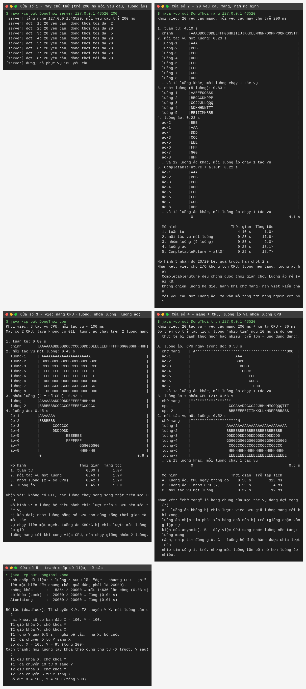

# Bài mở rộng MR5.2 – So sánh các mô hình đồng thời: tuần tự, luồng, nhóm luồng, luồng ảo, CompletableFuture (Java)

| Thông tin | Nội dung |
|---|---|
| Loại | **Bài mở rộng** – không có trong giáo trình, không có mã giả tương ứng |
| Liên hệ với giáo trình | Chương 5: Bài 5.1 (khung bất đồng bộ), Bài 5.2 (kiểm tra nhiều cổng đồng thời có giới hạn); Chương 6: Bài 6.1 (server đa luồng, nhóm luồng), Bài 6.2 (server bất đồng bộ) |
| Thư viện | JDK 21: `java.net.Socket`, `Thread.ofPlatform()`, `Thread.ofVirtual()`, `Executors.newFixedThreadPool`, `Executors.newVirtualThreadPerTaskExecutor`, `CompletableFuture`, `ReentrantLock`, `AtomicLong` |
| Bản ngôn ngữ khác | [C#](../../../csharp/Chuong05/BaiMR5.2_MoPhongDongThoi/), [Python](../../../python/Chuong05/BaiMR5.2_MoPhongDongThoi/), [Rust](../../../rust/Chuong05/BaiMR5.2_MoPhongDongThoi/), [Go](../../../go/Chuong05/BaiMR5.2_MoPhongDongThoi/) |

## Mục tiêu
Cùng một khối việc, chạy bằng nhiều mô hình đồng thời của Java, đo thời gian thật và **vẽ biểu đồ Gantt bằng văn bản** cho thấy tác vụ nào chạy trên worker nào, vào lúc nào – đối chiếu với bản Python (luồng, GIL, `asyncio`, nhóm tiến trình) và bản Go (goroutine, kênh).

| Lệnh | Khối việc | Mô hình so sánh |
|---|---|---|
| `mang` | 20 yêu cầu TCP tới máy chủ thử, mỗi yêu cầu trễ 200 ms (chờ I/O) | 1. tuần tự; 2. mỗi tác vụ một luồng nền tảng; 3. nhóm 5 luồng (`ExecutorService`); 4. mỗi tác vụ một **luồng ảo**; 5. `CompletableFuture.supplyAsync` + `allOf` + hạn chót 2 s (`orTimeout`) |
| `cpu` | 8 tác vụ tính toán, mỗi tác vụ ≈ 100 ms | 1. tuần tự; 2. mỗi tác vụ một luồng nền tảng; 3. nhóm luồng bằng số CPU; 4. mỗi tác vụ một luồng ảo |
| `tron` | 20 tác vụ = yêu cầu mạng 200 ms + xử lý CPU ≈ 30 ms | A. luồng ảo, CPU chạy ngay trong luồng ảo; B. luồng ảo cho mạng + nhóm luồng nền tảng (số CPU) cho CPU; C. mỗi tác vụ một luồng nền tảng – đo thêm **độ trễ lập lịch** bằng luồng nhịp tim |
| `khoa` | biến đếm chung, chuyển tiền giữa hai tài khoản | tranh chấp dữ liệu và sửa bằng `ReentrantLock`, `AtomicLong`; bế tắc và cách tránh bằng thứ tự lấy khóa |

## Kiến thức chính
- **Luồng nền tảng (platform thread)** là luồng của hệ điều hành: mỗi luồng có ngăn xếp riêng cỡ MB, được hệ điều hành chia lượt (time-slicing). **Luồng ảo (virtual thread, JDK 21, JEP 444)** do JVM quản lý, rất nhẹ; khi chờ mạng, luồng ảo *rời* luồng mang (carrier) để luồng ảo khác chạy. Vì vậy viết mã chặn kiểu “mỗi yêu cầu một luồng” với luồng ảo vẫn mở rộng được như mã bất đồng bộ.
- **Việc chờ I/O và việc nặng CPU khác nhau:** khi chờ mạng, CPU rảnh nên mọi mô hình đồng thời đều chồng được thời gian chờ (20 × 200 ms ≈ 4 s → ≈ 0,2 s). Nhóm 5 luồng chạy thành 4 đợt (≈ 0,8 s) – giới hạn đồng thời có chủ ý, như Bài 5.2.
- **`CompletableFuture`:** ghép kết quả của nhiều tác vụ (`allOf`), đặt hạn chót chung (`orTimeout`) – tương ứng `asyncio.gather` của Python, fan-in qua kênh + `context` của Go.
- **Không có GIL:** luồng Java chạy song song thật trên mọi CPU; khối `cpu` nhanh gần gấp số CPU. Tạo nhiều luồng hơn số CPU không nhanh hơn, mỗi tác vụ chỉ bị kéo dài vì chia lượt.
- **Luồng ảo không bị chia lượt:** một luồng ảo đang tính toán giữ luồng mang tới khi xong (hoặc tới khi chặn I/O). Với việc CPU, luồng ảo chạy giống nhóm luồng bằng số CPU; nếu mọi luồng mang đều bận tính toán, các luồng ảo khác (nhịp tim, kết nối khác) phải xếp hàng chờ – giống việc chặn vòng lặp sự kiện của `asyncio`. Cách sửa: đẩy việc CPU sang một nhóm luồng nền tảng riêng.
- **Tranh chấp dữ liệu:** “đọc – nhường CPU – ghi” không bảo vệ làm mất cập nhật; sửa bằng khóa (`ReentrantLock`, `synchronized`) hoặc thao tác nguyên tử (`AtomicLong.incrementAndGet`).
- **Bế tắc:** hai luồng lấy hai khóa theo thứ tự ngược nhau thì chờ nhau mãi; `tryLock(thời gian)` cho phép chờ có hạn để phát hiện; cách tránh đơn giản nhất là mọi luồng lấy khóa theo **cùng một thứ tự**.

## Cấu trúc tệp
- `DongThoi.java` – chương trình chính: ba khối việc `mang`, `cpu`, `tron` và các mô hình; vai `server` gọi máy chủ thử.
- `DongHo.java` – ghi khoảng thời gian (`System.nanoTime`) và vẽ biểu đồ Gantt, bảng so sánh.
- `Khoa.java` – tranh chấp dữ liệu, `ReentrantLock`, `AtomicLong`; bế tắc và thứ tự lấy khóa.
- `MayChuTre.java` – máy chủ thử (mỗi kết nối một luồng ảo) trả lời sau một độ trễ giả lập; báo số yêu cầu và số kết nối đồng thời lớn nhất của mỗi “đợt”. Giao thức giống bản Python, Go (`GET <k>\n` → `OK <k>\n`).
- `demo.json` – kịch bản chạy minh họa (dùng với `tools/demo.py`).
- `ket_qua.txt`, `ket_qua.png` – kết quả thực thi thật.

## Cách chạy
Trong thư mục bài:
```bash
javac -encoding UTF-8 -d out *.java
java -cp out DongThoi server 127.0.0.1 9000 200      # cửa sổ 1: máy chủ thử, trễ 200 ms
java -cp out DongThoi mang 127.0.0.1 9000            # cửa sổ 2
java -cp out DongThoi cpu
java -cp out DongThoi tron 127.0.0.1 9000
java -cp out DongThoi khoa
```
Khối `mang`, `tron` dùng được với máy chủ thử của bản Python, Go (cùng giao thức).

Tái lập kết quả từ thư mục gốc của kho: `python3 tools/demo.py java/Chuong05/BaiMR5.2_MoPhongDongThoi`.

## Kết quả thực thi


Cách đọc biểu đồ: mỗi hàng là một worker; mỗi cột là 1/48 trục thời gian chung của cả khối việc; chữ cái là tác vụ đang chạy (A = tác vụ 1), `*` là nhiều tác vụ cùng lúc trên một hàng (ở khối `tron`, hàng “chờ mạng” gom mọi tác vụ đang đợi mạng). Lần chạy trong ảnh (Linux, 2 CPU):
- **mang:** tuần tự 4,10 s; mỗi tác vụ một luồng 0,23 s; nhóm 5 luồng 0,83 s (4 đợt: hàng `luồng-1` lần lượt chạy A, F, O, S); luồng ảo 0,23 s; `CompletableFuture` 0,22 s, nhận đủ 20/20 kết quả trước hạn chót. Cửa sổ máy chủ: đồng thời lớn nhất mỗi đợt 2, 20, 5, 20, 20.
- **cpu:** tuần tự 0,80 s; 8 luồng nền tảng 0,43 s (mỗi tác vụ bị kéo dài gần gấp 4 vì 8 luồng chia lượt trên 2 CPU); nhóm 2 luồng 0,42 s; 8 luồng ảo 0,45 s – từng cặp luồng ảo chạy liền một mạch, giống nhóm 2 luồng, vì luồng ảo không bị chia lượt.
- **tron:** A (CPU trong luồng ảo) 0,58 s nhưng nhịp tim trễ tới 323 ms – luồng ảo nhịp tim phải chờ hai luồng mang làm xong hàng loạt việc CPU; B (đẩy CPU sang nhóm 2 luồng nền tảng) 0,53 s, trễ chỉ 4 ms; C (luồng nền tảng) 0,52 s, trễ 12 ms nhờ hệ điều hành chia lượt.
- **khoa:** không khóa còn khoảng 5 000/20 000 (số cụ thể thay đổi mỗi lần chạy); `ReentrantLock` và `AtomicLong` đều đúng 20 000. Bế tắc: T1 chờ quá 0,5 s thì nhả khóa nên T2 làm xong; lấy khóa theo thứ tự X trước Y thì cả hai giao dịch đều xong, tổng số dư luôn là 200.

Thời gian đo thay đổi chút ít giữa các lần chạy và giữa các máy (đặc biệt khi máy đang bận việc khác); quan hệ giữa các mô hình thì ổn định.

## Ghi chú
- Việc CPU là vòng lặp bộ sinh đồng dư tuyến tính giống bản Python, Go; phép nhân `int` tràn số trong Java cho đúng kết quả mod 2^32. Số vòng lặp được hiệu chỉnh lúc chạy (đo 5 lần, lấy lần nhanh nhất – sau khi JIT đã biên dịch vòng lặp) để mỗi tác vụ ≈ 100 ms (hoặc 30 ms). Kết quả cộng vào `sink` để JIT không loại bỏ vòng lặp.
- Số luồng mang của luồng ảo mặc định bằng số CPU (chỉnh bằng `-Djdk.virtualThreadScheduler.parallelism=N`, chỉ có tác dụng khi khởi động JVM). Thử `java -Djdk.virtualThreadScheduler.parallelism=1 -cp out DongThoi tron …` để thấy mọi luồng ảo chạy trên một luồng mang – giống `asyncio` một luồng: mô hình A vẫn trễ hàng trăm ms (lần thử: 335 ms), mô hình B vẫn ít trễ.
- Bản Python có mô hình `asyncio` và nhóm tiến trình (vượt GIL); Java không có GIL nên không cần nhóm tiến trình, và luồng ảo đóng vai trò của coroutine. Bản Go có `GOMAXPROCS = 1`; Java không đổi được số luồng mang lúc đang chạy nên mô hình C dùng luồng nền tảng để so sánh lập lịch có chia lượt.
- Số đồng thời lớn nhất ở máy chủ có thể nhỉnh hơn kích thước nhóm một chút (đợt 1 là 2 thay vì 1): client đã mở kết nối mới trong khi luồng phía máy chủ của kết nối cũ chưa kịp đóng.
- Ở mô hình tranh chấp, `Thread.yield()` giữa lúc đọc và lúc ghi tượng trưng cho một thao tác chậm; biến đếm cố ý không `volatile`, không khóa. Ở minh họa bế tắc, T2 chỉ khởi động sau khi T1 đã giữ khóa X (`CountDownLatch`) để thứ tự in ra ổn định.
- Kiểm thử: Linux, OpenJDK 21.0.12, máy 2 CPU.

## Bài tập gợi ý
1. Đổi kích thước nhóm luồng ở khối `mang` thành 2, 10, 20; dự đoán trước thời gian (≈ ⌈20 / n⌉ × 0,2 s) rồi đo lại. Ở cửa sổ máy chủ, số đồng thời tối đa thay đổi thế nào?
2. Tăng số yêu cầu lên 10 000 với mô hình 2 và mô hình 4 (thêm `Semaphore(100)` để không mở quá nhiều socket một lúc); đo bộ nhớ bằng `Runtime.getRuntime().totalMemory() - freeMemory()` và số luồng bằng `Thread.activeCount()`.
3. Giảm hạn chót của mô hình 5 xuống 100 ms: chương trình nhận được bao nhiêu kết quả? Các tác vụ còn lại có bị hủy không (gợi ý: `orTimeout` không ngắt luồng đang chặn ở `read`; cần `setSoTimeout` hoặc đóng socket)?
4. Viết lại tranh chấp bằng `BlockingQueue`: các luồng chỉ gửi “+1” vào hàng đợi, một luồng duy nhất cộng vào biến – không cần khóa (mô hình truyền thông điệp).
5. (Nâng cao) Ở mô hình A khối `tron`, thay vòng lặp CPU bằng vòng lặp có `Thread.yield()` sau mỗi 1 triệu bước: độ trễ nhịp tim thay đổi thế nào? Giải thích bằng cơ chế nhường luồng mang của luồng ảo.

## Đọc thêm
- JEP 444 – *Virtual Threads* (JDK 21), 2023; tài liệu Oracle *Virtual Threads* (mục *Don't Pool Virtual Threads*, *Avoid Lengthy and Frequent Pinning*).
- Tài liệu JDK: `java.util.concurrent` (`ExecutorService`, `CompletableFuture`, `locks.ReentrantLock`, `atomic.AtomicLong`).
- Brian Goetz và cộng sự, *Java Concurrency in Practice*, Addison-Wesley, 2006, Chương 2 (an toàn luồng), Chương 6 (thực thi tác vụ), Chương 10 (tránh bế tắc).
- Claus Töpke, *Network Programming and Automation Essentials*, Packt, 2023, Chương 8 *Scaling Your Code*.

Mã nguồn của bài được viết mới cho kho này; các tài liệu trên chỉ là nguồn tham khảo kiến thức.
