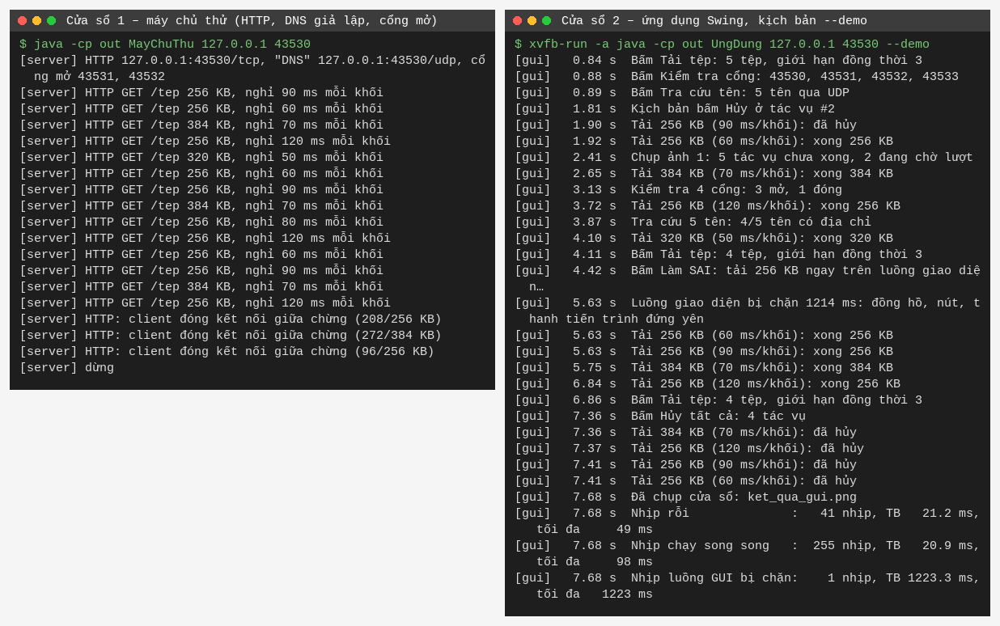
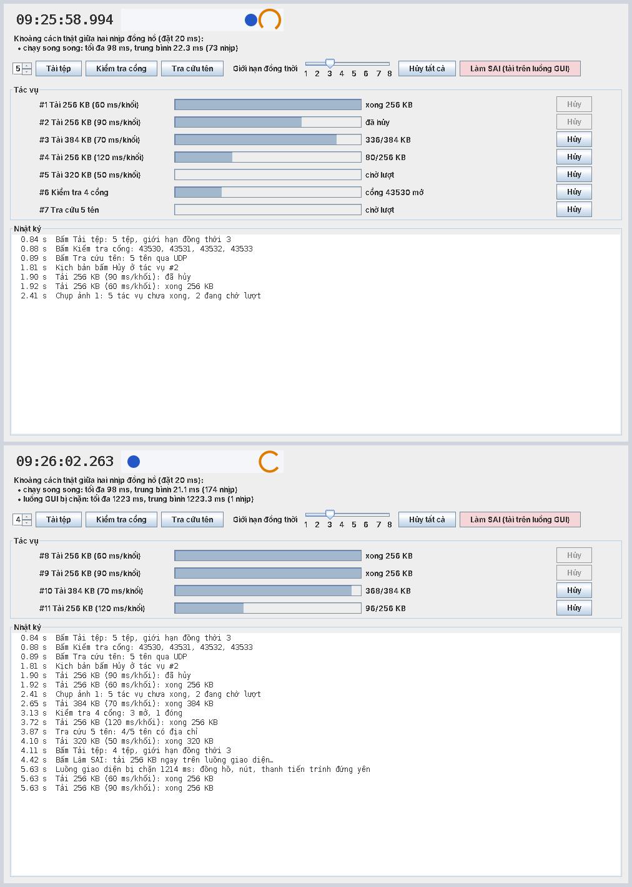

# Bài mở rộng MR5.3 – Giao diện luôn phản hồi khi nhiều tác vụ mạng chạy song song (Java, Swing)

| Thông tin | Nội dung |
|---|---|
| Loại | **Bài mở rộng** – không có trong giáo trình, không có mã giả tương ứng |
| Liên hệ với giáo trình | Chương 5: Bài 5.3 (giao diện bất đồng bộ), Bài 5.5 (tải tệp có tiến trình và hủy), Bài 5.2 (giới hạn đồng thời); Bài 1.2 (kiểm tra cổng), Bài 4.3 (tra cứu tên qua UDP); MR5.2 (các mô hình đồng thời) |
| Thư viện | JDK 21: Swing (`javax.swing`: `JProgressBar`, `JSlider`, `JSpinner`, `Timer`, `SwingUtilities.invokeLater`), luồng ảo, `HttpURLConnection`, `com.sun.net.httpserver.HttpServer` (máy chủ thử), `DatagramSocket`; `java.awt.Robot` chỉ dùng để chụp ảnh trong kịch bản minh họa |
| Bản ngôn ngữ khác | [C#](../../../csharp/Chuong05/BaiMR5.3_GiaoDienDaTacVu/), [Python](../../../python/Chuong05/BaiMR5.3_GiaoDienDaTacVu/), [Rust](../../../rust/Chuong05/BaiMR5.3_GiaoDienDaTacVu/), [Go](../../../go/Chuong05/BaiMR5.3_GiaoDienDaTacVu/) |

## Mục tiêu
Một ứng dụng desktop chạy **nhiều tác vụ mạng cùng lúc** – tải tệp HTTP từ máy chủ thử với độ trễ khác nhau, kiểm tra cổng TCP, tra cứu tên qua máy chủ “DNS” giả lập trên UDP – mà **giao diện không bao giờ đứng**: đồng hồ (có mili giây) và hoạt hình chạy đều, mỗi tác vụ có thanh tiến trình và nút Hủy riêng, có nút Hủy tất cả và thanh trượt giới hạn số tác vụ chạy đồng thời. Nút **“Làm SAI”** chạy đúng việc tải tệp đó ngay trên luồng giao diện để thấy cả cửa sổ đứng bao lâu. Ứng dụng tự đo **khoảng cách thật giữa hai nhịp đồng hồ** (đặt 20 ms): luồng giao diện còn rảnh thì khoảng cách ≈ 20 ms, bị chặn thì tăng vọt.

## Kiến thức chính
- **Hai quy tắc của lập trình giao diện:** (1) chỉ luồng giao diện được chạm vào thành phần giao diện (widget); (2) luồng giao diện không bao giờ chờ mạng hay tính toán lâu. Swing (luồng EDT – Event Dispatch Thread), Tk, WinForms, WPF, Android, trình duyệt… đều theo mô hình một luồng giao diện với vòng lặp sự kiện.
- **Luồng nền + chuyển cập nhật về EDT:** mỗi tác vụ chạy trên một luồng ảo; luồng nền không chạm vào thành phần Swing mà gói mỗi cập nhật (tiến trình, trạng thái, kết quả) thành một `Runnable` và gửi về EDT bằng `SwingUtilities.invokeLater` (UI_INVOKE của Bài 5.3) – hàng đợi sự kiện của Swing đóng vai trò `queue.Queue` của bản Python.
- **Giới hạn đồng thời đổi được khi đang chạy:** `Limiter` dùng `synchronized` + `wait`/`notifyAll` (tương ứng `threading.Condition`); tác vụ chưa tới lượt hiện “chờ lượt”; kéo thanh trượt thì các tác vụ đang chờ được đánh thức.
- **Hủy hợp tác:** mỗi tác vụ có một cờ `AtomicBoolean`; tác vụ kiểm tra cờ giữa hai khối dữ liệu, giữa hai cổng, giữa hai tên – vì vậy hủy có hiệu lực sau tối đa một bước (một khối 16 KB, một cổng, một tên). Tác vụ bị hủy khi còn đang chờ lượt thì không bao giờ mở kết nối.
- **Đo độ “mượt”:** `javax.swing.Timer` 20 ms gọi `tick()` trên EDT, ghi khoảng cách thật giữa hai lần chạy, theo giai đoạn “rỗi”, “chạy song song”, “luồng GUI bị chặn”.

## Cấu trúc tệp
- `UngDung.java` – ứng dụng Swing: dựng giao diện, nhịp đồng hồ và thống kê, tạo/hủy tác vụ, nút “Làm SAI”; kịch bản `--demo` (thao tác trên cửa sổ thật, chụp bằng `java.awt.Robot`).
- `TacVu.java` – phần không dùng Swing: `Limiter`, tải tệp HTTP có tiến trình, kiểm tra cổng, tra cứu tên qua UDP, ngoại lệ `Cancelled`.
- `MayChuThu.java` – máy chủ thử cục bộ (cùng giao thức với bản Python): HTTP `GET /tep?kb=..&tre=..` (gửi từng khối 16 KB, nghỉ `tre` ms sau mỗi khối), “DNS” giả lập trên UDP (100–400 ms, có một tên không tồn tại), hai cổng TCP mở.
- `demo.json` – kịch bản chạy minh họa (dùng với `tools/demo.py`).
- `ket_qua.txt`, `ket_qua.png` – nhật ký thật của máy chủ và ứng dụng; `ket_qua_gui.png` – hai ảnh chụp cửa sổ thật.

## Cách chạy
Trong thư mục bài:
```bash
javac -encoding UTF-8 -d out *.java
java -cp out MayChuThu 127.0.0.1 9000        # cửa sổ 1: máy chủ thử (dùng cổng 9000–9002)
java -cp out UngDung 127.0.0.1 9000          # cửa sổ 2: ứng dụng; cổng 9003 để trống (đóng)
```
Thử: bấm **Tải tệp** (5 tệp), **Kiểm tra cổng**, **Tra cứu tên**; kéo thanh trượt giới hạn đồng thời; bấm **Hủy** ở một tác vụ; rồi bấm **Làm SAI** và quan sát đồng hồ, quả bóng đứng yên khoảng 1,2 s. Ứng dụng Java chạy được với máy chủ thử của bản Python (đã thử).

Kịch bản minh họa tự động không cần màn hình (Linux): `xvfb-run -a java -cp out UngDung 127.0.0.1 9000 --demo`. Tái lập kết quả từ thư mục gốc của kho: `python3 tools/demo.py java/Chuong05/BaiMR5.3_GiaoDienDaTacVu`.

## Kết quả thực thi




Kịch bản `--demo` (giới hạn đồng thời 3): bấm Tải 5 tệp, Kiểm tra cổng, Tra cứu tên – 7 tác vụ; bấm Hủy tác vụ #2 khi nó đang tải (`đã hủy`, máy chủ ghi nhận client đóng kết nối giữa chừng). **Ảnh trên** chụp lúc 2,41 s: 5 tác vụ chưa xong, các thanh tiến trình đang chạy, 2 tác vụ “chờ lượt”. Kiểm tra cổng cho 3 cổng mở, 1 đóng; tra cứu tên cho 4/5 tên có địa chỉ (`khong-co.lab` → NXDOMAIN). Sau đó bấm Tải 4 tệp rồi bấm **Làm SAI**: luồng giao diện bị chặn 1214 ms. **Ảnh dưới** chụp ngay sau đó: dòng thống kê cho thấy khi luồng GUI bị chặn, một “nhịp” dài 1223 ms; hai tệp #8, #9 vẫn tải xong ở luồng nền trong lúc cửa sổ đứng – kết quả của chúng chỉ hiện ra cùng lúc khi luồng giao diện được giải phóng. Cuối cùng bấm Tải 4 tệp rồi **Hủy tất cả**: các tác vụ dừng ngay.

Thống kê cuối nhật ký: rỗi 41 nhịp, trung bình 21,2 ms; chạy song song 255 nhịp, trung bình 20,9 ms, tối đa 98 ms; luồng GUI bị chặn: một “nhịp” dài 1223 ms. Nhịp dài nhất khi chạy song song (≈ 100 ms) rơi vào lần bấm đầu tiên: JVM nạp và biên dịch lần đầu các lớp Swing, luồng ảo, HTTP dùng cho tác vụ; các lần bấm sau chỉ tốn vài ms (bản Python: tối đa 24 ms).

## Ghi chú
- Không gọi thành phần Swing từ luồng nền: Swing không an toàn luồng; mọi cập nhật đi qua `SwingUtilities.invokeLater`. Kịch bản `--demo` chạy trên luồng riêng và thao tác cửa sổ bằng `invokeAndWait`.
- Kịch bản bấm nút bằng `doClick(0)`: `doClick()` không tham số giữ nút ở trạng thái nhấn 68 ms **trên EDT** (để vẽ hiệu ứng nhấn), làm sai thống kê nhịp.
- `java.awt.Robot.createScreenCapture` chụp màn hình từ luồng kịch bản, không chặn EDT, nên không cần bỏ qua nhịp khi chụp như bản Python.
- `HttpURLConnection.disconnect()` đóng hẳn socket khi tác vụ bị hủy, nhờ đó máy chủ ghi nhận "client đóng kết nối giữa chừng".
- Bộ giới hạn chỉ đảm bảo số tác vụ *đang chạy*; luồng của tác vụ chờ lượt vẫn được tạo (rẻ với vài chục tác vụ). Bản Java dùng luồng ảo nên chờ lượt rất rẻ (xem MR5.2).
- Kiểm thử: Linux, OpenJDK 21.0.12 dưới Xvfb.

## Bài tập gợi ý
1. Đổi `TICK_MS` thành 5 ms và 100 ms; khoảng cách trung bình đo được có đúng như đặt không? Vì sao `javax.swing.Timer` không đảm bảo chính xác (gợi ý: `setCoalesce`)?
2. Cho thanh trượt giới hạn đồng thời = 1 rồi bấm Tải 5 tệp; trong lúc chạy kéo lên 8. Quan sát các tác vụ “chờ lượt” được khởi động cùng lúc.
3. Thêm cột “tốc độ” (KB/s) và “thời gian còn lại” cho mỗi tác vụ tải, tính ở luồng nền và gửi qua hàng đợi.
4. Viết lại tác vụ tải bằng `SwingWorker` (`doInBackground`, `publish`/`process`, `done`) hoặc `java.net.http.HttpClient.sendAsync` + `CompletableFuture`; so sánh độ gọn của mã.
5. (Nâng cao) Làm “Làm SAI” kiểu khác: chạy việc nặng CPU (MR5.2) trên một luồng nền thay vì luồng giao diện. Giao diện có còn mượt không? So sánh với bản Python (GIL) và giải thích bằng MR5.2 (luồng ảo không bị chia lượt).

## Đọc thêm
- Tài liệu Oracle *The Java Tutorials – Concurrency in Swing* (mục *The Event Dispatch Thread*, *Worker Threads and SwingWorker*); tài liệu JDK `javax.swing.Timer`, `SwingUtilities.invokeLater`, `java.net.HttpURLConnection`.
- RFC 9110 – *HTTP Semantics*, 2022 (§8.6 Content-Length).
- Claus Töpke, *Network Programming and Automation Essentials*, Packt, 2023, Chương 8 *Scaling Your Code*.

Mã nguồn của bài được viết mới cho kho này; các tài liệu trên chỉ là nguồn tham khảo kiến thức.
