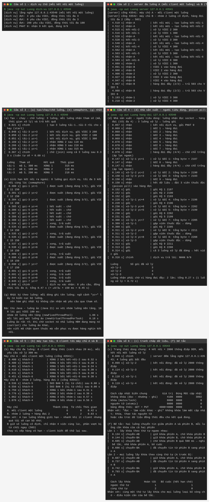

# Bài mở rộng MR5.4 – Luồng (thread) và đa luồng trong chương trình mạng (Java)

| Thông tin | Nội dung |
|---|---|
| Loại | **Bài mở rộng** – không có trong giáo trình, không có mã giả tương ứng |
| Liên hệ với giáo trình | Chương 5 (Bài 5.1–5.6); Chương 6 (Bài 6.1 server đa luồng, nhóm luồng; Bài 6.2) |
| Thư viện | JDK 21: `java.lang.Thread`, `java.util.concurrent` (`ThreadPoolExecutor`, `ExecutorService`, `ArrayBlockingQueue`, `ConcurrentHashMap`, `Future`), `java.util.concurrent.locks` (`ReentrantLock`, `Condition`), `java.util.concurrent.atomic`, `ThreadLocal`, luồng ảo |
| Bản ngôn ngữ khác | [Python](../../../python/Chuong05/BaiMR5.4_LuongVaDaLuong/) (bản tham chiếu), [C#](../../../csharp/Chuong05/BaiMR5.4_LuongVaDaLuong/), [Rust](../../../rust/Chuong05/BaiMR5.4_LuongVaDaLuong/), [Go](../../../go/Chuong05/BaiMR5.4_LuongVaDaLuong/) |

## Mục tiêu
Cùng kịch bản, cùng giao thức và cùng thông điệp với bản Python: đi từng bước vào **luồng nền tảng** (platform thread) của Java trong một chương trình mạng, và so sánh ngắn với **luồng ảo** (virtual thread, Java 21):

| Vai trò | Phần | Nội dung |
|---|---|---|
| `luong` | (a) | `new Thread(runnable, "tải-1")`, `start()`, `join()`; tham số qua biến final mà lambda bắt; kết quả qua ô riêng của mảng (và `Callable` + `Future.get()` ở phần luồng ảo) |
| `server` + `tai` | (b) | Server A: **mỗi client một `Thread`**; server B: **`ThreadPoolExecutor` 2 luồng + `ArrayBlockingQueue(2)` + `AbortPolicy`** – `RejectedExecutionException` → `503 BAN` |
| `khoa` | (c) | 4 kết nối × 2000 `DEM`: không khóa, `ReentrantLock`, `AtomicLong`, `ConcurrentHashMap.merge` |
| `hang-doi` | (d) | Nhà sản xuất – người tiêu dùng: `ArrayBlockingQueue(4)` (`offer` thử, `put` chặn), viên thuốc độc là một đối tượng đánh dấu |
| `luong` | (e) | Semaphore tự làm bằng **`ReentrantLock` + `Condition`** (`await` / `signal`) – `java.util.concurrent.Semaphore` làm sẵn việc này |
| `khoa` | (f) | Bế tắc hai khóa ngược thứ tự; `tryLock(500, ms)` phát hiện, thứ tự lấy khóa sửa |
| mọi vai trò | (g) | Nhật ký có tên luồng và ngữ cảnh `yc=` trong `ThreadLocal<String>` (giống MDC của SLF4J/Logback) |
| `luong` | thêm | **Luồng ảo**: 100 lời gọi `VIEC 100 ms` với `newFixedThreadPool(10)` so với `newVirtualThreadPerTaskExecutor()` |

## Liên hệ giáo trình
- **Chương 5 (Bài 5.1–5.6):** bản Java của Chương 5 dùng luồng ảo và `CompletableFuture`; bài này là lớp nền – luồng nền tảng, khóa, hàng đợi chặn. Giới hạn đồng thời (Bài 5.2) xuất hiện lại ở (e).
- **Chương 6 (Bài 6.1, 6.2):** phần (b) là hai kiến trúc server của Bài 6.1; [MR5.5](../BaiMR5.5_PhoiHopDaLuongBatDongBo/) phối hợp vòng lặp sự kiện (`Selector`) với nhóm luồng.

## Kiến thức chính
- **Luồng nền tảng** = một luồng HĐH (stack ~1 MB); `Thread.join()` chờ; `Runnable` không trả giá trị, `Callable<T>` gửi vào `ExecutorService` thì nhận `Future<T>` và `get()` chờ + lấy kết quả (hoặc ngoại lệ).
- **`ThreadPoolExecutor(core, max, keepAlive, queue, factory, handler)`:** chưa đủ `core` luồng thì tạo luồng mới; đủ rồi thì xếp vào hàng đợi; hàng đợi đầy (và đã `max` luồng) thì gọi `RejectedExecutionHandler` – `AbortPolicy` ném ngoại lệ (dùng để trả 503), `CallerRunsPolicy` bắt luồng gọi tự chạy (một kiểu áp lực ngược). `Executors.newFixedThreadPool` dùng hàng đợi **không giới hạn** – dễ phình bộ nhớ khi quá tải.
- **Tranh chấp:** trường `long` thường “đọc – `Thread.yield()` – ghi” mất cập nhật. `ReentrantLock` (hoặc `synchronized`) bảo vệ đoạn găng; `AtomicLong` thao tác nguyên tử; `ConcurrentHashMap.merge` cập nhật bảng an toàn. Không cho nhiều luồng cùng ghi `HashMap` thường.
- **Biến điều kiện:** `Condition.await()` nhả khóa và ngủ tới khi `signal()`; luôn chờ trong vòng `while (điều kiện chưa thỏa)` vì có thể thức dậy giả (spurious wakeup).
- **`BlockingQueue`:** `offer`/`put`, `poll`/`take`; không chấp nhận `null` nên viên thuốc độc là một đối tượng riêng. Dừng ngay thì `Thread.interrupt()` – `take()` đang chờ ném `InterruptedException`.
- **Luồng ảo (JEP 444):** rất rẻ (stack nhỏ trên heap); khi chặn ở socket, luồng ảo **nhả luồng HĐH mang nó (carrier)** cho luồng ảo khác. Nhờ vậy mã chặn tuần tự quen thuộc vẫn phục vụ hàng nghìn kết nối – nhóm 10 luồng nền tảng chỉ chạy 10 lời gọi một lúc.

**Khác biệt so với bản Python:** không có GIL – ở (c) mất cập nhật nhiều hơn hẳn; semaphore ở (e) tự làm bằng `ReentrantLock` + `Condition` để minh họa biến điều kiện; thêm phần so sánh luồng ảo (nên dịch vụ thử in thêm một dòng “đợt: 200 yêu cầu VIEC”).

## Tệp
- `Luong.java` – `main`, phân nhánh vai trò; (a), (e) với lớp `GioiHan` (Lock + Condition), (g), luồng ảo.
- `NhatKy.java` – nhật ký theo luồng (`ThreadLocal`), đọc/ghi dòng UTF-8 trên socket, định dạng `Locale.ROOT`.
- `DichVu.java` – dịch vụ thử `VIEC`, `PHAT`, `THONGKE`.
- `MayChu.java` – (b) server A, B (`ThreadPoolExecutor`) và máy tạo tải.
- `Khoa.java` – (c) tranh chấp dữ liệu, (f) bế tắc với `tryLock`.
- `HangDoi.java` – (d) nhà sản xuất – người tiêu dùng.
- `demo.json`; `ket_qua.txt`, `ket_qua.png` – kết quả thực thi thật.

## Cách chạy
Trong thư mục bài:
```bash
javac -encoding UTF-8 -d out *.java
java -cp out Luong dich-vu  127.0.0.1 9000     # cửa sổ 1
java -cp out Luong server   127.0.0.1 9001     # cửa sổ 2: A ở 9001, B ở 9002
java -cp out Luong luong    127.0.0.1 9000
java -cp out Luong hang-doi 127.0.0.1 9000
java -cp out Luong tai      127.0.0.1 9001
java -cp out Luong khoa     127.0.0.1 9003
```
Tái lập: `python3 tools/demo.py java/Chuong05/BaiMR5.4_LuongVaDaLuong` (cổng 43540–43543).

## Kết quả


Lần chạy trong ảnh (Linux, 2 CPU, OpenJDK 21):
- **(a)** ba luồng xong sau 0,33 s (tuần tự ≈ 0,60 s).
- **(b)** A: 6/6 trong 0,42 s; B: `nhóm-1`, `nhóm-2` chạy VIEC 1, 2, VIEC 3, 4 xếp hàng, VIEC 5, 6 bị `AbortPolicy` từ chối (`503`, 0,00 s); tổng 0,63 s.
- **(c)** không khóa còn 4108/8000 (mất 3892); `ReentrantLock`, `AtomicLong`, `ConcurrentHashMap` đúng 8000.
- **(d)** 9 gói, mỗi luồng 3 gói, 0,27 s; luồng nhận chờ 2 lần; `NHAN 9/9`.
- **(e)** đồng thời tối đa 3, tổng 0,47 s.
- **(f)** ngược thứ tự: 1 hoàn tất, 1 bỏ cuộc; cùng thứ tự: 2 hoàn tất.
- **Luồng ảo:** 100 lời gọi chờ 100 ms – nhóm 10 luồng nền tảng 1,06 s (10 đợt), mỗi lời gọi một luồng ảo 0,18 s.

## Bài tập gợi ý
1. Đổi server B sang `CallerRunsPolicy`: client thứ 5, 6 có còn nhận `503` không? Luồng `nhận-B` bị chặn ra sao?
2. Viết lại (e) bằng `java.util.concurrent.Semaphore` (`tryAcquire`, `acquire`, `release`) và so sánh với lớp `GioiHan`.
3. Chạy server A với luồng ảo (`Thread.ofVirtual().name("kết-nối-", 1).start(...)`) và 2000 client; so sánh bộ nhớ với luồng nền tảng.
4. Ở (d), dừng các luồng xử lý bằng `interrupt()` thay vì viên thuốc độc; gói đang xử lý dở xử lý thế nào?
5. Dùng `jcmd <pid> Thread.print` (hoặc `jstack`) lúc (f) đang bế tắc ở lần 1 – JVM có tự báo “Found one Java-level deadlock” không?

## Đọc thêm
- Oracle: [Java Tutorials – Concurrency](https://docs.oracle.com/javase/tutorial/essential/concurrency/), [Virtual Threads (Java 21 Core Libraries)](https://docs.oracle.com/en/java/javase/21/core/virtual-threads.html); OpenJDK [JEP 444: Virtual Threads](https://openjdk.org/jeps/444).
- API Java 21: [`Thread`](https://docs.oracle.com/en/java/javase/21/docs/api/java.base/java/lang/Thread.html), [`ThreadPoolExecutor`](https://docs.oracle.com/en/java/javase/21/docs/api/java.base/java/util/concurrent/ThreadPoolExecutor.html), [`BlockingQueue`](https://docs.oracle.com/en/java/javase/21/docs/api/java.base/java/util/concurrent/BlockingQueue.html), [`ReentrantLock`](https://docs.oracle.com/en/java/javase/21/docs/api/java.base/java/util/concurrent/locks/ReentrantLock.html), [`Condition`](https://docs.oracle.com/en/java/javase/21/docs/api/java.base/java/util/concurrent/locks/Condition.html), [`ConcurrentHashMap`](https://docs.oracle.com/en/java/javase/21/docs/api/java.base/java/util/concurrent/ConcurrentHashMap.html), [`ThreadLocal`](https://docs.oracle.com/en/java/javase/21/docs/api/java.base/java/lang/ThreadLocal.html).

Mã nguồn của bài được viết mới cho kho này; các tài liệu trên chỉ là nguồn tham khảo kiến thức.
