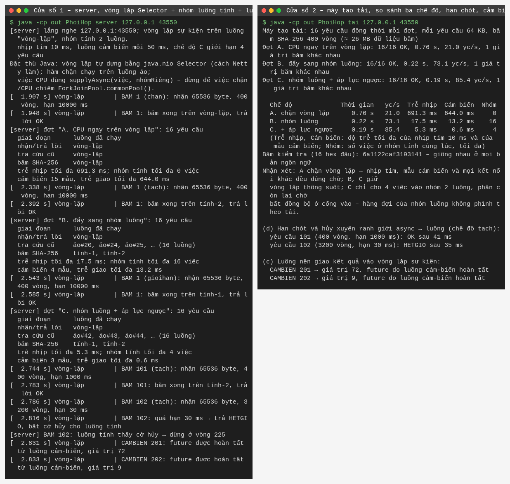

# Bài mở rộng MR5.5 – Phối hợp đa luồng và bất đồng bộ trong server mạng (Java)

| Thông tin | Nội dung |
|---|---|
| Loại | **Bài mở rộng** – không có trong giáo trình, không có mã giả tương ứng |
| Liên hệ với giáo trình | Chương 5 (Bài 5.1–5.6); Chương 6 (Bài 6.1, 6.2, 6.3 Reactor); MR5.4 |
| Thư viện | JDK 21: `java.nio.channels.Selector` (vòng lặp sự kiện), `CompletableFuture` (`supplyAsync`, `thenAcceptAsync`, `orTimeout`, `complete`), `Executors.newFixedThreadPool`, `newVirtualThreadPerTaskExecutor`, `AtomicBoolean`, `MessageDigest` |
| Bản ngôn ngữ khác | [Python](../../../python/Chuong05/BaiMR5.5_PhoiHopDaLuongBatDongBo/) (bản tham chiếu), [C#](../../../csharp/Chuong05/BaiMR5.5_PhoiHopDaLuongBatDongBo/), [Rust](../../../rust/Chuong05/BaiMR5.5_PhoiHopDaLuongBatDongBo/), [Go](../../../go/Chuong05/BaiMR5.5_PhoiHopDaLuongBatDongBo/) |

## Mục tiêu
Cùng kịch bản, giao thức và thông điệp với bản Python: server bất đồng bộ nhận `BAM` (64 KB), gọi **hàm thư viện cũ kiểu chặn** (20 ms) rồi **băm SHA-256** 400 vòng; so sánh ba chế độ A (làm ngay trên vòng lặp – SAI), B (đẩy sang nhóm luồng), C (B + áp lực ngược) bằng **nhịp tim 10 ms**; thêm hạn chót/hủy và một luồng nền giao kết quả vào vòng lặp.

Vòng lặp sự kiện là `VongLap` – **một luồng** chạy `Selector` (cách Netty, Vert.x làm, cũng là mẫu Reactor của Bài 6.3): mỗi lượt `select()` chờ socket sẵn sàng (tối đa tới lúc nhịp tim), đọc không chặn, chạy các việc mà luồng khác gửi vào, rồi chạy nhịp tim. `VongLap` cài đặt `Executor`, nên `CompletableFuture.xxxAsync(…, vongLap)` đưa phần tiếp theo **về** vòng lặp.

| Phần | Cách làm trong Java |
|---|---|
| (a) việc CPU | `CompletableFuture.supplyAsync(() -> bam(...), nhómTính)` – nhóm riêng 2 luồng `tính-1`, `tính-2` |
| (b) hàm chặn | `supplyAsync(Chung::traCuuCu, luồngẢo)` – mỗi lời gọi một **luồng ảo** (`ảo#k`) |
| (c) luồng nền → vòng lặp | luồng `cảm-biến` gọi `vongLap.execute(...)` cho mẫu định kỳ; với `CAMBIEN`, luồng cảm biến gọi `CompletableFuture.complete(...)` – phía vòng lặp `thenAcceptAsync(…, vongLap)` |
| (d) hủy, hạn chót | `ketQua.orTimeout(hạn)` → `whenCompleteAsync` trên vòng lặp bật `AtomicBoolean` mà luồng băm kiểm tra mỗi vòng |
| (e) áp lực ngược | vòng lặp đếm “suất” ở cổng vào (≤ 4) + `ArrayDeque` các yêu cầu chờ |
| (f) cách làm SAI | chế độ `chan`: gọi `traCuuCu()` và `bam()` ngay trên vòng lặp |

## Liên hệ giáo trình
- **Chương 5 (Bài 5.1–5.6):** `CompletableFuture` và luồng ảo của bản Java Chương 5; hạn chót, hủy hợp tác (Bài 5.6).
- **Chương 6 (Bài 6.1, 6.2, 6.3):** nhóm luồng, server bất đồng bộ, Reactor (`Selector`) – bài này ghép chúng lại; nối tiếp [MR5.4](../BaiMR5.4_LuongVaDaLuong/).

## Kiến thức chính
- **`Selector` = vòng lặp sự kiện:** một luồng theo dõi nhiều `SocketChannel` không chặn; luồng đó tuyệt đối không được làm việc lâu – chế độ A cho thấy mọi kết nối, nhịp tim, mẫu cảm biến cùng đứng chờ.
- **`supplyAsync(việc, executor)` luôn truyền executor riêng.** Không truyền thì việc chạy trên `ForkJoinPool.commonPool()` dùng chung toàn JVM (cỡ = số CPU − 1) – việc chặn hoặc việc CPU dài làm nghẽn mọi thư viện khác dùng chung pool đó.
- **Luồng ảo cho mã chặn:** hàm chặn trên luồng ảo không giữ luồng HĐH khi ngủ/chờ socket (trừ khi bị “ghim” – *pinning* – trong `synchronized` hoặc mã native), nên tạo một luồng ảo cho mỗi lời gọi là bình thường.
- **luồng → vòng lặp:** chỉ được chạm trạng thái của vòng lặp *trên* vòng lặp. Từ luồng khác: `vongLap.execute(r)` (xếp việc + `selector.wakeup()`), hoặc hoàn tất một `CompletableFuture` (`complete()` an toàn từ mọi luồng) rồi để phần tiếp theo chạy bằng `thenAcceptAsync(…, vongLap)`. Một kênh khác có sẵn trong JDK là `SubmissionPublisher` (Flow API).
- **Hủy:** `future.cancel(true)` của `CompletableFuture` **không** ngắt được việc đang chạy; muốn dừng phải có cờ (`AtomicBoolean`) hoặc `Thread.interrupt()` mà việc tự kiểm tra.

**Khác biệt so với bản Python:** vòng lặp tự dựng bằng `Selector` thay cho asyncio; hàm chặn chạy trên luồng ảo (bảng giai đoạn in `ảo#20, ảo#24, …`) thay cho 8 luồng `chặn-k`; áp lực ngược tự đếm suất thay cho `asyncio.Semaphore`. Ghi trả lời ngắn bằng `channel.write` trong vòng lặp (bộ đệm gửi luôn đủ chỗ trong bài này; server thật đăng ký `OP_WRITE`).

## Tệp
- `PhoiHop.java` – `main`, máy tạo tải (16 luồng ảo mỗi đợt), bảng so sánh, hạn chót, `CAMBIEN`.
- `VongLap.java` – vòng lặp sự kiện `Selector` một luồng, cài đặt `Executor`, nhịp tim.
- `MayChu.java` – server: đọc yêu cầu không chặn, ba chế độ, nhóm tính, luồng ảo, luồng cảm biến, thống kê.
- `Chung.java` – hằng số, `bam()` (SHA-256 có cờ hủy), `traCuuCu()`, nhật ký, hàm gửi của client.
- `demo.json`; `ket_qua.txt`, `ket_qua.png` – kết quả thực thi thật.

## Cách chạy
```bash
javac -encoding UTF-8 -d out *.java
java -cp out PhoiHop server 127.0.0.1 9000     # cửa sổ 1
java -cp out PhoiHop tai    127.0.0.1 9000     # cửa sổ 2
```
Tái lập: `python3 tools/demo.py java/Chuong05/BaiMR5.5_PhoiHopDaLuongBatDongBo` (cổng 43550). Server Java phục vụ được client Rust/Python (đã thử: cùng giá trị băm `6a1122caf3193141`).

## Kết quả


Lần chạy trong ảnh (Linux, 2 CPU, OpenJDK 21):

| Chế độ | Thời gian 16 yêu cầu | Trễ nhịp tối đa | Trễ giao mẫu cảm biến | Việc ở nhóm tính tối đa |
|---|---|---|---|---|
| A. chặn vòng lặp | 0,76 s | 691 ms | 644 ms | 0 |
| B. đẩy sang nhóm luồng | 0,22 s | 17,5 ms | 13,2 ms | 16 |
| C. + áp lực ngược | 0,19 s | 5,3 ms | 0,6 ms | 4 |

- Bảng giai đoạn: ở B, C tra cứu cũ chạy trên 16 luồng ảo khác nhau, băm trên `tính-1`, `tính-2`.
- **(d)** yêu cầu 102 (hạn 30 ms) nhận `HETGIO` sau 35 ms; luồng băm dừng ở vòng 225.

## Bài tập gợi ý
1. Bỏ tham số `nhomTinh` trong `supplyAsync` (dùng `commonPool`) rồi đo lại B: luồng nào băm, `commonPool` có mấy luồng trên máy 2 CPU?
2. Chạy luôn việc băm trên luồng ảo: có nên không? (gợi ý: luồng ảo không giúp việc CPU, và nhiều luồng ảo bận CPU tranh luồng carrier).
3. Đăng ký `OP_WRITE` để ghi câu trả lời dài (1 MB) mà không chặn vòng lặp.
4. Thêm hạn chờ ở cổng vào cho chế độ C: chờ quá 100 ms thì trả `503`.
5. Viết lại server bằng luồng ảo thuần (mỗi kết nối một luồng ảo, mã chặn) và so sánh độ dài mã, trễ, cách giới hạn việc CPU (`Semaphore`).

## Đọc thêm
- API Java 21: [`Selector`](https://docs.oracle.com/en/java/javase/21/docs/api/java.base/java/nio/channels/Selector.html), [`CompletableFuture`](https://docs.oracle.com/en/java/javase/21/docs/api/java.base/java/util/concurrent/CompletableFuture.html), [`ForkJoinPool.commonPool`](https://docs.oracle.com/en/java/javase/21/docs/api/java.base/java/util/concurrent/ForkJoinPool.html), [`SubmissionPublisher`](https://docs.oracle.com/en/java/javase/21/docs/api/java.base/java/util/concurrent/SubmissionPublisher.html), [`MessageDigest`](https://docs.oracle.com/en/java/javase/21/docs/api/java.base/java/security/MessageDigest.html).
- Oracle: [Virtual Threads (Java 21 Core Libraries)](https://docs.oracle.com/en/java/javase/21/core/virtual-threads.html); OpenJDK [JEP 444: Virtual Threads](https://openjdk.org/jeps/444).

Mã nguồn của bài được viết mới cho kho này; các tài liệu trên chỉ là nguồn tham khảo kiến thức.
