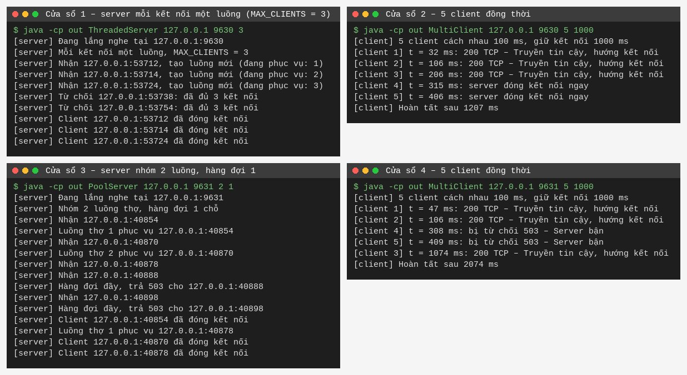

# Bài 6.1 – Server tra cứu đa luồng và server nhóm luồng (Java)

| Thông tin | Nội dung |
|---|---|
| Mã giả tương ứng | Mã giả 6.1 (Server đa luồng: mỗi kết nối một luồng), Mã giả 6.2 (Server dùng nhóm luồng và hàng đợi có giới hạn) |
| Mục giáo trình | 6.2.1 Luồng cho mỗi kết nối, 6.2.2 Nhóm luồng |
| Kế thừa | Mã giả 2.1 (PARSE_ENDPOINT), 2.2 (SAFE_CONNECT), 3.1 (khung server), 3.4 (RECV_EXACT), 3.6 (khung JSON), 3.7 (PROCESS_REQUEST, HANDLE_LOOKUP), 3.8 (client tra cứu, rút gọn) |
| Thư viện | JDK: `java.net.ServerSocket`, `Socket`, `java.util.concurrent.atomic.AtomicInteger`, `ArrayBlockingQueue`; JSON tự viết (`Json.java`) vì JDK không có thư viện JSON |

## Mục tiêu
Chuyển server tra cứu tuần tự của Chương 3 thành server phục vụ đồng thời nhiều client theo hai cách: mỗi kết nối một luồng có trần `MAX_CLIENTS`, và nhóm k luồng thợ với hàng đợi có giới hạn, trả mã 503 khi hàng đợi đầy (áp lực ngược). Phần nghiệp vụ `HANDLE_LOOKUP` được giữ nguyên.

## Tệp
- `ThreadedServer.java` – Mã giả 6.1: `main` (THREADED_SERVER), `serve` (SERVE).
- `PoolServer.java` – Mã giả 6.2: `main` (POOL_SERVER), `worker` (WORKER).
- `LookupService.java` – Mã giả 3.7: `processRequest`, `handleLookup`.
- `NetUtil.java` – Mã giả 2.1, 2.2, 3.4, 3.6.
- `Json.java` – JSON_ENCODE, JSON_DECODE tối giản.
- `MultiClient.java` – chương trình mở n client tra cứu đồng thời.
- `glossary.json` – từ điển thuật ngữ.
- `demo.json` – kịch bản chạy minh họa (dùng với `tools/demo.py`).
- `ket_qua.txt`, `ket_qua.png` – kết quả thực thi thật.

## Cách chạy
Mở các cửa sổ dòng lệnh trong thư mục bài:
```bash
javac -encoding UTF-8 -d out *.java
# Cửa sổ 1 – server mỗi kết nối một luồng (mặc định 0.0.0.0 9000, MAX_CLIENTS 500)
java -cp out ThreadedServer 0.0.0.0 9000
# hoặc server nhóm luồng: k = 8 luồng thợ, hàng đợi 16 chỗ
java -cp out PoolServer 0.0.0.0 9000 8 16
# Cửa sổ 2 – 5 client đồng thời, mỗi client giữ kết nối 1000 ms
java -cp out MultiClient 127.0.0.1 9000 5 1000
```
Trên Windows, lệnh `javac -encoding UTF-8 -d out *.java` dùng được trong PowerShell và cmd.
Dừng server bằng Ctrl+C.

## Kết quả thực thi


Kịch bản chạy hai server với tham số nhỏ để thấy rõ giới hạn: server mỗi kết nối một luồng với `MAX_CLIENTS = 3` phục vụ ngay ba client đầu (mỗi client một luồng, client 2 và 3 không phải chờ client 1 giữ kết nối), client 4 và 5 bị đóng kết nối ngay sau `ACCEPT`. Server nhóm 2 luồng thợ, hàng đợi 1 chỗ phục vụ ngay client 1, 2; client 3 nằm trong hàng đợi và chỉ được phục vụ ở t ≈ 1000 ms khi luồng thợ 1 rảnh; client 4, 5 nhận phản hồi `503 Server bận`.

## Ghi chú
- Phần nghiệp vụ dùng `HANDLE_LOOKUP` (khung JSON, Mã giả 3.7) thay cho `HANDLE_ECHO` vì Mã giả 6.2 trả lỗi 503 dưới dạng khung JSON; Mục 6.2 cho phép giữ nguyên `HANDLE_ECHO` hoặc `HANDLE_LOOKUP`.
- `SERVE` bắt thêm `ConnectionClosed` (đóng giữa khung) và `ProtocolError` (khung quá lớn) như khối `CATCH` của Mã giả 3.1; Mã giả 6.1 chỉ ghi `NetError`, `Timeout`. Thiếu hai loại này, lỗi thoát khỏi luồng con (khối `FINALLY` vẫn chạy).
- Tham số thứ ba của server mỗi kết nối một luồng ghi đè `MAX_CLIENTS` (mặc định 500) để minh họa. Giáo trình không quy định giá trị mặc định của k và `queue_size`; bài chọn k = 8 (theo ví dụ ở Mục 6.2.2) và 16.
- Khi server đóng kết nối ngay sau `ACCEPT` trong lúc yêu cầu của client đã đến, hệ điều hành gửi RST thay cho FIN; client có thể thấy EOF hoặc lỗi ConnectionReset và cả hai đều được báo là "server đóng kết nối ngay". Trên Linux, phản hồi 503 đã nằm trong bộ đệm nhận vẫn đọc được sau RST; trên Windows dữ liệu chưa đọc có thể bị hủy khi nhận RST, khi đó client chỉ thấy lỗi kết nối.
- `multi_client` là chương trình minh họa bổ sung (không có trong mã giả): các client khởi động cách nhau 100 ms để thứ tự `ACCEPT` ổn định; thời điểm t thay đổi nhẹ giữa các lần chạy.
- `ATOMIC_COUNTER` là `AtomicInteger`; `BLOCKING_QUEUE` là `ArrayBlockingQueue` (`offer` = `try_put`, `take` = `take`). `SPAWN_THREAD` dùng luồng hệ điều hành (`new Thread`) đúng tinh thần Mục 6.2.1; luồng ảo được dùng ở Bài 6.2.
- Kiểm thử: Linux, OpenJDK 21.0.12.1.
