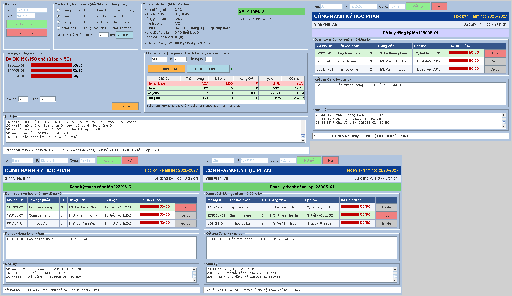
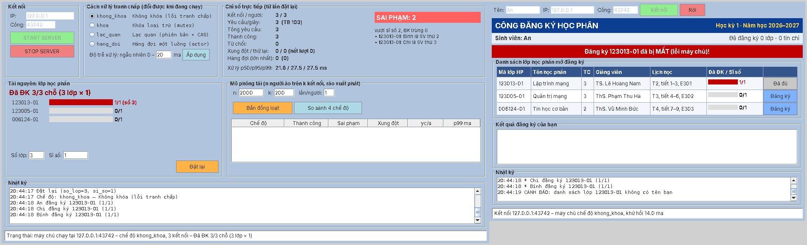
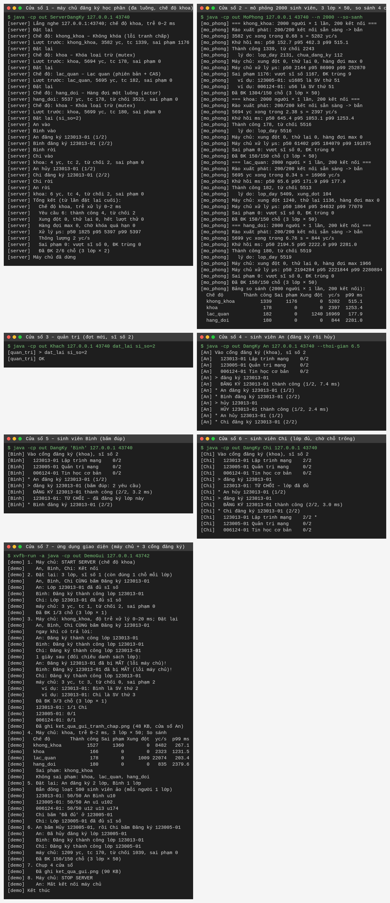

# Bài mở rộng MR6.10 – Đăng ký học phần: 2000 sinh viên tranh 150 chỗ (Java)

| Thông tin | Nội dung |
|---|---|
| Loại | **Bài mở rộng**, không có trong giáo trình và không có mã giả tương ứng. Thuộc nhóm "tranh chấp tài nguyên" MR6.6–MR6.14, dùng chung khung của [MR6.6](../BaiMR6.6_DauGia/) |
| Liên hệ với giáo trình | Chương 6: Bài 6.1 (server đa luồng, một luồng mỗi kết nối), Bài 6.7 (kiểm thử tải); Chương 3: Bài 3.2 (định khung thông điệp theo dòng); bài mở rộng MR5.4/MR5.5 (luồng, đồng bộ) |
| Thư viện | JDK 21, chỉ thư viện chuẩn: `java.net`, `java.util.concurrent` (`ReentrantLock` theo từng lớp, `LinkedBlockingQueue`, `CyclicBarrier`), `Set` bất biến làm giá trị ô; bản giao diện dùng thêm Swing (`GridBagLayout` cho bảng lớp), `java.awt.Robot`, `javax.imageio`. `Json.java` tự viết |
| Bản ngôn ngữ khác | [C#](../../../csharp/Chuong06/BaiMR6.10_DangKyHocPhan/), [Python](../../../python/Chuong06/BaiMR6.10_DangKyHocPhan/), [Rust](../../../rust/Chuong06/BaiMR6.10_DangKyHocPhan/), [Go](../../../go/Chuong06/BaiMR6.10_DangKyHocPhan/) |

## Mục tiêu
Bài mô phỏng cổng đăng ký học phần ngày mở đăng ký: **3 lớp học phần, sĩ số 50** (tối đa 6 lớp), **2000 sinh viên** cùng bấm "Đăng ký". Hai thao tác ghi: `dang_ky` (lớp còn chỗ và mình chưa có tên mới nhận) và `huy` (chỉ hủy lớp mình đã đăng ký). Mỗi lớp là một ô tài nguyên (giá trị = tập tên sinh viên, bất biến; ghi = tạo tập mới), nên hai lớp khác nhau được xử lý song song còn một lớp "hot" là điểm nóng. Thao tác "đọc → kiểm tra (0–2 ms) → ghi" chạy theo **bốn cách**: không khóa, khóa loại trừ theo lớp, lạc quan, hàng đợi một luồng. **Sổ kiểm toán** đếm **vượt sĩ số** và **ĐK trùng** (một sinh viên được nhận hai lần vào cùng lớp: bấm đúp hoặc hai thiết bị).

Bản Java chuyển ngữ đúng bản Python (giao thức, hành vi, dòng in). Khung chép nguyên từ MR6.6 bản Java; bài này chỉ viết nghiệp vụ, ứng dụng người dùng, bảng tài nguyên và kịch bản demo.

## Kiến thức chính
Số liệu lấy từ `ket_qua.txt`, một lần chạy thật trên máy cục bộ (127.0.0.1, OpenJDK 21, 2 lõi, độ trễ xử lý 0–2 ms). Mỗi lần chạy, số liệu lệch đi đôi chút.

```
  Chế độ       Thành công Sai phạm Xung đột  yc/s  p99 ms
  khong_khoa         1339     1176        0  5282   515.1
  khoa                178        0        0  2397  1253.4
  lac_quan            182        0     1240 16969   177.9
  hang_doi            180        0        0   844  2281.0
```
(2000 sinh viên × 1 lớp, 200 kết nối, 3 lớp × 50 chỗ. "Thành công" gồm lượt đăng ký và lượt "đổi ý" hủy được chấp nhận – 10 % sinh viên được nhận rồi hủy ngay; sinh viên thứ 100, 200, … dùng tên người liền trước. "Sai phạm" do sổ kiểm toán đếm.)

- **Vượt sĩ số (race condition).** Ở `khong_khoa`, hàng trăm luồng cùng đọc "lớp còn chỗ" rồi cùng ghi tập mới: bản ghi sau đè bản trước (mất cập nhật), nên danh sách lớp lúc nào cũng "còn chỗ" và sổ nhận **1304 lượt đăng ký cho 150 chỗ** (`vượt sĩ số 1167`, ví dụ `123005-01: u1685 là SV thứ 51`) và 9 lượt `ĐK trùng`. Ba chế độ còn lại cho đúng 150/150 chỗ, 0 sai phạm. Người dùng thật thấy điều này trên giao diện: cả ba cùng "Đăng ký thành công", 1 giây sau hai người thấy "Đăng ký … đã bị MẤT (lỗi máy chủ)!" vì danh sách lớp không có tên mình.
- **Khóa theo lớp.** `khoa` khóa riêng ô `lop:<mã>` (`ReentrantLock` của ô) suốt đọc – kiểm tra – ghi; ba lớp xử lý song song. Ở đây mọi người dồn vào 3 lớp nên `khoa` (2397 yc/s) chỉ nhỉnh hơn `hang_doi` (844 yc/s): điểm nóng tuần tự hóa dù khóa mịn.
- **Lạc quan (Kung & Robinson 1981).** `lac_quan` đọc (tập tên, phiên bản), kiểm tra ngoài khóa, rồi so sánh-và-đổi: **1240 xung đột** (trên một lớp hot, cứ hai luồng cùng đọc thì một luồng phải làm lại), 104 yêu cầu hết 5 lần thử bị từ chối `xung_dot` ("xung đột, thử lại sau"). Đổi lại, phần lớn yêu cầu là "lớp đã đủ" chỉ đọc nên không cần CAS – chế độ này nhanh nhất (16 969 yc/s).
- **Idempotency theo nghiệp vụ.** Bấm đúp sinh hai `ma_yc` khác nhau; luật "một sinh viên một chỗ trong lớp" nằm trong trạng thái: lần thứ hai nhận `da_dang_ky` ("đã đăng ký lớp này") – cửa sổ 5.
- **Tranh chấp kết quả ↔ trạng thái đẩy.** Giao diện đối chiếu kết quả `kq` với danh sách lớp trong `cap_nhat` và chỉ báo "bị MẤT" khi danh sách thiếu tên mình liên tục 0,5 s. Bản Java bỏ qua thêm lớp vừa có `kq` mà chưa có `cap_nhat` nào tới sau (bản trạng thái đang giữ chụp *trước* lần ghi của mình): không có điều này, cửa sổ vừa "Hủy" thành công có thể đọc bản cũ còn tên mình, tưởng "đăng ký từ thiết bị khác" rồi 0,5 s sau báo nhầm "bị MẤT" – lỗi thời điểm đã gặp khi chạy bản Java (luồng nhanh hơn).

### Giao thức (giống hệt ở 5 ngôn ngữ)
Phần chung (chào, quản trị, `thong_ke`, `lap_lai`) xem [README MR6.6](../BaiMR6.6_DauGia/README.md#giao-thức-giống-hệt-ở-5-ngôn-ngữ).

| Chiều | Thông điệp |
|---|---|
| người dùng → server | `{"loai":"dang_ky","ma_yc":k,"ma_lop":"123013-01"}`, `{"loai":"huy","ma_yc":k,"ma_lop":"123013-01"}` (kết nối gộp thêm `"nguoi":"u17"`) |
| server → client | `{"loai":"kq","ma_yc":k,"ok":true,"thao_tac":"dang_ky","ma_lop":…,"nguoi":…,"da_dk":37}` hoặc `{"ok":false,"ma_loi":"lop_day"\|"da_dang_ky"\|"chua_dang_ky"\|"sai_du_lieu"\|"xung_dot"\|…,"ly_do":…,"ma_lop":…,"da_dk":50}` |
| server → tất cả | `{"loai":"cap_nhat","che_do":…,"si_so":50,"lop":[{"ma","ten","gv","lich","tc","si_so","da_dk","theo_so","sv":[tên…]}…]}` (≤ 10 lần/s); `{"loai":"su_kien","noi_dung":"An đăng ký 123013-01 (1/50)"}` (chỉ người dùng thật) |
| quản trị → server | `{"loai":"dat_lai","ma_yc":k,"so_lop":3,"si_so":50}` (1–6 lớp, sĩ số 1–500) |

Sai phạm trong `thong_ke`: `vượt sĩ số`, `ĐK trùng`; `tom_tat`: `Đã ĐK 150/150 chỗ (3 lớp × 50)`.

**Chạy chéo với bản Python (đã thử trên cùng máy):** (a) máy chủ Java + `mo_phong.py --n 2000 --so-sanh` + `dang_ky.py`: khong_khoa 1329 thành công / 1164 sai phạm, ba chế độ còn lại 178–182/0 (lac_quan 1112 xung đột); `dang_ky.py` bấm đúp nhận "ĐĂNG KÝ 123013-01 thành công" rồi "TỪ CHỐI – đã đăng ký lớp này", lệnh `xem` có dấu `*`. (b) máy chủ Python + `MoPhong` Java + `DangKy` Java: khong_khoa 2006/1836, ba chế độ còn lại 168–186/0; dòng in của `DangKy` giống hệt `dang_ky.py`.

## Cấu trúc tệp
- `Chung.java`, `KetNoiKhach.java`, `Khach.java`, `GiaoDienChung.java`, `Json.java`, phần KHUNG của `MoPhong.java`: **khung chung**, chép nguyên từ MR6.6 bản Java (chỉ đổi dòng đầu chú thích).
- `MayChu.java`: nghiệp vụ `MayChuDangKy` (danh mục 6 lớp, mỗi lớp một ô `lop:<mã>`) và `SoKiemToanDangKy`; `ServerDangKy.java` là bản dòng lệnh.
- `MoPhong.java`: phần NGHIỆP VỤ gồm `NguCanh` (danh sách mã lớp), `NguoiAo` (thứ tự ưu tiên xáo theo tên bằng `new Random(ten.hashCode())`, lớp đủ thì thử lớp sau, 10 % đổi ý hủy), `thamSoDatLai()` = {}.
- `DangKy.java`: sinh viên bản dòng lệnh (`dk <mã> [x2]`, `huy <mã>`, `xem`).
- `ServerGui.java`: bảng điều khiển máy chủ; `DangKyGui.java`: cổng đăng ký; `DemoGui.java`: kịch bản tự bấm.
- `demo.json`, `ket_qua.txt`, `ket_qua.png`, `ket_qua_gui.png`, `ket_qua_gui_tranh_chap.png`: kịch bản và kết quả thực thi thật.

## Cách chạy
Trong thư mục bài (cần JDK 21):
```bash
javac -encoding UTF-8 -d out *.java
java -cp out ServerDangKy 127.0.0.1 9000                        # cửa sổ 1 (gõ lệnh ở đây)
java -cp out MoPhong 127.0.0.1 9000 --n 2000 --so-sanh          # cửa sổ 2: bảng so sánh 4 chế độ
java -cp out Khach 127.0.0.1 9000 dat_lai si_so=2               # đợt mới, sĩ số 2
java -cp out DangKy An 127.0.0.1 9000                           # cửa sổ 3, 4…: dk 123013-01 / huy … / xem
```
- Lệnh của máy chủ: `che_do khong_khoa|khoa|lac_quan|hang_doi`, `tre <ms>`, `dat_lai [so_lop=… si_so=…]`, `thong_ke`, `thoat`. Tùy chọn: `--che-do`, `--tre-ms`, `--so-lop`, `--si-so`.
- Lệnh của `DangKy`: `dk <mã lớp>`, `dk <mã lớp> x2` (bấm đúp), `huy <mã lớp>`, `xem`, `thoat`. Dòng `@t lệnh` chờ tới giây thứ t.

Tái lập kết quả từ thư mục gốc của kho: `python3 tools/demo.py java/Chuong06/BaiMR6.10_DangKyHocPhan`.

## Ứng dụng giao diện


Ảnh trên là lần chạy thật của `DemoGui` (Linux, Xvfb, OpenJDK 21, Metal): máy chủ (trên trái), An (trên phải), Bình và Chi (dưới). Kịch bản đã so sánh 4 chế độ (bảng ở giữa: `khong_khoa` 1360 sai phạm tô đỏ, ba chế độ kia 0), rồi đặt lại: An đăng ký 2 lớp, Bình 1 lớp, 500 sinh viên ảo lấp đầy cả ba lớp (thanh đỏ 50/50). Chi bấm "Đã đủ" ở 123005-01 thì nhận "Lớp 123005-01 đã đủ sĩ số"; An bấm **Hủy** lớp đó ("Đã hủy đăng ký lớp 123005-01"), chỗ trống hiện ngay ở cửa sổ Chi, Chi bấm Đăng ký và được nhận.



Bước trước đó: máy chủ `khong_khoa`, độ trễ 0–20 ms, sĩ số 1. An, Bình, Chi cùng bấm Đăng ký 123013-01: cả ba nhận "Đăng ký thành công", 1 giây sau danh sách lớp chỉ còn một tên nên hai người thấy "Đăng ký 123013-01 đã bị MẤT (lỗi máy chủ)!" (ảnh phải); ô **SAI PHẠM** đỏ (vượt sĩ số 2: `123013-01: Bình là SV thứ 2`). Cùng thao tác ở `khoa` (bước 2): một người được, hai người "Lớp 123013-01 đã đủ sĩ số".

- **Máy chủ** (`ServerGui`): phần chung giống MR6.6; **tài nguyên**: tóm tắt "Đã ĐK x/y chỗ", mỗi lớp một thanh "đã đăng ký / sĩ số" (đỏ khi đủ; khi sổ kiểm toán ghi vượt sĩ số thì hiện thêm "(sổ n)" màu đỏ), ô **Số lớp**, **Sĩ số**, nút **Đặt lại**.
- **Cổng đăng ký** (`DangKyGui`): thanh tiêu đề "CỔNG ĐĂNG KÝ HỌC PHẦN", thông tin sinh viên (số lớp, số tín chỉ), dòng thông báo màu, bảng lớp (mã, tên, TC, giảng viên, lịch, thanh sĩ số xanh/cam/đỏ, nút **Đăng ký** / **Hủy** / **Đã đủ**; lớp của mình tô xanh chữ đậm), bảng "Kết quả đăng ký của bạn".

### Cách chạy
```bash
javac -encoding UTF-8 -d out *.java
java -cp out ServerGui 127.0.0.1 43742          # bấm START SERVER (3 lớp × 50)
java -cp out DangKyGui An 127.0.0.1 43742
java -cp out DangKyGui Bình 127.0.0.1 43742
```
- **Windows:** chỉ cần JDK 21 (`winget install -e --id Microsoft.OpenJDK.21`). **Linux:** `sudo apt install openjdk-21-jdk`. Kịch bản tự động (Linux, cần `xvfb`): `xvfb-run -a -s "-screen 0 2600x1700x24" java -cp out DemoGui 127.0.0.1 43742`.
- Chạy riêng từng cửa sổ: mọi dòng nhật ký và cứ 5 giây một dòng số liệu cũng in ra dòng lệnh.
- Thử trên nhiều máy: máy chủ nghe IP card mạng (hoặc `0.0.0.0`), mở tường lửa cho cổng; đặt sĩ số nhỏ hơn số sinh viên để cả lớp cùng tranh. Khi đó **chỉ dùng `khoa`, `lac_quan`, `hang_doi`**.

## Kết quả thực thi


## Ghi chú
- Giá trị ô là `Set` bất biến (`Set.of()` / `Collections.unmodifiableSet`), hàm xử lý tạo tập mới chứ không sửa tập đã đọc – điều kiện để `lac_quan` gọi lại hàm xử lý an toàn và để luồng hiển thị không bao giờ thấy một tập "đang sửa dở".
- Thứ tự ưu tiên lớp của mỗi người ảo xáo bằng `Random(ten.hashCode())` – cùng tên thì cùng thứ tự (như `random.Random(ten)` của Python, khác dãy số cụ thể).
- Trong kịch bản giao diện, máy chủ, bộ mô phỏng và cửa sổ chạy trong một JVM nên yc/s thấp hơn bản dòng lệnh; kịch bản bấm nút bằng `doClick(0)`, mỗi nút gửi yêu cầu trước rồi mới vẽ lại.
- Kiểm thử: Linux, OpenJDK 21.0.12 (dòng lệnh và giao diện dưới Xvfb), chạy chéo với Python 3.13.

## Bài tập gợi ý
1. Chạy `MoPhong --n 2000 --so-sanh --tre-ms 0`. `khong_khoa` còn vượt sĩ số không? Vì sao vẫn có (đa lõi thật) dù không còn `sleep`?
2. Tăng lên 6 lớp (`dat_lai so_lop=6`). Thông lượng của `khoa` và số xung đột của `lac_quan` thay đổi thế nào? Liên hệ độ mịn của khóa.
3. Thêm luật "mỗi sinh viên tối đa 2 lớp" (cần đọc hai loại tài nguyên: lớp và "hồ sơ" sinh viên). Khóa những ô nào, theo thứ tự nào để không khóa chết?
4. Thêm "danh sách chờ" khi lớp đầy: ai hủy thì người đầu danh sách chờ tự được nhận. Thao tác đó cần đi qua chế độ xử lý tranh chấp ra sao?
5. Giao diện: cho cổng đăng ký báo "Có chỗ trống!" khi một lớp đang đầy vừa có người hủy.

## Đọc thêm
- H. T. Kung, J. T. Robinson (1981). *On Optimistic Methods for Concurrency Control*. ACM Transactions on Database Systems 6(2).
- E. G. Coffman, M. J. Elphick, A. Shoshani (1971). *System Deadlocks*. ACM Computing Surveys 3(2).
- Tài liệu JDK 21: [`java.util.concurrent`](https://docs.oracle.com/en/java/javase/21/docs/api/java.base/java/util/concurrent/package-summary.html), [`ReentrantLock`](https://docs.oracle.com/en/java/javase/21/docs/api/java.base/java/util/concurrent/locks/ReentrantLock.html), [`AtomicReference`](https://docs.oracle.com/en/java/javase/21/docs/api/java.base/java/util/concurrent/atomic/AtomicReference.html), [`BlockingQueue`](https://docs.oracle.com/en/java/javase/21/docs/api/java.base/java/util/concurrent/BlockingQueue.html), [`Set.of`](https://docs.oracle.com/en/java/javase/21/docs/api/java.base/java/util/Set.html#unmodifiable), [`javax.swing`](https://docs.oracle.com/en/java/javase/21/docs/api/java.desktop/javax/swing/package-summary.html).

Mã nguồn của bài được viết mới cho kho này.
