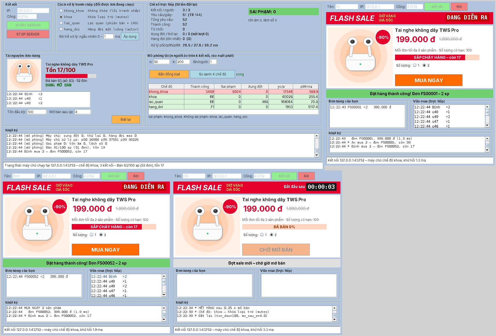
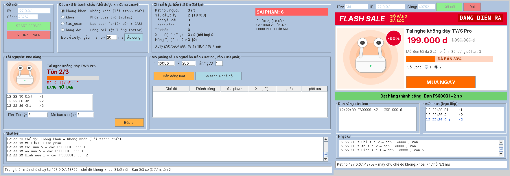
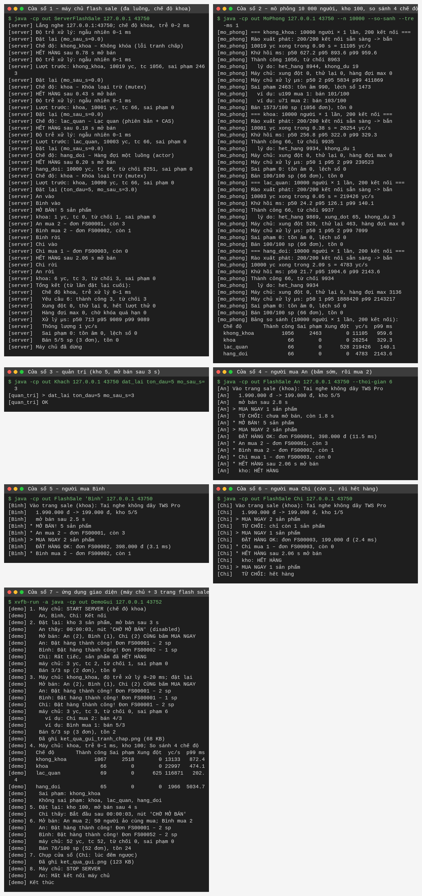

# Bài mở rộng MR6.11 – Flash sale: 10 000 người cùng bấm "MUA NGAY" cho 100 sản phẩm (Java)

| Thông tin | Nội dung |
|---|---|
| Loại | **Bài mở rộng**, không có trong giáo trình và không có mã giả tương ứng. Thuộc nhóm "tranh chấp tài nguyên" MR6.6–MR6.14, dùng chung khung của [MR6.6](../BaiMR6.6_DauGia/) |
| Liên hệ với giáo trình | Chương 6: Bài 6.1 (server đa luồng, một luồng mỗi kết nối), Bài 6.7 (kiểm thử tải); Chương 3: Bài 3.2 (định khung thông điệp theo dòng); bài mở rộng MR5.4/MR5.5 (luồng, đồng bộ) |
| Thư viện | JDK 21, chỉ thư viện chuẩn: `java.net`, `java.util.concurrent` (`ReentrantLock`, `LinkedBlockingQueue`, `CyclicBarrier`, `ThreadLocalRandom`), `System.nanoTime` (đồng hồ đơn điệu cho giờ mở bán); bản giao diện dùng thêm Swing, `java.awt.font.TextAttribute` (giá gạch ngang), `java.awt.Robot`, `javax.imageio`. `Json.java` tự viết |
| Bản ngôn ngữ khác | [C#](../../../csharp/Chuong06/BaiMR6.11_FlashSale/), [Python](../../../python/Chuong06/BaiMR6.11_FlashSale/), [Rust](../../../rust/Chuong06/BaiMR6.11_FlashSale/), [Go](../../../go/Chuong06/BaiMR6.11_FlashSale/) |

## Mục tiêu
Bài mô phỏng "giờ vàng" flash sale: kho có **100 sản phẩm**, mở bán lúc T (đếm ngược), **10 000 người** cùng bấm "MUA NGAY" đúng lúc mở, mỗi đơn 1–2 sản phẩm. Toàn bộ kho là **một ô "nóng"** `kho` {tồn, đã bán, số đơn} mà mọi đơn cùng tranh. Thao tác `mua` "đọc tồn → kiểm tra (0–1 ms) → trừ tồn" chạy theo **bốn cách**: không khóa, khóa loại trừ, lạc quan, hàng đợi một luồng. Hai việc **không** cần vùng găng: kiểm tra giờ mở bán (chỉ đọc đồng hồ, trả `chua_mo` kèm `con_ms`) và "hết hàng nhanh" (tồn chỉ giảm, đã thấy 0 thì chắc chắn 0). **Sổ kiểm toán** đếm **tồn âm** (bán vượt tồn đầu kỳ) và **lệch sổ** (tổng đã bán theo sổ ≠ tồn đầu − tồn hiện tại).

Bản Java chuyển ngữ đúng bản Python (giao thức, hành vi, dòng in). Khung chép nguyên từ MR6.6 bản Java; bài này chỉ viết nghiệp vụ, ứng dụng người dùng, bảng tài nguyên và kịch bản demo.

## Kiến thức chính
Số liệu lấy từ `ket_qua.txt`, một lần chạy thật trên máy cục bộ (127.0.0.1, OpenJDK 21, 2 lõi, độ trễ xử lý 0–1 ms – `--tre-ms 1` như bản Python). Mỗi lần chạy, số liệu lệch đi đôi chút.

```
  Chế độ       Thành công Sai phạm Xung đột  yc/s  p99 ms
  khong_khoa         1056     2463        0 11105   959.6
  khoa                 66        0        0 26254   329.3
  lac_quan             66        0      528 219426   140.1
  hang_doi             66        0        0  4783  2143.6
```
(10 000 người × 1 đơn, 200 kết nối, kho 100. `THAM_SO_DAT_LAI` = `{"mo_sau_s": 0}`: mở bán ngay lúc đặt lại, rào xuất phát chính là "giờ G". "Thành công" là số đơn được chấp nhận; "Sai phạm" do sổ kiểm toán đếm.)

- **Bán vượt (race condition).** Ở `khong_khoa`, hàng trăm luồng cùng đọc "tồn 37" rồi cùng ghi "tồn 35": mỗi luồng tưởng mình là người duy nhất. Kho 100 sản phẩm nhận **1056 đơn, 1573 sản phẩm** (`tồn âm 990`, ví dụ `u199 mua 1: bán 101/100`), và vì các bản ghi đè nhau nên tồn cuối không khớp số đã bán (`lệch sổ 1473`). Ba chế độ còn lại bán đúng 100/100 sản phẩm cho 66 đơn, 0 sai phạm.
- **Một ô nóng: khóa = tuần tự.** Mọi đơn chạm cùng ô `kho`, nên `khoa` tuần tự hóa phần "đọc – trừ – ghi". Nhưng chỉ khoảng 100 đơn đầu thật sự cần vào vùng găng: sau khi cháy hàng, "hết hàng nhanh" (đọc tồn không khóa) trả lời ngay hàng nghìn yêu cầu còn lại. Vì thế `khoa` vẫn đạt 26 254 yc/s, còn `lac_quan` – cháy hàng sớm nhất vì không ai phải chờ khóa – đạt **219 426 yc/s**. `hang_doi` chậm nhất (4783 yc/s, hàng đợi max 3136) vì yêu cầu xếp vào hàng trước khi kho kịp về 0.
- **Lạc quan (Kung & Robinson 1981).** 528 xung đột trên một ô duy nhất; 65 yêu cầu hết 5 lần thử nhận `xung_dot` ("xung đột, thử lại sau") – trên điểm nóng, CAS phải trả giá bằng việc làm lại.
- **Kiểm tra ngoài vùng găng phải an toàn.** "Hết hàng nhanh" đúng vì tồn **đơn điệu giảm**; kiểm tra "còn đủ hàng" thì không được làm ngoài vùng găng (đó chính là lỗi của `khong_khoa`).
- **Đồng hồ đơn điệu, gửi thời lượng.** Giờ mở bán lưu theo `System.nanoTime`; `cap_nhat` gửi `mo_con_ms` (còn bao nhiêu ms) chứ không gửi thời điểm tuyệt đối, nên đồng hồ của máy khách lệch cũng không sao. Lượt dòng lệnh: An bấm sớm nhận "TỪ CHỐI: chưa mở bán, còn 1.8 s"; Chi đặt 2 khi còn 1 nhận "chỉ còn 1 sản phẩm", đặt lại 1 thì được, bấm thêm thì "hết hàng".

### Giao thức (giống hệt ở 5 ngôn ngữ)
Phần chung (chào, quản trị, `thong_ke`, `lap_lai`) xem [README MR6.6](../BaiMR6.6_DauGia/README.md#giao-thức-giống-hệt-ở-5-ngôn-ngữ).

| Chiều | Thông điệp |
|---|---|
| người dùng → server | `{"loai":"mua","ma_yc":k,"so_luong":2}` (kết nối gộp thêm `"nguoi":"u17"`) |
| server → client | `{"loai":"kq","ma_yc":k,"ok":true,"ma_don":"FS00012","so_luong":2,"ton":61,"nguoi":"An","thanh_tien":398000}` hoặc `{"ok":false,"ma_loi":"chua_mo"\|"khong_du"\|"het_hang"\|"sai_du_lieu"\|"xung_dot"\|…,"ly_do":…,"con_ms"/"ton":…}` |
| server → tất cả | `{"loai":"cap_nhat","che_do":…,"sp":{"ten","gia_goc","gia_sale","toi_da"},"ton_dau":100,"ton":61,"da_ban":39,"so_don":25,"ban_theo_so":39,"mo_ban":true,"mo_con_ms":0,"don_gan":[{"nguoi","so_luong","gio"}…]}` (≤ 10 lần/s); `su_kien`: "MỞ BÁN! 100 sản phẩm", "HẾT HÀNG sau 0.32 s mở bán", "An mua 2 – đơn FS00001, còn 98" (chỉ người dùng thật) |
| quản trị → server | `{"loai":"dat_lai","ma_yc":k,"ton_dau":100,"mo_sau_s":30,"toi_da":2,"gia_goc":…,"gia_sale":…,"ten_sp":…}` |

Sai phạm trong `thong_ke`: `tồn âm`, `lệch sổ`; `tom_tat`: `Bán 100/100 sp (66 đơn), tồn 0`.

**Chạy chéo với bản Python (đã thử trên cùng máy):** (a) máy chủ Java + `mo_phong.py --n 5000 --so-sanh --tre-ms 1` + `flash_sale.py`: khong_khoa 1441 đơn / 3429 sai phạm, ba chế độ còn lại 63–70/0 (lac_quan 701 xung đột); `flash_sale.py` nhận "chưa mở bán, còn 0.9 s", "ĐẶT HÀNG OK: đơn FS00001", "chỉ còn 1 sản phẩm". (b) máy chủ Python + `MoPhong` Java + `FlashSale` Java: khong_khoa 3213/7765, ba chế độ còn lại 64–70/0; dòng in của `FlashSale` giống hệt `flash_sale.py`.

## Cấu trúc tệp
- `Chung.java`, `KetNoiKhach.java`, `Khach.java`, `GiaoDienChung.java`, `Json.java`, phần KHUNG của `MoPhong.java`: **khung chung**, chép nguyên từ MR6.6 bản Java (chỉ đổi dòng đầu chú thích).
- `MayChu.java`: nghiệp vụ `MayChuFlashSale` (ô `kho`, giờ mở bán, "hết hàng nhanh", báo MỞ BÁN trong `dinhKy`) và `SoKiemToanFlashSale`; `ServerFlashSale.java` là bản dòng lệnh.
- `MoPhong.java`: phần NGHIỆP VỤ gồm `NguoiAo` (mỗi đơn 1–2 sản phẩm; "chỉ còn k" thì mua đúng k; hết hàng thì thôi), `thamSoDatLai()` = `{"mo_sau_s": 0}`.
- `FlashSale.java`: người mua bản dòng lệnh (`mua [n]`).
- `ServerGui.java`: bảng điều khiển máy chủ; `FlashSaleGui.java`: trang flash sale (cũng chứa `veTaiNghe` – ảnh sản phẩm dùng ở cả hai cửa sổ); `DemoGui.java`: kịch bản tự bấm.
- `demo.json`, `ket_qua.txt`, `ket_qua.png`, `ket_qua_gui.png`, `ket_qua_gui_tranh_chap.png`: kịch bản và kết quả thực thi thật.

## Cách chạy
Trong thư mục bài (cần JDK 21):
```bash
javac -encoding UTF-8 -d out *.java
java -cp out ServerFlashSale 127.0.0.1 9000                              # cửa sổ 1 (gõ lệnh ở đây)
java -cp out MoPhong 127.0.0.1 9000 --n 10000 --so-sanh --tre-ms 1       # cửa sổ 2: bảng so sánh 4 chế độ
java -cp out Khach 127.0.0.1 9000 dat_lai ton_dau=5 mo_sau_s=10          # đợt sale mới: 5 sản phẩm, mở sau 10 s
java -cp out FlashSale An 127.0.0.1 9000                                 # cửa sổ 3, 4…: mua 2
```
- Lệnh của máy chủ: `che_do khong_khoa|khoa|lac_quan|hang_doi`, `tre <ms>`, `dat_lai [ton_dau=… mo_sau_s=… toi_da=… gia_goc=… gia_sale=… ten_sp=…]`, `thong_ke`, `thoat`. Tùy chọn: `--che-do`, `--tre-ms`, `--ton`, `--mo-sau`.
- Lệnh của `FlashSale`: `mua [n]`, `thoat`. Dòng `@t lệnh` chờ tới giây thứ t.

Tái lập kết quả từ thư mục gốc của kho: `python3 tools/demo.py java/Chuong06/BaiMR6.11_FlashSale`.

## Ứng dụng giao diện


Ảnh trên là lần chạy thật của `DemoGui` (Linux, Xvfb, OpenJDK 21, Metal): máy chủ (trên trái), An (trên phải), Bình và Chi (dưới). Kịch bản đã so sánh 4 chế độ (bảng ở giữa: `khong_khoa` 2518 sai phạm tô đỏ, ba chế độ kia 0), rồi đặt lại kho 100, mở bán sau 4 s: cửa sổ Chi được chụp lúc đếm ngược ("Bắt đầu sau 00:00:03", nút "CHỜ MỞ BÁN" bị khóa). Khi mở bán, An mua 2 (đơn FS00001), 50 người ảo cùng mua, Bình mua 2 (đơn FS00052); thanh tồn kho "ĐÃ BÁN 76%", danh sách "Vừa mua" trực tiếp.



Bước trước đó: máy chủ `khong_khoa`, độ trễ 0–20 ms, kho **3 sản phẩm**. Hết đếm ngược, An (2), Bình (1), Chi (2) cùng bấm MUA NGAY: cả ba "Đặt hàng thành công!", cả ba cùng nhận mã đơn FS00001 (đọc cùng một số đơn), 5 sản phẩm được bán từ kho 3 và tồn cuối còn 2; ô **SAI PHẠM** đỏ (6: tồn âm 2, lệch sổ 4). Cùng thao tác ở `khoa` (bước 2): An và Bình mua được, Chi nhận "Rất tiếc, sản phẩm đã HẾT HÀNG".

- **Máy chủ** (`ServerGui`): phần chung giống MR6.6; **tài nguyên**: ảnh sản phẩm, "Tồn x/y" cỡ lớn, thanh đã bán, "Đã bán … (sổ: …) · … đơn" (đỏ khi sổ lệch kho hoặc vượt tồn đầu), đồng hồ "Mở bán sau 00:00:ss" / "ĐANG MỞ BÁN" / "HẾT HÀNG", ba đơn mới nhất, ô **Tồn đầu kỳ**, **Mở bán sau (s)**, nút **Đặt lại**.
- **Trang flash sale** (`FlashSaleGui`): dải FLASH SALE "GIỜ VÀNG GIÁ SỐC" với đồng hồ đếm ngược (rồi "ĐANG DIỄN RA", "CHÁY HÀNG"); thẻ sản phẩm (tai nghe vẽ bằng `Graphics2D`, nhãn "-90%", lớp phủ "HẾT HÀNG"), giá sale đỏ, giá gốc gạch ngang, giới hạn mỗi đơn, thanh "ĐÃ BÁN x% / SẮP CHÁY HÀNG – còn n", chọn số lượng 1/2, nút **MUA NGAY** (khóa tới giờ mở bán); dòng thông báo; "Đơn hàng của bạn" và "Vừa mua (trực tiếp)" (đơn của mình tô xanh).

### Cách chạy
```bash
javac -encoding UTF-8 -d out *.java
java -cp out ServerGui 127.0.0.1 43752          # bấm START SERVER (kho 100, mở bán sau 30 s)
java -cp out FlashSaleGui An 127.0.0.1 43752
java -cp out FlashSaleGui Bình 127.0.0.1 43752
```
- **Windows:** chỉ cần JDK 21 (`winget install -e --id Microsoft.OpenJDK.21`). **Linux:** `sudo apt install openjdk-21-jdk`. Kịch bản tự động (Linux, cần `xvfb`): `xvfb-run -a -s "-screen 0 2600x1700x24" java -cp out DemoGui 127.0.0.1 43752`.
- Chạy riêng từng cửa sổ: mọi dòng nhật ký và cứ 5 giây một dòng số liệu cũng in ra dòng lệnh.
- Thử trên nhiều máy: máy chủ nghe IP card mạng (hoặc `0.0.0.0`), mở tường lửa cho cổng; đặt kho nhỏ hơn số sinh viên và cả lớp cùng chờ đếm ngược. Khi đó **chỉ dùng `khoa`, `lac_quan`, `hang_doi`**.

## Kết quả thực thi


## Ghi chú
- Dòng `lac_quan` của bảng trong kịch bản giao diện (116 871 yc/s) và dòng "Lượt trước" của máy chủ khi số yêu cầu lớn dài 65 ký tự: số đo được quá rộng so với cột `yc/s` (5 ký tự) của định dạng chung. Định dạng giữ đúng như bản Python (khung chung), không sửa.
- `NguoiAo` chọn số lượng bằng `ThreadLocalRandom`; bài này không cần trạng thái chung nên `NguCanh` chỉ đọc giới hạn mỗi đơn.
- Trong kịch bản giao diện, máy chủ, bộ mô phỏng và cửa sổ chạy trong một JVM nên yc/s thấp hơn bản dòng lệnh; kịch bản bấm nút bằng `doClick(0)`, mỗi nút gửi yêu cầu trước rồi mới vẽ lại.
- Kiểm thử: Linux, OpenJDK 21.0.12 (dòng lệnh và giao diện dưới Xvfb), chạy chéo với Python 3.13.

## Bài tập gợi ý
1. Bỏ "hết hàng nhanh" trong `MayChu.java` rồi chạy lại `--so-sanh`. Thông lượng `khoa` và `hang_doi` thay đổi thế nào? Vì sao?
2. Chia kho thành 10 "ngăn" (10 ô, mỗi ô 10 sản phẩm), mỗi đơn chọn ngẫu nhiên một ngăn còn hàng. `khoa` và `lac_quan` có nhanh hơn không? Sổ kiểm toán cần đổi gì?
3. Thêm luật "mỗi người tối đa 1 đơn" (cần ô theo người như MR6.9). Bấm đúp lúc mở bán sẽ thế nào ở từng chế độ?
4. Đổi `mo_con_ms` thành thời điểm tuyệt đối (epoch ms) rồi chỉnh đồng hồ máy khách lệch 5 s. Đồng hồ đếm ngược hiển thị ra sao?
5. Giao diện: thêm hiệu ứng "nhấp nháy" cho thanh tồn kho khi còn dưới 10 sản phẩm.

## Đọc thêm
- H. T. Kung, J. T. Robinson (1981). *On Optimistic Methods for Concurrency Control*. ACM Transactions on Database Systems 6(2).
- Tài liệu JDK 21: [`java.util.concurrent`](https://docs.oracle.com/en/java/javase/21/docs/api/java.base/java/util/concurrent/package-summary.html), [`ReentrantLock`](https://docs.oracle.com/en/java/javase/21/docs/api/java.base/java/util/concurrent/locks/ReentrantLock.html), [`AtomicReference`](https://docs.oracle.com/en/java/javase/21/docs/api/java.base/java/util/concurrent/atomic/AtomicReference.html), [`BlockingQueue`](https://docs.oracle.com/en/java/javase/21/docs/api/java.base/java/util/concurrent/BlockingQueue.html), [`System.nanoTime`](https://docs.oracle.com/en/java/javase/21/docs/api/java.base/java/lang/System.html#nanoTime()), [`java.awt.font.TextAttribute`](https://docs.oracle.com/en/java/javase/21/docs/api/java.desktop/java/awt/font/TextAttribute.html).

Mã nguồn của bài được viết mới cho kho này.
