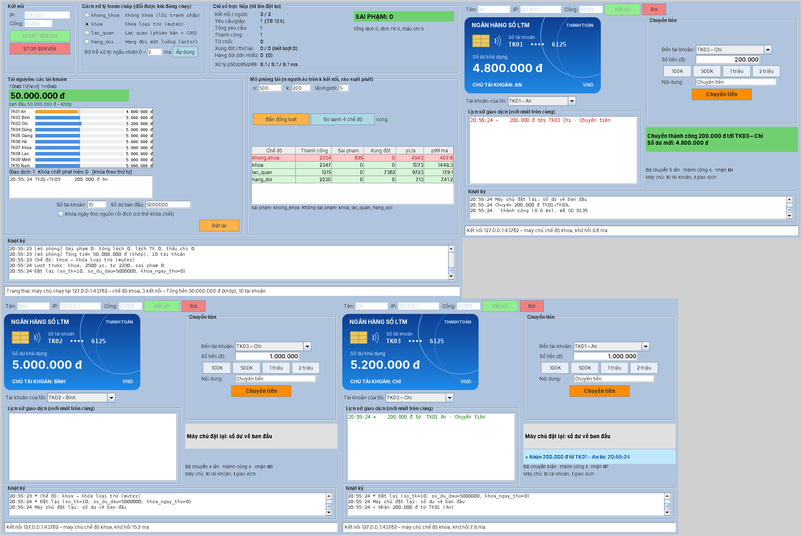
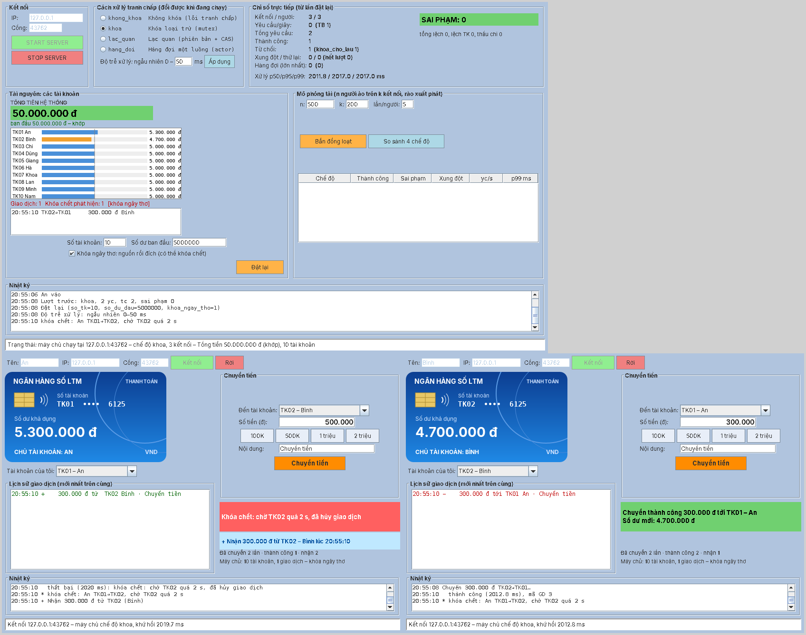
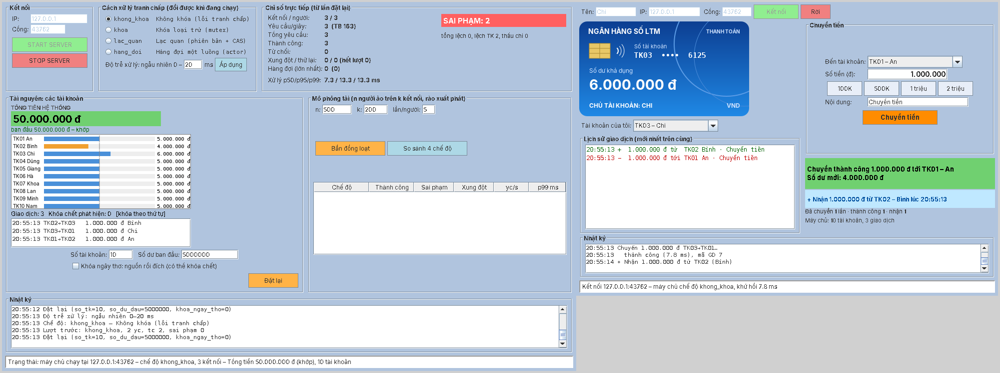
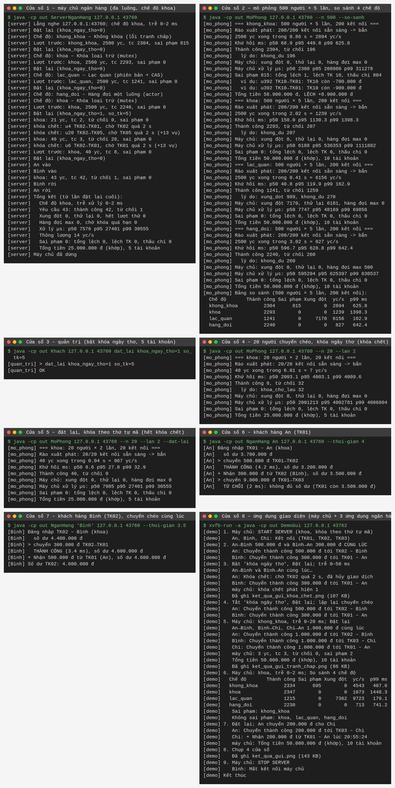

# Bài mở rộng MR6.12 – Chuyển khoản: n người chuyển tiền chéo nhau cùng lúc (Java)

| Thông tin | Nội dung |
|---|---|
| Loại | **Bài mở rộng**, không có trong giáo trình và không có mã giả tương ứng. Thuộc nhóm "tranh chấp tài nguyên" MR6.6–MR6.14, dùng chung khung của [MR6.6](../BaiMR6.6_DauGia/) |
| Liên hệ với giáo trình | Chương 6: Bài 6.1 (server đa luồng, một luồng mỗi kết nối), Bài 6.7 (kiểm thử tải); Chương 3: Bài 3.2 (định khung thông điệp theo dòng); bài mở rộng MR5.4/MR5.5 (luồng, đồng bộ) |
| Thư viện | JDK 21, chỉ thư viện chuẩn: `java.net`, `java.util.concurrent` (`ReentrantLock.tryLock(2 s)` theo từng tài khoản – phát hiện khóa chết, `LinkedBlockingQueue`, `CyclicBarrier`, `AtomicLong`); bản giao diện dùng thêm Swing (`GradientPaint` vẽ thẻ ngân hàng, `JComboBox`), `java.awt.Robot`, `javax.imageio`. `Json.java` tự viết |
| Bản ngôn ngữ khác | [C#](../../../csharp/Chuong06/BaiMR6.12_ChuyenKhoan/), [Python](../../../python/Chuong06/BaiMR6.12_ChuyenKhoan/), [Rust](../../../rust/Chuong06/BaiMR6.12_ChuyenKhoan/), [Go](../../../go/Chuong06/BaiMR6.12_ChuyenKhoan/) |

## Mục tiêu
Bài mô phỏng một ngân hàng có **5–20 tài khoản** (mặc định 10, mỗi tài khoản 5.000.000 đ). Thao tác `chuyen` trừ tài khoản nguồn và cộng tài khoản đích **trong cùng một thao tác** – tức là luôn chạm **hai tài nguyên**; số dư nguồn không đủ thì từ chối. Nhiều người chuyển chéo cùng lúc (A→B và B→A). Bốn cách xử lý tranh chấp: không khóa, khóa hai tài khoản **theo thứ tự mã** (TK01 trước TK02), lạc quan (so sánh-và-đổi **cả hai** tài khoản nguyên tử), hàng đợi một luồng; thêm tùy chọn **khóa ngây thơ** (`khoa_ngay_tho=1`: khóa nguồn rồi mới khóa đích) để thấy **khóa chết** (deadlock). **Sổ kiểm toán** tự tính số dư theo sổ và đếm **thấu chi** (một giao dịch làm nguồn âm), **lệch TK** (số tài khoản có số dư cuối khác sổ – mất cập nhật) và **tổng lệch** (tổng tiền hệ thống khác ban đầu).

Bản Java chuyển ngữ đúng bản Python (giao thức, hành vi, dòng in). Khung chép nguyên từ MR6.6 bản Java; bài này chỉ viết nghiệp vụ, ứng dụng người dùng, bảng tài nguyên và kịch bản demo.

## Kiến thức chính
Số liệu lấy từ `ket_qua.txt`, một lần chạy thật trên máy cục bộ (127.0.0.1, OpenJDK 21, 2 lõi, độ trễ xử lý 0–2 ms). Mỗi lần chạy, số liệu lệch đi đôi chút.

```
  Chế độ       Thành công Sai phạm Xung đột  yc/s  p99 ms
  khong_khoa         2304      815        0  2894   625.8
  khoa               2293        0        0  1239  1398.3
  lac_quan           1241        0     7170  6156   162.9
  hang_doi           2240        0        0   827   642.4
```
(500 người × 5 lần chuyển qua lại giữa một cặp tài khoản ngẫu nhiên, 200 kết nối, 10 tài khoản; số tiền 100.000–2.000.000 đ. `THAM_SO_DAT_LAI` = `{"khoa_ngay_tho": 0}`.)

- **Mất cập nhật, tiền tự sinh ra.** Ở `khong_khoa`, hai luồng cùng đọc số dư TK10 rồi cùng ghi: bản ghi sau đè bản trước. Kết quả sau 2304 giao dịch: **tổng tiền 58.900.000 đ, LỆCH +8.900.000 đ** so với 50.000.000 đ ban đầu, cả 10 tài khoản lệch sổ, sổ đếm **804 lần thấu chi** (`u392 TK10→TK01: TK10 còn -700.000 đ` – theo sổ, hai giao dịch cùng thấy "đủ tiền" rồi cùng trừ). Ba chế độ còn lại giữ đúng 50.000.000 đ (khớp), 0 sai phạm.
- **Khóa chết và thứ tự khóa (Coffman và cộng sự 1971).** Với `khoa_ngay_tho=1` (cửa sổ 3–4: 20 người chuyển chéo trên 5 tài khoản), A→B giữ A chờ B, B→A giữ B chờ A: vòng chờ. Khung phát hiện bằng `tryLock` quá **2 s**: giao dịch "nạn nhân" bị hủy (`khoa_cho_lau`), nhả khóa, giao dịch kia đi tiếp. Kết quả: 40 yêu cầu mất **6,01 s**, chỉ 8 thành công, 32 bị hủy "khóa chết: chờ TK.. quá 2 s, đã hủy giao dịch"; máy chủ báo `khóa chết: u4 TK02→TK01, chờ TK02 quá 2 s` (gộp tối đa 1 dòng/giây, "(+13 vụ)"). Đặt lại về khóa theo thứ tự mã (cửa sổ 5): cùng tải xong trong **0,04 s**, 40/40 thành công.
- **Lạc quan trên hai ô.** `lac_quan` đọc (số dư, phiên bản) của cả hai tài khoản, so sánh-và-đổi **cả hai** dưới một khóa ngắn: 7170 xung đột – nhiều cặp chuyển chéo đụng nhau – và 989 giao dịch hết 5 lần thử bị từ chối `xung_dot`; đổi lại nhanh nhất (6156 yc/s, p99 162,9 ms) và không bao giờ khóa chết.
- **Hàng đợi một luồng.** `hang_doi` không cần khóa nên không thể khóa chết, nhưng tuần tự: 827 yc/s, hàng đợi max 500.
- **Mã giao dịch và lịch sử.** Mỗi giao dịch được chấp nhận nhận `ma_gd` tăng mãi (`AtomicLong`, không đặt lại); `cap_nhat` mang 20 giao dịch gần nhất để ứng dụng báo "+ Nhận … từ …" đúng một lần (lọc theo `ma_gd` đã thấy).

### Giao thức (giống hệt ở 5 ngôn ngữ)
Phần chung (chào, quản trị, `thong_ke`, `lap_lai`) xem [README MR6.6](../BaiMR6.6_DauGia/README.md#giao-thức-giống-hệt-ở-5-ngôn-ngữ).

| Chiều | Thông điệp |
|---|---|
| người dùng → server | `{"loai":"chuyen","ma_yc":k,"tu":"TK01","den":"TK02","so_tien":500000,"noi_dung":"…"}` (nội dung tùy chọn, ≤ 40 ký tự; kết nối gộp thêm `"nguoi":"u17"`) |
| server → client | `{"loai":"kq","ma_yc":k,"ok":true,"tu","den","so_tien","so_du"(số dư mới của nguồn),"nguoi","noi_dung","ma_gd"}` hoặc `{"ok":false,"ma_loi":"khong_du"\|"khoa_cho_lau"\|"xung_dot"\|"khong_co"\|"sai_du_lieu"\|…,"ly_do":…}` |
| server → tất cả | `{"loai":"cap_nhat","che_do":…,"tai_khoan":[{"ma","chu","so_du"}…],"tong","tong_dau","khoa_ngay_tho","khoa_chet","so_gd","lich_su":[{"ma","gio","nguoi","tu","den","so_tien","noi_dung"}…]}` (≤ 10 lần/s); `{"loai":"su_kien","noi_dung":"khóa chết: …"}` |
| quản trị → server | `{"loai":"dat_lai","ma_yc":k,"so_tk":10,"so_du_dau":5000000,"khoa_ngay_tho":0\|1}` |

Sai phạm trong `thong_ke`: `tổng lệch`, `lệch TK`, `thấu chi`; `tom_tat`: `Tổng tiền 50.000.000 đ (khớp), 10 tài khoản` hoặc `Tổng tiền 58.900.000 đ, LỆCH +8.900.000 đ`.

**Chạy chéo với bản Python (đã thử trên cùng máy):** (a) máy chủ Java + `mo_phong.py --n 500 --so-sanh`: khong_khoa 2378 thành công / 742 sai phạm, ba chế độ còn lại 1583–2346/0 (lac_quan 5755 xung đột); `khach.py dat_lai khoa_ngay_tho=1 so_tk=5` rồi `mo_phong.py --n 20 --lan 2`: 9 thành công, 31 `khoa_cho_lau`, máy chủ Java báo "khóa chết: …"; `ngan_hang.py` chuyển và xem số dư đúng. (b) máy chủ Python + `MoPhong` Java + `NganHang` Java: khong_khoa 2472/820, ba chế độ còn lại 0 sai phạm; khóa ngây thơ 6 thành công, 34 `khoa_cho_lau`; dòng in của `NganHang` giống hệt `ngan_hang.py`.

## Cấu trúc tệp
- `Chung.java`, `KetNoiKhach.java`, `Khach.java`, `GiaoDienChung.java`, `Json.java`, phần KHUNG của `MoPhong.java`: **khung chung**, chép nguyên từ MR6.6 bản Java (chỉ đổi dòng đầu chú thích). Khóa ngây thơ là cờ `khoaNgayTho` có sẵn của `KhoTranhChap` (khóa theo thứ tự đưa vào, nghỉ giữa hai lần khóa).
- `MayChu.java`: nghiệp vụ `MayChuNganHang` (mỗi tài khoản một ô `TKxx`, giá trị `Long`; báo khóa chết gộp 1 dòng/giây) và `SoKiemToanNganHang`; `ServerNganHang.java` là bản dòng lệnh (`--khoa-ngay-tho`).
- `MoPhong.java`: phần NGHIỆP VỤ gồm `NguoiAo` (một cặp tài khoản ngẫu nhiên, chuyển qua lại `lan` lần), `thamSoDatLai()` = `{"khoa_ngay_tho": 0}`.
- `NganHang.java`: khách hàng bản dòng lệnh (`chuyen <TK> <số tiền> [nội dung]`, `so_du`).
- `ServerGui.java`: bảng điều khiển máy chủ; `NganHangGui.java`: ứng dụng ngân hàng số; `DemoGui.java`: kịch bản tự bấm.
- `demo.json`, `ket_qua.txt`, `ket_qua.png`, `ket_qua_gui.png`, `ket_qua_gui_khoa_chet.png`, `ket_qua_gui_tranh_chap.png`: kịch bản và kết quả thực thi thật.

## Cách chạy
Trong thư mục bài (cần JDK 21):
```bash
javac -encoding UTF-8 -d out *.java
java -cp out ServerNganHang 127.0.0.1 9000                             # cửa sổ 1 (gõ lệnh ở đây)
java -cp out MoPhong 127.0.0.1 9000 --n 500 --so-sanh                  # cửa sổ 2: bảng so sánh 4 chế độ
java -cp out Khach 127.0.0.1 9000 dat_lai khoa_ngay_tho=1 so_tk=5      # bật khóa ngây thơ
java -cp out MoPhong 127.0.0.1 9000 --n 20 --lan 2                     # thấy khóa chết (≈ 6 s)
java -cp out MoPhong 127.0.0.1 9000 --n 20 --lan 2 --dat-lai           # khóa theo thứ tự mã: hết khóa chết
java -cp out NganHang An 127.0.0.1 9000                                # cửa sổ 3, 4…: chuyen TK02 500000 / so_du
```
- Lệnh của máy chủ: `che_do khong_khoa|khoa|lac_quan|hang_doi`, `tre <ms>`, `dat_lai [so_tk=… so_du_dau=… khoa_ngay_tho=0|1]`, `thong_ke`, `thoat`. Tùy chọn: `--che-do`, `--tre-ms`, `--so-tk`, `--so-du`, `--khoa-ngay-tho`.
- Lệnh của `NganHang`: `chuyen <TK đích> <số tiền> [nội dung]`, `so_du`, `thoat`; `--tk TK01` chọn tài khoản (mặc định tài khoản mang tên mình). Dòng `@t lệnh` chờ tới giây thứ t.

Tái lập kết quả từ thư mục gốc của kho: `python3 tools/demo.py java/Chuong06/BaiMR6.12_ChuyenKhoan`.

## Ứng dụng giao diện


Ảnh trên là lần chạy thật của `DemoGui` (Linux, Xvfb, OpenJDK 21, Metal): máy chủ (trên trái), An (trên phải), Bình và Chi (dưới). Kịch bản đã so sánh 4 chế độ (bảng ở giữa: `khong_khoa` 695 sai phạm tô đỏ, ba chế độ kia 0), rồi đặt lại: An chuyển 200.000 đ cho Chi – An thấy "Chuyển thành công … Số dư mới: 4.800.000 đ" và dòng đỏ trong lịch sử, Chi thấy "+ Nhận 200.000 đ từ TK01 – An" (dòng xanh), thẻ của Chi 5.200.000 đ; tổng tiền hệ thống 50.000.000 đ (khớp, nền xanh).



Bật **Khóa ngây thơ**, độ trễ 0–50 ms: An→Bình 500.000 đ và Bình→An 300.000 đ cùng lúc. Hai giao dịch giữ khóa của nhau; sau 2 s một bên bị hủy ("Khóa chết: chờ TK02 quá 2 s, đã hủy giao dịch", nền đỏ), bên kia thành công; máy chủ đếm "Khóa chết phát hiện: 1". Tắt khóa ngây thơ (khóa theo thứ tự mã), cùng thao tác cho cả hai thành công.



`khong_khoa`, độ trễ 0–20 ms: An→Bình, Bình→Chi, Chi→An 1.000.000 đ cùng lúc – cả ba "Chuyển thành công" nhưng số dư bị ghi đè; ô **SAI PHẠM** đỏ (lệch TK – mất cập nhật). Bản Python ở cùng bước còn thấy tổng tiền LỆCH +1.000.000 đ; lần chạy này của bản Java tổng vẫn khớp nhưng hai tài khoản lệch sổ (sai phạm 2).

- **Máy chủ** (`ServerGui`): phần chung giống MR6.6; **tài nguyên**: TỔNG TIỀN HỆ THỐNG (xanh khi khớp, đỏ "LỆCH +… đ"), mỗi tài khoản một thanh số dư (vạch xám = số dư ban đầu, cam khi dưới mức ban đầu), số giao dịch, "Khóa chết phát hiện", chế độ khóa, ba giao dịch mới nhất, ô **Số tài khoản**, **Số dư ban đầu**, ô chọn **Khóa ngây thơ**, nút **Đặt lại**.
- **Ngân hàng số** (`NganHangGui`): thẻ tài khoản (nền chuyển màu, chip, số tài khoản, SỐ DƯ cỡ lớn, chủ tài khoản), chọn "Tài khoản của tôi", form chuyển tiền (tài khoản đích, số tiền + nút 100K / 500K / 1 triệu / 2 triệu, nội dung), dòng thông báo, tiền đến "+ Nhận …", lịch sử giao dịch (tiền ra đỏ, tiền vào xanh), dòng hệ thống (số tài khoản, số giao dịch, cảnh báo tổng tiền lệch).

### Cách chạy
```bash
javac -encoding UTF-8 -d out *.java
java -cp out ServerGui 127.0.0.1 43762          # bấm START SERVER (10 tài khoản × 5.000.000 đ)
java -cp out NganHangGui An 127.0.0.1 43762
java -cp out NganHangGui Bình 127.0.0.1 43762
```
- **Windows:** chỉ cần JDK 21 (`winget install -e --id Microsoft.OpenJDK.21`). **Linux:** `sudo apt install openjdk-21-jdk`. Kịch bản tự động (Linux, cần `xvfb`): `xvfb-run -a -s "-screen 0 2600x1700x24" java -cp out DemoGui 127.0.0.1 43762`.
- Chạy riêng từng cửa sổ: mọi dòng nhật ký và cứ 5 giây một dòng số liệu cũng in ra dòng lệnh.
- Thử trên nhiều máy: máy chủ nghe IP card mạng (hoặc `0.0.0.0`), mở tường lửa cho cổng; từng cặp sinh viên chuyển chéo cho nhau. Khi đó **chỉ dùng `khoa`, `lac_quan`, `hang_doi`** (khóa ngây thơ chỉ để thấy khóa chết).

## Kết quả thực thi


## Ghi chú
- Giá trị ô là số dư (`Long`), nên luồng hiển thị đọc bằng `kho.anhChup()` (bản chụp mọi ô) thay vì `kho.doc()` (vốn trả về `Map`).
- Thông báo khóa chết gộp tối đa 1 dòng/giây ("(+n vụ)") để nhật ký không ngập khi hàng chục giao dịch cùng chờ.
- Trong kịch bản giao diện, máy chủ, bộ mô phỏng và cửa sổ chạy trong một JVM nên yc/s thấp hơn bản dòng lệnh; kịch bản bấm nút bằng `doClick(0)`, nút "Chuyển tiền" gửi yêu cầu trước rồi mới vẽ lại.
- Kiểm thử: Linux, OpenJDK 21.0.12 (dòng lệnh và giao diện dưới Xvfb), chạy chéo với Python 3.13.

## Bài tập gợi ý
1. Với khóa ngây thơ, giảm thời gian chờ khóa tối đa từ 2 s xuống 0,2 s. Thông lượng và số giao dịch bị hủy thay đổi thế nào? Vì sao "hết thời gian chờ" chỉ là phát hiện, không phải phòng tránh khóa chết?
2. Thêm thao tác "chuyển cho nhiều người" (1 nguồn, 3 đích). Cần khóa những ô nào, theo thứ tự nào?
3. Ở `lac_quan`, đếm số giao dịch bị từ chối `xung_dot` khi chỉ còn 5 tài khoản. Nếu tăng `SO_LAN_THU` lên 20 thì sao?
4. Thêm "hạn mức thấu chi" 1.000.000 đ: sổ kiểm toán cần đổi luật "thấu chi" thế nào?
5. Giao diện: vẽ biểu đồ số dư của tài khoản mình theo thời gian (từ lịch sử giao dịch).

## Đọc thêm
- E. G. Coffman, M. J. Elphick, A. Shoshani (1971). *System Deadlocks*. ACM Computing Surveys 3(2): bốn điều kiện khóa chết; phòng tránh bằng thứ tự khóa toàn cục.
- H. T. Kung, J. T. Robinson (1981). *On Optimistic Methods for Concurrency Control*. ACM Transactions on Database Systems 6(2).
- Tài liệu JDK 21: [`ReentrantLock.tryLock(long, TimeUnit)`](https://docs.oracle.com/en/java/javase/21/docs/api/java.base/java/util/concurrent/locks/ReentrantLock.html#tryLock(long,java.util.concurrent.TimeUnit)), [`java.util.concurrent`](https://docs.oracle.com/en/java/javase/21/docs/api/java.base/java/util/concurrent/package-summary.html), [`AtomicReference`](https://docs.oracle.com/en/java/javase/21/docs/api/java.base/java/util/concurrent/atomic/AtomicReference.html), [`BlockingQueue`](https://docs.oracle.com/en/java/javase/21/docs/api/java.base/java/util/concurrent/BlockingQueue.html), [`java.awt.GradientPaint`](https://docs.oracle.com/en/java/javase/21/docs/api/java.desktop/java/awt/GradientPaint.html).

Mã nguồn của bài được viết mới cho kho này.
