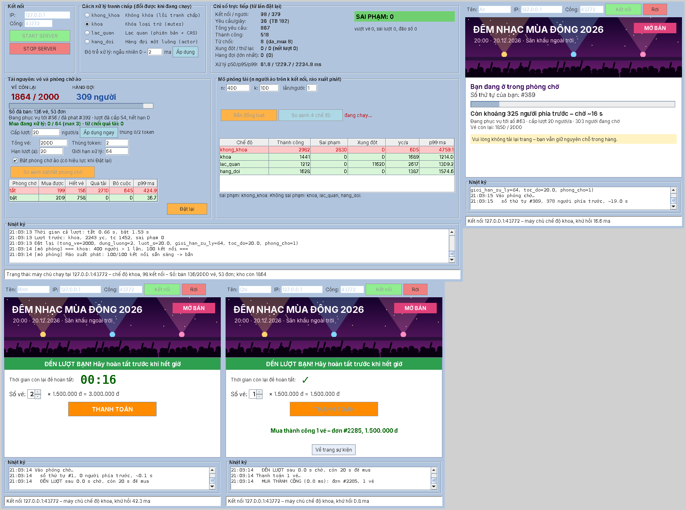
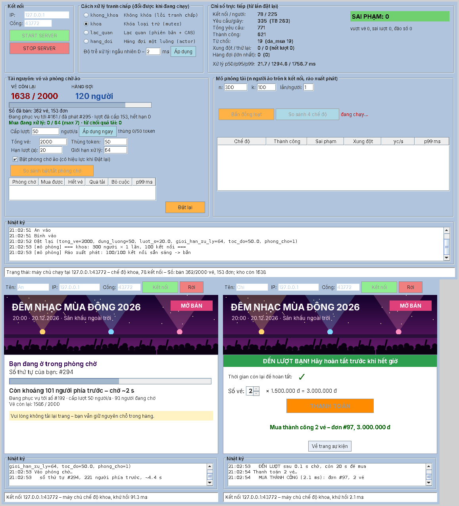
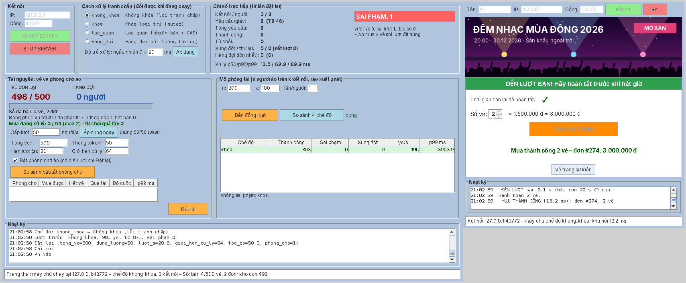
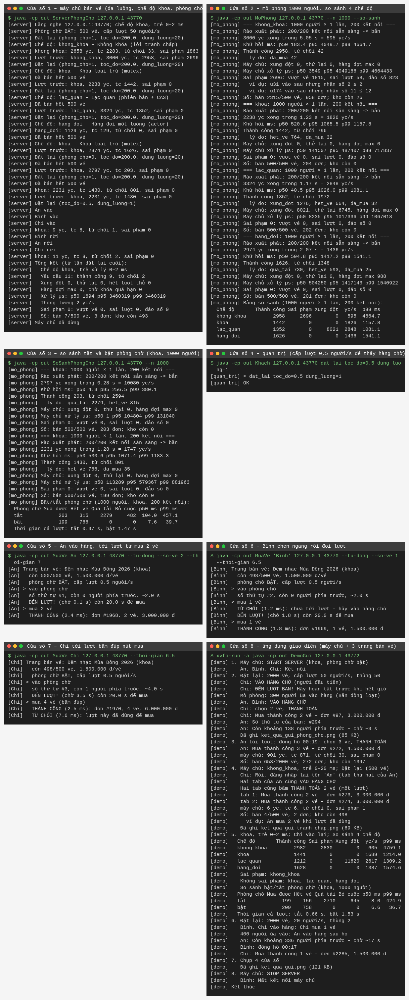

# Bài mở rộng MR6.13 – Phòng chờ ảo bán vé concert: hàng nghìn người tranh 500 vé (Java)

| Thông tin | Nội dung |
|---|---|
| Loại | **Bài mở rộng**, không có trong giáo trình và không có mã giả tương ứng. Thuộc nhóm "tranh chấp tài nguyên" MR6.6–MR6.14, dùng chung khung của [MR6.6](../BaiMR6.6_DauGia/) |
| Liên hệ với giáo trình | Chương 6: Bài 6.1 (server đa luồng, một luồng mỗi kết nối), Bài 6.7 (kiểm thử tải); Chương 3: Bài 3.2 (định khung thông điệp theo dòng); bài mở rộng MR5.4/MR5.5 (luồng, đồng bộ) |
| Thư viện | JDK 21, chỉ thư viện chuẩn: `java.net`, `java.util.concurrent` (`ReentrantLock`, `LinkedBlockingQueue`, `CyclicBarrier`, `AtomicLong`), `PriorityQueue` (hàng chờ theo số thứ tự), `ArrayDeque`; bản giao diện dùng thêm Swing (`CardLayout` cho ba trang, `JProgressBar`, `JSpinner`, `AlphaComposite`), `java.awt.Robot`, `javax.imageio`. `Json.java` tự viết |
| Bản ngôn ngữ khác | [C#](../../../csharp/Chuong06/BaiMR6.13_PhongCho/), [Python](../../../python/Chuong06/BaiMR6.13_PhongCho/), [Rust](../../../rust/Chuong06/BaiMR6.13_PhongCho/), [Go](../../../go/Chuong06/BaiMR6.13_PhongCho/) |

## Mục tiêu
Bài mô phỏng trang bán **500 vé** concert có **phòng chờ ảo** (virtual waiting room). Người dùng `xep_hang` (nhận số thứ tự, số người phía trước, thời gian chờ ước tính), rồi `cho_luot` – yêu cầu **chờ dài** (long polling): máy chủ chỉ trả lời khi tới lượt hoặc hết vé. Máy chủ cấp lượt theo **thùng token** (token bucket: rót `toc_do` token/giây, chứa tối đa `dung_luong`), mỗi lượt có hạn `luot_s` = 20 s để `mua` 1–4 vé. Tắt phòng chờ thì ai cũng gọi `mua` ngay; máy chủ chỉ cho `gioi_han_xu_ly` = 64 yêu cầu mua đang xử lý cùng lúc, quá số đó từ chối `qua_tai` (như HTTP 503). Ba ô của `KhoTranhChap` đi qua 4 cách xử lý tranh chấp: `hang` (phát số thứ tự), `kho` (vé còn), `luot:<tên>` (tiêu lượt **nguyên tử** cùng trừ kho). **Sổ kiểm toán** đếm **vượt vé**, **sai lượt** (một lượt dùng hai lần – hai tab) và **đảo số** (người vào sau nhận số không lớn hơn người vào trước – FIFO bị phá).

Bản Java chuyển ngữ đúng bản Python (giao thức, hành vi, dòng in). Khung chép nguyên từ MR6.6 bản Java; bài này viết nghiệp vụ, `SoSanhPhongCho` (so sánh bật/tắt phòng chờ), ứng dụng người dùng, bảng tài nguyên và kịch bản demo.

## Kiến thức chính
Số liệu lấy từ `ket_qua.txt`, một lần chạy thật trên máy cục bộ (127.0.0.1, OpenJDK 21, 2 lõi, độ trễ xử lý 0–2 ms). Mỗi lần chạy, số liệu lệch đi đôi chút.

```
  Chế độ       Thành công Sai phạm Xung đột  yc/s  p99 ms
  khong_khoa         2958     2696        0   595  4664.7
  khoa               1442        0        0  1826  1157.8
  lac_quan           1352        0     8021  2848  1081.1
  hang_doi           1626        0        0  1436  1541.1
```
(1000 người, 200 kết nối, phòng chờ bật, cấp lượt 200 người/s, thùng 20 token – `THAM_SO_DAT_LAI`. "Thành công" đếm mọi yêu cầu được chấp nhận: xếp hàng, tới lượt, mua; khứ hồi gồm cả thời gian đứng trong phòng chờ.)

```
  Phòng chờ Mua được Hết vé Quá tải Bỏ cuộc p50 ms p99 ms
  tắt            203    315    2279     482  104.0  457.1
  bật            199    766       0       0    7.6   39.7
  Thời gian cả lượt: tắt 0.97 s, bật 1.47 s
```
(`SoSanhPhongCho --n 1000`, chế độ `khoa`. Mua được, Hết vé, Bỏ cuộc: số NGƯỜI; Quá tải: số LẦN bị từ chối `qua_tai`; p50/p99: thời gian mua của từng người, từ lần bấm "mua" đầu tiên tới kết quả cuối, gồm cả các lần bấm lại.)

- **Ba kiểu tranh chấp cùng lúc ở `khong_khoa`.** Phát số thứ tự "đọc – cộng 1 – ghi" không đồng bộ làm hai người cùng nhận một số (`đảo số 823`, ví dụ `u174 vào sau nhưng nhận số 11 ≤ 12`); trừ kho đè nhau làm **bán 2315 vé cho 500 chỗ** (`vượt vé 1815`); hai tab cùng một người cùng đọc "lượt còn" (`sai lượt 58`). Ba chế độ còn lại: 0 sai phạm, đúng 500/500 vé.
- **Phòng chờ ảo = san phẳng tải.** Tắt phòng chờ: 1000 người dồn vào `mua`, **2279 lần bị từ chối quá tải**, 482 người bỏ cuộc sau 3 lần bấm lại dù vẫn còn vé, p99 thời gian mua 457 ms. Bật phòng chờ: phía "mua" chỉ nhận đều đặn theo thùng token, **0 lần quá tải, 0 người bỏ cuộc**, p99 thời gian mua chỉ **39,7 ms**; đổi lại cả lượt kéo dài hơn (1,47 s so với 0,97 s) vì mọi người phải xếp hàng. Người không mua được ở chế độ bật là vì **hết vé thật** (766 người), không phải vì hệ thống quá tải.
- **Công bằng FIFO.** Luồng nền (100 ms) lấy người có **số thứ tự nhỏ nhất** (`PriorityQueue`) ra trước; số thứ tự phát qua ô `hang` nên ở chế độ an toàn không bao giờ đảo. Lượt quá hạn 20 s bị thu hồi (`het_han`).
- **Tiêu lượt nguyên tử.** `mua` đọc **cùng lúc** ô `kho` và ô `luot:<tên>` và ghi cả hai trong một thao tác, nên hai tab bấm mua cùng lúc chỉ một đơn được nhận (tab kia "lượt này đã dùng để mua" – cửa sổ 7 bấm đúp). Ở `khong_khoa` cả hai đơn được nhận: sai phạm "sai lượt".
- **Chờ dài (long polling).** `cho_luot` không trả lời ngay: máy chủ giữ hàm trả lời trong danh sách của người đó và luồng nền gọi khi cấp lượt / hết vé / đặt lại – client không phải hỏi lại liên tục.
- **`hang_doi` gặp giới hạn xử lý.** Ở chế độ này các yêu cầu mua xếp hàng chờ một luồng, số đang xử lý vượt 64 nên 730 lần bị từ chối `qua_tai` – hàng đợi một luồng không thay được phòng chờ.

### Giao thức (giống hệt ở 5 ngôn ngữ)
Phần chung (chào, quản trị, `thong_ke`, `lap_lai`) xem [README MR6.6](../BaiMR6.6_DauGia/README.md#giao-thức-giống-hệt-ở-5-ngôn-ngữ).

| Chiều | Thông điệp |
|---|---|
| người dùng → server | `{"loai":"xep_hang","ma_yc":k}`, `{"loai":"cho_luot","ma_yc":k}` (chờ dài), `{"loai":"mua","ma_yc":k,"so_ve":2}` (kết nối gộp thêm `"nguoi":"u17"`) |
| server → client | `xep_hang`: `{"loai":"kq","ma_yc":k,"ok":true,"so":291,"truoc":134,"cho_s":2.7,"trang_thai":"cho"[,"da_co":true]}`; `cho_luot` (khi tới lượt): `{"ok":true,"luot":true,"so":291,"han_ms":20000}`; `mua`: `{"ok":true,"so_ve":3,"thanh_tien":4500000,"con":…,"ma_don":272}`; từ chối: `"ma_loi":"het_ve"\|"qua_tai"\|"khong_luot"\|"da_mua"\|"het_luot"\|"pc_tat"\|"chua_xep_hang"\|"dat_lai"\|"xung_dot"\|"sai_du_lieu"` |
| server → tất cả | `{"loai":"cap_nhat","che_do":…,"su_kien":{"ten","gia_ve","tong_ve","ve_toi_da","luot_s"},"phong_cho","con_lai","da_ban","toc_do","dung_luong","token","dang_phuc_vu","so_cap","dang_cho","da_cap_luot","het_han","het_ve","dang_xu_ly","xu_ly_max","gioi_han","qua_tai","so_don","ban_so","lich_su":[…]}` (≤ 10 lần/s); `{"loai":"su_kien","noi_dung":"Đã bán hết 500 vé"}` |
| quản trị → server | `{"loai":"dat_lai","ma_yc":k,"phong_cho":0\|1,"tong_ve":500,"toc_do":50,"dung_luong":50,"luot_s":20,"gioi_han_xu_ly":64,"ve_toi_da":4,"gia_ve":…,"ten_su_kien":…}` |

Sai phạm trong `thong_ke`: `vượt vé`, `sai lượt`, `đảo số`; `tom_tat`: `Sổ: bán 500/500 vé, 199 đơn; kho còn 0`.

**Chạy chéo với bản Python (đã thử trên cùng máy):** (a) máy chủ Java + `mo_phong.py --n 1000 --so-sanh` + `so_sanh_phong_cho.py` + `mua_ve.py`: khong_khoa 2457 thành công / 2077 sai phạm, ba chế độ còn lại 0; bật/tắt phòng chờ: tắt 2735 lần quá tải, 612 bỏ cuộc, p99 529,7 ms – bật 0 quá tải, p99 27,5 ms; `mua_ve.py` (cấp lượt 0,5 người/s) tới lượt, bấm đúp: một đơn THÀNH CÔNG, một "TỪ CHỐI: lượt này đã dùng để mua". (b) máy chủ Python + `MoPhong`, `SoSanhPhongCho`, `MuaVe` Java: khong_khoa 2978/2869, ba chế độ còn lại 0; tắt 2716 quá tải / bật 0, p99 574,7 ms → 48,7 ms; dòng in của `MuaVe` giống hệt `mua_ve.py`.

## Cấu trúc tệp
- `Chung.java`, `KetNoiKhach.java`, `Khach.java`, `GiaoDienChung.java`, `Json.java`, phần KHUNG của `MoPhong.java`: **khung chung**, chép nguyên từ MR6.6 bản Java (chỉ đổi dòng đầu chú thích).
- `MayChu.java`: nghiệp vụ `MayChuPhongCho` (ô `hang`, `kho`, `luot:<tên>`; phòng chờ, thùng token, thu hồi lượt quá hạn và trả lời chờ dài trong `dinhKy`; giới hạn xử lý `qua_tai`; `datTocDo` đổi tốc độ khi đang chạy) và `SoKiemToanPhongCho`; `ServerPhongCho.java` là bản dòng lệnh (lệnh thêm `toc_do <người/s>`).
- `MoPhong.java`: phần NGHIỆP VỤ gồm `DoMua` (kết quả cuối, thời gian mua của từng người), `NguoiAo` (xếp hàng → chờ lượt → mua; phòng chờ tắt thì mua ngay, quá tải bấm lại tối đa 3 lần; 1/10 người là tab thứ hai của người liền trước), `bangPhongCho`, `soSanhPhongCho`; `thamSoDatLai()` = `{"phong_cho": 1, "toc_do": 200, "dung_luong": 20}`.
- `SoSanhPhongCho.java`: so sánh tắt / bật phòng chờ (dòng lệnh).
- `MuaVe.java`: người mua bản dòng lệnh (`xep_hang`, `mua <n>`, `mua2 <n>`, `--tu-dong`).
- `ServerGui.java`: bảng điều khiển máy chủ (thêm nút "So sánh bật/tắt phòng chờ" chạy nền và bảng hai dòng); `PhongChoGui.java`: trang bán vé ba trang; `DemoGui.java`: kịch bản tự bấm.
- `demo.json`, `ket_qua.txt`, `ket_qua.png`, `ket_qua_gui.png`, `ket_qua_gui_phong_cho.png`, `ket_qua_gui_tranh_chap.png`: kịch bản và kết quả thực thi thật.

## Cách chạy
Trong thư mục bài (cần JDK 21):
```bash
javac -encoding UTF-8 -d out *.java
java -cp out ServerPhongCho 127.0.0.1 9000                          # cửa sổ 1 (gõ lệnh ở đây)
java -cp out MoPhong 127.0.0.1 9000 --n 1000 --so-sanh              # cửa sổ 2: bảng so sánh 4 chế độ
java -cp out SoSanhPhongCho 127.0.0.1 9000 --n 1000                 # tắt / bật phòng chờ
java -cp out Khach 127.0.0.1 9000 dat_lai toc_do=0.5 dung_luong=1   # cấp lượt chậm để thấy hàng chờ
java -cp out MuaVe An 127.0.0.1 9000 --tu-dong --so-ve 2            # cửa sổ 3, 4…
```
- Lệnh của máy chủ: `che_do khong_khoa|khoa|lac_quan|hang_doi`, `tre <ms>`, `toc_do <người/s>`, `dat_lai [tong_ve=… phong_cho=0|1 toc_do=… dung_luong=… luot_s=… gioi_han_xu_ly=… ve_toi_da=… gia_ve=… ten_su_kien=…]`, `thong_ke`, `thoat`. Tùy chọn: `--che-do`, `--tre-ms`, `--tong-ve`, `--toc-do`, `--dung-luong`, `--luot-s`, `--gioi-han`, `--tat-phong-cho`.
- Lệnh của `MuaVe`: `xep_hang`, `mua <n>`, `mua2 <n>` (bấm đúp), `thoat`; `--tu-dong` vào hàng ngay và tới lượt thì tự mua `--so-ve` vé. Dòng `@t lệnh` chờ tới giây thứ t.

Tái lập kết quả từ thư mục gốc của kho: `python3 tools/demo.py java/Chuong06/BaiMR6.13_PhongCho`.

## Ứng dụng giao diện


Ảnh trên là lần chạy thật của `DemoGui` (Linux, Xvfb, OpenJDK 21, Metal): máy chủ (trên trái), An (trên phải), Bình và Chi (dưới). Kịch bản đã chạy so sánh 4 chế độ (bảng giữa: `khong_khoa` 2830 sai phạm tô đỏ) và so sánh bật/tắt phòng chờ (bảng nhỏ bên trái: tắt 2710 lần quá tải tô đỏ, bật 0), rồi đặt lại 2000 vé, cấp lượt 20 người/s, thùng 2: Bình và Chi vào hàng trước nên tới lượt ngay (Bình còn 00:16 để mua, Chi đã "Mua thành công 1 vé"); 400 người ảo ùa vào và An xếp sau họ: thanh tiến trình, "Còn khoảng 325 người phía trước – chờ ~16 s", số đang phục vụ tăng dần.



Bước 2 (cấp lượt 50 người/s): Chi vào hàng đầu tiên, tới lượt ngay (đồng hồ 20 s) và mua 2 vé; 300 người ảo ùa vào, An vào sau họ: "Số thứ tự của bạn: #294 – Còn khoảng 138 người phía trước – chờ ~3 s". Khoảng 3 s sau An tới lượt và mua 3 vé.



Bước 4: máy chủ `khong_khoa`, độ trễ 0–20 ms. Cửa sổ Chi đăng nhập lại bằng tên "An" (tab thứ hai của An); hai tab cùng vào hàng, cùng được **một** lượt, cùng bấm THANH TOÁN 2 vé: cả hai "Mua thành công" (đơn #273, #274); ô **SAI PHẠM** đỏ ("An mua 2 vé khi lượt đã dùng"). Ở chế độ an toàn tab thứ hai nhận "Lượt này đã được dùng để mua".

- **Máy chủ** (`ServerGui`): phần chung giống MR6.6; **tài nguyên**: VÉ CÒN LẠI và HÀNG ĐỢI cỡ lớn, thanh vé, sổ đã bán (đỏ khi vượt), "Đang phục vụ tới #… / đã phát #…", lượt đã cấp / hết hạn, "Mua đang xử lý x / 64 (max …) · từ chối quá tải", ô **Cấp lượt … người/s** + **Áp dụng ngay**, mức token trong thùng, ô **Tổng vé**, **Thùng token**, **Hạn lượt (s)**, **Giới hạn xử lý**, ô chọn **Bật phòng chờ ảo**, nút **So sánh bật/tắt phòng chờ** + bảng hai dòng, nút **Đặt lại**.
- **Trang bán vé** (`PhongChoGui`): áp phích concert vẽ bằng `Graphics2D` (đèn sân khấu trong suốt, đám đông), ba trang: **Sự kiện** (giá vé, thanh vé còn lại, mô tả phòng chờ, nút "VÀO HÀNG CHỜ MUA VÉ" / "MUA VÉ NGAY"); **Phòng chờ** (số thứ tự, thanh tiến trình vị trí, số người phía trước và thời gian chờ ước tính, số đang phục vụ, tốc độ cấp lượt); **Chọn vé** ("ĐẾN LƯỢT BẠN!", đồng hồ đếm ngược 20 s đỏ khi < 5 s, chọn số vé, thành tiền, nút THANH TOÁN, kết quả, "Về trang sự kiện").

### Cách chạy
```bash
javac -encoding UTF-8 -d out *.java
java -cp out ServerGui 127.0.0.1 43772          # bấm START SERVER (500 vé, phòng chờ bật, 50 người/s)
java -cp out PhongChoGui An 127.0.0.1 43772
java -cp out PhongChoGui Bình 127.0.0.1 43772
```
- **Windows:** chỉ cần JDK 21 (`winget install -e --id Microsoft.OpenJDK.21`). **Linux:** `sudo apt install openjdk-21-jdk`. Kịch bản tự động (Linux, cần `xvfb`): `xvfb-run -a -s "-screen 0 2600x1700x24" java -cp out DemoGui 127.0.0.1 43772`.
- Chạy riêng từng cửa sổ: mọi dòng nhật ký và cứ 5 giây một dòng số liệu cũng in ra dòng lệnh.
- Thử trên nhiều máy: máy chủ nghe IP card mạng (hoặc `0.0.0.0`), mở tường lửa cho cổng; đặt cấp lượt 1–2 người/s để cả lớp thấy hàng chờ. Khi đó **chỉ dùng `khoa`, `lac_quan`, `hang_doi`**.

## Kết quả thực thi


## Ghi chú
- `GiaoDienChung` (khung, chép nguyên) không mở hàm chạy nền của mô phỏng cho lớp con, nên `ServerGui` tự chạy `soSanhPhongCho` trên luồng nền (khóa các nút mô phỏng, "đang chạy…" / "xong") và mở lại nút "So sánh bật/tắt phòng chờ" ở nhịp vẽ 250 ms.
- Thời gian mua đo bằng `System.nanoTime` (như `time.perf_counter` của Python).
- Trong kịch bản giao diện, máy chủ, bộ mô phỏng và cửa sổ chạy trong một JVM nên yc/s thấp hơn bản dòng lệnh; kịch bản bấm nút bằng `doClick(0)`, mỗi nút gửi yêu cầu trước rồi mới vẽ lại.
- Kiểm thử: Linux, OpenJDK 21.0.12 (dòng lệnh và giao diện dưới Xvfb), chạy chéo với Python 3.13.

## Bài tập gợi ý
1. Chạy `SoSanhPhongCho` với `gioi_han_xu_ly` 16, 64, 256 (`Khach … dat_lai gioi_han_xu_ly=…`). Khi nào phòng chờ tắt không còn quá tải? Đổi lại máy chủ phải chịu gì?
2. Đổi tốc độ cấp lượt khi đang chạy (`toc_do 5` rồi `toc_do 500`). Thời gian chờ ước tính của người đang đứng trong hàng thay đổi ra sao?
3. Thêm "ưu tiên" (thẻ thành viên được xếp lên trước 50 bậc). Sổ kiểm toán cần đổi luật "đảo số" thế nào?
4. Bỏ ô `luot:<tên>` khỏi `mua` (chỉ kiểm tra trạng thái trong phòng chờ, ngoài vùng găng). Ở `khoa`, hai tab bấm mua cùng lúc sẽ ra sao?
5. Giao diện: hiển thị vị trí trong hàng bằng hình người xếp hàng (mỗi chấm 10 người).

## Đọc thêm
- H. T. Kung, J. T. Robinson (1981). *On Optimistic Methods for Concurrency Control*. ACM Transactions on Database Systems 6(2).
- E. G. Coffman, M. J. Elphick, A. Shoshani (1971). *System Deadlocks*. ACM Computing Surveys 3(2).
- Tài liệu JDK 21: [`java.util.concurrent`](https://docs.oracle.com/en/java/javase/21/docs/api/java.base/java/util/concurrent/package-summary.html), [`ReentrantLock`](https://docs.oracle.com/en/java/javase/21/docs/api/java.base/java/util/concurrent/locks/ReentrantLock.html), [`AtomicReference`](https://docs.oracle.com/en/java/javase/21/docs/api/java.base/java/util/concurrent/atomic/AtomicReference.html), [`BlockingQueue`](https://docs.oracle.com/en/java/javase/21/docs/api/java.base/java/util/concurrent/BlockingQueue.html), [`PriorityQueue`](https://docs.oracle.com/en/java/javase/21/docs/api/java.base/java/util/PriorityQueue.html), [`java.awt.CardLayout`](https://docs.oracle.com/en/java/javase/21/docs/api/java.desktop/java/awt/CardLayout.html).

Mã nguồn của bài được viết mới cho kho này.
