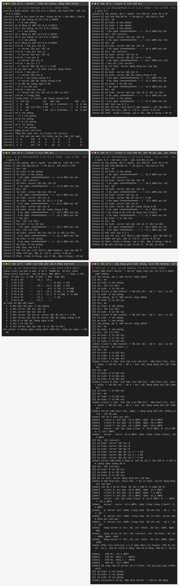
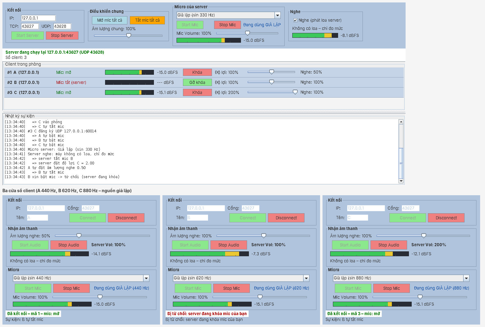

# Bài mở rộng MR6.2 – Phòng hội thoại âm thanh nhiều client (Java)

| Thông tin | Nội dung |
|---|---|
| Loại | **Bài mở rộng** – không có trong giáo trình, không có mã giả tương ứng |
| Liên hệ với giáo trình | Chương 6: Bài 6.1 (server đa luồng), Bài 6.4 (server chat nhiều client); Chương 4: Bài 4.1 (UDP); Chương 3: Bài 3.2 (định khung thông điệp) |
| Thư viện | JDK 21: `java.net.Socket`, `java.net.DatagramSocket`, `java.nio.ByteBuffer`, `javax.sound.sampled` (`AudioSystem.write`/`getAudioInputStream` cho WAV; `TargetDataLine`, `SourceDataLine` cho micro/loa thật – tùy chọn), `ScheduledExecutorService`; Swing (`javax.swing`), `java.awt.Robot` cho bản giao diện; `Json.java` tự viết – chỉ JDK, không thư viện ngoài |
| Bản ngôn ngữ khác | [C#](../../../csharp/Chuong06/BaiMR6.2_HoiThoaiAmThanh/), [Python](../../../python/Chuong06/BaiMR6.2_HoiThoaiAmThanh/), [Rust](../../../rust/Chuong06/BaiMR6.2_HoiThoaiAmThanh/), [Go](../../../go/Chuong06/BaiMR6.2_HoiThoaiAmThanh/) |

## Mục tiêu
Xây dựng một "phòng họp thoại" thu nhỏ: n client nối tới một server; mỗi client gửi âm thanh micro dạng PCM qua UDP, server **trộn tiếng** và gửi cho mỗi người tiếng của *những người khác* ("mix-minus"). Kênh điều khiển TCP cho phép server tắt/bật mic của tất cả hoặc từng người, đặt độ lợi đầu vào từng người, âm lượng chung; mỗi client tự tắt mic và tự chỉnh âm lượng nghe. Client ghi lại những gì nghe được thành tệp WAV; chương trình phân tích tần số (thuật toán Goertzel) **chứng minh bằng số liệu** rằng mỗi lệnh điều khiển đã có hiệu lực.

## Kiến thức chính
- **Âm thanh số.** Lấy mẫu 16 000 lần/giây, mỗi mẫu 16 bit có dấu, một kênh (mono) → 16 000 × 16 = 256 kbit/s. Khung 20 ms = 320 mẫu = 640 byte → 50 gói/giây. Phụ phí header mỗi gói 12 (RTP) + 8 (UDP) + 20 (IPv4) = 40 byte → 16 kbit/s; tổng ≈ 272 kbit/s mỗi chiều cho mỗi client (đúng với số `272 kbit/s gồm header` client in ra khi mic mở suốt).
- **Hai kênh, hai giao thức.** Điều khiển cần tin cậy, đúng thứ tự → TCP, mỗi dòng một JSON (định khung theo dòng như Bài 3.2). Âm thanh cần đến đúng lúc → UDP: mất một gói chỉ mất 20 ms, còn truyền lại kiểu TCP sẽ đến quá muộn để phát.
- **Gói RTP (RFC 3550).** Header 12 byte: `V=2`, payload type (96 = âm thanh L16, 127 = gói giữ kết nối rỗng), **số thứ tự** 16 bit (phát hiện mất, đảo thứ tự), **nhãn thời gian** 32 bit tính bằng mẫu (tăng 320 mỗi khung, *kể cả khi tắt mic*), **SSRC** = mã client. Mẫu L16 theo thứ tự byte mạng (big-endian, RFC 3551), trong khi WAV lưu little-endian.
- **Bộ đệm jitter.** Gói đến không đều (jitter). Bên nhận giữ vài khung rồi mới phát mỗi 20 ms một khung theo số thứ tự: thiếu khung → phát khoảng lặng (che lỗi), rỗng → *cạn bộ đệm*, chờ nạp lại; đến sau lượt phát → *trễ*, bỏ. Đệm sâu hơn chịu jitter tốt hơn nhưng tăng độ trễ (3 khung = 60 ms). Jitter được ước lượng theo RFC 3550 mục 6.4.1: `J += (|D| − J)/16`.
- **Trộn tiếng, mix-minus, cắt ngọn.** Mỗi nhịp 20 ms: tổng `T = Σ gᵢ·xᵢ` của các client đang mở mic (gᵢ là độ lợi đầu vào); người nghe k nhận `(T − gₖ·xₖ) × âm_lượng_chung` – không nghe tiếng vọng của mình. Tổng có thể vượt phạm vi 16 bit → **cắt ngọn** (clipping) về −32768…32767, gây méo (sinh hài). Server đếm số mẫu bị cắt ngọn cho từng người nghe.
- **dBFS.** Mức RMS so với toàn thang: sin biên độ 0,25 → −15,1 dBFS; nhân 2 → +6,0 dB; nhân 0,5 → −6,0 dB; hai âm cùng mức cộng lại → +3 dB.
- **Goertzel.** Tính một điểm của DFT bằng bộ lọc bậc hai `s[n] = x[n] + 2cos(ω)s[n−1] − s[n−2]`, rẻ hơn FFT khi chỉ cần vài tần số (cách điện thoại giải mã phím DTMF). Mỗi client phát một tần số riêng (A 440 Hz, B 620 Hz, C 880 Hz), nên đo mức ở từng tần số là biết ai đang nói, to bao nhiêu.
- **Không tin client.** Server tự bỏ gói từ client đang bị tắt mic (kể cả client cố tình gửi), chỉ nhận UDP từ địa chỉ đã đăng ký và cùng IP với kết nối TCP; client `connect()` socket UDP để chỉ nhận gói từ server.

### Quy tắc quyền điều khiển

| # | Quy tắc |
|---|---|
| 1 | Mic của X mở **khi và chỉ khi** X không tự tắt **và** server không khóa mic của X |
| 2 | Server tắt (khóa) thắng client: đang bị khóa, client xin bật bị **từ chối** |
| 3 | Server bật = gỡ khóa, **không bật hộ** mic mà người dùng đã tự tắt (quyền riêng tư: server làm người dùng im lặng được, nhưng không tự ý mở micro của họ) |
| 4 | Độ lợi đầu vào từng người và âm lượng chung do server đặt, áp dụng khi trộn |
| 5 | Âm lượng nghe do từng client tự đặt, áp dụng tại client; server không có lệnh đổi giá trị này |
| 6 | Tự tắt mic có hiệu lực ngay tại client; tự bật phải chờ server xác nhận |

Âm lượng người A thực sự nghe thấy tiếng B: `độ_lợi_B × âm_lượng_chung × âm_lượng_nghe_A`.

## Cấu trúc tệp
- `AmThanh.java` – hằng số âm thanh, đóng/tách gói RTP, PCM ↔ byte, dBFS, thanh đo mức, `BoDemJitter`, Goertzel, đọc/ghi WAV bằng `javax.sound.sampled`, đọc lệnh `@t` từ stdin.
- `ServerAmThanh.java` – server: kênh TCP (mỗi client một luồng ảo), luồng nhận UDP, nhịp trộn 20 ms (`scheduleAtFixedRate`), bảng điều khiển đọc stdin.
- `KhachAmThanh.java` – client: nguồn âm (sin / WAV / micro thật), vòng 20 ms thu–gửi–nhận–phát, ghi WAV và tệp mốc sự kiện `*_moc.json`.
- `PhanTichWav.java` – chia bản ghi theo mốc sự kiện, đo mức từng âm bằng Goertzel, kiểm tra mix-minus.
- `Json.java` – bộ mã hóa, giải mã JSON tối giản (chép từ Bài 5.3 bản Java).
- Bản giao diện (Swing):
  - `ServerAmThanhGui.java` – cửa sổ "Bảng điều khiển âm thanh" của server (vai trò `server_gui`); dùng thẳng lớp `ServerAmThanh`.
  - `KhachAmThanhGui.java` – cửa sổ client (vai trò `client_gui`); `PhienAmThanh.java` – phần mạng/thu/phát của client giao diện (không chạm điều khiển Swing).
  - `ThietBiAmThanh.java` – liệt kê và mở micro/loa thật (`TargetDataLine`, `SourceDataLine`), nguồn giả lập sin; `ThanhMuc.java` – thanh đo mức dBFS.
  - `DemoGui.java` – kịch bản tự thao tác (vai trò `demo_gui`): server + 3 client trong một tiến trình, chụp cửa sổ thành `ket_qua_gui.png`.
- `demo.json`, `ket_qua.txt`, `ket_qua.png` – kịch bản minh họa và kết quả thực thi thật (gồm cả phần `demo_gui`); `ket_qua_gui.png` – ảnh các cửa sổ giao diện.

`ServerAmThanh` được tổ chức thành lớp có đối tượng (mỗi đối tượng là một phòng) để bản giao diện bấm Start/Stop Server nhiều lần và gọi chung các hàm `tatBatMic`, `datDoLoi`, `datAmLuongChung` với bảng điều khiển stdin; đầu ra của bản dòng lệnh không đổi.

## Cách chạy
Trong thư mục bài:
```bash
javac -encoding UTF-8 -d out *.java
java -cp out ServerAmThanh 127.0.0.1 9000 9001                                   # cửa sổ 1 (gõ lệnh điều khiển ở đây)
java -cp out KhachAmThanh B 127.0.0.1 9000 --tan-so 620                           # cửa sổ 2
java -cp out KhachAmThanh C 127.0.0.1 9000 --tan-so 880                           # cửa sổ 3
java -cp out KhachAmThanh A 127.0.0.1 9000 --tan-so 440 --ghi out/ghi_A.wav --thoi-gian 20
java -cp out PhanTichWav out/ghi_A.wav 440:A 620:B 880:C                          # sau khi A kết thúc
```
Lệnh server: `tat_mic tat_ca`, `tat_mic B`, `bat_mic tat_ca`, `do_loi C 2`, `am_luong_chung 0.5`, `trang_thai`, `thoat`. Lệnh client: `tat_mic`, `bat_mic`, `am_luong 0.5`, `thoat`. Dòng `@t lệnh` chờ tới giây thứ t rồi mới chạy lệnh (dùng cho kịch bản tự động).

Tùy chọn client: `--wav tệp.wav` (nguồn là tệp WAV 16 bit mono 16 kHz, phát lặp), `--mat-goi 0.05` (giả lập mất 5 % gói gửi), `--dem 3` (độ sâu bộ đệm jitter), `--thoi-gian`, `--bien-do`.

**Micro và loa thật (tùy chọn):** thêm `--mic` và/hoặc `--loa`; bản Java dùng `javax.sound.sampled` có sẵn trong JDK (không cần thư viện ngoài). Máy không có thiết bị âm thanh hoặc thiết bị không hỗ trợ 16 kHz/16 bit/mono thì client báo và dùng nguồn tổng hợp. Nên đeo tai nghe: phòng không có khử vọng, loa sẽ lọt lại vào micro. Phần này chỉ được thử nhánh dự phòng (môi trường kiểm thử không có thiết bị âm thanh).

Giao thức giống hệt bản Python, Go: client Java nối được vào server Python (đã thử), tệp WAV do bản Java ghi được `phan_tich_wav.py` của bản Python đọc và cho cùng bảng kết quả.

Tái lập kết quả từ thư mục gốc của kho: `python3 tools/demo.py java/Chuong06/BaiMR6.2_HoiThoaiAmThanh`.

## Kết quả thực thi


Kịch bản: B (620 Hz), C (880 Hz), A (440 Hz, giả lập mất 5 % gói gửi) vào phòng; A ghi những gì nghe được. Server lần lượt: tắt mic tất cả (2,5 s) → bật lại (3,5 s) → tắt mic B và đặt độ lợi C = 2 (4,5 s) → B xin bật mic, **bị từ chối** → bật mic B và đặt âm lượng chung 0,5 (5,5 s); A tự đặt âm lượng nghe 0,5 (≈ 6,5 s); C tự tắt mic (≈ 7,5 s); server "bật mic tất cả" (8,0 s) nhưng C **vẫn tắt** (quy tắc 3). Kết quả phân tích bản ghi của A khớp đúng giá trị lý thuyết:

| Đoạn | Trạng thái | B 620 Hz | C 880 Hz | Lý thuyết |
|---|---|---|---|---|
| 1, 3 | mọi mic mở | −15,1 | −15,1 | sin 0,25 → −15,1 dBFS |
| 2 | server tắt tất cả | vắng | vắng | |
| 4 | B bị khóa, độ lợi C = 2 | vắng | −9,0 | +6,0 dB |
| 5 | âm lượng chung 0,5 | −21,1 | −15,1 | −6,0 dB (C: 2 × 0,5 = 1) |
| 6 | A tự đặt âm lượng nghe 0,5 | −27,1 | −21,1 | thêm −6,0 dB |
| 7, 8 | C tự tắt; server bật tất cả | −27,1 | vắng | C vẫn tắt |

Âm 440 Hz của chính A vắng ở mọi đoạn – mix-minus đúng. Server đếm được số gói mất trong luồng của A đúng bằng số gói A giả lập làm rơi, các khung thiếu được thay bằng khoảng lặng. Jitter trên máy cục bộ chỉ khoảng 0,1–0,5 ms; các client không cạn bộ đệm (3 khung) lần nào trong lần chạy này. Nếu một nhịp bị hệ điều hành lập lịch trễ làm bộ đệm cạn, đoạn chứa lần cạn đó có thêm vài chục ms im lặng và đo thấp hơn vài phần mười dB (một lần chạy thử đo được −21,5 thay vì −21,1 dBFS). Mức nghe in mỗi giây là trung bình của cả giây nên thay đổi dần qua các mốc; bảng phân tích bỏ 0,15 s đầu mỗi đoạn để loại độ trễ (≈ 80 ms: bộ đệm jitter + một nhịp trộn).

## Ứng dụng giao diện


**Server – "Bảng điều khiển âm thanh"**: nhóm *Kết nối* (IP, cổng TCP/UDP, Start/Stop Server); *Điều khiển chung* (Mở mic tất cả = gỡ khóa, Tắt mic tất cả = khóa, Âm lượng chung 0–200 %); *Micro của server* (chọn thiết bị thật hoặc "Giả lập (sin 330 Hz)", Start/Stop Mic, Mic Volume, thanh đo); *Nghe* (phát ra loa máy server tổng tiếng các client, không gồm tiếng server). Mỗi client một hàng: mã/tên, trạng thái mic (mở / tắt (tự tắt) / tắt (server)), thanh đo mức vào (dBFS, 10 lần/s), nút Khóa/Gỡ khóa, thanh trượt độ lợi 0–200 %, âm lượng nghe client báo lên. Dưới cùng là nhật ký sự kiện.

**Client**: *Kết nối* (IP, cổng, tên, Connect/Disconnect); *Nhận âm thanh* (âm lượng nghe 0–200 %, Start/Stop Audio = phát/không phát ra loa, nhãn **Server Vol: xx %**, thanh đo mức tiếng nhận); *Micro* (thiết bị thật hoặc "Giả lập (sin 440 Hz)", Start/Stop Mic, Mic Volume, thanh đo); dòng trạng thái (Đã kết nối – mic: mở / tự tắt / bị khóa (server), Bị từ chối…).

**Giao thức chỉ thêm một tin** (mọi ngôn ngữ giống nhau, tương thích ngược): server → client `{"loai":"do_loi","gia_tri":g}` một lần sau `chao` và mỗi khi server đổi độ lợi của client đó; client cũ (kể cả `KhachAmThanh`) bỏ qua loại tin không biết. Tiếng micro server là một nguồn trong bộ trộn với `SSRC_SERVER` = 0: mọi client nghe, không đi qua mạng tới chính server.

### Cách chạy
```bash
javac -encoding UTF-8 -d out *.java
java -cp out ServerAmThanhGui 127.0.0.1 9000 9001            # cửa sổ server
java -cp out KhachAmThanhGui 127.0.0.1 9000 A                 # mỗi client một cửa sổ (đổi tên B, C…)
java -cp out KhachAmThanhGui 127.0.0.1 9000 B --tan-so 620    # --tan-so: tần số của nguồn giả lập
java -cp out DemoGui 127.0.0.1 43627 43628                    # kịch bản tự thao tác, ghi ket_qua_gui.png
```
- **Windows**: chạy các lệnh trên trong PowerShell/cmd (chỉ cần JDK 21, ví dụ `winget install -e --id Microsoft.OpenJDK.21`). Muốn client ở máy khác: server nhập IP của card mạng (không phải 127.0.0.1) và mở cổng TCP/UDP trong Windows Firewall.
- **Linux không có màn hình** (máy chủ, container): `xvfb-run -a -s "-screen 0 1920x1200x24" java -cp out DemoGui`.
- **Thiết bị thật hay giả lập**: ô chọn liệt kê các bộ trộn của `javax.sound.sampled` có đường thu 16 kHz/16 bit/mono, cuối danh sách là "Giả lập (sin … Hz)". Thiết bị chỉ được mở khi bấm Start Mic (micro) hoặc Start Audio/Nghe (loa) – không tự bật lúc khởi động; vừa kết nối, client gửi ngay `tu_tat_mic`. Nhãn cạnh nút cho biết "Đang dùng micro THẬT" hay "GIẢ LẬP"; micro không mở được thì tự chuyển sang giả lập và báo lý do; máy không có loa vẫn chạy ("Không có loa – chỉ đo mức"). Nên đeo tai nghe khi dùng micro và loa thật (bài không có khử vọng).

### Luồng và quy tắc chạm điều khiển
```
 Luồng giao diện (EDT) ──bấm nút──> luồng lệnh nền (lenhNen / viecNen) ──> ServerAmThanh / PhienAmThanh
        ^   Timer Swing 100 ms đọc mức dBFS, trạng thái (trường volatile, chụp nhanh dưới khóa)
        |   invokeLater(nhật ký, kết quả kết nối)
 Luồng mạng: nhận kết nối TCP, đọc TCP mỗi client, nhận UDP ──> bộ đệm jitter
 Nhịp 20 ms (ScheduledExecutorService): trộn mix-minus + micro server -> gửi UDP; client: thu -> gửi, nhận -> phát loa
 Luồng thu micro (TargetDataLine.read chặn) ──hàng đợi 8 khung──> nhịp 20 ms;  loa: chỉ ghi khi còn chỗ (không chặn)
```
Chỉ luồng giao diện (EDT) được đọc/ghi điều khiển Swing. Luồng nền báo về bằng `SwingUtilities.invokeLater`; số liệu thay đổi liên tục được `javax.swing.Timer` (chạy trên EDT) đọc 10 lần/giây. Thao tác có thể chờ (kết nối, mở thiết bị, gửi tin TCP khi giữ khóa server) không chạy trên EDT, nên cửa sổ không bao giờ "đơ". Thanh trượt độ lợi/âm lượng chỉ gửi lệnh khi thả chuột (`getValueIsAdjusting()`), tránh gửi dồn dập.

## Ghi chú
- Java không có kiểu số không dấu: số thứ tự 16 bit, nhãn thời gian và SSRC 32 bit được đọc rồi `& 0xFFFF`, `& 0xFFFFFFFFL`; mẫu PCM là `short`. `ByteBuffer` mặc định big-endian (thứ tự byte mạng của RTP); khi ghi WAV, mẫu được chuyển sang little-endian rồi giao cho `AudioSystem.write` tạo header RIFF.
- Nhịp trộn của server dùng `ScheduledExecutorService.scheduleAtFixedRate` (lịch cố định, không trôi), vòng 20 ms của client tự tính hạn kế tiếp và `LockSupport.parkNanos`. Mọi trạng thái dùng chung được bảo vệ bằng một khóa (`synchronized`).
- Mốc `@t` tính từ lúc lớp `AmThanh` được nạp (≈ 0,3 s sau khi tiến trình JVM khởi động); thời gian chờ giữa các tiến trình trong `demo.json` giữ như bản Python nên bảng phân tích trùng với bản Python.
- Thời gian và số gói có thể chênh vài đơn vị giữa các lần chạy (lịch luồng của hệ điều hành); mức dBFS trong bảng phân tích ổn định tới 0,1 dB.
- Luồng trộn chạy theo đồng hồ của server, luồng gửi theo đồng hồ của từng client; trên máy thật hai đồng hồ trôi lệch nhau (clock drift) nên bộ đệm sẽ dần đầy hoặc cạn – hệ thống thực tế co giãn nhẹ âm thanh để bù.
- Hệ thống thực tế nén âm thanh (Opus, RFC 6716 – khoảng 16–32 kbit/s cho thoại), mã hóa và xác thực gói (SRTP, RFC 3711), khử vọng, tự động cân bằng mức; bài giữ PCM không nén để dễ quan sát. Không có SRTP, bất kỳ ai trên đường truyền đều nghe được và có thể giả gói với SSRC của người khác – kiểm tra địa chỉ nguồn chỉ là lớp phòng vệ tối thiểu.
- Kiểm thử: Linux, OpenJDK 21.0.12 (không có thiết bị âm thanh; `--mic`, `--loa` chỉ được thử nhánh dự phòng).
- Kết quả bản giao diện (`demo_gui` trong `ket_qua.txt`, ảnh `ket_qua_gui.png`) chạy thật dưới `xvfb-run` trên Linux, **nguồn giả lập** (container không có card âm thanh: danh sách micro trống, loa báo "Không có loa – chỉ đo mức"). Server khóa B, đặt độ lợi C = 200 %, A đặt âm lượng nghe 50 %: phân tích Goertzel 1 s A nghe được cho 330 Hz (micro server) −21,1 dBFS, 880 Hz (C) −15,1 dBFS, 440 Hz (chính A) và 620 Hz (B bị khóa) vắng – đúng lý thuyết; C hiện "Server Vol: 200%"; B xin bật mic khi đang bị khóa nhận "Bị từ chối". Micro/loa thật cần chạy trên máy có thiết bị (Windows của tác giả).

## Bài tập gợi ý
1. Đổi `--dem` của client thành 1 và chạy kèm `--mat-goi 0.1`; đếm số lần cạn bộ đệm và nghe thử bản ghi. Giải thích sự đánh đổi giữa độ trễ và độ ổn định.
2. Đặt `do_loi C 5`: quan sát số mẫu cắt ngọn trong `trang_thai`/tổng kết và đo hài bậc 3 (2640 Hz) bằng `java -cp out PhanTichWav ... 2640:H3`. Cài đặt giới hạn mềm (soft limiter) thay cho cắt cứng.
3. Thay phát khoảng lặng khi mất gói bằng lặp lại khung trước (packet loss concealment) và so sánh mức đo được của âm bị mất gói.
4. Thêm lệnh server `chi_nghe <tên>` (chế độ người nghe) và lệnh client `xin_phat_bieu` (giơ tay) – server duyệt rồi mới gỡ khóa.
5. Giao diện: thêm nút "Push-to-talk" cho client (giữ chuột thì `tu_bat_mic`, thả thì `tu_tat_mic`) và đèn "đang nói" trên hàng của server khi mức vào > −40 dBFS.
6. Giao diện: vẽ dạng sóng (oscilloscope) 20 ms gần nhất của tiếng nhận bằng `paintComponent`, cập nhật bằng `javax.swing.Timer`; giải thích vì sao không được vẽ trực tiếp từ luồng nhịp 20 ms.
7. Nâng cao: thêm gói báo cáo kiểu RTCP (RFC 3550 mục 6.4) để mỗi client định kỳ báo cho server tỉ lệ mất và jitter của luồng mình nhận; server hiển thị trong `trang_thai`.

## Đọc thêm
- RFC 3550 – *RTP: A Transport Protocol for Real-Time Applications* (header RTP mục 5.1; ước lượng jitter mục 6.4.1; tính số gói mất phụ lục A.3).
- RFC 3551 – *RTP Profile for Audio and Video Conferences with Minimal Control* (payload type động, định dạng L16 mục 4.5.11).
- RFC 7667 – *RTP Topologies* (Topo-Mixer – server trộn như bài này; Topo-SFU).
- RFC 768 – *User Datagram Protocol*.
- G. Goertzel, “An Algorithm for the Evaluation of Finite Trigonometric Series”, *The American Mathematical Monthly*, 65(1), 1958, tr. 34–37.
- Tài liệu JDK: `javax.sound.sampled` (`AudioSystem`, `AudioFormat`, `TargetDataLine`, `SourceDataLine`); Oracle *The Java Tutorials – Sound* (mục *Capturing Audio*, *Playing Back Audio*).

Mã nguồn của bài được viết mới cho kho này.
