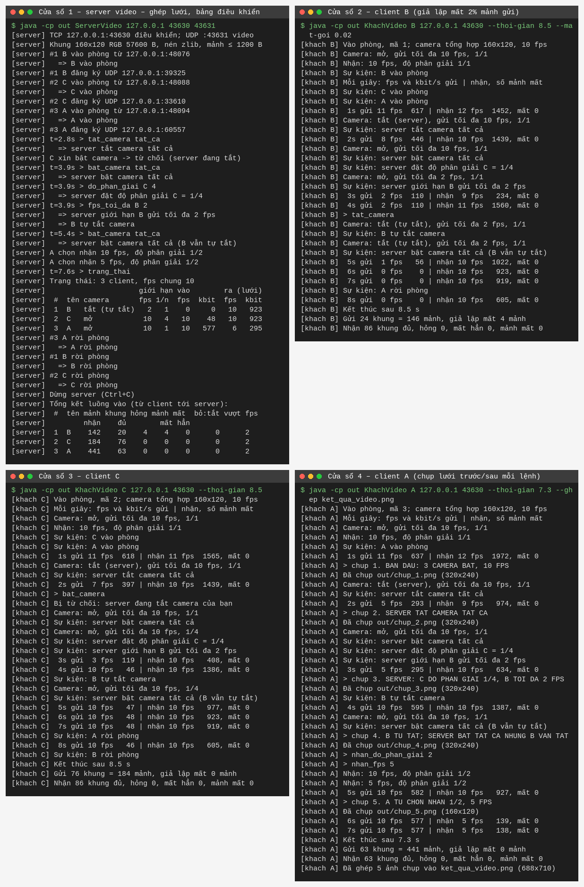
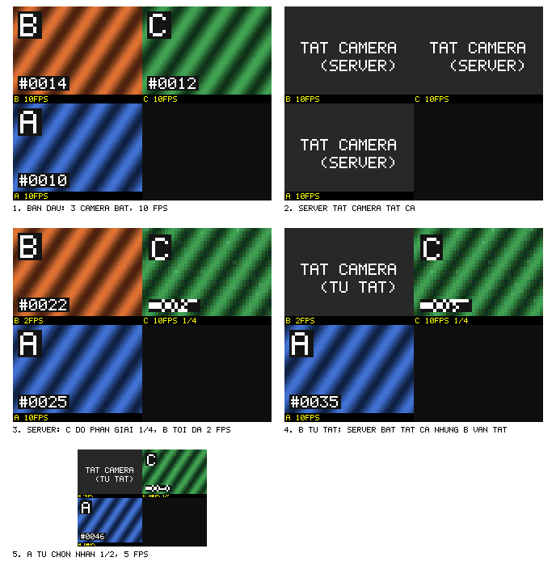

# Bài mở rộng MR6.3 – Phòng hội thoại video nhiều client (Java)

| Thông tin | Nội dung |
|---|---|
| Loại | **Bài mở rộng** – không có trong giáo trình, không có mã giả tương ứng |
| Liên hệ với giáo trình | Bài mở rộng MR6.2 (hội thoại âm thanh); Chương 6: Bài 6.1 (server đa luồng), Bài 6.4 (server chat); Chương 4: Bài 4.1 (UDP); Chương 3: Bài 3.2 (định khung thông điệp) |
| Thư viện | JDK 21: `java.net.Socket`, `java.net.DatagramSocket`, `java.nio.ByteBuffer`, `java.util.zip.Deflater`/`Inflater` (zlib), `javax.imageio.ImageIO` (PNG); `Json.java` tự viết |
| Bản ngôn ngữ khác | [C#](../../../csharp/Chuong06/BaiMR6.3_HoiThoaiVideo/), [Python](../../../python/Chuong06/BaiMR6.3_HoiThoaiVideo/), [Rust](../../../rust/Chuong06/BaiMR6.3_HoiThoaiVideo/), [Go](../../../go/Chuong06/BaiMR6.3_HoiThoaiVideo/) |

## Mục tiêu
Cùng ý tưởng với MR6.2 nhưng cho hình ảnh: n client gửi khung hình camera qua UDP; server ghép khung của mọi người thành một **lưới** và gửi cho từng người theo tốc độ khung (fps) và độ phân giải mà người đó chọn. Server điều khiển được: tắt/bật camera của tất cả hoặc từng người, giới hạn fps gửi và độ phân giải gửi của từng người (tương tự độ lợi đầu vào ở MR6.2), giới hạn fps chung (tương tự âm lượng chung). Client tự tắt/bật camera, tự chọn fps và độ phân giải nhận. Client chụp lưới đang xem thành PNG trước/sau mỗi lệnh và ghép thành `ket_qua_video.png` – bằng chứng trực quan rằng lệnh có hiệu lực.

## Kiến thức chính
- **Kích thước khung và tốc độ bit.** Khung 160×120 điểm RGB = 160 × 120 × 3 = 57 600 byte; 10 fps không nén cần 57 600 × 8 × 10 ≈ 4,6 Mbit/s. Nén zlib (không mất dữ liệu) còn khoảng 7 KB/khung → ≈ 560–640 kbit/s. Giảm độ phân giải 1/4 mỗi chiều → 40×30 điểm = 1/16 số điểm ảnh, client C trong kết quả chỉ còn ≈ 47 kbit/s. Khung tổng hợp có "hạt nhiễu" thưa như cảm biến thật; không có nhiễu, ảnh nhân tạo nén quá tốt (≈ 1 KB) và không phản ánh được thực tế.
- **Chia mảnh và ghép khung.** Một khung nén (vài KB) lớn hơn một datagram an toàn. Mỗi datagram ≤ 1200 byte – mức QUIC (RFC 9000 mục 14) yêu cầu mọi đường truyền phải chở được, nhỏ hơn MTU 1500 của Ethernet sau khi trừ header IP/UDP và phần bọc của VPN, nên không bị phân mảnh IP. Header 20 byte: phiên bản, loại, mã nguồn, **số khung**, **chỉ số mảnh**, **tổng số mảnh**, rộng, cao, nhãn thời gian. Bên nhận gom đủ mảnh mới giải nén; **mất một mảnh là hỏng cả khung** – lý do codec thực tế có cơ chế chống lỗi (FEC, khung tham chiếu, yêu cầu khung khóa).
- **Video trực tiếp chỉ cần khung mới nhất.** Khi một khung đủ mảnh, mọi khung cũ hơn còn dở bị bỏ; không chờ, không truyền lại. Số khung tăng dần cho phép đếm khung hỏng (thiếu mảnh) và khung mất hẳn.
- **MCU và SFU (RFC 7667).** Bài dùng kiến trúc *ghép* (MCU/Topo-Mixer): server giải nén, ghép lưới, nén lại riêng cho từng người nhận – nên điều chỉnh được fps/độ phân giải *nhận* của từng người, nhưng tốn CPU server. Kiến trúc *chuyển tiếp chọn lọc* (SFU) chỉ chuyển tiếp luồng của từng người, client tự ghép; server nhẹ hơn nhiều nhưng muốn đổi độ phân giải cho từng người nhận thì người gửi phải gửi nhiều lớp (simulcast). Khác với âm thanh (mix-minus), lưới video có cả hình của chính mình (self-view) – không gây vọng, chỉ tốn băng thông.
- **Giới hạn hai phía.** Phía gửi: server báo `fps` tối đa và `chia` (1, 2, 4) qua TCP; client tuân thủ, và server **tự thực thi** – bỏ khung đến nhanh hơn 0,8/fps giây (cột "vượt fps": vài khung bị bỏ khi đồng hồ của client nhích sớm) và bỏ khung của camera đang tắt. Phía nhận: `fps nhận = min(fps client chọn, fps chung)`.
- **Phóng to và thu nhỏ ảnh.** Thu nhỏ: lấy 1 điểm trong mỗi khối d×d (chép 3 byte của điểm góc mỗi khối bằng `System.arraycopy`). Phóng to: lặp điểm gần nhất (nearest neighbour), nên ô của C ở độ phân giải 1/4 hiện thành các ô vuông 4×4.
- **PNG.** Ảnh RGB thô được chép vào `BufferedImage` rồi mã hóa bằng `javax.imageio.ImageIO` của JDK (PNG gồm chữ ký 8 byte và các khối `IHDR`, `IDAT` – dữ liệu nén zlib, `IEND`, mỗi khối có CRC-32).
- **Phòng vệ.** Giới hạn 256 mảnh/khung, giải nén có giới hạn kích thước (`decompressobj().decompress(dữ_liệu, 4 MB)`) chống "bom nén", kiểm tra rộng × cao × 3 khớp dữ liệu, chỉ nhận UDP từ địa chỉ đã đăng ký.

### Quy tắc quyền điều khiển (giống mic ở MR6.2)

| # | Quy tắc |
|---|---|
| 1 | Camera của X mở **khi và chỉ khi** X không tự tắt **và** server không tắt camera của X |
| 2 | Server tắt thắng client: đang bị server tắt, client xin bật bị **từ chối** |
| 3 | Server bật = gỡ lệnh tắt của server, **không bật hộ** camera mà người dùng tự tắt |
| 4 | Giới hạn gửi (fps tối đa, độ phân giải 1/1, 1/2, 1/4) của từng người và fps chung do server đặt |
| 5 | Tham số nhận (fps, độ phân giải lưới 1/1 hoặc 1/2) do từng client tự chọn; fps nhận không vượt fps chung |
| 6 | Tự tắt camera có hiệu lực ngay tại client; tự bật phải chờ server xác nhận |

## Cấu trúc tệp
- `Video.java` – header datagram, `chiaManh`, `GhepKhung`, phông chữ bitmap 5×7, tô/vẽ chữ, thu nhỏ/phóng to, `CameraTongHop`, nén/giải nén zlib có giới hạn, `ghiPNG` (`ImageIO`), đọc lệnh `@t`.
- `ServerVideo.java` – server: kênh TCP (mỗi client một luồng ảo), luồng nhận UDP (ghép mảnh, kiểm tra quyền, vẽ ô), luồng ghép lưới và gửi theo hạn của từng người nhận, bảng điều khiển.
- `KhachVideo.java` – client: vòng gửi theo fps cho phép, luồng nhận lưới, lệnh `chup`, ghép ảnh chụp (`--ghep`).
- `Json.java` – bộ mã hóa, giải mã JSON tối giản (chép từ Bài 5.3 bản Java).
- `demo.json`, `ket_qua.txt`, `ket_qua.png` – kịch bản và kết quả thực thi thật; `ket_qua_video.png` – 5 ảnh lưới do client A chụp trong lần chạy đó.

## Cách chạy
Trong thư mục bài:
```bash
javac -encoding UTF-8 -d out *.java
java -cp out ServerVideo 127.0.0.1 9000 9001                     # cửa sổ 1 (gõ lệnh điều khiển ở đây)
java -cp out KhachVideo B 127.0.0.1 9000                          # cửa sổ 2
java -cp out KhachVideo C 127.0.0.1 9000                          # cửa sổ 3
java -cp out KhachVideo A 127.0.0.1 9000 --thoi-gian 60 --ghep ket_qua_video.png   # cửa sổ 4
```
Lệnh server: `tat_camera tat_ca`, `tat_camera B`, `bat_camera tat_ca`, `fps_toi_da B 2`, `do_phan_giai C 4`, `fps_chung 5`, `trang_thai`, `thoat`. Lệnh client: `tat_camera`, `bat_camera`, `nhan_fps 5`, `nhan_do_phan_giai 2`, `chup <nhãn>` (lưu `out/chup_N.png`), `thoat`. Dòng `@t lệnh` chờ tới giây thứ t. Nhãn ảnh chụp chỉ vẽ được chữ in hoa không dấu, số và vài ký hiệu (phông 5×7 tự định nghĩa).

Tùy chọn client: `--fps 10` (tốc độ khung camera), `--mat-goi 0.02` (giả lập mất 2 % mảnh gửi), `--thoi-gian`. JDK không có API camera nên bản Java chỉ dùng camera tổng hợp (bản Python có `--camera` qua OpenCV).

Giao thức giống hệt bản Python, Go: client Python nối được vào server Java (đã thử, hai bên nhận đủ khung lưới).

Tái lập kết quả từ thư mục gốc của kho: `python3 tools/demo.py java/Chuong06/BaiMR6.3_HoiThoaiVideo`.

## Kết quả thực thi


Ảnh lưới do client A chụp trong lần chạy trên (ô theo thứ tự vào phòng: B, C, A; dải vàng dưới mỗi ô là giới hạn gửi server đặt cho người đó):



1. Ba camera bật, 10 fps; số khung (`#0014`…) do camera của từng client vẽ.
2. Server `tat_camera tat_ca`: cả ba ô "TAT CAMERA (SERVER)"; C xin bật camera và **bị từ chối**.
3. Server bật lại, `do_phan_giai C 4`, `fps_toi_da B 2`: ô C thành các ô vuông 4×4 (40×30 điểm được phóng to), luồng của C giảm từ ≈ 630 xuống ≈ 47 kbit/s; B chỉ còn gửi 2 fps.
4. B tự tắt camera; server `bat_camera tat_ca` nhưng ô B vẫn "TAT CAMERA (TU TAT)" (quy tắc 3).
5. A tự chọn nhận độ phân giải 1/2 và 5 fps: lưới A nhận còn 160×120, luồng nhận giảm từ ≈ 920 xuống ≈ 140 kbit/s (1/4 số điểm ảnh × 1/2 số khung).

Luồng của B giả lập mất 2 % mảnh: server đếm được khung hỏng và mảnh mất (bảng tổng kết), các khung đó bị bỏ, lưới vẫn hiện khung đủ gần nhất của B.

## Ghi chú
- Nén bằng `java.util.zip.Deflater(BEST_SPEED)` cho dòng dữ liệu định dạng zlib (có header 2 byte và Adler-32) – giống `zlib.compress` của Python và `compress/zlib` của Go, nên ba bản giải nén được khung của nhau. `Inflater` được đọc từng khối và dừng khi vượt 4 MB (chống “bom nén”).
- PNG được ghi bằng `ImageIO.write` từ `BufferedImage` kiểu `TYPE_INT_RGB` (bản Python tự viết các khối PNG, bản Go dùng `image/png`).
- Hạt nhiễu của camera tổng hợp dùng `java.util.Random(mã client)`, khác dãy số của Python, Go nên ảnh nền khác chút ít; kích thước nén, tốc độ bit tương đương.
- Số fps/kbit/s đo theo cửa sổ 1 giây không thẳng hàng với thời điểm lệnh, nên giây chuyển tiếp có giá trị trung gian; ở 5 fps một cửa sổ có thể đếm được 5 hoặc 6 khung.
- Nén zlib không mất dữ liệu kém xa codec video thật: H.264/VP8/AV1 nén có mất dữ liệu và chỉ gửi phần thay đổi giữa các khung (nén liên khung), đạt chất lượng tương đương ở vài chục kbit/s cho khung nhỏ như thế này. Video thật còn cần SRTP để mã hóa, điều khiển tắc nghẽn để tự giảm tốc khi mạng nghẽn, và đồng bộ hình–tiếng theo nhãn thời gian.
- Server ghép lưới và nén lại cho từng người nhận mỗi khung; với nhiều client hơn, CPU server sẽ là nút thắt – đó chính là lý do hệ thống lớn dùng SFU.
- Kiểm thử: Linux, OpenJDK 21.0.12.

## Bài tập gợi ý
1. Thêm `fps_chung 3` vào kịch bản server và quan sát fps nhận của mọi client; giải thích vì sao `nhan_fps 30` của client vẫn không vượt được giới hạn này.
2. Chạy client với `--mat-goi 0.1`: tính xác suất một khung 6 mảnh đến đủ (0,9⁶ ≈ 53 %) và so sánh với số khung hỏng server đếm được. Vì sao khung lớn chịu mất gói kém hơn?
3. Bỏ ô của chính người nhận khỏi lưới (giống mix-minus) và đo băng thông tiết kiệm được.
4. Hiển thị video trực tiếp: Tkinter `PhotoImage` nhận dữ liệu PPM (`P6` + header + RGB thô) – cập nhật ảnh mỗi khi nhận khung lưới mới.
5. Nâng cao: chuyển server sang kiến trúc SFU – chuyển tiếp nguyên mảnh của từng người, client tự ghép lưới; giới hạn fps nhận bằng cách server bỏ cả khung (mọi mảnh có cùng số khung). So sánh CPU server và độ trễ với bản MCU.

## Đọc thêm
- RFC 9000 – *QUIC: A UDP-Based Multiplexed and Secure Transport*, mục 14 (kích thước datagram 1200 byte).
- RFC 7667 – *RTP Topologies* (Topo-Mixer/MCU, Topo-SFU).
- RFC 8085 – *UDP Usage Guidelines* (mục 3.2: tránh phân mảnh IP, kích thước thông điệp).
- RFC 1950, RFC 1951 – định dạng zlib và DEFLATE.
- W3C, *Portable Network Graphics (PNG) Specification* (Second Edition), 2003 (cấu trúc khối, CRC, bộ lọc hàng).
- Tài liệu JDK: `java.util.zip.Deflater`, `java.util.zip.Inflater`, `javax.imageio.ImageIO`, `java.awt.image.BufferedImage`.

Mã nguồn của bài được viết mới cho kho này.
