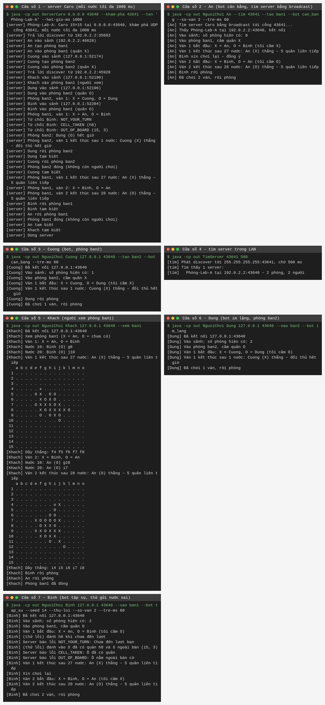

# Bài mở rộng MR6.4 – Caro nhiều phòng qua TCP, khám phá server trong LAN (Java)

| Thông tin | Nội dung |
|---|---|
| Loại | **Bài mở rộng** (mini game) – không có trong giáo trình, không có mã giả tương ứng |
| Liên hệ với giáo trình | Chương 6: Bài 6.4 (server chat: nhiều client, phát tin), Bài 6.5 (khám phá bằng UDP broadcast); Chương 3: Bài 3.2 (định khung JSON); bài mở rộng MR3.3 (máy trạng thái, kiểm tra đầu vào) |
| Thư viện | JDK 21: `java.net.Socket`, `java.net.ServerSocket`, `java.net.DatagramSocket` (`setBroadcast`, `setReuseAddress`), `java.util.concurrent.BlockingQueue`; `Json.java` tự viết |
| Bản ngôn ngữ khác | [C#](../../../csharp/Chuong06/BaiMR6.4_GameCaro/), [Python](../../../python/Chuong06/BaiMR6.4_GameCaro/), [Rust](../../../rust/Chuong06/BaiMR6.4_GameCaro/), [Go](../../../go/Chuong06/BaiMR6.4_GameCaro/) |

## Mục tiêu
Caro (gomoku): hai người lần lượt đặt quân X, O trên bàn 15 × 15, ai có 5 quân liên tiếp (ngang, dọc, chéo) trước thì thắng. Bài xây dựng một server trò chơi nhiều phòng hoàn chỉnh ở mức socket:
- **Sảnh và phòng**: xem danh sách phòng, tạo phòng, vào chơi, vào xem; mỗi phòng 2 người chơi và nhiều người xem.
- **Server là trọng tài (authoritative)**: server giữ bàn cờ thật, kiểm tra lượt, tọa độ, ô trống, tự phát hiện thắng/hòa; client chỉ gửi *ý định* (`move {r, c}`) và vẽ lại theo thông báo của server.
- **Phát tin trong phòng**: mỗi nước đi hợp lệ được gửi tới cả hai người chơi và mọi người xem; người xem vào muộn nhận *ảnh chụp* bàn cờ hiện tại.
- **Hết giờ mỗi nước**, **bỏ dở ván** (đối thủ thắng), **chơi lại** (cả hai đồng ý, đổi màu quân).
- **Khám phá server trong LAN** bằng UDP broadcast như Bài 6.5: client hỏi “có server Caro nào không?”, server trả lời kèm cổng TCP, số phòng, số người.

## Kiến thức chính
- Thông điệp (khung JSON có tiền tố độ dài, chép từ MR3.3): client → server `hello`, `list`, `create`, `join`, `watch`, `move {r, c}`, `rematch`, `leave`, `bye`; server → client `welcome`, `rooms`, `joined`, `start`, `board`, `moved {r, c, mark, by, move_no, next}`, `over {winner, reason, line}`, `rematch_wait`, `left`, `room_closed`, `error {code, msg}`.
- **Phán xử trước, thông báo sau**: server kiểm tra thắng rồi mới gửi `moved`, trong đó `next` là lượt kế (hoặc `null` khi ván đã hết). Client không tự suy ra lượt, nên không bao giờ “đánh thêm” sau khi ván kết thúc.
- Máy trạng thái của phòng: `CHO` (thiếu người) → `DANG_CHOI` → `KET_THUC` → (cả hai `rematch`) → `DANG_CHOI`. Mã lỗi: `NOT_IN_ROOM`, `NOT_PLAYER`, `GAME_NOT_RUNNING`, `NOT_YOUR_TURN`, `BAD_MOVE`, `OUT_OF_BOARD`, `CELL_TAKEN`, `ROOM_FULL`, `ROOM_EXISTS`, `NO_SUCH_ROOM`, `BAD_ROOM_NAME`, `ALREADY_IN_ROOM`…
- Một luồng trò chơi giữ toàn bộ trạng thái (sảnh, mọi phòng, bàn cờ); các luồng đọc TCP và luồng nhận UDP chỉ đẩy sự kiện vào hàng đợi. Hạn chót của mọi phòng được gom lại: vòng lặp chờ tới hạn chót **sớm nhất**. Luồng UDP không tự trả lời discover mà nhờ luồng trò chơi (chỉ nó biết số phòng) – không có dữ liệu dùng chung giữa các luồng.
- Kiểm tra thắng chỉ cần xét 4 hướng qua ô vừa đặt (`five_line`), không cần quét cả bàn.
- Bot tất định: điểm tấn công + phòng thủ theo độ dài dãy và số đầu còn trống; bot `tap_su` cộng điểm ngẫu nhiên từ bộ sinh LCG có hạt giống nên ván đấu tái lập được, và giống hệt ở bản Go.

## Tệp
- `GiaoThuc.java` – định khung JSON (chép từ MR3.3) và hàm `discover` (DISCOVER của Bài 6.5).
- `BanCo.java` – bàn cờ: `fiveLine`, `render`, tọa độ dạng `h8`, bot `chooseMove`, bộ sinh `Lcg`.
- `ServerCaro.java` – server: sảnh, phòng, trọng tài, hết giờ, chơi lại, trả lời khám phá UDP.
- `NguoiChoi.java` – client: người chơi (gõ lệnh), bot, người xem tự động; `--tim` để tìm server bằng broadcast.
- `TimServer.java` – chỉ tìm và liệt kê server Caro trong LAN.
- `Json.java` – bộ mã hóa, giải mã JSON tối giản (chép từ Bài 5.3 bản Java).
- `demo.json` – kịch bản chạy minh họa (dùng với `tools/demo.py`).
- `ket_qua.txt`, `ket_qua.png` – kết quả thực thi thật.

## Cách chạy
Trong thư mục bài:
```bash
javac -encoding UTF-8 -d out *.java
java -cp out ServerCaro 0.0.0.0 9100 --kham-pha 9999 --ten "Phòng-Lab-A"     # cửa sổ 1
java -cp out TimServer 9999                                                 # tìm server trong LAN
java -cp out NguoiChoi An --tim 9999                                        # cửa sổ 2: tìm rồi kết nối
java -cp out NguoiChoi Binh 127.0.0.1 9100 --vao ban1 --bot can_bang        # cửa sổ 3: bot vào phòng ban1
java -cp out NguoiChoi Khach 127.0.0.1 9100 --xem ban1                      # cửa sổ 4: người xem
```
Lệnh của người chơi: `ds` (danh sách phòng), `tao <phòng>`, `vao <phòng>`, `xem <phòng>`, ô cần đánh dạng cột + hàng như `h8` (ô giữa bàn), `lai` (xin chơi lại), `roi` (rời phòng), `thoat`. Trong ví dụ trên, An gõ `tao ban1` trước khi Binh vào. Server phải bind `0.0.0.0` thì máy khác trong LAN mới kết nối được; tường lửa (Windows Defender Firewall, `ufw`) cần cho phép cổng TCP 9100 và UDP 9999.

Kiểu bot: `can_bang`, `tan_cong`, `phong_thu`, `tap_su` (hay sai, dùng `--seed`), `im_lang` (không bao giờ đánh). `--thu-loi` làm bot cố tình gửi nước sai; `--so-van`, `--tre-ms` đặt số ván và thời gian “suy nghĩ”. Giao thức trên dây giống bản Python, Go: đã thử bot Java đấu bot Python trên server Python và `TimServer` tìm thấy server Python.

Tái lập kết quả từ thư mục gốc của kho: `python3 tools/demo.py java/Chuong06/BaiMR6.4_GameCaro`.

## Kết quả thực thi


- An tìm server bằng broadcast tới cổng 41641, thấy `Phòng-Lab-A` tại địa chỉ LAN của máy (192.0.2.2 trong môi trường kiểm thử), kết nối và tạo phòng `ban1`; Cuong tạo phòng `ban2`. Cửa sổ 4 tìm lại server và thấy 2 phòng, 2 người.
- **Hai phòng chạy song song.** Ở `ban2`, Dung (bot im lặng) không đánh: sau 1000 ms server xử Cuong thắng vì đối thủ hết giờ; Dung rời phòng, rồi Cuong rời và phòng đóng.
- Ở `ban1`, Binh (bot tập sự, `--thu-loi`) đánh khi chưa đến lượt (`NOT_YOUR_TURN`), đánh vào ô đã có quân h8 (`CELL_TAKEN`) và ô ngoài bàn (`OUT_OF_BOARD`) – server từ chối cả ba, bàn cờ không đổi. Ván 1 An (X) thắng sau 27 nước với dãy dọc f4–f8; người thua xin chơi lại, người thắng đồng ý, hai bên đổi màu quân; ván 2 An (O) thắng sau 28 nước với dãy dọc i4–i8.
- Khach (người xem) nhận đủ mọi nước đi qua phát tin: in tiến trình mỗi 10 nước và bàn cờ cuối mỗi ván (ô vừa đánh viết thường), rồi thoát khi phòng đóng.
- Bản Java cho cùng ván đấu, cùng trình tự sự kiện như bản Python và Go (chỉ khác cổng).

## Ghi chú
- Socket UDP khám phá của server được tạo bằng `new DatagramSocket(null)` (chưa bind) để kịp gọi `setReuseAddress(true)` trước `bind(0.0.0.0:cổng)`, tương ứng SETOPT trước BIND của Bài 6.5; phía client gọi `setBroadcast(true)` trước khi gửi tới `255.255.255.255`.
- Lệnh `bye` được server xử lý bằng `shutdownInput()` + `shutdownOutput()`: luồng đọc của kết nối đó nhận EOF và báo sự kiện `closed`, sau đó luồng trò chơi mới `close()` hẳn.
- Nhật ký của bản Java trùng từng dòng với bản Go (trừ cổng): bot dùng cùng bộ sinh LCG và cùng quy tắc chọn nước. Kịch bản `demo.json` chờ lâu hơn giữa các tiến trình vì JVM khởi động chậm hơn.
- Bản Java bật `setTcpNoDelay(true)` cho mọi kết nối (như bản Python): nước đi là khung nhỏ, thuật toán Nagle kết hợp với ACK trễ có thể giữ khung lại hàng chục mili giây. Go bật sẵn tùy chọn này.
- Bot dùng quy ước “người thua (hoặc O nếu hòa) lên tiếng trước” khi kết thúc ván, và gửi một thông điệp `bye` duy nhất khi rời đi – để hai bot không gửi cùng lúc, nhờ đó nhật ký demo có thứ tự cố định. Người chơi thật không cần quy ước này.
- Luật ở đây là *gomoku tự do* (5 quân trở lên đều thắng). Luật Caro Việt Nam thường thêm điều kiện “không bị chặn hai đầu” – xem Bài tập 1.
- Bot chỉ đánh giá một nước (không tìm kiếm sâu), đủ để minh họa; Allis (1994) đã chứng minh: trên bàn 15 × 15 theo luật tự do, người đi trước luôn thắng nếu chơi hoàn hảo.
- Kiểm thử: Linux, OpenJDK 21.0.12. Chỉ dùng JDK, không cần thư viện ngoài.

## Bài tập gợi ý
1. Thêm luật **chặn hai đầu**: dãy 5 bị quân đối phương chặn ở cả hai đầu không được tính thắng; chỉ cần sửa `five_line` ở server – client không phải đổi gì (lợi ích của server làm trọng tài).
2. Thêm lệnh `chat {text}` trong phòng (người chơi và người xem cùng thấy) và lệnh `undo` (xin đi lại, đối thủ phải đồng ý).
3. Lưu biên bản ván đấu (danh sách nước đi) ra tệp JSON và viết chương trình phát lại ván cho người xem.
4. Cho người chơi mất mạng được **kết nối lại** trong 20 giây và tiếp tục ván (server giữ ghế, gửi lại ảnh chụp `board`).
5. Viết bot mạnh hơn bằng tìm kiếm minimax hai lớp có cắt tỉa alpha–beta; cho đấu 20 ván với bot `can_bang` để so sánh.

## Đọc thêm
- Bài 6.4 (server chat) và Bài 6.5 (khám phá bằng broadcast) của kho này; Mục 6.4 của giáo trình.
- RFC 919 – *Broadcasting Internet Datagrams*, 1984; RFC 922 – *Broadcasting Internet Datagrams in the Presence of Subnets*, 1984.
- RFC 896 – John Nagle, *Congestion Control in IP/TCP Internetworks*, 1984 (lý do bật `TCP_NODELAY`).
- L. Victor Allis, *Searching for Solutions in Games and Artificial Intelligence*, luận án tiến sĩ, Đại học Limburg, Maastricht, 1994 (lời giải gomoku).
- Tài liệu JDK: `java.net.DatagramSocket` (`setBroadcast`, `setReuseAddress`), `java.net.Socket` (`setTcpNoDelay`, `shutdownInput`, `shutdownOutput`).

Mã nguồn của bài được viết mới cho kho này.
