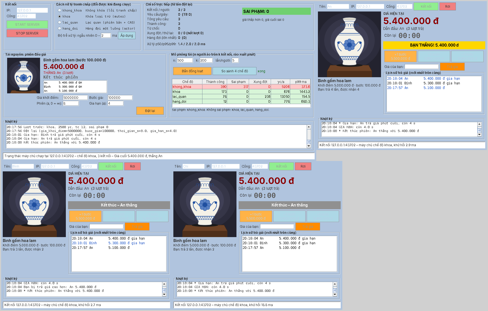
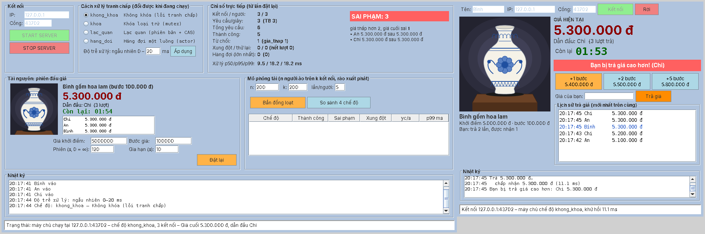
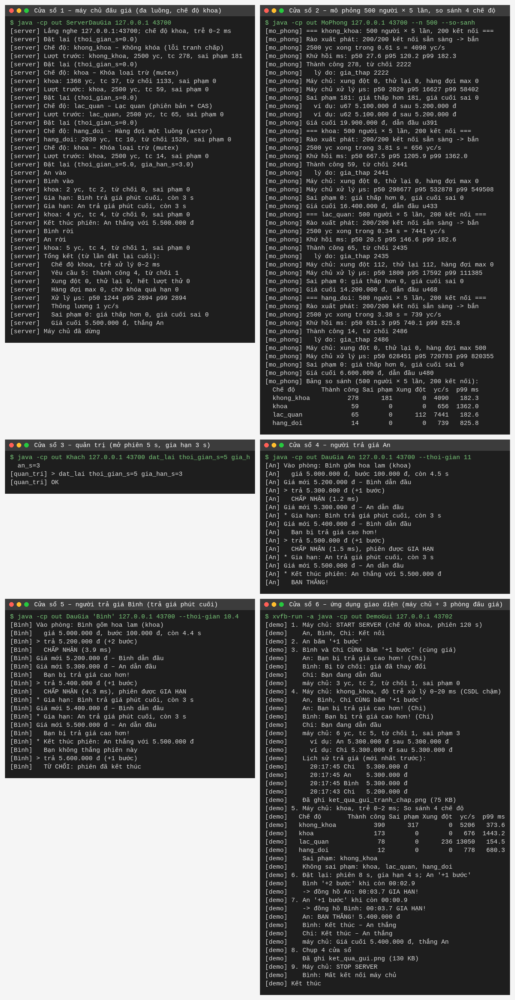

# Bài mở rộng MR6.6 – Đấu giá trực tuyến: n người cùng tranh một món hàng (Java)

| Thông tin | Nội dung |
|---|---|
| Loại | **Bài mở rộng**, không có trong giáo trình và không có mã giả tương ứng. Đây là bài đầu của nhóm "tranh chấp tài nguyên" MR6.6–MR6.14 |
| Liên hệ với giáo trình | Chương 6: Bài 6.1 (server đa luồng, một luồng mỗi kết nối), Bài 6.7 (kiểm thử tải); Chương 3: Bài 3.2 (định khung thông điệp theo dòng); bài mở rộng MR5.4/MR5.5 (luồng, đồng bộ) |
| Thư viện | JDK 21, chỉ thư viện chuẩn: `java.net.ServerSocket`/`Socket`, `java.util.concurrent` (`ReentrantLock.tryLock`, `LinkedBlockingQueue`, `CyclicBarrier`, `CountDownLatch`, `ConcurrentHashMap`, `AtomicLong`, `ThreadLocalRandom`), `synchronized`/`wait`/`notifyAll`, `LockSupport.parkNanos`; bản giao diện dùng thêm Swing, `java.awt.Robot` (chụp cửa sổ), `javax.imageio`. `Json.java` tự viết (chép từ MR6.5 bản Java) – không thư viện ngoài |
| Bản ngôn ngữ khác | [C#](../../../csharp/Chuong06/BaiMR6.6_DauGia/), [Python](../../../python/Chuong06/BaiMR6.6_DauGia/), [Rust](../../../rust/Chuong06/BaiMR6.6_DauGia/), [Go](../../../go/Chuong06/BaiMR6.6_DauGia/) |

## Mục tiêu
Bài mô phỏng một phòng đấu giá trực tuyến. Một món hàng có giá khởi điểm và bước giá. **n người cùng trả giá**, và giá chỉ được nhận khi **≥ giá hiện tại + bước giá**. Đồng hồ đếm ngược đóng phiên; ai trả giá trong 10 giây cuối thì phiên được **gia hạn 10 giây** (đóng mềm, chống "bắn tỉa" phút cuối). Hết giờ, máy chủ công bố người thắng. Máy chủ TCP **đa luồng thật** (một luồng nền tảng mỗi kết nối, chạy song song trên nhiều lõi) giữ trạng thái. Mỗi lần trả giá là một thao tác "đọc → kiểm tra (giả lập độ trễ cơ sở dữ liệu 0–2 ms) → ghi", xử lý theo **bốn cách** chọn được ngay lúc đang chạy: không khóa, khóa loại trừ, điều khiển đồng thời lạc quan, hàng đợi một luồng. **Sổ kiểm toán** độc lập đếm sai phạm, còn **bộ mô phỏng tải** (500 người × 5 lần trên 200 kết nối, rào xuất phát và pipelining) cho thấy bằng số liệu thật: chỉ chế độ không khóa sinh sai phạm.

Bản Java chuyển ngữ đúng bản Python: cùng giao thức (chạy chéo được với máy chủ/khách Python), cùng hành vi, cùng dòng in. Phần khung (`Chung.java`, `KetNoiKhach.java`, `Khach.java`, phần KHUNG của `MoPhong.java`, `GiaoDienChung.java`) dùng chung cho các bài MR6.6–MR6.14 bản Java.

## Kiến thức chính
Số liệu dưới đây lấy từ `ket_qua.txt`, là một lần chạy thật trên máy cục bộ (127.0.0.1, OpenJDK 21, 2 lõi, độ trễ xử lý ngẫu nhiên 0–2 ms). Mỗi lần chạy, số liệu lệch đi đôi chút.

```
  Chế độ       Thành công Sai phạm Xung đột  yc/s  p99 ms
  khong_khoa          278      181        0  4090   182.3
  khoa                 59        0        0   656  1362.0
  lac_quan             65        0      112  7441   182.6
  hang_doi             14        0        0   739   825.8
```
(500 người × 5 lần trả giá = 2500 yêu cầu/chế độ, 200 kết nối. "Thành công" là số giá được chấp nhận, "Sai phạm" do sổ kiểm toán đếm, "Xung đột" là số lần so sánh-và-đổi thất bại, "yc/s" và "p99" (khứ hồi) đo ở bộ mô phỏng.)

- **Tranh chấp (race condition) và mất cập nhật.** Chế độ `khong_khoa` làm "đọc giá → chờ 0–2 ms → kiểm tra → ghi" mà không đồng bộ. Nhiều luồng cùng đọc một giá cũ, ai cũng qua kiểm tra, ai cũng nhận "CHẤP NHẬN", và bản ghi sau đè bản ghi trước: 278 giá được chấp nhận, trong đó **181** giá thấp hơn (giá đã chấp nhận trước + bước giá), ví dụ `u67 5.100.000 đ sau 5.200.000 đ`. Ở lần chạy khác còn có **giá cuối sai** (giá/người dẫn đầu cuối cùng không phải giá cao nhất từng được chấp nhận). Trong giao diện, đặt độ trễ 0–20 ms rồi ba người cùng bấm "+1 bước": cả ba cùng được chấp nhận ở **cùng một giá** 5.300.000 đ (sai phạm 3, `ket_qua_gui_tranh_chap.png`). Ô trạng thái là `volatile Object` thay nguyên đối tượng nên luồng đọc luôn thấy một bản trọn vẹn – lỗi ở đây là lỗi *logic* đọc–sửa–ghi chứ không phải hỏng bộ nhớ. Chế độ này chỉ dùng để minh họa lỗi trong phòng lab (loopback).
- **Vùng găng (critical section) và khóa theo tài nguyên.** Chế độ `khoa` cho mỗi ô một `ReentrantLock` và giữ khóa suốt đọc – kiểm tra – ghi (`tryLock(2 s)`; quá hạn thì trả `khoa_cho_lau`, nghi khóa chết). Sai phạm bằng 0, nhưng mọi yêu cầu phải xếp hàng qua một khóa duy nhất nên thông lượng chỉ ≈ 1 / (thời gian xử lý trung bình) ≈ 656 yc/s, thời gian xử lý ở máy chủ (gồm chờ khóa) p50 299 ms. Một món hàng là "điểm nóng" (hot spot). Khung khóa nhiều ô **theo thứ tự tên ô đã sắp xếp** để không khóa chết. Tương đương Java khác: `synchronized` (khóa nội tại) cũng cho cùng kết quả nhưng không có chờ có hạn như `tryLock`.
- **Điều khiển đồng thời lạc quan (Kung & Robinson 1981).** Chế độ `lac_quan` đọc (giá trị, **phiên bản**) dưới một khóa rất ngắn, xử lý *ngoài* khóa, rồi **so sánh-và-đổi**: chỉ ghi khi phiên bản chưa đổi; đổi rồi thì thử lại (tối đa 5 lần, nghỉ ngẫu nhiên 0–1 ms). Sai phạm 0, thông lượng **cao nhất** (7441 yc/s) vì phần lớn yêu cầu bị từ chối ngay sau lần đọc mà không chờ ai; 112 xung đột, 112 lần thử lại, không yêu cầu nào hết lượt. Với một ô, phép CAS này tương đương `AtomicReference.compareAndSet(cũ, mới)`; khung dùng khóa ngắn (`synchronized (khoaCas)`) vì phải so sánh *nhiều* ô cùng lúc và ghi sổ kiểm toán ngay trong bước so sánh-và-đổi.
- **Hàng đợi một luồng (mô hình actor).** Chế độ `hang_doi` cho luồng kết nối đặt yêu cầu vào `LinkedBlockingQueue` rồi đọc tiếp ngay; **một** luồng xử lý lần lượt, đến trước phục vụ trước, không cần khóa. Sai phạm 0, 739 yc/s (tuần tự như `khoa`), hàng đợi dài tối đa **500** (đúng số người đang chờ trả lời).
- **Đa lõi thật.** Khác Python (GIL), các luồng Java chạy song song; kết hợp với bộ mô phỏng nhanh hơn, `lac_quan` và `khong_khoa` đạt yc/s cao hơn bản Python, còn `khoa`, `hang_doi` vẫn bị chặn bởi độ trễ giả lập. Ở `khoa`, số giá được chấp nhận (59) nhiều hơn Python vì người ảo nhận `cap_nhat` mới thường xuyên hơn trong lúc xếp hàng.
- **Sổ kiểm toán.** Sổ ghi mọi giao dịch được chấp nhận dưới khóa riêng (`synchronized`), ngay trong vùng găng của chế độ (callback `khiGhi`), nên thứ tự trong sổ đúng là thứ tự ghi. Luật: một giá chấp nhận phải ≥ (giá cao nhất đã chấp nhận + bước giá); giá/người dẫn đầu cuối cùng phải là giá cao nhất trong sổ.
- **Cổng đổi chế độ.** `tamDung()` (monitor `synchronized` + `wait`/`notifyAll`) đóng cổng, chờ mọi thao tác đang chạy và đang xếp hàng xong rồi mới đổi chế độ hay đặt lại – hai chế độ không bao giờ chạy lẫn.
- **Rào xuất phát, pipelining, idempotency.** Bộ mô phỏng mở 200 kết nối (mỗi kết nối chở 2–3 người ảo: `"so_nguoi"` trong lời chào, tên người ở `"nguoi"`), mọi luồng chờ ở `CyclicBarrier(k + 1)` rồi cùng bắn; mỗi kết nối gửi yêu cầu của mọi người mình chở trong **một** lần ghi socket, trả lời nào về (ghép theo `ma_yc`) thì gửi ngay lần trả giá kế tiếp của người đó. `ma_yc` đã xử lý gửi lại thì máy chủ trả kết quả cũ kèm `"lap_lai": true`.
- **Đẩy trạng thái có gộp, đóng mềm.** Máy chủ chỉ bật cờ khi trạng thái đổi; luồng nền 100 ms gửi **một** `cap_nhat` cho mọi client (≤ 10 lần/s). Lượt dòng lệnh (phiên 5 s, gia hạn 3 s): Bình trả giá phút cuối → gia hạn; An trả giá phút cuối → gia hạn lần nữa; "Kết thúc phiên: An thắng với 5.500.000 đ"; lần trả giá sau đó của Bình nhận "TỪ CHỐI: phiên đã kết thúc". Đóng phiên cũng là một thao tác ghi đi qua cùng chế độ xử lý tranh chấp.

### Giao thức (giống hệt ở 5 ngôn ngữ)
TCP, mỗi dòng một JSON UTF-8 kết thúc `\n`, tối đa 64 KB một dòng. Mọi yêu cầu có `ma_yc` (số nguyên do client đánh), trả lời mang lại đúng `ma_yc` đó. `Json.java` ghi JSON không có khoảng trắng, Python ghi có khoảng trắng – bộ đọc của mọi bản đều chấp nhận cả hai.

| Chiều | Thông điệp |
|---|---|
| client → server | `{"loai":"chao","ten":"An","vai_tro":"nguoi_dung"\|"quan_tri"}` (đầu tiên, tên 1–16 ký tự); kết nối gộp của bộ mô phỏng thêm `"so_nguoi":m` |
| người dùng → server | `{"loai":"tra_gia","ma_yc":k,"gia":5300000}` (kết nối gộp thêm `"nguoi":"u17"`) |
| quản trị → server | `{"loai":"che_do","ma_yc":k,"gia_tri":"khoa"}`, `{"loai":"tre","ma_yc":k,"ms":2}`, `{"loai":"dat_lai","ma_yc":k,"thoi_gian_s":120,"gia_han_s":10,"gia_khoi_diem":…,"buoc_gia":…,"ten_mon":…}`, `{"loai":"thong_ke","ma_yc":k}` |
| server → client | `{"loai":"chao","ma":id,"che_do":"khoa","may_chu":"Đấu giá MR6.6"}`, ngay sau đó một `cap_nhat`; `{"loai":"loi","ly_do":…}` khi sai giao thức |
| server → client | `{"loai":"kq","ma_yc":k,"ok":true,"gia":…,"nguoi_dan_dau":…,"gia_han":bool}` hoặc `{"loai":"kq","ma_yc":k,"ok":false,"ma_loi":"gia_thap"\|"het_phien"\|"xung_dot"\|"khoa_cho_lau"\|"sai_du_lieu"\|"khong_quyen"\|"khong_ho_tro"\|…,"ly_do":…}` |
| server → tất cả | `{"loai":"cap_nhat","che_do":…,"mon":{"ten","gia_khoi_diem","buoc_gia","gia_han_s"},"gia","nguoi_dan_dau","so_lan","con_lai_ms"(null = không giới hạn),"ket_thuc","lich_su":[{"nguoi","gia","gio","gia_han"}…]}` (≤ 10 lần/s); `{"loai":"su_kien","noi_dung":"Kết thúc phiên: An thắng với …"}` |
| server → quản trị | `{"loai":"thong_ke","ma_yc":k,"che_do","tre_ms","so_yc","thanh_cong","tu_choi","xung_dot","thu_lai","het_lan_thu","khoa_cho_lau","hang_doi_max","ma_loi","yc_s","thong_luong","p50_us","p95_us","p99_us","hang_doi","sai_pham":[{"ma","ten","so"}],"sai_pham_tong","vi_du_sai_pham","tom_tat","so_ket_noi","so_nguoi"}` |

**Chạy chéo với bản Python (đã thử trên cùng máy):** (a) máy chủ Java + `mo_phong.py --n 500 --so-sanh` + `dau_gia.py`: khong_khoa 433 thành công / 354 sai phạm, khoa 69/0, lac_quan 72/0 (141 xung đột), hang_doi 16/0; người trả giá Python được chấp nhận hai lần, máy chủ Java in "Py vào/rời", sai phạm 0. (b) máy chủ Python + `MoPhong --so-sanh` Java + `DauGia` Java: khong_khoa 485/317, khoa 13/0, lac_quan 37/0 (59 xung đột), hang_doi 18/0; tổng kết của máy chủ Python "Giá cuối 7.100.000 đ, dẫn đầu Jv".

## Cấu trúc tệp
- `Chung.java`: **khung chung** – giao thức (`guiJson`, `maHoa`, `docDong`, `docLenhStdin`, `docThamSo`), `phanVi`, `ThongKe`, `KhoTranhChap` (4 chế độ, cổng `tamDung`), `SoKiemToan`, `KhachKetNoi`, `MayChuCoSo` (máy chủ TCP đa luồng), các hàm in `dongThongKe`, `bangSoSanh`, `tien`, `g` (như `%g` của Python), `py` (như `str()` của Python).
- `MayChu.java`: nghiệp vụ `MayChuDauGia` (trả giá, gia hạn, đóng phiên) và `SoKiemToanDauGia`; `ServerDauGia.java` là bản dòng lệnh.
- `KetNoiKhach.java`: lõi client `KetNoiKhach` (pipelining, ghép theo `ma_yc`) và `QuanTri`; `Khach.java`: công cụ quản trị dòng lệnh.
- `MoPhong.java`: bộ mô phỏng tải (`chayLuot`, `soSanh`); phần NGHIỆP VỤ là `NguCanh`, `NguoiAo`, `thamSoDatLai()`.
- `DauGia.java`: người trả giá bản dòng lệnh.
- `GiaoDienChung.java`: khung giao diện Swing chung (`CuaSoServerCoSo`, `CuaSoNguoiDungCoSo`, `KhungVe`, `NhatKy`, `chup`, `ghep`).
- `ServerGui.java`: bảng điều khiển máy chủ; `DauGiaGui.java`: phòng đấu giá; `DemoGui.java`: kịch bản tự bấm nút.
- `Json.java`: bộ mã hóa, giải mã JSON tối giản.
- `demo.json`, `ket_qua.txt`, `ket_qua.png`, `ket_qua_gui.png`, `ket_qua_gui_tranh_chap.png`: kịch bản và kết quả thực thi thật.

## Cách chạy
Trong thư mục bài (cần JDK 21):
```bash
javac -encoding UTF-8 -d out *.java
java -cp out ServerDauGia 127.0.0.1 9000                                # cửa sổ 1 (gõ lệnh ở đây)
java -cp out MoPhong 127.0.0.1 9000 --n 500 --so-sanh                   # cửa sổ 2: bảng so sánh 4 chế độ
java -cp out MoPhong 127.0.0.1 9000 --n 2000 --k 200 --che-do lac_quan --dat-lai
java -cp out Khach 127.0.0.1 9000 dat_lai thoi_gian_s=60 gia_han_s=10   # mở phiên 60 s
java -cp out DauGia An 127.0.0.1 9000                                   # cửa sổ 3, 4…: gõ tang 1 / tra 5300000
```
- Lệnh của máy chủ: `che_do khong_khoa|khoa|lac_quan|hang_doi`, `tre <ms>`, `dat_lai [khoa=giá_trị …]`, `thong_ke`, `thoat`. Tùy chọn: `--che-do`, `--tre-ms`, `--thoi-gian` (0 = không giới hạn), `--gia`, `--buoc`, `--gia-han`. Cứ 5 giây, nếu có yêu cầu mới, máy chủ in một dòng số liệu; Ctrl+C vẫn in bảng tổng kết (`Runtime.addShutdownHook`).
- Lệnh của `DauGia`: `tang [n]`, `tra <giá>`, `thoat`. Dòng `@t lệnh` chờ tới giây thứ t rồi mới chạy lệnh.
- `Khach <host> <cổng> che_do x | tre ms | dat_lai k=v … | thong_ke` gửi lệnh quản trị.

Tái lập kết quả từ thư mục gốc của kho: `python3 tools/demo.py java/Chuong06/BaiMR6.6_DauGia`.

## Ứng dụng giao diện


Ảnh trên là lần chạy thật của `DemoGui` (Linux, Xvfb, OpenJDK 21, giao diện Metal; máy chủ, bộ mô phỏng và 3 cửa sổ trong một JVM): bảng điều khiển máy chủ (trên trái), An (trên phải, "BẠN THẮNG!"), Bình và Chi (dưới). Kịch bản đã chạy so sánh 4 chế độ (bảng ở giữa: `khong_khoa` 390 thành công / 317 sai phạm tô đỏ; `khoa` 173/0, `lac_quan` 78/0 với 236 xung đột, `hang_doi` 12/0) rồi mở phiên 8 s, gia hạn 4 s: Bình trả giá khi còn 2,9 s, An trả giá khi còn 0,9 s, phiên được gia hạn hai lần (đồng hồ nhảy lên 00:03.7, chớp "GIA HẠN!") và An thắng với 5.400.000 đ.



Ở bước trước đó, máy chủ ở `khong_khoa`, độ trễ 0–20 ms. An, Bình và Chi cùng bấm "+1 bước" ở cùng một giá và cả ba được chấp nhận 5.300.000 đ; ô **SAI PHẠM** đỏ (3: giá thấp hơn 2, giá cuối sai 1), lịch sử có ba dòng cùng giá. Cùng thao tác ở `khoa` (bước 3), người thứ hai nhận "Bị từ chối: giá đã thay đổi".

- **Máy chủ** (`ServerGui`): IP, cổng, START/STOP; **4 nút chọn chế độ** (đổi được khi đang chạy); độ trễ xử lý; **chỉ số trực tiếp**: kết nối/người, yêu cầu/giây, tổng, thành công, từ chối (theo mã lỗi), xung đột/thử lại, hàng đợi (lớn nhất), xử lý p50/p95/p99, **SAI PHẠM** (xanh khi 0, đỏ khi > 0) kèm ví dụ; **tài nguyên**: ảnh món hàng, giá, người dẫn đầu/thắng, đồng hồ phiên, ba giá gần nhất, tham số đặt lại và nút **Đặt lại**; **mô phỏng tải**: n, k, số lần/người, **Bắn đồng loạt**, **So sánh 4 chế độ** (bảng `JTable`, dòng có sai phạm nền đỏ); nhật ký.
- **Phòng đấu giá** (`DauGiaGui`): "Bình gốm hoa lam" vẽ bằng `Graphics2D` (đường cong như `smooth` của Tk); **giá hiện tại** cỡ lớn; người dẫn đầu, số lượt; **đồng hồ đếm ngược** (đỏ khi < 10 s, "GIA HẠN!"); dòng thông báo ("Bạn đang dẫn đầu", "Bạn bị trả giá cao hơn!", "Bị từ chối: giá đã thay đổi", "BẠN THẮNG!", "Kết thúc – … thắng"); nút **+1/+2/+5 bước** ghi sẵn giá; ô nhập giá; lịch sử (giá của mình tô xanh); thanh trạng thái hiện chế độ và khứ hồi.

### Cách chạy
```bash
javac -encoding UTF-8 -d out *.java
java -cp out ServerGui 127.0.0.1 43702          # bấm START SERVER (phiên mặc định 120 s)
java -cp out DauGiaGui An 127.0.0.1 43702
java -cp out DauGiaGui Bình 127.0.0.1 43702
```
- **Windows:** chỉ cần JDK 21 (`winget install -e --id Microsoft.OpenJDK.21`). **Linux:** `sudo apt install openjdk-21-jdk`. **macOS:** `brew install openjdk@21`. Kịch bản tự động (Linux, cần `xvfb`): `xvfb-run -a -s "-screen 0 2600x1700x24" java -cp out DemoGui 127.0.0.1 43702`; trên Windows chạy thẳng `java -cp out DemoGui`.
- Chạy riêng từng cửa sổ (không qua `DemoGui`): mọi dòng nhật ký và cứ 5 giây một dòng số liệu cũng in ra dòng lệnh (tiền tố `[server]`, `[An]`…), chuyển hướng được vào tệp.
- Thử trên nhiều máy: máy chủ nghe IP card mạng (hoặc `0.0.0.0`) và mở tường lửa cho cổng; mỗi sinh viên chạy `DauGiaGui` với IP của máy thầy. Khi đó **chỉ dùng `khoa`, `lac_quan`, `hang_doi`**; `khong_khoa` để dành cho phần minh họa lỗi.

## Kết quả thực thi


## Ghi chú
- Trong Swing, `AbstractButton.doClick()` mặc định giữ nút 68 ms (ngủ trên luồng giao diện); kịch bản dùng `doClick(0)` để ba lần bấm "cùng lúc" thật sự cách nhau dưới 1 ms như `invoke()` của Tk.
- "Xử lý µs" ở máy chủ tính từ lúc đọc xong yêu cầu tới lúc gửi trả lời, gồm cả chờ khóa/hàng đợi; phân vị theo hạng gần nhất trên tối đa 200 000 mẫu từ lần đặt lại cuối.
- Số in: `%g` của Python (`trễ 0–2 ms`, `còn 3 s`) được làm lại bằng `Chung.g`, `str()` của số thực (`thoi_gian_s=5.0`) bằng `Double.toString`; chữ số thập phân dùng dấu chấm (`Locale.ROOT`).
- Kiểm thử: Linux, OpenJDK 21.0.12 (dòng lệnh và giao diện dưới Xvfb), chạy chéo với Python 3.13.

## Bài tập gợi ý
1. Chạy `MoPhong --so-sanh` với `--tre-ms 0`, `2`, `10`. Sai phạm của `khong_khoa` và thông lượng của `khoa` thay đổi thế nào? Giải thích bằng độ rộng của khe "đọc → ghi".
2. Tăng `--n` lên 5000 với `--k 200` rồi `--k 20`. Hàng đợi lớn nhất của `hang_doi` và p99 thay đổi ra sao? Vì sao pipelining giúp vài trăm kết nối "chở" được hàng nghìn người?
3. Viết lại `lac_quan` cho riêng trường hợp một ô bằng `AtomicReference<Ô>` và `compareAndSet` (không có `synchronized`). Vì sao khi đó sổ kiểm toán có thể ghi sai thứ tự, và cần sửa gì?
4. Thêm thao tác `rut_gia` (người dẫn đầu rút giá, giá về giá trước đó). Cần gì trong trạng thái? Sổ kiểm toán cần luật nào?
5. Thêm nhiều món hàng (`mon_1`, `mon_2`, …) và chia người ảo ra các món. So sánh `khoa` (khóa theo từng món) với `hang_doi` khi số món tăng.
6. Giao diện: vẽ trên `KhungVe` của máy chủ biểu đồ giá theo thời gian. Ở `khong_khoa`, đường giá có "tụt xuống" không?

## Đọc thêm
- H. T. Kung, J. T. Robinson (1981). *On Optimistic Methods for Concurrency Control*. ACM Transactions on Database Systems 6(2).
- E. G. Coffman, M. J. Elphick, A. Shoshani (1971). *System Deadlocks*. ACM Computing Surveys 3(2): điều kiện khóa chết và cách phòng bằng thứ tự khóa.
- Tài liệu JDK 21: [`java.util.concurrent`](https://docs.oracle.com/en/java/javase/21/docs/api/java.base/java/util/concurrent/package-summary.html), [`ReentrantLock`](https://docs.oracle.com/en/java/javase/21/docs/api/java.base/java/util/concurrent/locks/ReentrantLock.html), [`AtomicReference`](https://docs.oracle.com/en/java/javase/21/docs/api/java.base/java/util/concurrent/atomic/AtomicReference.html), [`BlockingQueue`](https://docs.oracle.com/en/java/javase/21/docs/api/java.base/java/util/concurrent/BlockingQueue.html), [`CyclicBarrier`](https://docs.oracle.com/en/java/javase/21/docs/api/java.base/java/util/concurrent/CyclicBarrier.html), [`java.net.ServerSocket`](https://docs.oracle.com/en/java/javase/21/docs/api/java.base/java/net/ServerSocket.html), [`javax.swing`](https://docs.oracle.com/en/java/javase/21/docs/api/java.desktop/javax/swing/package-summary.html); *The Java Language Specification*, chương 17 (Threads and Locks).

Mã nguồn của bài được viết mới cho kho này.
