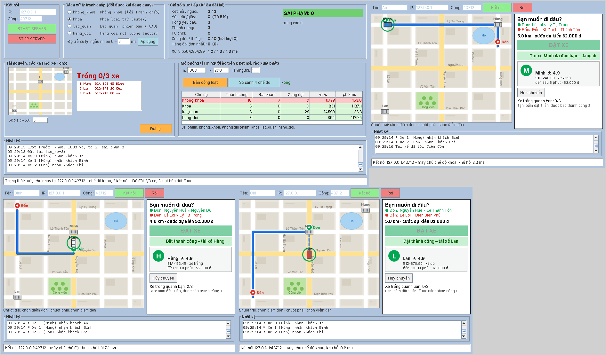
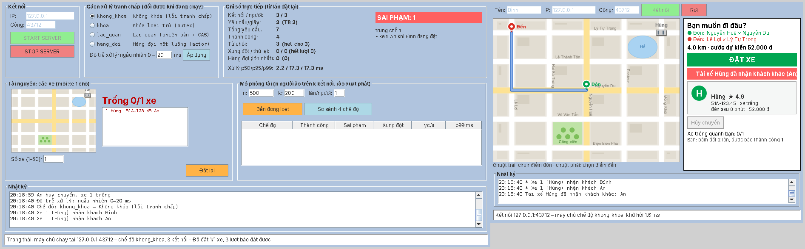
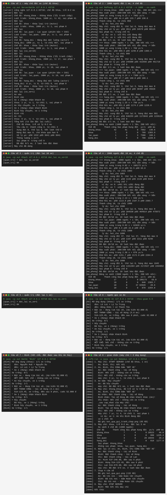

# Bài mở rộng MR6.7 – Đặt xe: n người cùng bấm "Đặt xe" cho một chỗ (Java)

| Thông tin | Nội dung |
|---|---|
| Loại | **Bài mở rộng**, không có trong giáo trình và không có mã giả tương ứng. Bài thứ hai của nhóm "tranh chấp tài nguyên" MR6.6–MR6.14, dùng chung khung của [MR6.6](../BaiMR6.6_DauGia/) |
| Liên hệ với giáo trình | Chương 6: Bài 6.1 (server đa luồng, một luồng mỗi kết nối), Bài 6.7 (kiểm thử tải); Chương 3: Bài 3.2 (định khung thông điệp theo dòng); bài mở rộng MR5.4/MR5.5 (luồng, đồng bộ) |
| Thư viện | JDK 21, chỉ thư viện chuẩn: `java.net`, `java.util.concurrent` (`ReentrantLock`, `LinkedBlockingQueue`, `CyclicBarrier`, `AtomicLong`, `ThreadLocalRandom`), `synchronized`; bản giao diện dùng thêm Swing (`javax.swing.Timer` cho hoạt hình xe), `java.awt.Robot`, `javax.imageio`. `Json.java` tự viết |
| Bản ngôn ngữ khác | [C#](../../../csharp/Chuong06/BaiMR6.7_DatXe/), [Python](../../../python/Chuong06/BaiMR6.7_DatXe/), [Rust](../../../rust/Chuong06/BaiMR6.7_DatXe/), [Go](../../../go/Chuong06/BaiMR6.7_DatXe/) |

## Mục tiêu
Bài mô phỏng một ứng dụng gọi xe. Có **m chiếc xe** (mặc định 1), mỗi xe **một chỗ**. **n người cùng bấm "Đặt xe"**: máy chủ giao xe trống gần điểm đón nhất, hết xe thì báo "Hết chỗ"; người đặt được có thể hủy chuyến để trả xe. Mỗi lần đặt là một thao tác "đọc trạng thái các xe → chọn xe (giả lập độ trễ cơ sở dữ liệu 0–2 ms) → ghi", xử lý theo **bốn cách** chọn được ngay lúc đang chạy: không khóa, khóa loại trừ, lạc quan, hàng đợi một luồng. **Sổ kiểm toán** đếm số lần một chỗ đã có người lại được giao cho người thứ hai. **Bộ mô phỏng tải** (1000 người cùng đặt 1 xe; 2000 người cùng đặt 10 xe; 200 kết nối, rào xuất phát, pipelining) cho thấy bằng số liệu thật: chỉ chế độ không khóa "bán" một chỗ cho nhiều người.

Bản Java chuyển ngữ đúng bản Python (giao thức, hành vi, dòng in). Khung (`Chung.java`, `KetNoiKhach.java`, `Khach.java`, `GiaoDienChung.java`, phần KHUNG của `MoPhong.java`, `Json.java`) chép nguyên từ MR6.6 bản Java; bài này chỉ viết nghiệp vụ (`MayChu.java`, phần NGHIỆP VỤ của `MoPhong.java`), ứng dụng người dùng, bảng tài nguyên của máy chủ và kịch bản demo.

## Kiến thức chính
Số liệu dưới đây lấy từ `ket_qua.txt`, một lần chạy thật trên máy cục bộ (127.0.0.1, OpenJDK 21, 2 lõi, độ trễ xử lý 0–2 ms). Mỗi lần chạy, số liệu lệch đi đôi chút.

```
1000 người cùng đặt 1 xe:
  Chế độ       Thành công Sai phạm Xung đột  yc/s  p99 ms
  khong_khoa           42       41        0  7862   138.6
  khoa                  1        0        0   769  1303.9
  lac_quan              1        0        3  7386   166.1
  hang_doi              1        0        0   799  1228.6
2000 người cùng đặt 10 xe:
  Chế độ       Thành công Sai phạm Xung đột  yc/s  p99 ms
  khong_khoa           17        7        0 106173    63.0
  khoa                 10        0        0   940  2303.7
  lac_quan             10        0       37 62929    28.6
  hang_doi             10        0        0   870  2264.8
```
(Mỗi người bấm một lần, 200 kết nối. "Thành công" là số người được báo "Đặt thành công", "Sai phạm" do sổ kiểm toán đếm, "Xung đột" là số lần so sánh-và-đổi thất bại, "yc/s" và "p99" (khứ hồi) đo ở bộ mô phỏng.)

- **Tranh chấp: một chỗ, nhiều người.** Ở `khong_khoa`, đặt xe làm "đọc các xe → chờ 0–2 ms → chọn xe trống → ghi" không đồng bộ. Mọi luồng đọc được trước lần ghi đầu tiên đều thấy "xe 1 trống", đều được báo "Đặt thành công – tài xế Hùng", bản ghi sau đè bản ghi trước. Với 1 xe, **42 người** cùng được báo thành công cho **một** chỗ, sổ kiểm toán đếm **41** lần "trùng chỗ" (ví dụ `xe 1: u22 khi u32 đang đặt`) – nhiều hơn hẳn bản Python (7/6) vì các luồng Java chạy song song thật trên nhiều lõi nên nhiều luồng lọt vào khe "đọc → ghi" đầu tiên. Người bị đè không hề biết: trên giao diện họ thấy "Tài xế Hùng đã nhận khách khác!" khi bản cập nhật kế tiếp tới, tức là *sau* khi đã được báo thành công. Chế độ này chỉ dùng để minh họa lỗi trong phòng lab (loopback).
- **Vì sao sai phạm tăng theo số khe chứ không theo số người.** Khe tranh chấp chỉ mở từ lúc luồng đầu tiên đọc tới lúc nó ghi xong; mọi người đọc sau đó đều thấy "Hết chỗ" và bị từ chối đúng. Với 10 xe, 2000 người, lần chạy này chỉ 17 người được báo thành công (7 sai phạm) vì phần lớn yêu cầu tới sau khi cả mười xe đã có khách; số liệu dao động mạnh giữa các lần chạy.
- **Vùng găng nhiều ô.** Để biết người đặt đã có chuyến chưa và xe trống nào gần nhất, mỗi lần đặt đọc **cả m ô** `xe1…xem`. Chế độ `khoa` giữ `ReentrantLock` của mọi ô (theo thứ tự tên ô, nên không khóa chết) suốt đọc – chọn – ghi: sai phạm 0, nhưng mọi yêu cầu đi qua cùng một bộ khóa nên thông lượng chỉ ≈ 770–940 yc/s, như `hang_doi`. Khóa theo từng tài nguyên chỉ có lợi khi mỗi thao tác chạm ít ô, như ghế rạp ở [MR6.8](../BaiMR6.8_DatVePhim/).
- **Lạc quan (Kung & Robinson 1981).** `lac_quan` đọc (giá trị, phiên bản) của các ô, chọn xe *ngoài* khóa, rồi so sánh-và-đổi: chỉ ghi nếu không ô nào đổi phiên bản (ý tưởng của `AtomicReference.compareAndSet`, mở rộng cho nhiều ô dưới một khóa rất ngắn). Chỉ vài yêu cầu đầu thật sự ghi nên xung đột ít (3 với 1 xe, 37 với 10 xe); người đến sau bị từ chối "hết chỗ" ngay sau lần đọc, nên thông lượng cao (7386 và 62929 yc/s).
- **Hàng đợi một luồng (actor).** `hang_doi` cho một luồng lấy việc từ `LinkedBlockingQueue` và xử lý lần lượt: sai phạm 0, hàng đợi dài tối đa **991** (1000 người) và **1945** (2000 người), khứ hồi p99 ≈ 1,2–2,3 s chính là thời gian xếp hàng.
- **Ảnh chụp trạng thái có số thứ tự.** `cap_nhat` gộp 10 lần/giây nên một bản chụp *trước* lần ghi của mình có thể tới *sau* trả lời `kq`. Mỗi lần ghi được đánh số (`AtomicLong`, `kq["phien"]`) và mỗi `cap_nhat` mang `"phien"` lúc chụp; client chỉ kết luận "xe đã nhận khách khác" từ bản cập nhật có `phien` ≥ số của lần đặt của mình.
- **Idempotency và pipelining.** Bộ mô phỏng gửi mọi yêu cầu của 5–10 người trên một kết nối trong một lần ghi socket sau `CyclicBarrier`; `ma_yc` gửi lại không bị đặt lần hai (máy chủ gửi lại kết quả cũ kèm `"lap_lai": true`).

### Giao thức (giống hệt ở 5 ngôn ngữ)
Khung chung (chào, quản trị, `kq`, `cap_nhat`, `su_kien`, `thong_ke`) xem [README MR6.6](../BaiMR6.6_DauGia/README.md#giao-thức-giống-hệt-ở-5-ngôn-ngữ). Phần riêng của bài:

| Chiều | Thông điệp |
|---|---|
| người dùng → server | `{"loai":"dat_xe","ma_yc":k,"don":[x,y],"den":[x,y]}` (ngã tư trên lưới 5 × 5, tọa độ 0.1/0.3/0.5/0.7/0.9; bỏ trống thì đón ở [0.5,0.5]); `{"loai":"huy","ma_yc":k}`. Kết nối gộp thêm `"nguoi":"u17"` |
| quản trị → server | `{"loai":"dat_lai","ma_yc":k,"so_xe":10}` (1–50) |
| server → client | `{"loai":"kq","ma_yc":k,"ok":true,"xe":1,"khach","tai_xe","bien_so","mau","phut","cuoc","phien"}`; từ chối: `"ma_loi":"het_cho"\|"da_dat"\|"chua_dat"\|"xung_dot"\|"sai_du_lieu"\|…` |
| server → tất cả | `{"loai":"cap_nhat","che_do","phien","so_xe","trong","xe":[{"ma","tai_xe","bien_so","mau","vi_tri","khach","don","den","gio","cuoc","phut"}…],"lich_su":[…]}`; `{"loai":"su_kien","noi_dung":"Xe 1 (Hùng) nhận khách An"}` (chỉ cho người dùng thật) |

Sai phạm trong `thong_ke`: `[{"ma":"trung_cho","ten":"trùng chỗ","so":n}]`; `tom_tat`: `Đã đặt 1/1 xe, 42 lượt báo đặt được`.

**Chạy chéo với bản Python (đã thử trên cùng máy):** (a) máy chủ Java + `mo_phong.py --n 1000 --so-sanh` + `dat_xe.py`: khong_khoa 200 người được báo thành công / 199 sai phạm, ba chế độ còn lại 1/0 (lac_quan 8 xung đột); `dat_xe.py` nhận "HẾT CHỖ", `huy` nhận "TỪ CHỐI: bạn chưa đặt xe". (b) máy chủ Python + `MoPhong` Java + `DatXe` Java: khong_khoa 2/1, ba chế độ còn lại 1/0 (lac_quan 3 xung đột); dòng in của `DatXe` giống hệt `dat_xe.py`.

## Cấu trúc tệp
- `Chung.java`, `KetNoiKhach.java`, `Khach.java`, `GiaoDienChung.java`, `Json.java`: **khung chung**, chép nguyên từ MR6.6 bản Java (chỉ đổi dòng đầu chú thích).
- `MayChu.java`: nghiệp vụ `MayChuDatXe` (đặt xe, hủy, chọn xe gần nhất, cước, số thứ tự lần ghi) và `SoKiemToanDatXe`; bản đồ (tên phố, ngã tư); `ServerDatXe.java` là bản dòng lệnh.
- `MoPhong.java`: bộ mô phỏng tải; phần NGHIỆP VỤ là `NguCanh`, `NguoiAo` (đặt từ một ngã tư ngẫu nhiên), `thamSoDatLai()` = {} (giữ số xe hiện tại của máy chủ).
- `DatXe.java`: người gọi xe bản dòng lệnh.
- `ServerGui.java`: bảng điều khiển máy chủ; `DatXeGui.java`: ứng dụng gọi xe (lớp `BanDo` vẽ bản đồ, dùng ở cả hai cửa sổ); `DemoGui.java`: kịch bản tự bấm nút.
- `demo.json`, `ket_qua.txt`, `ket_qua.png`, `ket_qua_gui.png`, `ket_qua_gui_tranh_chap.png`: kịch bản và kết quả thực thi thật.

## Cách chạy
Trong thư mục bài (cần JDK 21):
```bash
javac -encoding UTF-8 -d out *.java
java -cp out ServerDatXe 127.0.0.1 9000                      # cửa sổ 1 (gõ lệnh ở đây)
java -cp out MoPhong 127.0.0.1 9000 --n 1000 --so-sanh       # cửa sổ 2: 1000 người, 1 xe
java -cp out Khach 127.0.0.1 9000 dat_lai so_xe=10           # 10 xe
java -cp out MoPhong 127.0.0.1 9000 --n 2000 --so-sanh       # 2000 người, 10 xe
java -cp out DatXe An 127.0.0.1 9000                         # cửa sổ 3, 4…: gõ dat / huy
```
- Lệnh của máy chủ: `che_do khong_khoa|khoa|lac_quan|hang_doi`, `tre <ms>`, `dat_lai [so_xe=…]`, `thong_ke`, `thoat`. Tùy chọn: `--che-do`, `--tre-ms`, `--so-xe`.
- Lệnh của `DatXe`: `dat` (đặt từ điểm đón mặc định theo tên), `huy`, `thoat`. Dòng `@t lệnh` chờ tới giây thứ t rồi mới chạy lệnh.
- `MoPhong` có thêm `--k` (số kết nối), `--lan` (số lần bấm lại khi bị từ chối vì xung đột), `--che-do`, `--dat-lai`, `--tre-ms`.

Trong lượt chạy dòng lệnh (1 xe, `khoa`): An đặt được, Bình nhận "HẾT CHỖ", An hủy, Bình đặt lại được, rồi đến lượt An nhận "HẾT CHỖ". Tái lập kết quả từ thư mục gốc của kho: `python3 tools/demo.py java/Chuong06/BaiMR6.7_DatXe`.

## Ứng dụng giao diện


Ảnh trên là lần chạy thật của `DemoGui` (Linux, Xvfb, OpenJDK 21, Metal): máy chủ (trên trái), An (trên phải), Bình và Chi (dưới). Kịch bản đã chạy so sánh 4 chế độ với 3 xe (1000 người: `khong_khoa` 7 người được báo thành công, 4 sai phạm; ba chế độ kia 3/0), rồi đặt lại 3 xe. Ba người cùng bấm "ĐẶT XE" và mỗi người được một xe (Minh, Hùng, Lan); xe chạy hoạt hình theo tuyến nét đứt tới điểm đón rồi theo tuyến xanh tới điểm đến.



Bước trước đó: máy chủ ở `khong_khoa`, độ trễ 0–20 ms, 1 xe. An, Bình, Chi cùng bấm "ĐẶT XE"; An và Bình cùng nhận "Đặt thành công", bản cập nhật kế tiếp cho thấy xe 1 chở An nên Bình thấy "Tài xế Hùng đã nhận khách khác (An)!"; ô **SAI PHẠM** đỏ (trùng chỗ 1). Ở lần chạy thử trước, cả ba cùng được báo thành công (sai phạm 2). Cùng thao tác ở `khoa` (bước 2): một người "Đặt thành công", hai người "Hết chỗ – không còn xe trống".

- **Máy chủ** (`ServerGui`): phần chung giống MR6.6; **tài nguyên**: bản đồ thu nhỏ với các xe (xe có khách mờ đi, ghi tên khách), "Trống x/m xe", danh sách xe (tài xế, biển số, khách – đỏ khi có khách), ô **Số xe** và nút **Đặt lại**.
- **Gọi xe** (`DatXeGui`): **bản đồ** vẽ bằng `Graphics2D` (5 × 5 phố có tên, đường chính vàng, công viên, hồ, nhà; nền vẽ một lần vào `BufferedImage`); **điểm đón** (ghim xanh, chuột trái), **điểm đến** (ghim đỏ, chuột phải); tuyến đường; các xe theo màu; quãng đường và **cước dự kiến**; nút **ĐẶT XE**; trạng thái "Đang tìm tài xế…", "Đặt thành công – tài xế …", "Hết chỗ", "Tài xế … đã nhận khách khác!", "Tài xế … đã đón bạn – đang đi", "Đã tới nơi"; **thẻ tài xế**; nút **Hủy chuyến** (tới nơi thì thành **Hoàn tất chuyến**); "Xe trống quanh bạn"; thanh trạng thái hiện chế độ máy chủ và khứ hồi.

### Cách chạy
```bash
javac -encoding UTF-8 -d out *.java
java -cp out ServerGui 127.0.0.1 43712          # bấm START SERVER (1 xe)
java -cp out DatXeGui An 127.0.0.1 43712
java -cp out DatXeGui Bình 127.0.0.1 43712
```
- **Windows:** chỉ cần JDK 21 (`winget install -e --id Microsoft.OpenJDK.21`). **Linux:** `sudo apt install openjdk-21-jdk`. Kịch bản tự động (Linux, cần `xvfb`): `xvfb-run -a -s "-screen 0 2600x1700x24" java -cp out DemoGui 127.0.0.1 43712`.
- Chạy riêng từng cửa sổ: mọi dòng nhật ký và cứ 5 giây một dòng số liệu cũng in ra dòng lệnh.
- Thử trên nhiều máy: máy chủ nghe IP card mạng (hoặc `0.0.0.0`) và mở tường lửa cho cổng; mỗi sinh viên chạy `DatXeGui` với IP của máy thầy, cả lớp đếm ngược rồi cùng bấm "ĐẶT XE". Khi đó **chỉ dùng `khoa`, `lac_quan`, `hang_doi`**.

## Kết quả thực thi


## Ghi chú
- Nút "ĐẶT XE" gửi yêu cầu *trước* rồi mới vẽ lại giao diện; nhãn HTML của Swing được nạp sẵn khi dựng cửa sổ. Nếu không, lần dựng HTML đầu tiên tốn hàng chục ms trên luồng giao diện và ba lần bấm "cùng lúc" trong kịch bản không còn cùng lúc (khe tranh chấp đã đóng).
- Kịch bản dùng `doClick(0)` (mặc định `doClick()` giữ nút 68 ms).
- `thamSoDatLai()` = {}: `--so-sanh` đặt lại trạng thái mà vẫn giữ số xe đang có.
- Trong kịch bản giao diện, máy chủ, bộ mô phỏng và cửa sổ chạy trong một JVM nên yc/s thấp hơn bản dòng lệnh.
- Kiểm thử: Linux, OpenJDK 21.0.12 (dòng lệnh và giao diện dưới Xvfb), chạy chéo với Python 3.13.

## Bài tập gợi ý
1. Chạy `MoPhong --che-do khong_khoa --dat-lai` nhiều lần với 1 xe, rồi với `--tre-ms 10`. Vì sao số sai phạm tăng theo độ trễ mà gần như không tăng theo `--n`? So sánh với bản Python (GIL).
2. Đổi `xuLyYeuCau` để mỗi lần đặt chỉ khóa **một** ô (đọc không khóa để chọn xe, rồi `thucHien(List.of("xeK"), …)`; xe vừa có người thì thử xe kế). Đo thông lượng `khoa` với 10 xe. "Một người không đặt hai xe" còn được bảo đảm không?
3. Thêm thao tác `hoan_thanh` và cho `NguoiAo` đặt – hủy – đặt lại nhiều vòng (`--lan 5`). Sai phạm của `khong_khoa` thay đổi thế nào?
4. Cho xe di chuyển thật ở máy chủ (cập nhật `vi_tri` trong `dinhKy`). Ở `lac_quan`, số xung đột của thao tác đặt xe tăng ra sao?
5. Giao diện: khi nhận "Đặt thành công" rồi thấy "đã nhận khách khác", tự động đặt lại. Đây có phải cách "sửa" tranh chấp không? Vì sao?

## Đọc thêm
- H. T. Kung, J. T. Robinson (1981). *On Optimistic Methods for Concurrency Control*. ACM Transactions on Database Systems 6(2).
- E. G. Coffman, M. J. Elphick, A. Shoshani (1971). *System Deadlocks*. ACM Computing Surveys 3(2): điều kiện khóa chết và cách phòng bằng thứ tự khóa.
- Tài liệu JDK 21: [`java.util.concurrent`](https://docs.oracle.com/en/java/javase/21/docs/api/java.base/java/util/concurrent/package-summary.html), [`ReentrantLock`](https://docs.oracle.com/en/java/javase/21/docs/api/java.base/java/util/concurrent/locks/ReentrantLock.html), [`AtomicReference`](https://docs.oracle.com/en/java/javase/21/docs/api/java.base/java/util/concurrent/atomic/AtomicReference.html), [`BlockingQueue`](https://docs.oracle.com/en/java/javase/21/docs/api/java.base/java/util/concurrent/BlockingQueue.html), [`javax.swing.Timer`](https://docs.oracle.com/en/java/javase/21/docs/api/java.desktop/javax/swing/Timer.html), [`java.awt.Graphics2D`](https://docs.oracle.com/en/java/javase/21/docs/api/java.desktop/java/awt/Graphics2D.html).

Mã nguồn của bài được viết mới cho kho này.
