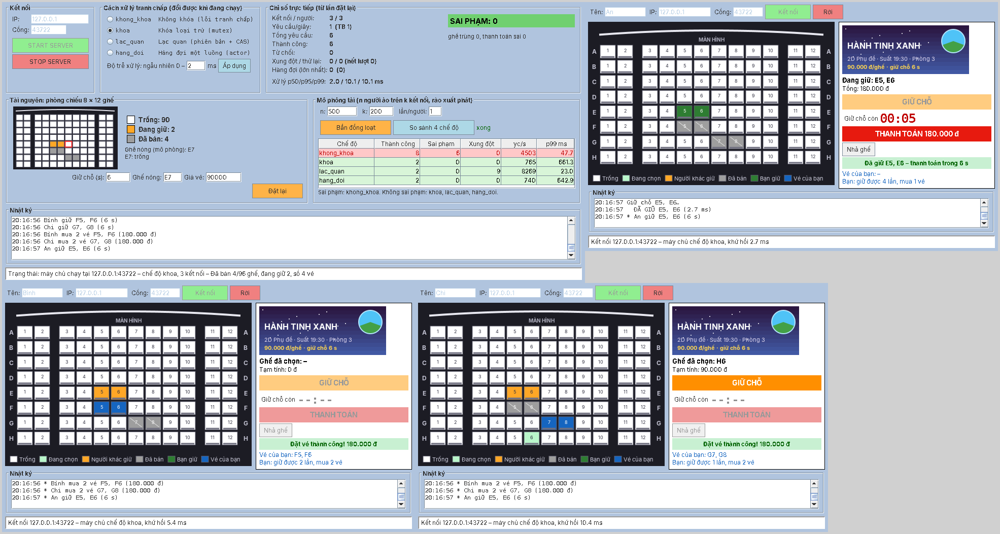
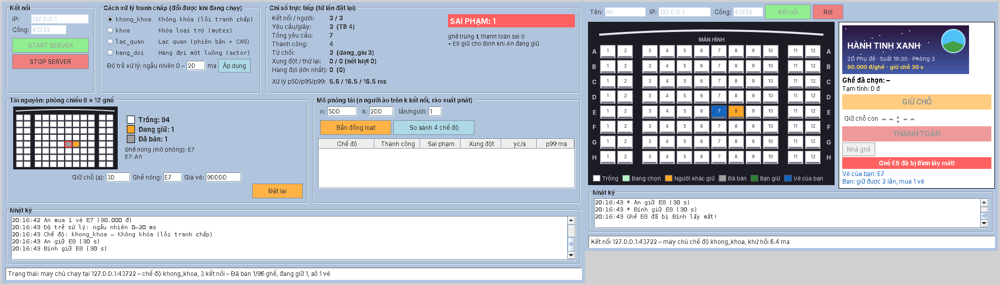
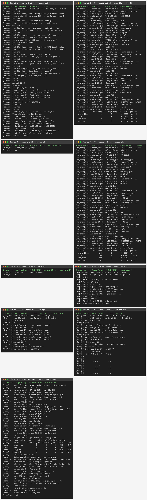

# Bài mở rộng MR6.8 – Đặt vé xem phim: giữ chỗ có thời hạn, n người cùng tranh một ghế (Java)

| Thông tin | Nội dung |
|---|---|
| Loại | **Bài mở rộng**, không có trong giáo trình và không có mã giả tương ứng. Thuộc nhóm "tranh chấp tài nguyên" MR6.6–MR6.13, dùng chung khung của [MR6.6](../BaiMR6.6_DauGia/) |
| Liên hệ với giáo trình | Chương 6: Bài 6.1 (server đa luồng, một luồng mỗi kết nối), Bài 6.7 (kiểm thử tải); Chương 3: Bài 3.2 (định khung thông điệp theo dòng); bài mở rộng MR5.4/MR5.5 (luồng, đồng bộ) |
| Thư viện | JDK 21, chỉ thư viện chuẩn: `java.net`, `java.util.concurrent` (`ReentrantLock` theo từng ghế, `LinkedBlockingQueue`, `CyclicBarrier`, `ConcurrentHashMap.newKeySet`, `AtomicLong`), `System.nanoTime` (đồng hồ đơn điệu); bản giao diện dùng thêm Swing, `java.awt.Robot`, `javax.imageio`. `Json.java` tự viết |
| Bản ngôn ngữ khác | [C#](../../../csharp/Chuong06/BaiMR6.8_DatVePhim/), [Python](../../../python/Chuong06/BaiMR6.8_DatVePhim/), [Rust](../../../rust/Chuong06/BaiMR6.8_DatVePhim/), [Go](../../../go/Chuong06/BaiMR6.8_DatVePhim/) |

## Mục tiêu
Bài mô phỏng một ứng dụng đặt vé xem phim. Phòng chiếu có **8 hàng (A–H) × 12 ghế**. Người xem chọn ghế rồi **giữ chỗ** (`giu_cho`): ghế được giữ riêng cho họ trong **30 giây** (TTL). Trong thời gian đó họ **thanh toán** (`thanh_toan`) để nhận vé, hoặc **nhả** (`nha`) ghế. Quá hạn mà chưa thanh toán thì ghế **tự nhả**: luồng nền của máy chủ dọn ghế quá hạn mỗi 100 ms, và một lượt giữ quá hạn cũng bị coi là trống ngay cả khi chưa kịp dọn. Thanh toán sau hạn bị từ chối. Mỗi ghế là một ô tài nguyên; mọi thao tác "đọc → kiểm tra (giả lập độ trễ 0–2 ms) → ghi" được xử lý theo **bốn cách**: không khóa, khóa loại trừ theo từng ghế, lạc quan, hàng đợi một luồng. **Sổ kiểm toán** đếm ghế giữ/bán cho hai người và thanh toán sai. **Bộ mô phỏng tải** chạy hai tình huống: 500 người cùng giữ một ghế "nóng" E7, và 300 người × 3 lần thử chọn nhóm 1–2 ghế ngẫu nhiên trên cả rạp.

Bản Java chuyển ngữ đúng bản Python (giao thức, hành vi, dòng in). Khung chép nguyên từ MR6.6 bản Java; bài này chỉ viết nghiệp vụ, ứng dụng người dùng, bảng tài nguyên của máy chủ và kịch bản demo.

## Kiến thức chính
Số liệu dưới đây lấy từ `ket_qua.txt`, một lần chạy thật trên máy cục bộ (127.0.0.1, OpenJDK 21, 2 lõi, độ trễ xử lý 0–2 ms). Mỗi lần chạy, số liệu lệch đi đôi chút.

```
500 người cùng giữ ghế nóng E7 (giữ được thì thanh toán ngay):
  Chế độ       Thành công Sai phạm Xung đột  yc/s  p99 ms
  khong_khoa            6        5        0  2859   230.5
  khoa                  2        0        0   799   624.7
  lac_quan              2        0        2  4025   113.9
  hang_doi              2        0        0   837   600.9
300 người × 3 lần thử, nhóm 1–2 ghế ngẫu nhiên (96 ghế):
  Chế độ       Thành công Sai phạm Xung đột  yc/s  p99 ms
  khong_khoa          149        6        0  2654   189.0
  khoa                148        0        0 47223    74.8
  lac_quan            160        0       13  9318    46.7
  hang_doi            154        0        0   827   370.7
```
("Thành công" đếm cả lần giữ chỗ và lần thanh toán được chấp nhận; "Sai phạm" do sổ kiểm toán đếm; "Xung đột" là số lần so sánh-và-đổi thất bại; "yc/s" và "p99" (khứ hồi) đo ở bộ mô phỏng; 200 kết nối.)

- **Tranh chấp trên một ghế nóng.** Ở `khong_khoa`, 500 người cùng đọc "E7 trống" và **5** người cùng được báo "ĐÃ GIỮ" (6 thành công = 5 lần giữ + 1 lần thanh toán). Sổ kiểm toán đếm **4** lần "ghế trùng" (ví dụ `E7 giữ cho u2 khi u179 đang giữ`) và **1** "thanh toán sai": một người bị đè vẫn thanh toán được vì lượt giữ của mình đã được ghi lại đúng lúc (đọc–ghi đan xen). Những người khác đi thanh toán bị từ chối "ghế E7 không do bạn giữ" (`khong_giu 4`). Người dùng thật thấy điều này trên giao diện: vừa được báo "Đã giữ E8" thì ngay sau đó là "Ghế E8 đã bị Bình lấy mất!". Ba chế độ còn lại cho đúng 1 người giữ, 1 vé, 0 sai phạm. `khong_khoa` chỉ dùng để minh họa lỗi trong phòng lab (loopback).
- **Khóa theo từng tài nguyên + đa lõi thật.** Ở tình huống nhiều ghế, mỗi yêu cầu chỉ chạm 1–2 ô. `khoa` khóa riêng từng ghế (`ReentrantLock` của ô), nên hai người chọn hai ghế khác nhau chạy **song song** – ở Java là song song thật trên nhiều lõi. Thông lượng đạt **47 223 yc/s** (xử lý ở máy chủ p50 1,4 ms), gấp hơn 50 lần `hang_doi` (827 yc/s, p50 320 ms, hàng đợi max 297); với một ghế nóng hai chế độ ngang nhau (799 và 837 yc/s). Bản Python cùng tình huống chỉ được 5545 yc/s vì GIL – lợi thế ở đó đến từ việc các luồng *cùng chờ* cơ sở dữ liệu giả lập. Một khóa toàn cục hay một luồng duy nhất tuần tự hóa cả những thao tác không hề đụng nhau.
- **Khóa nhiều ô theo thứ tự, không khóa chết.** Giữ "E7, E8" phải khóa cả hai ô (nhóm ghế được cả hoặc không được gì). Khung xin khóa theo **thứ tự tên ô đã sắp xếp** (`List.sort(null)`), nên "E8, E7" và "E7, E8" không bao giờ chờ nhau vòng tròn (Coffman và cộng sự 1971). Cả bốn chế độ đều bán hết 96/96 ghế ở tình huống nhiều ghế.
- **Lạc quan.** `lac_quan` đọc (giá trị, phiên bản) của các ghế trong yêu cầu, kiểm tra ngoài khóa rồi so sánh-và-đổi. Xung đột ít (2 và 13) vì phần lớn yêu cầu bị từ chối ngay sau lần đọc ("đã bán", "đang có người giữ").
- **Giữ chỗ có thời hạn (TTL) và luồng dọn.** Lượt giữ lưu thời điểm hết hạn theo **đồng hồ đơn điệu** (`System.nanoTime`), client nhận `con_lai_ms` chứ không nhận thời điểm tuyệt đối. Nhả ghế quá hạn cũng là một thao tác ghi đi qua cùng chế độ xử lý tranh chấp (ghế đang dọn nằm trong `ConcurrentHashMap.newKeySet()`). Lượt chạy dòng lệnh (giữ chỗ 3 s):
  - An giữ E7 rồi không thanh toán. Bình giữ E7 khi An còn hạn thì bị từ chối "ghế E7 đang có người giữ". Hết hạn, máy chủ báo "Hết hạn giữ E7 (An), ghế trống lại", Bình giữ và mua được E7 (mã vé `S1930-E7`).
  - An thanh toán muộn: "TỪ CHỐI: ghế E7 không do bạn giữ". Chi giữ F5, F6, thanh toán sau hạn: "TỪ CHỐI: giữ chỗ F5 đã hết hạn" (máy chủ nhớ ai giữ ghế lần cuối để báo đúng lý do).
- **Sổ kiểm toán.** Sổ giữ bản sao "ghế → (giữ/bán, người, hạn)" và kiểm tra từng giao dịch theo thứ tự ghi: giữ hay bán ghế mà người khác đang giữ còn hạn hoặc đã mua là `trung_ghe`; thanh toán được chấp nhận cho ghế không do mình giữ hoặc đã quá hạn là `tt_sai`. Thời điểm kiểm tra hạn là thời điểm mà hàm nghiệp vụ đã dùng (`_luc`, bỏ khỏi trả lời trước khi gửi client).
- **Ảnh chụp trạng thái có số thứ tự.** Mỗi lần ghi được đánh số (`kq["phien"]`), mỗi `cap_nhat` mang `"phien"` lúc chụp; client chỉ kết luận "ghế đã bị lấy" hay "đã hết hạn" từ bản cập nhật có `phien` ≥ số của lần giữ của mình.

### Giao thức (giống hệt ở 5 ngôn ngữ)
Khung chung xem [README MR6.6](../BaiMR6.6_DauGia/README.md#giao-thức-giống-hệt-ở-5-ngôn-ngữ). Phần riêng của bài:

| Chiều | Thông điệp |
|---|---|
| người dùng → server | `{"loai":"giu_cho","ma_yc":k,"ghe":["E7","E8"]}`, `{"loai":"thanh_toan","ma_yc":k,"ghe":[…]}`, `{"loai":"nha","ma_yc":k,"ghe":[…]}` (1–8 mã ghế A1–H12, không trùng). Kết nối gộp thêm `"nguoi":"u17"` |
| quản trị → server | `{"loai":"dat_lai","ma_yc":k,"ttl_s":30,"ghe_nong":"E7"\|"","gia_ve":90000,"phim":…,"suat":"19:30"}` |
| server → client | giữ: `{"loai":"kq","ok":true,"ghe":[…],"moi":[…],"het_han_ms":30000,"nguoi","phien"}`; thanh toán: `{"ok":true,"ghe","ma_ve":["S1930-E7"],"tien","nguoi","phien"}`; nhả: `{"ok":true,"ghe","nguoi","phien"}`; từ chối: `"ma_loi":"dang_giu"\|"da_ban"\|"khong_giu"\|"het_han"\|"xung_dot"\|"sai_du_lieu"\|…` (giữ thất bại kèm `"ghe_ban":[…]`) |
| server → tất cả | `{"loai":"cap_nhat","che_do","phien","phim","suat","gia_ve","ttl_s","ghe_nong","hang":"ABCDEFGH","cot":12,"so_do":["....g..b....",…],"chu":{"E7":"An",…},"con_lai_ms":{"E7":27000,…},"dem":{"trong","giu","ban"}}`; `su_kien` cho người dùng thật: "An giữ E7 (30 s)", "Bình mua 1 vé E7 (90.000 đ)", "Hết hạn giữ E7 (An), ghế trống lại" |

Sai phạm trong `thong_ke`: `ghế trùng`, `thanh toán sai`; `tom_tat`: `Đã bán 96/96 ghế, đang giữ 0, sổ 96 vé`.

**Chạy chéo với bản Python (đã thử trên cùng máy):** (a) máy chủ Java + `mo_phong.py --n 500 --so-sanh` + `dat_ve.py`: khong_khoa 30 thành công / 29 sai phạm, ba chế độ còn lại 2/0 (lac_quan 8 xung đột); `dat_ve.py` nhận "TỪ CHỐI: ghế E7 đã bán" và lệnh `xem` in đúng sơ đồ (E7 = `b`). (b) máy chủ Python + `MoPhong` Java + `DatVe` Java: khong_khoa 4/2, ba chế độ còn lại 2/0 (lac_quan 3 xung đột); dòng in và sơ đồ của `DatVe` giống hệt `dat_ve.py`.

## Cấu trúc tệp
- `Chung.java`, `KetNoiKhach.java`, `Khach.java`, `GiaoDienChung.java`, `Json.java`: **khung chung**, chép nguyên từ MR6.6 bản Java (chỉ đổi dòng đầu chú thích).
- `MayChu.java`: nghiệp vụ `MayChuDatVe` (giữ chỗ, thanh toán, nhả, dọn ghế quá hạn trong `dinhKy`, số thứ tự lần ghi) và `SoKiemToanDatVe`; `ServerDatVe.java` là bản dòng lệnh.
- `MoPhong.java`: bộ mô phỏng tải; phần NGHIỆP VỤ là `NguCanh` (sơ đồ ghế kết nối biết, chọn nhóm ghế trống ngẫu nhiên), `NguoiAo` (lần đầu giữ ghế nóng, giữ được thì thanh toán, bị từ chối thì chọn ghế khác), `thamSoDatLai()` = {}.
- `DatVe.java`: người đặt vé bản dòng lệnh (có lệnh `xem` in sơ đồ ghế).
- `ServerGui.java`: bảng điều khiển máy chủ; `DatVeGui.java`: ứng dụng đặt vé (lớp `SoDoGhe` vẽ phòng chiếu, dùng ở cả hai cửa sổ); `DemoGui.java`: kịch bản tự bấm.
- `demo.json`, `ket_qua.txt`, `ket_qua.png`, `ket_qua_gui.png`, `ket_qua_gui_tranh_chap.png`: kịch bản và kết quả thực thi thật.

## Cách chạy
Trong thư mục bài (cần JDK 21):
```bash
javac -encoding UTF-8 -d out *.java
java -cp out ServerDatVe 127.0.0.1 9000                             # cửa sổ 1 (gõ lệnh ở đây)
java -cp out MoPhong 127.0.0.1 9000 --n 500 --so-sanh               # cửa sổ 2: 500 người, ghế nóng E7
java -cp out Khach 127.0.0.1 9000 dat_lai ghe_nong=                 # bỏ ghế nóng: chọn ghế ngẫu nhiên
java -cp out MoPhong 127.0.0.1 9000 --n 300 --lan 3 --so-sanh       # nhiều ghế
java -cp out Khach 127.0.0.1 9000 dat_lai ttl_s=10 ghe_nong=E7      # giữ chỗ 10 s
java -cp out DatVe An 127.0.0.1 9000                                # cửa sổ 3, 4…: giu E7 / tt / nha / xem
```
- Lệnh của máy chủ: `che_do khong_khoa|khoa|lac_quan|hang_doi`, `tre <ms>`, `dat_lai [ttl_s=… ghe_nong=… gia_ve=…]`, `thong_ke`, `thoat`. Tùy chọn: `--che-do`, `--tre-ms`, `--ttl`, `--ghe-nong`.
- Lệnh của `DatVe`: `giu E7 [E8 …]`, `tt [ghế…]` (mặc định là các ghế vừa giữ, kể cả khi đã hết hạn, để thấy máy chủ từ chối), `nha [ghế…]`, `xem`, `thoat`. Dòng `@t lệnh` chờ tới giây thứ t rồi mới chạy lệnh.
- `MoPhong --lan L`: mỗi người thử giữ chỗ tối đa L lần.

Tái lập kết quả từ thư mục gốc của kho: `python3 tools/demo.py java/Chuong06/BaiMR6.8_DatVePhim`.

## Ứng dụng giao diện


Ảnh trên là lần chạy thật của `DemoGui` (Linux, Xvfb, OpenJDK 21, Metal): máy chủ (trên trái), An (trên phải), Bình và Chi (dưới). Kịch bản đã chạy so sánh 4 chế độ với ghế nóng E7 (bảng ở giữa: `khong_khoa` 8 thành công / 6 sai phạm tô đỏ, ba chế độ kia 2/0), rồi đặt lại với thời hạn giữ chỗ 6 s. An giữ F5, F6 mà không thanh toán; Bình bấm F6 thì thấy "Ghế F6 đang có người giữ"; hết hạn, An thấy "Hết thời gian giữ chỗ – ghế đã được nhả", Bình giữ lại F5, F6 và mua được (xanh dương ở Bình, xám ở người khác); Chi mua G7, G8. Lúc chụp, An đang giữ E5, E6 (xanh lá, đồng hồ 00:05, nút "THANH TOÁN 180.000 đ"), hai người kia thấy hai ghế đó màu cam, Chi đang chọn H6 (xanh nhạt).



Bước trước đó: máy chủ ở `khong_khoa`, độ trễ 0–20 ms. Cả ba chọn E8 rồi cùng bấm "GIỮ CHỖ"; An và Bình cùng nhận "ĐÃ GIỮ E8", bản cập nhật kế tiếp cho thấy E8 thuộc Bình nên An thấy "Ghế E8 đã bị Bình lấy mất!"; ô **SAI PHẠM** đỏ (ghế trùng 1). Cùng thao tác ở `khoa` (bước 2, ghế E7): một người giữ được, hai người nhận "Không giữ được: ghế E7 đang có người giữ".

- **Máy chủ** (`ServerGui`): phần chung giống MR6.6; **tài nguyên**: sơ đồ phòng chiếu thu nhỏ (trống / đang giữ / đã bán, ghế nóng viền đỏ), số ghế trống – đang giữ – đã bán, ghế nóng đang thuộc ai, ô **Giữ chỗ (s)**, **Ghế nóng**, **Giá vé** và nút **Đặt lại**.
- **Đặt vé** (`DatVeGui`): áp phích phim vẽ bằng `Graphics2D`; **sơ đồ ghế** với MÀN HÌNH, hai lối đi, nhãn hàng A–H, số ghế; màu **trống**, **đang chọn**, **người khác giữ**, **đã bán**, **bạn giữ**, **vé của bạn** kèm chú giải; bấm ghế để chọn/bỏ chọn (tối đa 8); "Ghế đã chọn", "Tạm tính"; nút **GIỮ CHỖ**; **đồng hồ giữ chỗ** (đỏ khi < 10 s, hết giờ thì khóa nút thanh toán); nút **THANH TOÁN** ghi tổng tiền; **Nhả ghế**; dòng thông báo; "Vé của bạn". Sơ đồ đổi ngay khi người khác giữ hoặc mua ghế (≤ 10 cập nhật/giây).

### Cách chạy
```bash
javac -encoding UTF-8 -d out *.java
java -cp out ServerGui 127.0.0.1 43722          # bấm START SERVER (giữ chỗ 30 s)
java -cp out DatVeGui An 127.0.0.1 43722
java -cp out DatVeGui Bình 127.0.0.1 43722
```
- **Windows:** chỉ cần JDK 21 (`winget install -e --id Microsoft.OpenJDK.21`). **Linux:** `sudo apt install openjdk-21-jdk`. Kịch bản tự động (Linux, cần `xvfb`): `xvfb-run -a -s "-screen 0 2600x1700x24" java -cp out DemoGui 127.0.0.1 43722`.
- Chạy riêng từng cửa sổ: mọi dòng nhật ký và cứ 5 giây một dòng số liệu cũng in ra dòng lệnh.
- Thử trên nhiều máy: máy chủ nghe IP card mạng (hoặc `0.0.0.0`) và mở tường lửa cho cổng; cả lớp cùng tranh ghế E7. Khi đó **chỉ dùng `khoa`, `lac_quan`, `hang_doi`**.

## Kết quả thực thi


## Ghi chú
- Trong lượt giữ chỗ, các trường nội bộ (`_luc`, `_het_han`) được bỏ khỏi trả lời trước khi gửi client, như bản Python.
- Ô trạng thái của mỗi ghế là `Map` mới cho mỗi lần ghi (`volatile`), nên luồng đọc để hiển thị (`trangThaiNghiepVu`) không bao giờ thấy một ghế "nửa giữ nửa bán".
- `thamSoDatLai()` = {}: `--so-sanh` đặt lại sơ đồ ghế mà vẫn giữ thời hạn và ghế nóng hiện tại của máy chủ.
- Trong kịch bản giao diện, máy chủ, bộ mô phỏng và cửa sổ chạy trong một JVM nên yc/s thấp hơn bản dòng lệnh; kịch bản dùng `doClick(0)`.
- Kiểm thử: Linux, OpenJDK 21.0.12 (dòng lệnh và giao diện dưới Xvfb), chạy chéo với Python 3.13.

## Bài tập gợi ý
1. Chạy tình huống nhiều ghế với `--tre-ms 0`, `2`, `10`. Khoảng cách thông lượng giữa `khoa` và `hang_doi` thay đổi thế nào? So sánh với bản Python.
2. Bật `khoaNgayTho` của `KhoTranhChap` rồi cho một nửa số người ảo giữ "E8, E7" và nửa kia giữ "E7, E8". Có xuất hiện `khoa_cho_lau` (nghi khóa chết, `tryLock` quá 2 s) không?
3. Thêm thao tác `gia_han` (gia hạn giữ chỗ thêm 30 s, tối đa một lần). Sổ kiểm toán cần luật nào để phát hiện gia hạn quá số lần ở `khong_khoa`?
4. Bỏ "lazy expiry" (chỉ để luồng dọn nhả ghế quá hạn). Người đến đúng lúc ghế vừa hết hạn mà luồng dọn chưa chạy sẽ thấy gì?
5. Làm "ghế đôi" (cặp ghế bán cùng nhau, ví dụ H5–H6). Viết hàm nghiệp vụ và luật sổ kiểm toán tương ứng.
6. Giao diện: vẽ trên ghế người khác đang giữ một vòng tròn nhỏ thể hiện thời gian giữ còn lại (từ `con_lai_ms`).

## Đọc thêm
- H. T. Kung, J. T. Robinson (1981). *On Optimistic Methods for Concurrency Control*. ACM Transactions on Database Systems 6(2).
- E. G. Coffman, M. J. Elphick, A. Shoshani (1971). *System Deadlocks*. ACM Computing Surveys 3(2): điều kiện khóa chết và cách phòng bằng thứ tự khóa.
- Tài liệu JDK 21: [`java.util.concurrent`](https://docs.oracle.com/en/java/javase/21/docs/api/java.base/java/util/concurrent/package-summary.html), [`ReentrantLock`](https://docs.oracle.com/en/java/javase/21/docs/api/java.base/java/util/concurrent/locks/ReentrantLock.html), [`AtomicReference`](https://docs.oracle.com/en/java/javase/21/docs/api/java.base/java/util/concurrent/atomic/AtomicReference.html), [`BlockingQueue`](https://docs.oracle.com/en/java/javase/21/docs/api/java.base/java/util/concurrent/BlockingQueue.html), [`System.nanoTime`](https://docs.oracle.com/en/java/javase/21/docs/api/java.base/java/lang/System.html#nanoTime()), [`javax.swing`](https://docs.oracle.com/en/java/javase/21/docs/api/java.desktop/javax/swing/package-summary.html).

Mã nguồn của bài được viết mới cho kho này.
