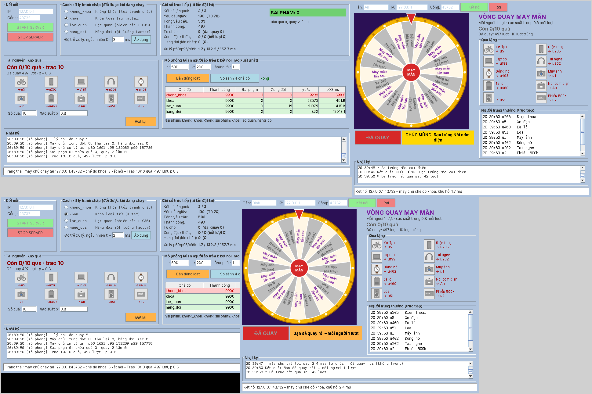
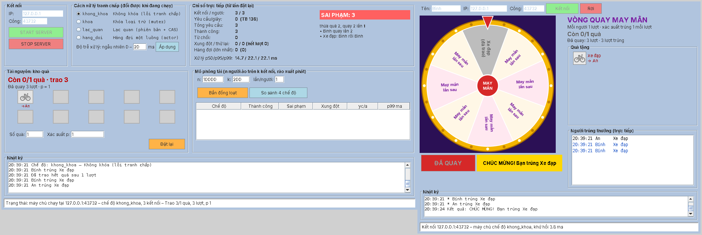
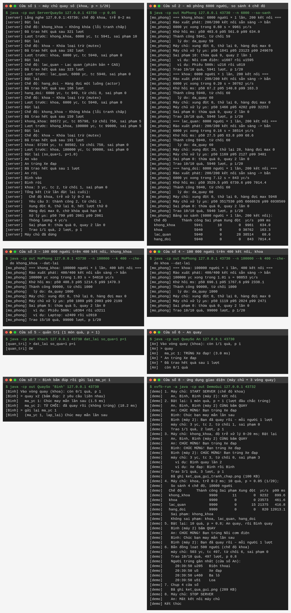

# Bài mở rộng MR6.9 – Quay số trúng thưởng: 100 000 lượt quay tranh 10 món quà (Java)

| Thông tin | Nội dung |
|---|---|
| Loại | **Bài mở rộng**, không có trong giáo trình và không có mã giả tương ứng. Thuộc nhóm "tranh chấp tài nguyên" MR6.6–MR6.13, dùng chung khung của [MR6.6](../BaiMR6.6_DauGia/) |
| Liên hệ với giáo trình | Chương 6: Bài 6.1 (server đa luồng, một luồng mỗi kết nối), Bài 6.7 (kiểm thử tải); Chương 3: Bài 3.2 (định khung thông điệp theo dòng); bài mở rộng MR5.4/MR5.5 (luồng, đồng bộ) |
| Thư viện | JDK 21, chỉ thư viện chuẩn: `java.net`, `java.util.concurrent` (`ReentrantLock` theo từng ô, `LinkedBlockingQueue`, `CyclicBarrier`, `ThreadLocalRandom`), `synchronized` (khóa tạo ô, sổ kiểm toán); bản giao diện dùng thêm Swing (`Timer` cho hoạt hình), `java.awt.Robot`, `javax.imageio`. `Json.java` tự viết |
| Bản ngôn ngữ khác | [C#](../../../csharp/Chuong06/BaiMR6.9_QuaySo/), [Python](../../../python/Chuong06/BaiMR6.9_QuaySo/), [Rust](../../../rust/Chuong06/BaiMR6.9_QuaySo/), [Go](../../../go/Chuong06/BaiMR6.9_QuaySo/) |

## Mục tiêu
Bài mô phỏng chương trình khuyến mãi "Vòng quay may mắn". Kho có **10 món quà**, hàng chục nghìn khách hàng mỗi người được **quay đúng một lần**. Mỗi lượt trúng với xác suất **p** (mặc định 1/2000) nếu kho còn quà; người trúng nhận ngẫu nhiên một món còn lại. Hai tài nguyên bị tranh chấp: **kho quà** (ô `qua`, mọi lượt trúng cùng ghi) và **lượt quay của từng người** (ô `ng:<tên>`; hai thiết bị của cùng một người, hoặc một lần bấm đúp, cùng gửi `quay`). Thao tác "đọc → kiểm tra (giả lập độ trễ 0–2 ms) → ghi" được xử lý theo **bốn cách** đổi được lúc đang chạy: không khóa, khóa loại trừ, lạc quan, hàng đợi một luồng. **Sổ kiểm toán** đếm **thừa quà** và **quay 2 lần**. Bộ mô phỏng dồn **100 000 người lên 400 kết nối**.

Bản Java chuyển ngữ đúng bản Python (giao thức, hành vi, dòng in). Khung (`Json`, `Chung`, `KetNoiKhach`, `Khach`, `GiaoDienChung`, phần KHUNG của `MoPhong`) chép nguyên từ MR6.6 bản Java; bài này chỉ viết nghiệp vụ, ứng dụng người dùng, bảng tài nguyên và kịch bản demo.

## Kiến thức chính
Số liệu lấy từ `ket_qua.txt`, một lần chạy thật trên máy cục bộ (127.0.0.1, OpenJDK 21, 2 lõi, độ trễ xử lý 0–2 ms). Như bản Python, máy chủ demo chạy với **p = 1/20** (`--p 0.05`) để sai phạm hiện rõ trong vài giây. Mỗi lần chạy, số liệu lệch đi đôi chút.

```
  Chế độ       Thành công Sai phạm Xung đột  yc/s  p99 ms
  khong_khoa         5941       10        0  9961   634.0
  khoa               5940        0        0 30762   163.3
  lac_quan           5940        0       28 38514    68.6
  hang_doi           5940        0        0   843  7014.4
```
(6000 người × 1 lượt, 200 kết nối, 10 quà, p = 1/20. "Thành công" là số lượt quay được chấp nhận; 60 yêu cầu còn lại là thiết bị thứ hai của 60 người và phải bị từ chối `da_quay`. "Sai phạm" do sổ kiểm toán đếm; "Xung đột" là số lần so sánh-và-đổi thất bại; "yc/s", "p99" (khứ hồi) đo ở bộ mô phỏng.)

**100 000 người trên 400 kết nối**, cùng p = 1/20:

| Chế độ | Thời gian | yc/s | Khứ hồi p99 | Thành công / từ chối | Sai phạm |
|---|---|---|---|---|---|
| `khong_khoa` | 1,83 s | 54 610 | 1,47 s | 99 000 / 1000 | 5 (thừa quà 5: **trao 15/10 quà**) |
| `khoa` | 1,01 s | 98 853 | 2,34 s | 99 000 / 1000 | 0 (trao 10/10) |

- **Tranh chấp trên kho quà.** Ở `khong_khoa`, hai lượt trúng gần như cùng lúc cùng đọc kho, cùng bốc một món rồi ghi lại: có khi hai người bốc trúng **cùng một món** (`Nồi cơm điện: u1607 rồi u1595`), có khi bản ghi sau đè bản trước làm món vừa trao "sống lại". 6000 người được trao **19 món** từ kho 10 món (thừa quà 9) và một người có hai lượt quay được chấp nhận (quay 2 lần 1). Ba chế độ còn lại trao đúng 10/10.
- **Idempotency theo tên, không chỉ theo `ma_yc`.** Khung chống *gửi lại* cùng `ma_yc` (cửa sổ 7: `gui_lai 1` nhận lại "Chúc may mắn lần sau" kèm `lap_lai`, không quay lần nữa). Bấm đúp hay hai thiết bị sinh **hai `ma_yc` khác nhau**, nên luật "mỗi người một lượt" nằm trong trạng thái: ô `ng:<tên>` ghi kết quả, yêu cầu thứ hai nhận `da_quay` ("đã quay rồi (không trúng)").
- **Khóa theo tài nguyên + đa lõi thật.** Rút thăm (`ThreadLocalRandom.nextDouble() < p`) làm **trước**, ngoài vùng găng. Lượt không trúng chỉ khóa ô của chính người đó, nên hàng trăm lượt chạy song song trên nhiều lõi; chỉ lượt trúng mới khóa thêm ô `qua` (hai khóa theo thứ tự tên ô, không khóa chết); hết quà thì khỏi chạm ô `qua`. Kết quả: `khoa` 30 762 yc/s, gấp hơn 36 lần `hang_doi`, ngang tầm `khong_khoa` (ở lượt 100 000 người còn đo được cao hơn – số yc/s dao động giữa các lần chạy, điều chắc chắn là khóa theo ô không làm chậm đáng kể). Bản Python cùng tình huống khoảng 9300 yc/s vì GIL.
- **Lạc quan (Kung & Robinson 1981).** `lac_quan` đọc (giá trị, phiên bản), xử lý ngoài khóa, so sánh-và-đổi: 28 xung đột, mỗi xung đột thử lại thành công, 0 sai phạm, nhanh nhất (38 514 yc/s).
- **Hàng đợi một luồng (actor).** `hang_doi` đúng tuyệt đối nhưng **tuần tự**: 843 yc/s, hàng đợi dài tới 5948, p99 khứ hồi 7 s. Vì vậy lượt 100 000 người chỉ chạy `khong_khoa` và `khoa` (như bản Python).
- **Đọc nhanh không quét cả kho.** Lần chạy đầu của bản Java đọc ô `qua` bằng `kho.anhChup()` (chép cả 100 000 ô mỗi lượt trúng thăm) và chỉ đạt khoảng 3300 yc/s; đọc thẳng ô `qua` (`kho.doc("qua")`) đưa lên 54 610 – 98 853 yc/s.

### Giao thức (giống hệt ở 5 ngôn ngữ)
Phần chung (chào, quản trị, `thong_ke`, `lap_lai`) xem [README MR6.6](../BaiMR6.6_DauGia/README.md#giao-thức-giống-hệt-ở-5-ngôn-ngữ).

| Chiều | Thông điệp |
|---|---|
| người dùng → server | `{"loai":"quay","ma_yc":k}` (kết nối gộp thêm `"nguoi":"u17"`) |
| server → client | `{"loai":"kq","ma_yc":k,"ok":true,"trung":true,"qua":3,"ten_qua":"Tai nghe","nguoi":"An","con_lai":9}` · `{"ok":true,"trung":false,"qua":null,"nguoi":"An"}` · `{"ok":false,"ma_loi":"da_quay","ly_do":"đã quay rồi (trúng Tai nghe)","qua":3}` |
| server → tất cả | `{"loai":"cap_nhat","che_do":…,"so_qua":10,"p":5.0E-4,"con_lai":7,"qua":[{"ma","ten","con","nguoi"}…],"da_quay":12345,"so_trung":3,"nguoi_trung":[{"nguoi","qua","gio"}…]}` (≤ 10 lần/s); `{"loai":"su_kien","noi_dung":"An trúng Tai nghe"}` |
| quản trị → server | `{"loai":"dat_lai","ma_yc":k,"so_qua":10,"p":0.0005}` (số quà 1–10, p trong [0, 1]) |

Sai phạm trong `thong_ke`: `thừa quà`, `quay 2 lần`; `tom_tat`: `Trao 10/10 quà, 5940 lượt, p 1/20`.

**Chạy chéo với bản Python (đã thử trên cùng máy):** (a) máy chủ Java + `mo_phong.py --n 3000 --so-sanh` + `quay_so.py`: khong_khoa 2971 thành công / 8 sai phạm, ba chế độ còn lại 2970/0 (lac_quan 27 xung đột); `quay_so.py` bấm đúp nhận "TỪ CHỐI: đã quay rồi (không trúng)", `gui_lai 1` nhận `(ma_yc 1, lap_lai) Chúc may mắn lần sau`. (b) máy chủ Python + `MoPhong` Java + `QuaySo` Java: khong_khoa 2970/50, ba chế độ còn lại 2970/0; dòng in của `QuaySo` giống hệt `quay_so.py`.

## Cấu trúc tệp
- `Chung.java`, `KetNoiKhach.java`, `Khach.java`, `GiaoDienChung.java`, `Json.java`, phần KHUNG của `MoPhong.java`: **khung chung**, chép nguyên từ MR6.6 bản Java (chỉ đổi dòng đầu chú thích).
- `MayChu.java`: nghiệp vụ `MayChuQuaySo` (ô `qua`, ô `ng:<tên>` tạo khi người đó quay lần đầu dưới một khóa tạo ô, rút thăm ngoài vùng găng) và `SoKiemToanQuaySo`; `ServerQuaySo.java` là bản dòng lệnh.
- `MoPhong.java`: phần NGHIỆP VỤ gồm `NguoiAo` (quay `lan` lần; người thứ 100, 200, … dùng tên người liền trước), `thamSoDatLai()` = {}.
- `QuaySo.java`: người quay bản dòng lệnh (`quay`, `quay x2`, `gui_lai [k]`).
- `ServerGui.java`: bảng điều khiển máy chủ; `VongQuayGui.java`: vòng quay may mắn (cũng chứa `veQua` – ảnh 10 món quà, dùng ở cả hai cửa sổ); `DemoGui.java`: kịch bản tự bấm.
- `demo.json`, `ket_qua.txt`, `ket_qua.png`, `ket_qua_gui.png`, `ket_qua_gui_tranh_chap.png`: kịch bản và kết quả thực thi thật.

## Cách chạy
Trong thư mục bài (cần JDK 21):
```bash
javac -encoding UTF-8 -d out *.java
java -cp out ServerQuaySo 127.0.0.1 9000 --p 0.05                       # cửa sổ 1 (gõ lệnh ở đây)
java -cp out MoPhong 127.0.0.1 9000 --n 6000 --so-sanh                  # cửa sổ 2: bảng so sánh 4 chế độ
java -cp out MoPhong 127.0.0.1 9000 --n 100000 --k 400 --che-do khoa --dat-lai
java -cp out Khach 127.0.0.1 9000 dat_lai so_qua=10 p=0.0005             # chương trình thật: p = 1/2000
java -cp out QuaySo An 127.0.0.1 9000                                   # cửa sổ 3, 4…: quay / quay x2 / gui_lai
```
- Lệnh của máy chủ: `che_do khong_khoa|khoa|lac_quan|hang_doi`, `tre <ms>`, `dat_lai [so_qua=… p=…]`, `thong_ke`, `thoat`. Tùy chọn: `--che-do`, `--tre-ms`, `--so-qua`, `--p`.
- Lệnh của `QuaySo`: `quay`; `quay x2` (bấm đúp: hai `ma_yc` khác nhau); `gui_lai [k]` (gửi lại đúng `ma_yc` k – trường `ma_yc` truyền vào `guiYc` đè lên số tự đánh); `thoat`. Dòng `@t lệnh` chờ tới giây thứ t.

Tái lập kết quả từ thư mục gốc của kho: `python3 tools/demo.py java/Chuong06/BaiMR6.9_QuaySo`.

## Ứng dụng giao diện


Ảnh trên là lần chạy thật của `DemoGui` (Linux, Xvfb, OpenJDK 21, Metal): máy chủ (trên trái), An (trên phải), Bình và "Bình (máy 2)" (dưới). Kịch bản đã so sánh 4 chế độ (10 000 người, p = 1/20; bảng ở giữa: `khong_khoa` 11 sai phạm tô đỏ, ba chế độ kia 0), rồi với 10 quà và p = 0,8: An trúng Nồi cơm điện, Bình "Chúc bạn may mắn lần sau", "Bình (máy 2)" bấm QUAY thì nhận "Bạn đã quay rồi – mỗi người 1 lượt"; 500 người ảo quay hết số quà còn lại, danh sách người trúng trực tiếp cập nhật ở cả ba cửa sổ, ô quà đã trao chuyển xám kèm tên người nhận.



Bước trước đó: máy chủ `khong_khoa`, độ trễ 0–20 ms, **1 món quà**, p = 1. An, Bình và Bình (máy 2) cùng bấm QUAY: cả ba nhận "CHÚC MỪNG! Bạn trúng Xe đạp" (ảnh phải là Bình (máy 2)); ô **SAI PHẠM** đỏ (3: thừa quà 2, quay 2 lần 1), tóm tắt "Trao 3/1 quà". Cùng thao tác ở `khoa` (bước 2): đúng một người trúng, thiết bị thứ hai của Bình bị từ chối.

- **Máy chủ** (`ServerGui`): phần chung giống MR6.6; **tài nguyên**: số quà còn lại và số đã trao (đỏ khi trao quá số quà), số lượt đã quay, p, ảnh 10 món quà (viền xanh là còn, xám kèm "→tên" là đã trao), ô **Số quà**, **Xác suất p**, nút **Đặt lại**.
- **Vòng quay may mắn** (`VongQuayGui`): bánh xe vẽ bằng `Graphics2D` (`Arc2D.PIE`, chữ xoay theo ô), mỗi món một ô màu, xen giữa là "May mắn lần sau", món đã trao xám "(đã trao)"; kim ở đỉnh; đèn viền nhấp nháy khi quay. Bấm **QUAY**: yêu cầu gửi đi ngay, bánh xe quay tự do (`javax.swing.Timer` 30 ms); có kết quả thì giảm tốc (ease-out 2,6 s) và dừng **đúng ô kết quả**. Bên phải: số quà còn lại, ảnh từng món kèm "còn / → người nhận", danh sách người trúng trực tiếp (tên mình tô xanh).

### Cách chạy
```bash
javac -encoding UTF-8 -d out *.java
java -cp out ServerGui 127.0.0.1 43732          # bấm START SERVER (10 quà, p = 1/2000)
java -cp out VongQuayGui An 127.0.0.1 43732
java -cp out VongQuayGui Bình 127.0.0.1 43732
```
- **Windows:** chỉ cần JDK 21 (`winget install -e --id Microsoft.OpenJDK.21`). **Linux:** `sudo apt install openjdk-21-jdk`. Kịch bản tự động (Linux, cần `xvfb`): `xvfb-run -a -s "-screen 0 2600x1700x24" java -cp out DemoGui 127.0.0.1 43732`.
- Chạy riêng từng cửa sổ: mọi dòng nhật ký và cứ 5 giây một dòng số liệu cũng in ra dòng lệnh.
- Thử trên nhiều máy: máy chủ nghe IP card mạng (hoặc `0.0.0.0`), mở tường lửa cho cổng; muốn cả lớp có người trúng hãy đặt p = 0,1–0,3. Khi đó **chỉ dùng `khoa`, `lac_quan`, `hang_doi`**.

## Kết quả thực thi


## Ghi chú
- Java chạy song song thật trên nhiều lõi nên khe đọc–ghi rộng hơn bản Python (không có GIL); tranh chấp vẫn hiện rõ ở `khong_khoa` dù phần lớn yêu cầu chỉ chạm ô của chính người đó.
- Ô `ng:<tên>` được tạo dưới một khóa tạo ô riêng (`synchronized`) để hai thiết bị không tạo hai ô khác nhau cho cùng một người; việc kiểm tra "đã quay chưa" vẫn đi qua chế độ đang chọn.
- Dòng 5 giây và dòng "Lượt trước" của máy chủ có thể dài 65–66 ký tự khi số yêu cầu lên tới 100 000 – định dạng của khung chung, như bản Python.
- Trong kịch bản giao diện, máy chủ, bộ mô phỏng và cửa sổ chạy trong một JVM nên yc/s thấp hơn bản dòng lệnh; kịch bản bấm nút bằng `doClick(0)`, mỗi nút gửi yêu cầu trước rồi mới vẽ lại.
- Kiểm thử: Linux, OpenJDK 21.0.12 (dòng lệnh và giao diện dưới Xvfb), chạy chéo với Python 3.13.

## Bài tập gợi ý
1. Chạy `MoPhong --n 30000 --so-sanh` với p = 1/2000. `khong_khoa` có còn trao thừa quà không? Vì sao xác suất hai lượt trúng "đụng nhau" phụ thuộc p × (số yêu cầu đang xử lý cùng lúc) × (độ rộng khe đọc–ghi)?
2. Bỏ đoạn "hết quà thì khỏi chạm ô `qua`" trong `MayChu.java`, rồi đo lại thông lượng của `khoa` với p = 1/20.
3. Gộp ô của mọi người thành một ô `da_quay` (một tập tên). Thông lượng `khoa` và số xung đột `lac_quan` thay đổi thế nào (độ mịn của khóa – lock granularity)?
4. Thêm luật "mỗi người quay tối đa 3 lần, trúng tối đa 1 lần": đổi giá trị ô `ng:<tên>` và luật sổ kiểm toán ra sao?
5. Ở `lac_quan`, nếu rút thăm *bên trong* hàm xử lý (mỗi lần thử lại rút lại) thì xác suất trúng thực tế có còn là p không?
6. Giao diện: cho bánh xe dừng có "nảy" nhẹ, và phát tiếng "tách" (`Toolkit.beep()`) mỗi khi kim qua một ô.

## Đọc thêm
- H. T. Kung, J. T. Robinson (1981). *On Optimistic Methods for Concurrency Control*. ACM Transactions on Database Systems 6(2).
- E. G. Coffman, M. J. Elphick, A. Shoshani (1971). *System Deadlocks*. ACM Computing Surveys 3(2): thứ tự khóa (lượt trúng giữ hai khóa: ô người và ô quà).
- Tài liệu JDK 21: [`java.util.concurrent`](https://docs.oracle.com/en/java/javase/21/docs/api/java.base/java/util/concurrent/package-summary.html), [`ReentrantLock`](https://docs.oracle.com/en/java/javase/21/docs/api/java.base/java/util/concurrent/locks/ReentrantLock.html), [`AtomicReference`](https://docs.oracle.com/en/java/javase/21/docs/api/java.base/java/util/concurrent/atomic/AtomicReference.html), [`BlockingQueue`](https://docs.oracle.com/en/java/javase/21/docs/api/java.base/java/util/concurrent/BlockingQueue.html), [`ThreadLocalRandom`](https://docs.oracle.com/en/java/javase/21/docs/api/java.base/java/util/concurrent/ThreadLocalRandom.html), [`java.awt.geom.Arc2D`](https://docs.oracle.com/en/java/javase/21/docs/api/java.desktop/java/awt/geom/Arc2D.html).

Mã nguồn của bài được viết mới cho kho này.
