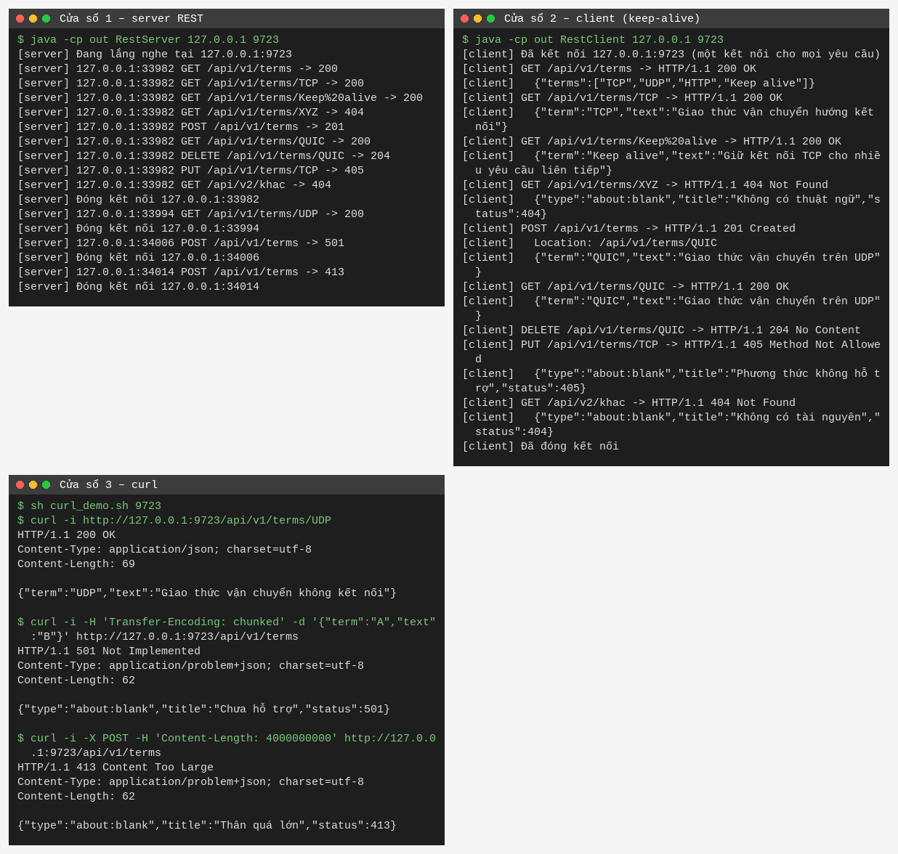

# Bài 7.2 – Server REST tối giản trên HTTP/1.1 (Java)

| Thông tin | Nội dung |
|---|---|
| Mã giả tương ứng | Mã giả 7.2 (Server REST tối giản trên HTTP/1.1) |
| Mục giáo trình | 7.2.3 Thiết kế RESTful API |
| Kế thừa | Mã giả 6.3 (server bất đồng bộ), Mã giả 7.1 (READ_HEADERS), Mã giả 3.7 (DICT nạp từ `glossary.json`) |
| Thư viện | JDK: `java.net.ServerSocket`, luồng ảo (`Thread.startVirtualThread`), `java.net.URLDecoder` |

## Mục tiêu
Cài đặt `HTTP_SESSION`, `ROUTE`, `RESPOND` cho dịch vụ tra cứu thuật ngữ theo thiết kế RESTful của Mục 7.2.3: giữ kết nối cho nhiều yêu cầu, từ chối thân chunked (501) và thân quá lớn (413) trước khi đọc, trả lỗi theo Problem Details (`application/problem+json`), tính `Content-Length` theo byte UTF-8. Bổ sung theo bài tập cuối chương: `POST /api/v1/terms` (201 kèm `Location`, 400, 409) và `DELETE /api/v1/terms/{term}` (204).

## Tệp
- `RestServer.java` – Mã giả 7.2: `httpSession`, `route`, `respond`, `problem`.
- `Reader.java` – bộ đọc có `pending` (READ_LINE, READ_EXACT, READ_HEADERS).
- `Json.java` – JSON tối giản (JDK không có thư viện JSON chuẩn).
- `RestClient.java` – client thử, gửi nhiều yêu cầu trên một kết nối keep-alive.
- `glossary.json`, `curl_demo.sh`.
- `demo.json` – kịch bản chạy minh họa (dùng với `tools/demo.py`).
- `ket_qua.txt`, `ket_qua.png` – kết quả thực thi thật.

## Cách chạy
Chạy trong thư mục bài (server đọc `glossary.json` ở thư mục hiện hành):
```bash
javac -encoding UTF-8 -d out Reader.java Json.java RestServer.java RestClient.java
```
```bash
# Cửa sổ 1 – server
java -cp out RestServer 0.0.0.0 8080
# Cửa sổ 2 – client keep-alive
java -cp out RestClient 127.0.0.1 8080
# Cửa sổ 3 – curl
sh curl_demo.sh 8080
```
Mỗi dòng nhập ở client có dạng `PHƯƠNG_THỨC ĐƯỜNG_DẪN [THÂN_JSON]`, ví dụ:
```
GET /api/v1/terms/TCP
POST /api/v1/terms {"term":"QUIC","text":"Giao thức vận chuyển trên UDP"}
DELETE /api/v1/terms/QUIC
```
Script `curl_demo.sh [port]` chạy ba lệnh curl của phần kết quả (cần `sh` và `curl`; trên Windows dùng Git Bash hoặc WSL).

## Kết quả thực thi


Client gửi chín yêu cầu trên cùng một kết nối (server ghi cùng một cổng nguồn cho cả chín yêu cầu) và nhận đủ các mã 200, 404, 201 kèm `Location`, 204 không có thân, 405; `Keep%20alive` được giải mã thành thuật ngữ có dấu cách. Cửa sổ curl cho thấy yêu cầu có `Transfer-Encoding: chunked` nhận 501, yêu cầu khai báo `Content-Length: 4000000000` nhận 413 ngay mà server không cấp phát bộ đệm, và kết nối bị đóng sau hai mã này.

## Ghi chú
- Theo bảng ánh xạ bất đồng bộ của Mục 5.2, Java dùng mã chặn trên luồng ảo thay cho `ASYNC`/`AWAIT`: mỗi kết nối một luồng ảo; `route` là `synchronized` vì các luồng dùng chung `DICT`.
- `Json.java` chỉ phân tích đối tượng phẳng có giá trị chuỗi (đủ cho thân POST `{"term":…,"text":…}`); giá trị khác kiểu chuỗi nhận 400.
- `URLEncoder` mã hóa dấu cách thành `+`, nên `Location` thay `+` bằng `%20` cho đúng cú pháp đường dẫn.
- `MAX_BODY` không có giá trị trong giáo trình; bài dùng 1 048 576 byte (bằng `MAX_FRAME` của Mã giả 3.6).
- Theo Mã giả 7.2: `Content-Length` được đọc thành số nguyên 64 bit (dòng 8), giá trị âm hoặc lớn hơn `MAX_BODY` nhận 413 (dòng 13); phản hồi 204 của thao tác DELETE không có thân và không có `Content-Type`, `Content-Length` (dòng 40–47). `READ_HEADERS` báo `ConnectionClosed` khi client đóng kết nối giữa phần tiêu đề (dòng 29 của Mã giả 7.1).
- Bổ sung so với mã giả: dòng yêu cầu không đủ ba phần nhận 400 rồi đóng kết nối; `PATH(target)` bỏ phần truy vấn sau `?` (nên `?page=1&size=50` được chấp nhận nhưng chưa phân trang).
- Như mã giả, server coi mọi kết nối là được giữ lại (không xét HTTP/1.0) và không áp dụng thời gian chờ nhàn rỗi.
- Thử thêm bằng curl: `curl -i http://127.0.0.1:8080/api/v1/terms`, `curl -i -X POST -d '{"term":"QUIC","text":"..."}' http://127.0.0.1:8080/api/v1/terms`.
- Kiểm thử: Linux, OpenJDK 21.0.12.1.
