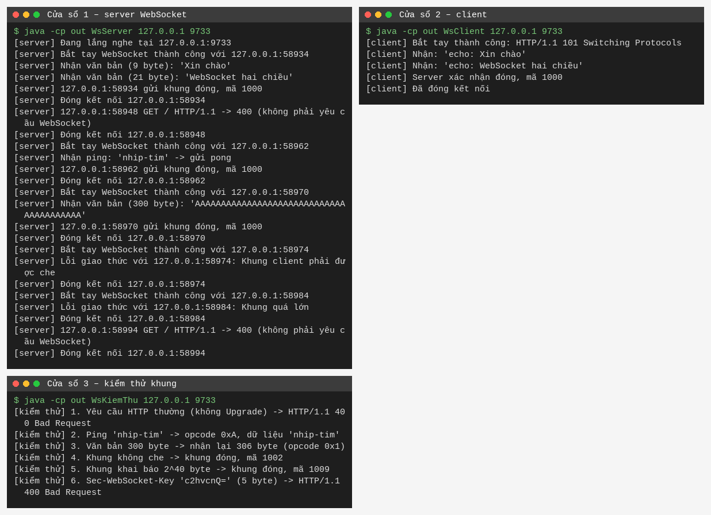

# Bài 7.3 – Server WebSocket tối giản và client thử (Java)

| Thông tin | Nội dung |
|---|---|
| Mã giả tương ứng | Mã giả 7.3 (Bắt tay mở đầu WebSocket phía server), Mã giả 7.4 (Đọc một khung WebSocket) |
| Mục giáo trình | 7.3.2 WebSocket |
| Kế thừa | Mã giả 7.2 (dòng đầu, READ_HEADERS, RESPOND), Mã giả 3.4 (READ_EXACT), Mã giả 6.3 (mỗi kết nối một tác vụ) |
| Thư viện | JDK: `java.net.ServerSocket`, luồng ảo, `java.security.MessageDigest`, `java.net.http.WebSocket` |

## Mục tiêu
Cài đặt bắt tay mở đầu `WS_ACCEPT` (kiểm tra `Upgrade`, `Sec-WebSocket-Version: 13`, tính `Sec-WebSocket-Accept` = Base64(SHA-1(khóa + GUID))) và đọc khung `WS_READ_FRAME` (bit FIN, opcode, bit MASK, độ dài 7/16/64 bit, bỏ che bằng XOR). Server gửi trả khung văn bản `echo: …`, trả lời ping bằng pong, đáp khung đóng, đóng kết nối với mã 1009 khi khung vượt `MAX_FRAME` và 1002 khi khung từ client không được che. Chương trình kiểm thử tự tạo khung, kể cả khung vi phạm đặc tả.

## Tệp
- `WsServer.java` – Mã giả 7.3 `wsAccept`, Mã giả 7.4 `wsReadFrame`, `wsClose`, vòng phục vụ trên luồng ảo.
- `Reader.java` – bộ đọc có `pending` (READ_LINE, READ_EXACT, READ_HEADERS).
- `WsClient.java` – client dùng `java.net.http.WebSocket`.
- `WsKiemThu.java` – sáu ca kiểm thử với khung tự tạo trên socket.
- `demo.json` – kịch bản chạy minh họa (dùng với `tools/demo.py`).
- `ket_qua.txt`, `ket_qua.png` – kết quả thực thi thật.

## Cách chạy
```bash
javac -encoding UTF-8 -d out Reader.java WsServer.java WsClient.java WsKiemThu.java
```
```bash
# Cửa sổ 1 – server
java -cp out WsServer 0.0.0.0 8080
# Cửa sổ 2 – client: nhập từng dòng, Ctrl+D (Linux) hoặc Ctrl+Z rồi Enter (Windows) để đóng
java -cp out WsClient 127.0.0.1 8080
# Cửa sổ 3 – kiểm thử khung
java -cp out WsKiemThu 127.0.0.1 8080
```

## Kết quả thực thi


Client bắt tay thành công (101), nhận lại hai thông điệp kèm tiếng Việt và đóng bình thường với mã 1000. Sáu ca kiểm thử đều cho kết quả mong đợi: yêu cầu không có `Upgrade` nhận 400; ping nhận pong cùng dữ liệu; thông điệp 300 byte (độ dài mở rộng 16 bit) được trả lại 306 byte; khung không che nhận khung đóng 1002; khung khai báo 2^40 byte nhận khung đóng 1009 ngay sau tiêu đề, trước khi server đọc hay cấp phát dữ liệu. Yêu cầu nâng cấp có `Sec-WebSocket-Key` giải mã Base64 chỉ được 5 byte nhận 400.

## Ghi chú
- Theo dòng 3–6 của Mã giả 7.3, server từ chối bắt tay (400) khi `Sec-WebSocket-Key` không giải mã Base64 được thành đúng 16 byte, cùng với các trường hợp thiếu `Upgrade: websocket` hoặc sai phiên bản. `READ_HEADERS` báo `ConnectionClosed` khi client đóng kết nối giữa phần tiêu đề (dòng 29 của Mã giả 7.1).
- Ngoài mã giả, server ghép khung tiếp nối (opcode 0x0) đến khi FIN = 1, trả lời ping (0x9) bằng pong (0xA) và đáp khung đóng bằng cùng mã đóng (1000 nếu khung đóng không có mã), như đoạn giải thích bước (7) của Mã giả 7.4.
- Như mã giả, độ dài 64 bit có bit cao bằng 1 được gộp vào nhánh “quá lớn” (1009) thay vì 1002.
- Server không kiểm tra `Origin`, không thương lượng giao thức con/phần mở rộng và không có TLS (`wss://`); ứng dụng thật nên luôn dùng `wss://`.
- Độ dài 64 bit đọc vào `long` có dấu: bit cao bằng 1 cho giá trị âm, nên điều kiện là `n > MAX_FRAME || n < 0`.
- `java.net.http.WebSocket` gọi `Listener` trên luồng của thư viện; client chuyển sự kiện sang luồng chính qua `BlockingQueue`. API không cho đọc dòng trạng thái bắt tay; `buildAsync` chỉ hoàn tất khi server trả 101 với `Sec-WebSocket-Accept` hợp lệ.
- Kiểm thử: Linux, OpenJDK 21.0.12.1.
