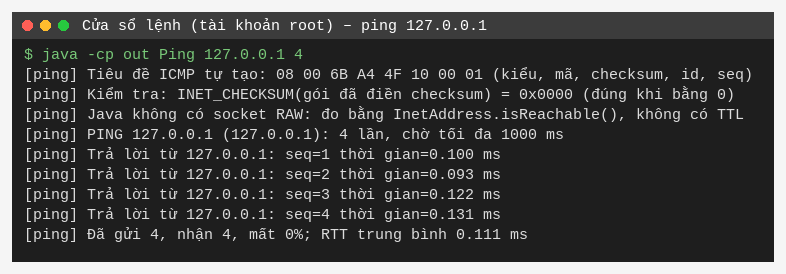

# Bài 7.7 – Gửi ICMP Echo Request và đo thời gian khứ hồi (Java)

| Thông tin | Nội dung |
|---|---|
| Mã giả tương ứng | Mã giả 7.8 (Gửi ICMP Echo Request và đo thời gian khứ hồi) |
| Mục giáo trình | 7.5.3 ICMP và chương trình ping |
| Kế thừa | Mã giả 4.4 (cùng mẫu gửi rồi chờ phản hồi có hạn giờ, bỏ qua gói không khớp) |
| Thư viện | JDK: `java.net.InetAddress.isReachable`, `java.nio.ByteBuffer` |

## Mục tiêu
Thư viện chuẩn Java không có socket RAW nên không gửi được gói ICMP tự tạo như Mã giả 7.8. Chương trình (1) tạo gói Echo Request và tính `INET_CHECKSUM` (RFC 1071) đúng như mã giả, kiểm tra lại bằng cách tính tổng kiểm tra của gói đã điền (phải bằng 0); (2) đo thời gian khứ hồi bằng `InetAddress.isReachable(timeout)`.

## Tệp
- `Ping.java` – `inetChecksum`, `echoRequest` (cấu trúc gói theo mã giả) và vòng đo bằng `isReachable`.
- `demo.json` – kịch bản chạy minh họa (dùng với `tools/demo.py`).
- `ket_qua.txt`, `ket_qua.png` – kết quả thực thi thật.

## Cách chạy
```bash
javac -encoding UTF-8 -d out Ping.java
java -cp out Ping 127.0.0.1 4 1000
```

## Kết quả thực thi


Tổng kiểm tra của gói đã điền checksum bằng 0x0000, xác nhận cài đặt RFC 1071 đúng. Bốn lần `isReachable` đều thành công với thời gian khoảng 0,1 ms; không có TTL vì API không trả về tiêu đề IP.

## Ghi chú
- Giới hạn: `isReachable` gửi ICMP Echo khi tiến trình có quyền dùng socket RAW (kịch bản minh họa chạy bằng root), ngược lại thử kết nối TCP tới cổng 7 (echo); khi đó máy đích trả RST cũng được coi là “tới được”, và tường lửa chặn cổng 7 làm kết quả sai. Không lấy được TTL, mã định danh hay số thứ tự.
- Muốn gửi ICMP thật từ Java cần thư viện ngoài (JNA/JNI) hoặc gọi chương trình `ping` của hệ điều hành qua `ProcessBuilder`.
- Mỗi lần ping mở một socket mới như mã giả; giữa hai lần ping có khoảng nghỉ 1 giây như lệnh ping của hệ điều hành; cuối cùng in số gói gửi, nhận, tỉ lệ mất và RTT trung bình.
- Bài tập cuối chương (ping 5 máy trong mạng lab, so sánh TTL 64/128) chạy cùng chương trình với địa chỉ các máy đó; kịch bản minh họa chỉ ping 127.0.0.1.
- Kiểm thử: Linux, OpenJDK 21.0.12.1.
