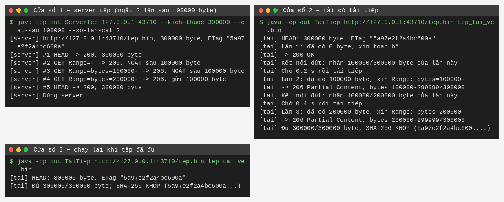

# Bài mở rộng MR7.1 – Tải tệp HTTP có tải tiếp (Range, If-Range) (Java)

| Thông tin | Nội dung |
|---|---|
| Loại | **Bài mở rộng** – không có trong giáo trình, không có mã giả tương ứng |
| Liên hệ với giáo trình | Chương 7: Bài 7.1 (client HTTP); Chương 5: Bài 5.5 (tải tệp), Bài 5.6 (thử lại có lùi thời gian); Chương 3: Bài 3.4 (kiểm tra SHA-256) |
| Thư viện | JDK 21: `java.net.ServerSocket` (server HTTP/1.1 tối giản tự viết), `java.net.HttpURLConnection` (client), `java.security.MessageDigest` (SHA-256), `java.util.regex` |
| Bản ngôn ngữ khác | [C#](../../../csharp/Chuong07/BaiMR7.1_TaiTiepHTTP/), [Python](../../../python/Chuong07/BaiMR7.1_TaiTiepHTTP/), [Rust](../../../rust/Chuong07/BaiMR7.1_TaiTiepHTTP/), [Go](../../../go/Chuong07/BaiMR7.1_TaiTiepHTTP/) |

## Mục tiêu
Khi tải tệp lớn mà kết nối đứt giữa chừng, tải lại từ đầu là lãng phí. HTTP cho phép xin một phần tài nguyên (RFC 9110): client gửi `Range: bytes=<đã_có>-`, server trả `206 Partial Content` kèm `Content-Range`. Tiêu đề `If-Range: <ETag>` bảo đảm chỉ nối tiếp khi tệp trên server chưa đổi (nếu đã đổi, server trả `200` toàn bộ). Server trong bài giả lập sự cố: hai yêu cầu GET đầu tiên bị ngắt sau 100 000 byte; client tự thử lại có lùi thời gian, nối tiếp từ chỗ dừng và kiểm tra SHA-256 khi xong.

## Tệp
- `ServerTep.java` – server tệp viết thẳng trên `ServerSocket`: HEAD, GET có `Range`/`If-Range`, 416, giả lập ngắt kết nối.
- `TaiTiep.java` – client tải tiếp: `head`, `getRange`, vòng thử lại, kiểm tra SHA-256.
- `demo.json` – kịch bản chạy minh họa (dùng với `tools/demo.py`).
- `ket_qua.txt`, `ket_qua.png` – kết quả thực thi thật.

## Cách chạy
Trong thư mục bài:
```bash
javac -encoding UTF-8 -d out *.java
java -cp out ServerTep 127.0.0.1 8000 --kich-thuoc 300000 --cat-sau 100000 --so-lan-cat 2   # cửa sổ 1
java -cp out TaiTiep http://127.0.0.1:8000/tep.bin tep_tai_ve.bin                        # cửa sổ 2
```
Thử thêm bằng curl: `curl -H "Range: bytes=10-19" -o - http://127.0.0.1:8000/tep.bin | xxd` (206), `-H "Range: bytes=400000-"` (416), `-H "Range: bytes=10-" -H 'If-Range: "khac"'` (200 toàn bộ). Kịch bản `demo.json` xóa `tep_tai_ve.bin` trước khi chạy; xóa tệp này sau khi thử. Server và client Java dùng được với bản Python, Go (đã thử client Java tải tiếp từ server Python, client Python tải từ server Java).

Tái lập kết quả từ thư mục gốc của kho: `python3 tools/demo.py java/Chuong07/BaiMR7.1_TaiTiepHTTP`.

## Kết quả thực thi


Lần 1 xin toàn bộ, nhận `200` nhưng chỉ được 100 000/300 000 byte thì kết nối đứt; lần 2 xin `bytes=100000-`, nhận `206` nhưng lại đứt sau 100 000 byte; lần 3 xin `bytes=200000-` và nhận đủ phần còn lại. Thời gian chờ giữa các lần tăng gấp đôi (0,2 s rồi 0,4 s). Tệp ghép lại có SHA-256 khớp với giá trị server công bố. Lần chạy thứ hai thấy tệp đã đủ nên không gửi GET nào. Hai bản Python và Go cho cùng kết quả (cùng nội dung tệp, cùng ETag).

## Ghi chú
- Server tự viết trên socket (thay cho `http.server` của Python) để giả lập ngắt kết nối giữa chừng: gửi một phần thân rồi `shutdownOutput()`. `com.sun.net.httpserver.HttpServer` của JDK báo lỗi khi thân ngắn hơn `Content-Length` đã khai báo nên khó minh họa tình huống này.
- Nhật ký bản Java trùng từng dòng với bản Python (trừ cổng), kể cả cụm từ trạng thái `200 OK`, `206 Partial Content` lấy từ `getResponseMessage()`.
- ETag ở đây là 16 ký tự đầu của SHA-256 nội dung (ETag mạnh). `X-Checksum-SHA256` là tiêu đề tự đặt cho bài; chuẩn hiện hành cho mã băm nội dung là trường `Repr-Digest` (RFC 9530).
- Bản Java tự phân tích `Range` (biểu thức chính quy `bytes=(\d+)-(\d*)`) để thấy cơ chế, chỉ hỗ trợ một dải dạng `a-` hoặc `a-b` (không hỗ trợ nhiều dải `multipart/byteranges` hay dạng hậu tố `-n`).
- Khác `http.client` của Python (chỉ trả chuỗi rỗng), `HttpURLConnection` **báo lỗi** `IOException: Premature EOF` khi kết nối đóng trước khi nhận đủ `Content-Length`. Client bắt lỗi đó, giữ phần đã ghi và vẫn tự so số byte đã nhận với `Content-Length` (cùng bài học “TCP EOF chưa chắc là đủ dữ liệu” ở Chương 3).
- Kiểm thử: Linux, OpenJDK 21.0.12.

## Đọc thêm
- Matt Butcher, Matt Farina, *Go in Practice*, Manning, 2016, Chương 8 (Technique 49 *Detecting timeouts*, Technique 50 *Timing out and resuming with HTTP*).
- M. O. Faruque Sarker, *Python Network Programming Cookbook*, Packt, 2014, Chương 4 (công thức *Writing an HTTP fail-over client with resume and partial downloading*; sách dùng `urllib.FancyURLopener` của Python 2, không còn trong Python 3).

Mã nguồn của bài được viết mới cho kho này; sách trên chỉ là tài liệu tham khảo ý tưởng.
