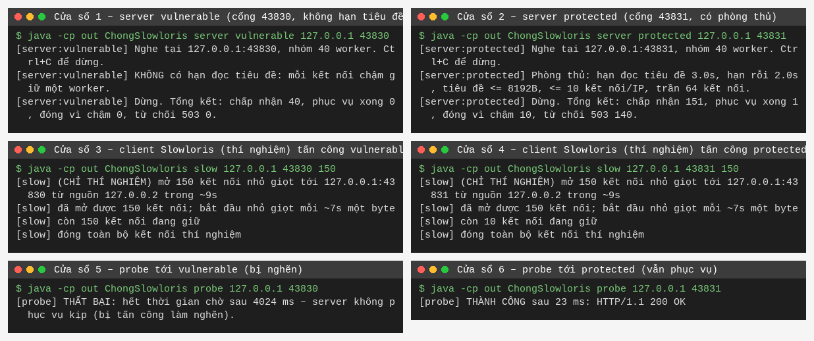

# Bài mở rộng MR8.3 – Phòng thủ tấn công từ chối dịch vụ kiểu Slowloris (Java)

| Thông tin | Nội dung |
|---|---|
| Loại | **Bài mở rộng** – không có trong giáo trình, không có mã giả tương ứng |
| Liên hệ với giáo trình | Chương 8 (vận hành dịch vụ an toàn); Chương 6: Bài 6.1, 6.2 (server nhiều client); Chương 3: Bài 3.4 (HTTP) |
| Thư viện | JDK 21: `java.net.ServerSocket`, `java.net.Socket` (`setSoTimeout`, `bind` địa chỉ nguồn), luồng nền tảng (`Thread.ofPlatform`) |
| Bản ngôn ngữ khác | [C#](../../../csharp/Chuong08/BaiMR8.3_ChongSlowloris/), [Python](../../../python/Chuong08/BaiMR8.3_ChongSlowloris/), [Rust](../../../rust/Chuong08/BaiMR8.3_ChongSlowloris/), [Go](../../../go/Chuong08/BaiMR8.3_ChongSlowloris/) |

## Mục tiêu
Slowloris là tấn công từ chối dịch vụ (DoS) ở **mức ứng dụng**: kẻ tấn công mở thật nhiều kết nối TCP rồi gửi phần đầu (request head) của yêu cầu HTTP một cách **cực chậm, không bao giờ kết thúc** (`\r\n\r\n`). Mỗi kết nối chiếm một luồng/worker của server; khi mọi worker đều đang chờ đọc tiêu đề, server không còn chỗ phục vụ người dùng thật, dù băng thông và CPU gần như không bị dùng.

Bài so sánh một server HTTP/1.1 nhỏ ở **hai chế độ** và dùng vai `probe` để đo xem một yêu cầu bình thường còn được trả lời hay không:
- `vulnerable`: nhóm luồng cố định (giống `MaxRequestWorkers` của Apache prefork), **không** đặt hạn đọc tiêu đề → kết nối nhỏ giọt giữ worker vô hạn.
- `protected`: cùng nhóm luồng nhưng thêm năm lớp phòng thủ: (1) **hạn đọc tiêu đề** tổng cộng 3 s; (2) **hạn chót rỗi** 2 s giữa hai lần nhận byte; (3) **cỡ tiêu đề tối đa** 8 KiB; (4) **giới hạn kết nối theo IP** (10); (5) **trần kết nối toàn cục** (64) – vượt thì trả `503 Service Unavailable` rồi đóng ngay để giải phóng worker.

> **Chỉ dùng trong phòng thí nghiệm.** Vai `slow` là *client tấn công* viết cho mục đích học tập; nó **chỉ chấp nhận đích loopback (127.0.0.0/8)** và từ chối mọi đích khác. Tuyệt đối không nhắm máy hay dịch vụ của người khác – đó là hành vi phá hoại và vi phạm pháp luật.

## Tệp
- `ChongSlowloris.java` – ba vai trong một tệp: `server vulnerable|protected`, `slow` (client thí nghiệm), `probe`.
- `demo.json` – kịch bản chạy minh họa (dùng với `tools/demo.py`).
- `ket_qua.txt`, `ket_qua.png` – kết quả thực thi thật.

## Cách chạy
Trong thư mục bài (mở nhiều cửa sổ dòng lệnh):
```bash
javac -encoding UTF-8 -d out ChongSlowloris.java

# Server dễ bị tấn công (cổng 43830) và server có phòng thủ (cổng 43831)
java -cp out ChongSlowloris server vulnerable 127.0.0.1 43830
java -cp out ChongSlowloris server protected  127.0.0.1 43831

# Client Slowloris thí nghiệm: mở 150 kết nối nhỏ giọt (nguồn 127.0.0.2 để tách IP với probe)
java -cp out ChongSlowloris slow 127.0.0.1 43830 150
java -cp out ChongSlowloris slow 127.0.0.1 43831 150

# Yêu cầu bình thường: đo xem server còn phục vụ không
java -cp out ChongSlowloris probe 127.0.0.1 43830   # bị nghẽn -> THẤT BẠI
java -cp out ChongSlowloris probe 127.0.0.1 43831   # vẫn phục vụ -> THÀNH CÔNG
```
Nhấn `Ctrl+C` ở cửa sổ server để in tổng kết số liệu (in từ shutdown hook).

Vai `slow` dùng địa chỉ **nguồn** `127.0.0.2` (vẫn là loopback; `Socket.bind` trước `connect`) để server phân biệt "kẻ tấn công" với `probe` (đi từ `127.0.0.1`), nhờ đó thấy rõ tác dụng của giới hạn kết nối theo IP ngay cả khi mọi thứ chạy trên một máy. Trên macOS cần thêm bí danh `sudo ifconfig lo0 alias 127.0.0.2` trước khi chạy.

Tái lập kết quả từ thư mục gốc của kho: `python3 tools/demo.py java/Chuong08/BaiMR8.3_ChongSlowloris`.

## Kết quả thực thi


Hai server cùng chịu 150 kết nối nhỏ giọt. Với **vulnerable**: cả 40 worker bị 40 kết nối đầu tiên giữ chặt (không hạn đọc), nên `probe` kết nối được nhưng **không nhận được phản hồi** và báo *THẤT BẠI: hết thời gian chờ sau ~4000 ms*; tổng kết server cho thấy chấp nhận 40, phục vụ xong 0. Với **protected**: server chấp nhận 151 kết nối nhưng chỉ giữ 10 kết nối/IP, 140 kết nối thừa bị trả `503` ngay nên worker luôn rảnh; các kết nối chậm bị đóng sau hạn 3 s (10 lần *đóng vì chậm*). Nhờ đó `probe` được trả lời ngay: *THÀNH CÔNG sau ~4 ms: HTTP/1.1 200 OK*. Bản Java in số liệu tổng kết giống hệt bản Python và Go (trừ cổng và độ trễ đo được).

## Bài tập gợi ý
1. (Cơ bản) Đổi `HAN_DOC_TIEU_DE` và `GIOI_HAN_IP`, chạy lại `probe` và quan sát số *đóng vì chậm* / *từ chối 503* thay đổi thế nào.
2. (Cơ bản) Thêm bộ đếm số kết nối đồng thời theo thời gian và in ra mỗi giây để thấy "đường cong" bị tấn công.
3. (Trung bình) Bổ sung hạn **đọc thân** (body) và hạn **ghi phản hồi** (chống tấn công Slow POST / Slow Read), không chỉ hạn đọc tiêu đề.
4. (Trung bình) Thay nhóm luồng cố định bằng luồng ảo (`Executors.newVirtualThreadPerTaskExecutor()`, mỗi kết nối một luồng ảo rẻ) hoặc NIO `Selector` và giải thích vì sao mô hình này bền hơn trước Slowloris.
5. (Nâng cao) Viết một "reverse proxy" nhỏ đặt trước server `vulnerable`, tự nó áp hạn đọc tiêu đề và giới hạn kết nối, cho thấy cách các proxy (nginx, HAProxy) bảo vệ server gốc.

## Ghi chú
- Hạn chót rỗi dùng `Socket.setSoTimeout` (đặt lại trước mỗi lần `read` theo thời gian còn lại của hạn tuyệt đối), tương ứng `settimeout` của Python; chế độ vulnerable đặt `setSoTimeout(0)` = chờ mãi.
- Vì JVM khởi động chậm hơn, các khoảng chờ trong `demo.json` dài hơn bản Python một chút nên client `slow` kịp một lượt nhỏ giọt và in thêm dòng *còn … kết nối đang giữ* (150 với vulnerable, 10 với protected – 140 kết nối bị trả 503 đã bị server đóng).
- Slowloris khai thác mô hình **một kết nối ⇄ một worker**. Server bất đồng bộ (event loop) ít bị ảnh hưởng hơn vì một luồng phục vụ nhiều kết nối, nhưng vẫn nên đặt hạn đọc tiêu đề để không giữ tài nguyên vô hạn.
- Biện pháp phòng thủ trong thực tế: đặt hạn thời gian đọc tiêu đề/thân (nginx `client_header_timeout`, Apache `mod_reqtimeout`), giới hạn số kết nối theo IP, đặt sau reverse proxy/CDN, dùng server bất đồng bộ.
- Vai `slow` cố tình giữ `N` nhỏ (150) và thời gian ngắn (~9 s) để minh họa an toàn, không gây hại cho máy chạy demo.
- Kiểm thử: Linux, OpenJDK 21.0.12.

## Đọc thêm
- RFC 9112 *HTTP/1.1 Message Syntax and Routing* – mục về phần đầu thông điệp và việc kết thúc tiêu đề bằng dòng trống.
- OWASP, *Slowloris / Slow HTTP DoS* (tài liệu Cheat Sheet về các biện pháp giảm thiểu).
- nginx, *Mitigating DDoS Attacks* và tài liệu `ngx_http_core_module` (`client_header_timeout`, `limit_conn`).
- Apache HTTP Server, tài liệu `mod_reqtimeout`.

Mã nguồn của bài được viết mới cho kho này; tài liệu trên chỉ là nguồn tham khảo ý tưởng phòng thủ.
