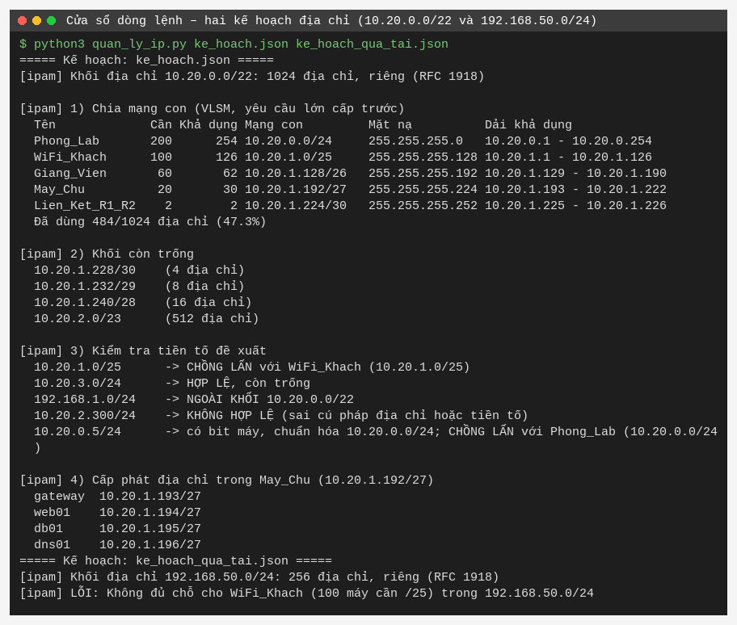

# Bài mở rộng MR1.1 – Quản lý địa chỉ IP (IPAM): chia mạng con, kiểm tra chồng lấn, cấp phát (Python)

| Thông tin | Nội dung |
|---|---|
| Loại | **Bài mở rộng** – không có trong giáo trình, không có mã giả tương ứng |
| Liên hệ với giáo trình | Chương 1, Mục 1.2.3 (địa chỉ IP, tiền tố mạng); Bài 1.1. Kế hoạch địa chỉ được dùng lại ở MR3.2 và MR8.2 |
| Thư viện | Thư viện chuẩn: `ipaddress`, `json` |
| Bản ngôn ngữ khác | [Go](../../../go/Chuong01/BaiMR1.1_QuanLyDiaChiIP/) |

## Mục tiêu
Dùng thư viện địa chỉ IP thay vì tự cắt chuỗi: đọc một kế hoạch địa chỉ (JSON), chia khối `10.20.0.0/22` thành các mạng con theo số máy cần (VLSM – yêu cầu lớn cấp trước để mọi khối đều thẳng hàng), liệt kê phần còn trống dưới dạng ít khối CIDR nhất, kiểm tra các tiền tố đề xuất (sai cú pháp, có bit máy, ngoài khối, chồng lấn) và cấp phát địa chỉ cho thiết bị. Đây là phần lõi của các công cụ IPAM và là bước đầu tiên của mọi kịch bản tự động hóa mạng.

## Tệp
- `quan_ly_ip.py` – chương trình chính: `prefix_for_hosts`, `plan_vlsm`, `free_blocks`, `check_prefix`, `assign_hosts`.
- `ke_hoach.json` – kế hoạch 5 mạng con trong `10.20.0.0/22`; `ke_hoach_qua_tai.json` – kế hoạch vượt quá khối `/24`.
- `demo.json` – kịch bản chạy minh họa (dùng với `tools/demo.py`).
- `ket_qua.txt`, `ket_qua.png` – kết quả thực thi thật.

## Cách chạy
Trong thư mục bài:
```bash
python3 quan_ly_ip.py ke_hoach.json ke_hoach_qua_tai.json
```
Chương trình nhận một hoặc nhiều tệp kế hoạch; mã thoát 1 nếu có kế hoạch không thực hiện được. Trên Windows dùng `python` hoặc `py` thay cho `python3`.

Tái lập kết quả từ thư mục gốc của kho: `python3 tools/demo.py python/Chuong01/BaiMR1.1_QuanLyDiaChiIP`.

## Kết quả thực thi


Năm yêu cầu được cấp từ lớn đến nhỏ: `/24` (254 máy), `/25`, `/26`, `/27` và `/30` cho liên kết điểm–điểm, dùng 484/1024 địa chỉ. Phần còn trống `10.20.1.228 – 10.20.3.255` được biểu diễn bằng bốn khối CIDR. Năm tiền tố đề xuất cho bốn kết luận khác nhau; `10.20.0.5/24` có bit máy nên được chuẩn hóa thành `10.20.0.0/24` rồi mới phát hiện chồng lấn. Kế hoạch thứ hai thất bại vì sau khi cấp `/24` cho Phong_Lab, khối `192.168.50.0/24` không còn chỗ cho `/25`. Bản Python và bản Go in kết quả giống hệt nhau.

## Ghi chú
- Chỉ xử lý IPv4 cho gọn; cả `ipaddress` và `net/netip` đều hỗ trợ IPv6.
- Liên kết điểm–điểm dùng `/30`; RFC 3021 cho phép `/31` (không có địa chỉ mạng và quảng bá) nhưng bài không dùng.
- Cột *Khả dụng* = số địa chỉ của khối trừ địa chỉ mạng và địa chỉ quảng bá; địa chỉ quảng bá là địa chỉ ngay sau cuối *Dải khả dụng*.
- `free_blocks` dùng `address_exclude` của `ipaddress`; `check_prefix` dùng `ip_network(strict=True)` để phát hiện bit máy rồi thử lại với `strict=False`.
- Kiểm thử: Linux, Python 3.13.18.

## Đọc thêm
- Claus Töpke, *Network Programming and Automation Essentials*, Packt, 2023, Chương 4 (mục *IP allocation considerations*) và Chương 5 (mục *Use IP libraries*).

Mã nguồn của bài được viết mới cho kho này; sách trên chỉ là tài liệu tham khảo ý tưởng.
