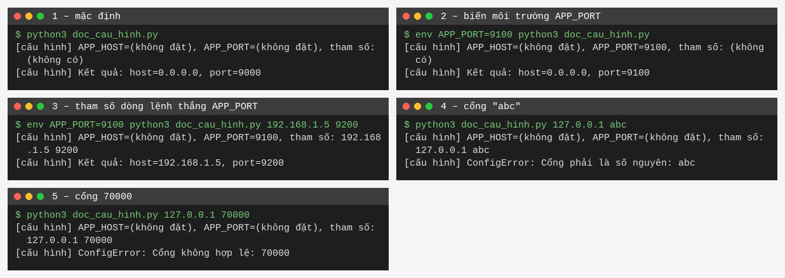

# Bài 2.1 – Đọc cấu hình địa chỉ và cổng (Python)

| Thông tin | Nội dung |
|---|---|
| Mã giả tương ứng | Mã giả 2.1 (PARSE_ENDPOINT – đọc địa chỉ và cổng từ tham số dòng lệnh, biến môi trường) |
| Mục giáo trình | 2.1.3 Tham số hóa địa chỉ và cổng |
| Kế thừa | Không (thủ tục gốc, được dùng lại ở mọi server và client từ Chương 3) |
| Thư viện | Thư viện chuẩn: `os`, `sys` |

## Mục tiêu
Minh họa thứ tự ưu tiên cấu hình: tham số dòng lệnh > biến môi trường `APP_HOST`, `APP_PORT` > giá trị mặc định (`0.0.0.0`, `9000`), cùng việc chuyển chuỗi sang số và kiểm tra phạm vi cổng 1–65535 với lỗi `ConfigError` rõ ràng.

## Tệp
- `doc_cau_hinh.py` – hàm `parse_endpoint` (Mã giả 2.1) và chương trình in cấu hình nhận được.
- `demo.json` – kịch bản chạy minh họa năm trường hợp (dùng với `tools/demo.py`).
- `ket_qua.txt`, `ket_qua.png` – kết quả thực thi thật.

## Cách chạy
```bash
# Linux/macOS
python3 doc_cau_hinh.py                              # mặc định
APP_PORT=9100 python3 doc_cau_hinh.py                # biến môi trường
APP_PORT=9100 python3 doc_cau_hinh.py 192.168.1.5 9200
python3 doc_cau_hinh.py 127.0.0.1 abc                # cổng không phải số
python3 doc_cau_hinh.py 127.0.0.1 70000              # cổng ngoài phạm vi
```
```bat
:: Windows (cmd)
set APP_PORT=9100
python doc_cau_hinh.py
set APP_PORT=
```

## Kết quả thực thi


Năm tiến trình cho đúng kết quả nêu trong giáo trình: giá trị mặc định `0.0.0.0:9000`; cổng 9100 lấy từ `APP_PORT`; tham số `192.168.1.5 9200` thắng `APP_PORT=9100`; cổng `abc` và `70000` bị từ chối bằng `ConfigError` với thông báo cụ thể. Trong `demo.json`, biến môi trường được đặt riêng cho từng tiến trình bằng lệnh `env`.

## Ghi chú
- Chương trình trả mã thoát 2 khi gặp `ConfigError`.
- `int()` của Python chấp nhận khoảng trắng hai đầu, dấu `+` và dấu gạch dưới phân cách chữ số (ví dụ `"9_000"` → 9000); mã giả không đề cập các trường hợp này.
- Thủ tục không kiểm tra `host` (đúng như mã giả); địa chỉ sai được phát hiện ở bước kết nối (Bài 2.2).
- Kiểm thử: Linux, Python 3.13.18.
