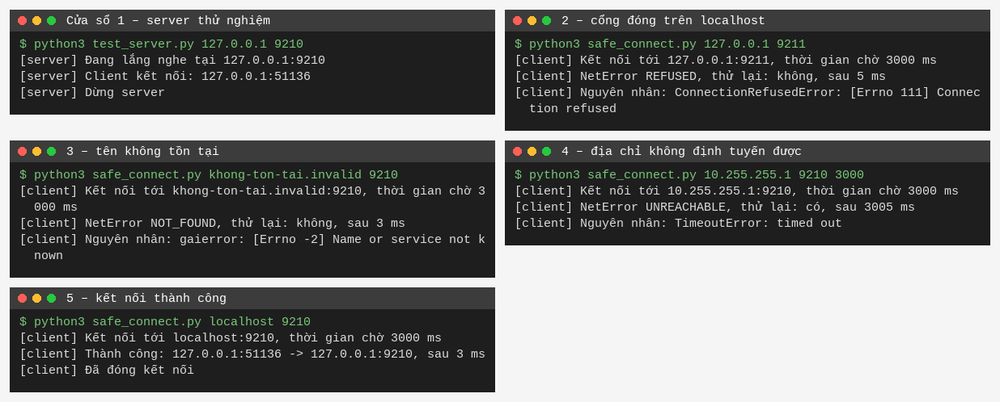

# Bài 2.2 – Kết nối có thời gian chờ và phân loại lỗi (Python)

| Thông tin | Nội dung |
|---|---|
| Mã giả tương ứng | Mã giả 2.2 (SAFE_CONNECT – kết nối có thời gian chờ và phân loại lỗi) |
| Mục giáo trình | 2.2.3 Khung xử lý lỗi dùng chung |
| Kế thừa | Mã giả 1.2 (PORT_CHECK), Mã giả 2.1 (PARSE_ENDPOINT, rút gọn) |
| Thư viện | Thư viện chuẩn: `socket`, `errno` |

## Mục tiêu
Cài đặt thủ tục kết nối thử lần lượt các địa chỉ của một tên, luôn đặt thời gian chờ, đóng socket khi thất bại và gom mọi lỗi về `NetError` với ba loại: `NOT_FOUND` (tên không tồn tại, không thử lại), `REFUSED` (mọi địa chỉ trả RST, không thử lại), `UNREACHABLE` (hết thời gian chờ hoặc không có đường đi, có thể thử lại).

## Tệp
- `safe_connect.py` – `parse_endpoint` (Mã giả 2.1), `safe_connect` (Mã giả 2.2) và client in kết quả.
- `test_server.py` – server thử nghiệm tối giản: chấp nhận kết nối rồi đóng ngay, chỉ để tạo trường hợp thành công.
- `demo.json` – kịch bản chạy minh họa (dùng với `tools/demo.py`).
- `ket_qua.txt`, `ket_qua.png` – kết quả thực thi thật.

## Cách chạy
```bash
# Cửa sổ 1 – server thử nghiệm
python3 test_server.py 127.0.0.1 9000
# Cửa sổ 2 – client: [host] [port] [timeout_ms]
python3 safe_connect.py localhost 9000              # thành công
python3 safe_connect.py 127.0.0.1 9001              # REFUSED
python3 safe_connect.py khong-ton-tai.invalid 9000  # NOT_FOUND
python3 safe_connect.py 10.255.255.1 9000 3000      # UNREACHABLE (hết thời gian chờ)
```
Trên Windows thay `python3` bằng `python`. Dừng server bằng Ctrl+C.

## Kết quả thực thi


Cổng đóng trên máy cục bộ bị từ chối gần như ngay lập tức (`REFUSED`, không thử lại); tên thuộc miền `.invalid` không phân giải được (`NOT_FOUND`); địa chỉ `10.255.255.1` không phản hồi nên thủ tục dừng sau đúng khoảng 3000 ms (`UNREACHABLE`, có thể thử lại); kết nối tới `localhost` thành công và server ghi nhận đúng cổng nguồn của client.

## Ghi chú
- `CONNECT_TIMEOUT` được cài bằng `settimeout()`; giá trị này cũng áp dụng cho các thao tác sau trên socket trả về, nơi gọi có thể đặt lại.
- `NetworkUnreachable`, `HostUnreachable` không có lớp ngoại lệ riêng trong Python mà là `OSError` với `errno` `ENETUNREACH`, `EHOSTUNREACH`; các `OSError` khác được chuyển lên nơi gọi sau khi socket đã được đóng, đúng như mã giả.
- Thời gian (ms) in ra phụ thuộc máy chạy; trường hợp 10.255.255.1 cho kết quả `UNREACHABLE` do hết thời gian chờ trong môi trường kiểm thử, trên mạng khác có thể nhận `HostUnreachable` sớm hơn.
- Kiểm thử: Linux, Python 3.13.18.
