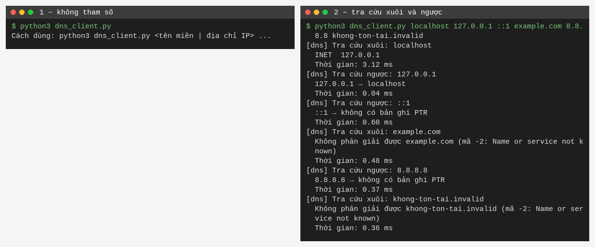

# Bài 2.3 – Client tra cứu DNS (Python)

| Thông tin | Nội dung |
|---|---|
| Mã giả tương ứng | Mã giả 2.3 (client tra cứu DNS dùng bộ phân giải của hệ điều hành) |
| Mục giáo trình | 2.5 Ví dụ: client tra cứu DNS |
| Kế thừa | Mã giả 1.1 (RESOLVE_HOST) |
| Thư viện | Thư viện chuẩn: `socket`, `ipaddress`, `time` |

## Mục tiêu
Nhận một hoặc nhiều tham số; với tên miền, in danh sách địa chỉ IPv4/IPv6 (tra cứu xuôi qua `getaddrinfo`); với địa chỉ IP, tra cứu ngược bản ghi PTR (`gethostbyaddr`); in thời gian tra cứu của từng tham số. Lỗi của một tham số không làm dừng các tham số còn lại.

## Tệp
- `dns_client.py` – `resolve_host` (Mã giả 1.1), `is_ip_address` và chương trình chính (Mã giả 2.3).
- `demo.json` – kịch bản chạy minh họa (dùng với `tools/demo.py`).
- `ket_qua.txt`, `ket_qua.png` – kết quả thực thi thật.

## Cách chạy
```bash
python3 dns_client.py                                        # in cách dùng
python3 dns_client.py localhost 127.0.0.1 www.ut.edu.vn 8.8.8.8 khong-ton-tai.invalid
```
Trên Windows thay `python3` bằng `python`.

## Kết quả thực thi


Không có tham số, chương trình in cách dùng. `localhost` phân giải thành `127.0.0.1` (tệp hosts của máy kiểm thử không khai báo `::1`) và `127.0.0.1` tra ngược ra `localhost`. Môi trường kiểm thử không truy cập được máy chủ DNS bên ngoài nên `example.com` không phân giải được và `8.8.8.8` không có bản ghi PTR; trên mạng thông thường, `8.8.8.8` cho tên `dns.google`. Tên `khong-ton-tai.invalid` đi vào nhánh `ResolveError`.

## Ghi chú
- Chương trình in thêm dòng tiêu đề `[dns] Tra cứu xuôi/ngược: …` trước kết quả của mỗi tham số để dễ đọc; mã giả không có dòng này.
- `getaddrinfo` được gọi với `type=SOCK_STREAM` để mỗi địa chỉ chỉ xuất hiện một lần (mặc định trả về một mục cho mỗi kiểu socket).
- Mã lỗi `e.code` của mã giả tương ứng `errno`, `strerror` của `socket.gaierror`; tra cứu ngược thất bại ném `socket.herror`.
- Kiểm thử: Linux, Python 3.13.18.
