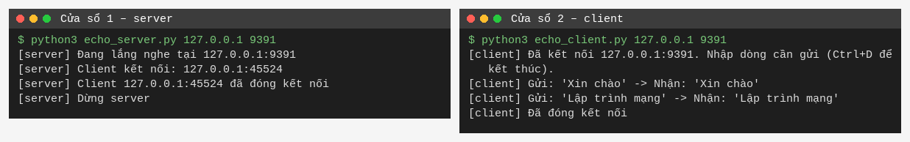

# Bài 3.1 – TCP Echo Server và Echo Client (Python)

| Thông tin | Nội dung |
|---|---|
| Mã giả tương ứng | Mã giả 3.1 (TCP Echo Server tuần tự), Mã giả 3.2 (TCP Echo Client) |
| Mục giáo trình | 3.2.2 Server tuần tự, 3.2.3 Client |
| Kế thừa | Mã giả 2.1 (đọc địa chỉ, cổng), Mã giả 2.2 (kết nối có thời gian chờ) |
| Thư viện | Thư viện chuẩn: `socket` |

## Mục tiêu
Minh họa vòng đời socket TCP: server `bind` – `listen` – `accept` – `recv`/`sendall` – `close`; client `connect` – `sendall` – `recv` – `shutdown` – `close`.

## Tệp
- `echo_server.py` – server tuần tự, gửi trả nguyên văn dữ liệu nhận được.
- `echo_client.py` – client đọc từng dòng từ bàn phím, gửi và in phản hồi.
- `demo.json` – kịch bản chạy minh họa (dùng với `tools/demo.py`).
- `ket_qua.txt`, `ket_qua.png` – kết quả thực thi thật.

## Cách chạy
Mở hai cửa sổ dòng lệnh trong thư mục bài:
```bash
# Cửa sổ 1 – server
python3 echo_server.py 0.0.0.0 9000
# Cửa sổ 2 – client
python3 echo_client.py 127.0.0.1 9000
```
Nhập vài dòng ở cửa sổ client; nhấn Ctrl+D (Linux/macOS) hoặc Ctrl+Z rồi Enter (Windows) để kết thúc. Dừng server bằng Ctrl+C.

## Kết quả thực thi


Server in địa chỉ client khi kết nối và khi client đóng kết nối; client nhận lại đúng chuỗi đã gửi, kể cả chuỗi tiếng Việt có dấu (UTF-8).

## Ghi chú
- Client gọi `recv(4096)` một lần cho mỗi dòng: chấp nhận được với dòng ngắn, nhưng sai khi thông điệp lớn vì TCP là luồng byte không giữ ranh giới thông điệp (Mục 3.4). Bài 3.2 bổ sung định khung.
- Kiểm thử: Linux, Python 3.13.
