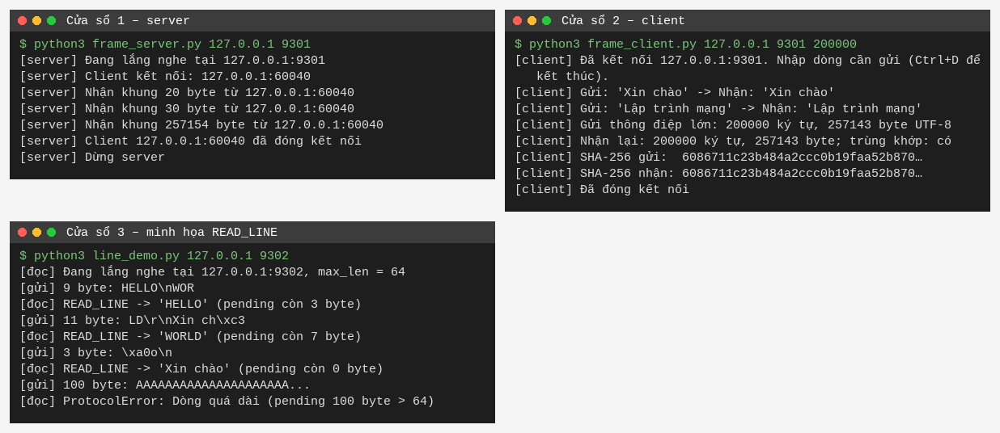

# Bài 3.2 – Thư viện định khung thông điệp (Python)

| Thông tin | Nội dung |
|---|---|
| Mã giả tương ứng | Mã giả 3.3 (SEND_ALL), Mã giả 3.4 (RECV_EXACT), Mã giả 3.5 (READ_LINE), Mã giả 3.6 (SEND_FRAME, RECV_FRAME, SEND_JSON, RECV_JSON) |
| Mục giáo trình | 3.2.4 Gửi và nhận dữ liệu, 3.4.1–3.4.4 Thiết kế giao thức trao đổi |
| Kế thừa | Mã giả 2.1, 2.2 (`netutil.py`); khung sườn Mã giả 3.1 (server) và 3.2 (client) |
| Thư viện | Thư viện chuẩn: `socket`, `struct`, `json`, `hashlib`, `threading` |

## Mục tiêu
Xây dựng thư viện định khung dùng lại ở các bài sau: gửi hết dãy byte, nhận đúng n byte, đọc một dòng kết thúc bằng LF/CRLF, gửi và nhận khung `[4 byte độ dài big-endian][nội dung]` chứa JSON mã hóa UTF-8. Chương trình minh họa cho thấy một thông điệp 200 000 ký tự (257 143 byte UTF-8) được nhận đủ và trùng khớp, trường hợp mà client của Bài 3.1 (một lần `recv(4096)`) không xử lý được.

## Tệp
- `framing.py` – thư viện: `send_all`, `recv_exact`, `Reader`/`read_line`, `send_frame`, `recv_frame`, `send_json`, `recv_json`; các lỗi `ConnectionClosed`, `ProtocolError`, `JsonError`; hằng `MAX_FRAME` = 1 MiB.
- `netutil.py` – `parse_endpoint` (Mã giả 2.1), `safe_connect` (Mã giả 2.2) và lỗi đã phân loại `NetError`.
- `frame_server.py` – echo server dùng khung JSON: `{"text": …}` → `{"status": 200, "text": …}`; JSON sai hoặc thiếu trường `text` → `status` 400.
- `frame_client.py` – gửi từng dòng nhập từ bàn phím; tham số thứ ba (tùy chọn) là số ký tự của một thông điệp lớn gửi sau cùng, so sánh nội dung và mã băm SHA-256 hai chiều.
- `line_demo.py` – minh họa `READ_LINE`: tự mở một kết nối loopback, gửi các mảnh cắt ngang dòng (kể cả cắt giữa hai byte UTF-8 của chữ "à") và một dòng 100 byte vượt `max_len` = 64.
- `demo.json` – kịch bản chạy minh họa (dùng với `tools/demo.py`).
- `ket_qua.txt`, `ket_qua.png` – kết quả thực thi thật.

## Cách chạy
Mở các cửa sổ dòng lệnh trong thư mục bài:
```bash
# Cửa sổ 1 – server
python3 frame_server.py 0.0.0.0 9000
# Cửa sổ 2 – client: gửi các dòng nhập, sau đó một thông điệp 200 000 ký tự
python3 frame_client.py 127.0.0.1 9000 200000
# Cửa sổ 3 – minh họa READ_LINE (một chương trình, tự kết nối tới chính nó)
python3 line_demo.py 127.0.0.1 9001
```
Trên Windows dùng `python` thay cho `python3`. Kết thúc nhập ở client bằng Ctrl+D (Linux/macOS) hoặc Ctrl+Z rồi Enter (Windows); dừng server bằng Ctrl+C.

## Kết quả thực thi


Server nhận khung 257 154 byte (nội dung JSON `{"text":"…"}`); client nhận lại đủ 200 000 ký tự và mã băm hai chiều trùng nhau. Ở cửa sổ 3, `READ_LINE` lần lượt trả về "HELLO", "WORLD" (đã bỏ CR), "Xin chào" (ghép đúng hai nửa của chữ "à") và giữ phần dư trong `pending`; dòng 100 byte không có LF gây lỗi `ProtocolError: Dòng quá dài`.

## Ghi chú
- `send_all` viết vòng lặp tường minh theo Mã giả 3.3; trong mã thực tế có thể dùng `socket.sendall` với cùng tác dụng.
- JSON được mã hóa với `ensure_ascii=False` và không có khoảng trắng, nên chữ tiếng Việt giữ nguyên dạng UTF-8 và độ dài khung giống nhau giữa ba ngôn ngữ.
- `json_decode` gộp lỗi giải mã UTF-8 và lỗi cú pháp JSON thành `JsonError`.
- `frame_server.py` gọi `recv_frame` rồi giải mã JSON (tách hai bước của `RECV_JSON`) chỉ để ghi kích thước khung vào nhật ký.
- Theo đúng mã giả, `read_line` bỏ qua phần dư không có LF khi đối tác đóng kết nối. Giới hạn `max_len` được kiểm tra cả khi đã tìm thấy LF (dòng 5 của Mã giả 3.5), nên một dòng dài hơn `max_len` luôn bị từ chối, kể cả khi LF nằm ngay trong khối 4096 byte vừa nhận.
- `line_demo.py` bật `TCP_NODELAY` và nghỉ 300 ms giữa các mảnh để mỗi mảnh đến bên nhận riêng rẽ, tức tái hiện có chủ đích hiện tượng chia nhỏ của Mục 3.4.1.
- Kiểm thử: Linux, Python 3.13.18.
