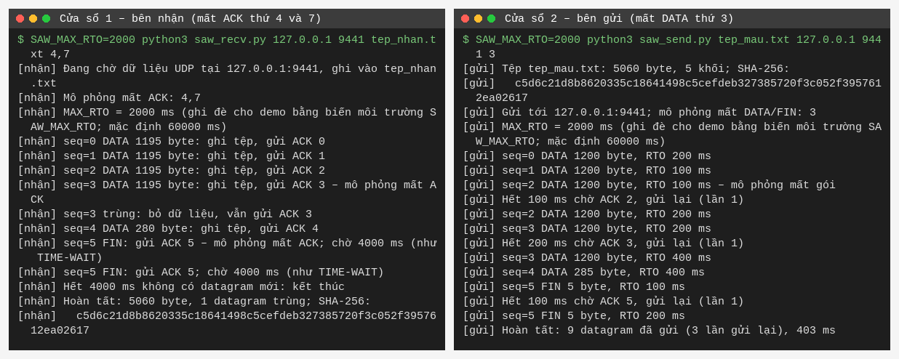

# Bài 4.4 – Truyền tệp tin cậy trên UDP bằng giao thức dừng và chờ (Python)

| Thông tin | Nội dung |
|---|---|
| Mã giả tương ứng | Mã giả 4.6 (SAW_SEND – bên gửi), Mã giả 4.7 (SAW_RECEIVE – bên nhận) |
| Mục giáo trình | 4.4.1 Số thứ tự, xác nhận và truyền lại; 4.4.2 Ước lượng thời gian khứ hồi và thời gian chờ (RFC 6298) |
| Kế thừa | Mã giả 4.4 (chờ phản hồi đúng địa chỉ, đúng mã trong phần thời gian còn lại); Mã giả 4.1 (vòng RECVFROM/SENDTO); Mã giả 2.1 |
| Thư viện | Thư viện chuẩn: `socket`, `struct`, `hashlib`, `random` |

## Mục tiêu
Cài đặt độ tin cậy ở tầng ứng dụng: datagram có tiêu đề 5 byte (số thứ tự 32 bit, byte loại DATA/ACK/FIN), bên gửi chờ ACK đúng số thứ tự với RTO ước lượng theo RFC 6298 (SRTT, RTTVAR, nhân đôi khi hết thời gian chờ, thuật toán Karn), bên nhận luôn gửi ACK, bỏ datagram trùng và chờ thêm sau FIN như TIME-WAIT. Có tham số mô phỏng mất gói ở cả hai phía; tính đúng đắn được kiểm tra bằng mã băm SHA-256 của tệp gửi và tệp nhận.

## Tệp
- `saw_send.py` – Mã giả 4.6, `RttEstimator` (RFC 6298), `wait_ack`.
- `saw_recv.py` – Mã giả 4.7.
- `saw_common.py` – hằng số, `parse_endpoint` (Mã giả 2.1), bộ mô phỏng mất gói `LossSim`, SHA-256.
- `tep_mau.txt` – tệp mẫu 5.060 byte dùng trong demo.
- `demo.json` – kịch bản chạy minh họa (dùng với `tools/demo.py`).
- `ket_qua.txt`, `ket_qua.png` – kết quả thực thi thật.

## Cách chạy
Trong thư mục bài (cần Python 3.11 trở lên):
```bash
# Cửa sổ 1 – bên nhận, mất ACK gửi đi thứ 4 và 7
python3 saw_recv.py 0.0.0.0 9000 tep_nhan.txt 4,7
# Cửa sổ 2 – bên gửi, mất datagram gửi đi thứ 3
python3 saw_send.py tep_mau.txt 127.0.0.1 9000 3
```
Mặc định `MAX_RTO` = 60 000 ms như giáo trình, nên bên nhận chờ 120 s sau FIN rồi mới in kết quả. Muốn chạy thử nhanh, đặt biến môi trường `SAW_MAX_RTO` (mili giây) ở cả hai cửa sổ trước khi chạy, ví dụ `export SAW_MAX_RTO=2000` (Linux/macOS), `set SAW_MAX_RTO=2000` (cmd) hoặc `$env:SAW_MAX_RTO=2000` (PowerShell) trên Windows; bản demo dùng giá trị 2000.

Tham số mô phỏng mất gói (tùy chọn, cuối dòng lệnh): `0.1` – mỗi datagram gửi đi mất ngẫu nhiên với xác suất 10% (bài tập 4.32); `3,7` – mất đúng datagram gửi đi thứ 3 và thứ 7, đếm cả lần gửi lại; bỏ trống – không mất gói. Đối chiếu mã SHA-256 in ở hai cửa sổ, hoặc dùng `sha256sum` (Linux), `certutil -hashfile tep_nhan.txt SHA256` (Windows). Trên Windows dùng `py` (hoặc `python`) thay cho `python3`.

## Kết quả thực thi


Datagram DATA `seq=2` bị mất ở bên gửi: sau 100 ms không có ACK, bên gửi nhân đôi RTO lên 200 ms và gửi lại. ACK của `seq=3` bị mất ở bên nhận: bên gửi gửi lại `seq=3`, bên nhận nhận ra datagram trùng, bỏ dữ liệu nhưng vẫn gửi ACK. ACK của FIN bị mất: bên gửi gửi lại FIN, bên nhận (đang chờ 2 × `MAX_RTO` = 4.000 ms như TIME-WAIT, vì demo đặt `SAW_MAX_RTO=2000`) trả lời ACK lần nữa nên bên gửi kết thúc thành công. Sau mẫu RTT hợp lệ của `seq=4`, RTO trở về 100 ms. Hai mã SHA-256 trùng nhau, xác nhận tệp nhận đúng từng byte.

## Ghi chú
- `MAX_RTO` = 60 000 ms như dòng 1 của Mã giả 4.6: `BACKOFF_RTO` nhân đôi RTO nhưng không vượt giá trị này, và bên nhận chờ 2 × `MAX_RTO` = 120 s sau FIN (dòng 13 của Mã giả 4.7). Biến môi trường `SAW_MAX_RTO` (mili giây) ghi đè giá trị này chỉ để chạy demo nhanh; khi bị ghi đè, cả hai bên in rõ giá trị đang dùng. Bản demo ở trên đặt `SAW_MAX_RTO=2000`, nên bên nhận chờ 4 000 ms sau FIN.
- RTO ban đầu 200 ms và RTO tối thiểu 100 ms được chọn cho mạng nội bộ (Mục 4.4.2 cho phép giá trị nhỏ hơn 1 giây sau khi đo); α = 1/8, β = 1/4, K = 4, G = 1 ms theo RFC 6298.
- Trong `WAIT_ACK`, lỗi `ConnectionReset` (Windows báo ICMP port unreachable khi bên nhận chưa chạy) được xử lý như hết thời gian chờ, giống dòng 12–13 của Mã giả 4.4: bên gửi lùi RTO rồi gửi lại thay vì quay vòng chờ. Bên nhận bỏ qua lỗi này và nhận tiếp.
- Bộ mô phỏng mất gói (`LossSim`) được thêm cho bài thực hành, không có trong mã giả: datagram "mất" không được gửi ra socket nhưng vẫn được ghi nhật ký.
- `WAIT_ACK` (mã giả chỉ gọi tên) được cài đặt theo khuôn của Mã giả 4.4: chờ trong phần thời gian còn lại, bỏ datagram từ địa chỉ khác, không phải ACK hoặc sai số thứ tự.
- Bên nhận ghi trực tiếp vào tệp đích và nhận datagram từ mọi địa chỉ như mã giả; chương trình thật nên ghi vào tệp tạm và chỉ chấp nhận một bên gửi.
- Kiểm thử bổ sung ngoài demo: tệp ngẫu nhiên 300.000 byte, mất ngẫu nhiên 10% ở cả hai phía, chéo ngôn ngữ (Python gửi → C# nhận, C# gửi → Java nhận, Java gửi → Python nhận): cả ba lần mã SHA-256 đều trùng.
- `time.monotonic()` cung cấp `NOW()`; hết thời gian chờ là `socket.timeout`.
- Kiểm thử: Linux, Python 3.13.18.
