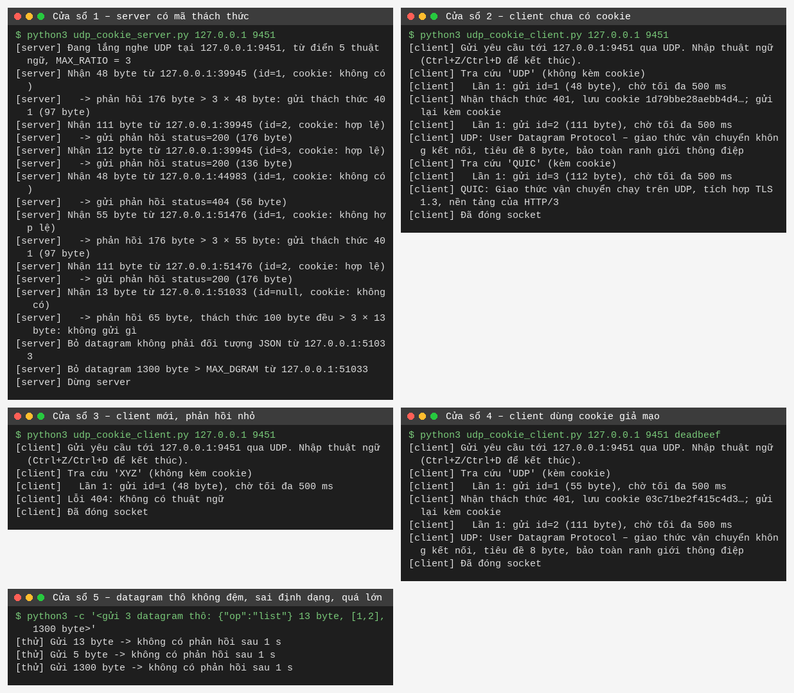

# Bài 4.5 – Xác thực địa chỉ nguồn bằng mã thách thức không trạng thái (Python)

| Thông tin | Nội dung |
|---|---|
| Mã giả tương ứng | Mã giả 4.8 (COOKIE, HANDLE_DATAGRAM); phía client theo đoạn văn sau Mã giả 4.8 |
| Mục giáo trình | 4.6.1 Giả mạo địa chỉ nguồn và tấn công khuếch đại |
| Kế thừa | Mã giả 4.3 (server tra cứu UDP, `PROCESS_REQUEST`) – thay thân vòng lặp bằng `HANDLE_DATAGRAM`; Mã giả 4.4 (`UDP_REQUEST`) ở client; Mã giả 2.1 |
| Thư viện | Thư viện chuẩn: `socket`, `json`, `hmac`, `hashlib` |

## Mục tiêu
Chống bị lợi dụng cho tấn công phản xạ và khuếch đại: với địa chỉ chưa xác thực, server không gửi phản hồi lớn hơn `MAX_RATIO` = 3 lần yêu cầu mà gửi thách thức nhỏ (mã 401 kèm cookie). Cookie = HMAC-SHA256(KEY, "ip:cổng:w") với w là khung thời gian 1 phút, nên server không cần lưu trạng thái; client nhận cookie, gửi lại yêu cầu kèm cookie và được phục vụ.

## Tệp
- `udp_cookie_server.py` – Mã giả 4.8 (`cookie`, `handle_datagram`) và `process_request`.
- `udp_cookie_client.py` – client lưu và gửi lại cookie, đệm yêu cầu đầu tiên tới 48 byte; `udp_request` (Mã giả 4.4).
- `glossary.json` – từ điển thuật ngữ.
- `demo.json` – kịch bản chạy minh họa (dùng với `tools/demo.py`).
- `ket_qua.txt`, `ket_qua.png` – kết quả thực thi thật.

## Cách chạy
Trong thư mục bài (cần Python 3.11 trở lên):
```bash
# Cửa sổ 1 – server
python3 udp_cookie_server.py 0.0.0.0 9100
# Cửa sổ 2 – client
python3 udp_cookie_client.py 127.0.0.1 9100
# Cửa sổ 3 – client dùng cookie giả mạo
python3 udp_cookie_client.py 127.0.0.1 9100 deadbeef
```
Chạy trong thư mục bài (nơi có `glossary.json`). Nhập tên thuật ngữ ở cửa sổ client. Tham số thứ ba của client (thêm cho bài thực hành) là cookie ban đầu, dùng để mô phỏng client gửi cookie giả mạo hoặc cookie của địa chỉ khác. Trên Windows dùng `py` (hoặc `python`) thay cho `python3`.

## Kết quả thực thi


Yêu cầu `UDP` đầu tiên chưa có cookie được client đệm khoảng trắng tới 48 byte; phản hồi 176 byte > 3 × 48 byte, nên server chỉ gửi thách thức 401 dài 97 byte; client lưu cookie, gửi lại kèm cookie và được phục vụ; yêu cầu `QUIC` sau đó dùng lại cookie và được phục vụ ngay. Client mới hỏi `XYZ` không cần cookie vì phản hồi 404 (56 byte) không vượt 3 lần yêu cầu 48 byte. Client dùng cookie giả mạo `deadbeef` bị server đánh giá "không hợp lệ" và nhận thách thức như client chưa có cookie. Cửa sổ 5 gửi ba datagram thô không qua client: `{"op":"list"}` 13 byte không đệm (thách thức 100 byte cũng vượt 3 × 13 byte nên server không gửi gì), `[1,2]` (không phải đối tượng) và một datagram 1300 byte (> `MAX_DGRAM`); cả ba đều bị bỏ im lặng.

## Ghi chú
- Theo dòng 7–13 của Mã giả 4.8, datagram dài hơn `MAX_DGRAM` = 1200 byte, không phải JSON (kể cả byte UTF-8 sai) hoặc không phải đối tượng JSON bị bỏ im lặng; server chỉ ghi một dòng nhật ký.
- Giữ phép kiểm tra phản hồi vượt `MAX_DGRAM` (mã 413) của Mã giả 4.3, vốn không xuất hiện trong thân `HANDLE_DATAGRAM`.
- `SAFE_EQUAL` (dòng 15–16) dùng hàm so sánh thời gian hằng `hmac.compare_digest` để không lộ vị trí ký tự sai đầu tiên qua thời gian xử lý.
- Dòng 22: nếu chính thông điệp thách thức cũng dài hơn `MAX_RATIO` lần yêu cầu thì server không gửi gì. Vì vậy client đệm khoảng trắng sau JSON để yêu cầu chưa có cookie dài ít nhất 48 byte (`MIN_FIRST`, chọn sao cho thách thức khoảng 100 byte không vượt 3 × 48 = 144 byte), tương tự gói Initial của QUIC tối thiểu 1200 byte. Khoảng trắng cuối là hợp lệ trong JSON. Giá trị 48 nhỏ hơn mức 1200 của QUIC để vẫn quan sát được thách thức 401 với phản hồi tra cứu khoảng 176 byte.
- Client gửi lại kèm cookie đúng một lần cho mỗi thuật ngữ để tránh lặp vô hạn nếu server liên tục thách thức.
- Khóa `KEY` được sinh ngẫu nhiên mỗi lần khởi động server nên cookie cũ mất hiệu lực sau khi server khởi động lại; server chấp nhận cookie của khung thời gian hiện tại và khung liền trước (tối đa khoảng 2 phút).
- `hmac.new(KEY, msg, hashlib.sha256).hexdigest()` tạo cookie dạng 64 ký tự hex.
- Kiểm thử: Linux, Python 3.13.18.
