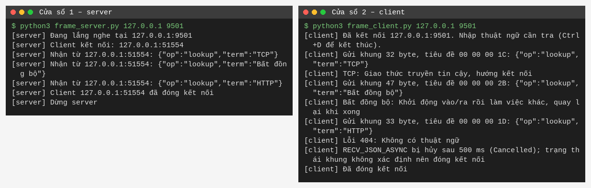

# Bài 5.1 – Các hàm gửi, nhận khung JSON bất đồng bộ (Python)

| Thông tin | Nội dung |
|---|---|
| Mã giả tương ứng | Mã giả 5.1 (Các hàm gửi, nhận khung JSON bất đồng bộ) |
| Mục giáo trình | 5.2.4 Các hàm socket bất đồng bộ; 5.4.1 Hủy tác vụ hợp tác |
| Kế thừa | Mã giả 3.3 (SEND_ALL), 3.4 (RECV_EXACT), 3.6 (khung JSON), 3.7 (PROCESS_REQUEST), 3.8 (LOOKUP_CLIENT), 2.1 (PARSE_ENDPOINT), 2.2 (SAFE_CONNECT) |
| Thư viện | Thư viện chuẩn: `asyncio`, `socket`, `struct`, `json` |

## Mục tiêu
Chuyển các hàm định khung của Mục 3.4 sang bất đồng bộ theo đúng quy tắc của Mục 5.2.4: mỗi lời gọi vào/ra được thay bằng phiên bản bất đồng bộ, logic giữ nguyên. Server tra cứu dùng các hàm này phục vụ mỗi kết nối bằng một tác vụ riêng; client in 4 byte tiêu đề của từng khung để đối chiếu với giải thích bước (6) và minh họa việc hủy một lời gọi nhận đang chờ bằng tín hiệu hủy (Mục 5.4.1).

## Tệp
- `khung_json_async.py` – `recv_exact_async`, `recv_json_async`, `send_json_async`, `parse_endpoint`, `safe_connect_async`, các lớp lỗi.
- `frame_server.py` – server tra cứu bất đồng bộ (mỗi kết nối một tác vụ asyncio).
- `frame_client.py` – client tra cứu, in tiêu đề khung và minh họa hủy.
- `demo.json` – kịch bản chạy minh họa (dùng với `tools/demo.py`).
- `ket_qua.txt`, `ket_qua.png` – kết quả thực thi thật.

## Cách chạy
Mở hai cửa sổ dòng lệnh trong thư mục bài (Windows dùng `py` thay cho `python3`):
```bash
# Cửa sổ 1 – server
python3 frame_server.py 0.0.0.0 9100
# Cửa sổ 2 – client
python3 frame_client.py 127.0.0.1 9100
```
Nhập từng thuật ngữ (ví dụ `TCP`), kết thúc bằng Ctrl+D (Linux/macOS) hoặc Ctrl+Z rồi Enter (Windows). Dừng server bằng Ctrl+C.

## Kết quả thực thi


Ba khung có độ dài nội dung 28, 43 và 29 byte (tiêu đề `00 00 00 1C`, `00 00 00 2B`, `00 00 00 1D`): chuỗi "Bất đồng bộ" có 11 ký tự nhưng chiếm nhiều byte hơn trong UTF-8, nên độ dài khung luôn tính bằng byte. Thuật ngữ không có trong từ điển nhận mã 404. Lời gọi nhận cuối bị hủy sau 500 ms; client đóng kết nối thay vì dùng tiếp, và server nhận biết client đóng đúng ranh giới khung (`received = 0`) nên kết thúc phiên bình thường.

## Ghi chú
- Tín hiệu hủy `ct`: asyncio không truyền token mà hủy bằng `task.cancel()`; lỗi `asyncio.CancelledError` phát sinh tại điểm `await` đang chờ. Vì vậy các hàm không có tham số `ct`; client minh họa hủy bằng `loop.call_later(0.5, task.cancel)`.
- `SEND_ALL_ASYNC` tương ứng với `writer.write(data)` rồi `await writer.drain()`; `RECV_ASYNC` tương ứng với `reader.read(n)`. `StreamReader.readexactly(n)` làm sẵn việc của `RECV_EXACT_ASYNC`, nhưng bài viết vòng lặp tường minh để đối chiếu với mã giả.
- JSON được mã hóa không thêm khoảng trắng và giữ nguyên chữ có dấu (`ensure_ascii=False`), nên độ dài khung giống hệt bản C# và Java.
- Server không có trong mã giả 5.1; server dùng lại nghiệp vụ của Mã giả 3.7 với từ điển nhỏ viết sẵn trong mã thay cho tệp `glossary.json`. Thời gian chờ nhận 5000 ms của client dùng `asyncio.wait_for`.
- Bàn phím được đọc bằng `asyncio.to_thread(sys.stdin.readline)` để không chặn vòng lặp sự kiện.
- Kiểm thử: Linux, Python 3.13.18.
