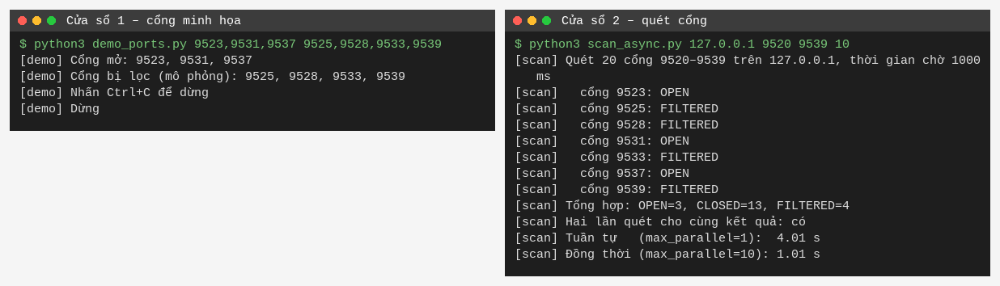

# Bài 5.2 – Kiểm tra nhiều cổng đồng thời có giới hạn (Python)

| Thông tin | Nội dung |
|---|---|
| Mã giả tương ứng | Mã giả 5.2 (Kiểm tra nhiều cổng đồng thời có giới hạn) |
| Mục giáo trình | 5.2.5 Thực hiện nhiều tác vụ đồng thời |
| Kế thừa | Mã giả 1.2 (PORT_CHECK), Mã giả 1.1 (RESOLVE_HOST) |
| Thư viện | Thư viện chuẩn: `asyncio` (`Semaphore`, `gather`, `open_connection`, `wait_for`), `socket` |

## Mục tiêu
Cài đặt `SCAN_PORTS` và `CHECK_ONE`: khởi động một tác vụ kiểm tra cho mỗi cổng mà chưa chờ, giới hạn số kết nối đồng thời bằng semaphore và chờ tất cả bằng `WHEN_ALL`. Chương trình quét cùng một dải cổng hai lần, tuần tự (`max_parallel` = 1) và đồng thời (`max_parallel` = k), để kiểm chứng công thức thời gian xấu nhất ⌈N/k⌉·t của Mục 5.2.5.

## Tệp
- `scan_async.py` – `port_check_async`, `check_one`, `scan_ports`; quét tuần tự rồi đồng thời và in thời gian.
- `demo_ports.py` – mở các cổng minh họa (mở, bị lọc) trên 127.0.0.1.
- `demo.json` – kịch bản chạy minh họa (dùng với `tools/demo.py`).
- `ket_qua.txt`, `ket_qua.png` – kết quả thực thi thật.

## Cách chạy
```bash
# Cửa sổ 1 – mở cổng minh họa
python3 demo_ports.py 9003,9011,9017 9005,9008,9013,9019
# Cửa sổ 2 – quét dải 9000–9019, k = 10
python3 scan_async.py 127.0.0.1 9000 9019 10
```

## Kết quả thực thi


Dải 20 cổng có 3 cổng mở, 4 cổng bị lọc (mô phỏng) và 13 cổng đóng. Mỗi cổng bị lọc chờ hết 1000 ms, nên quét tuần tự mất khoảng 4 × 1 s = 4,01 s, còn quét đồng thời với k = 10 mất khoảng ⌈4/10⌉ × 1 s = 1,01 s; cổng đóng và cổng mở trả lời gần như tức thời qua loopback. Hai lần quét cho cùng kết quả.

## Ghi chú
- `ACQUIRE_ASYNC … FINALLY RELEASE` được viết bằng `async with gate`, bảo đảm nhả semaphore cả khi kiểm tra lỗi. `WHEN_ALL` tương ứng với `asyncio.gather`, giữ đúng thứ tự cổng.
- `CONNECT_TIMEOUT` dùng `asyncio.wait_for(open_connection(...), 1.0)`; khi hết giờ, kết nối đang dở bị hủy và socket được đóng.
- Cổng "bị lọc" được mô phỏng trên loopback: socket lắng nghe với backlog 1 không bao giờ chấp nhận kết nối, chương trình minh họa tự lấp đầy hàng đợi; khi hàng đợi đầy, Linux bỏ qua gói SYN mới nên phía quét hết thời gian chờ giống như gặp tường lửa. Trên Windows, hàng đợi đầy thường được trả lời bằng RST, khi đó các cổng này hiện là CLOSED và hai thời gian quét gần bằng nhau.
- Như Mục 1.2.5, chương trình kiểm tra nhiều cổng chỉ được chạy trên hệ thống thuộc quyền quản lý hoặc trong mạng thí nghiệm cô lập; kịch bản minh họa chỉ quét 127.0.0.1.
- Kiểm thử: Linux, Python 3.13.18.
