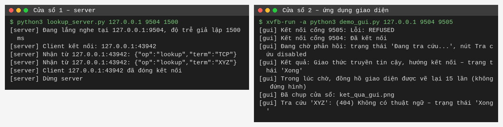
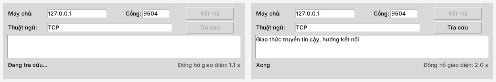

# Bài 5.3 – Ứng dụng tra cứu có giao diện bất đồng bộ (Python)

| Thông tin | Nội dung |
|---|---|
| Mã giả tương ứng | Mã giả 5.3 (Cách (1): luồng nền và UI_INVOKE), Mã giả 5.4 (Cách (2): trình xử lý sự kiện bất đồng bộ) |
| Mục giáo trình | 5.3.1 Mô hình luồng giao diện đơn, 5.3.2 Ba cách tiếp cận, 5.3.5 Tranh chấp và quản lý trạng thái |
| Kế thừa | Mã giả 2.2 (SAFE_CONNECT), 3.7 (server tra cứu), 3.8 (một lượt tra cứu), 5.1 (khung JSON bất đồng bộ) |
| Thư viện | Thư viện chuẩn: `tkinter`, `asyncio`, `threading`, `queue`, `socket`; ImageMagick (`import`, `convert`) chỉ dùng để chụp ảnh trong kịch bản minh họa |

## Mục tiêu
Kết hợp socket với giao diện đồ họa theo hai cách tiếp cận của Mục 5.3.2. Nút Kết nối dùng cách (1): luồng nền gọi `SAFE_CONNECT` chặn rồi chuyển kết quả về luồng giao diện bằng `UI_INVOKE` (Mã giả 5.3). Nút Tra cứu dùng cách (2): trình xử lý sự kiện bất đồng bộ gửi yêu cầu và chờ phản hồi mà không chặn luồng giao diện (Mã giả 5.4). Một đồng hồ trên cửa sổ cập nhật mỗi 100 ms để kiểm chứng giao diện không đứng hình khi server trả lời chậm.

## Tệp
- `lookup_gui.py` – cửa sổ Tkinter: `on_connect_click`, `connect_worker` (cách 1), `on_lookup_click` (cách 2), `ui_invoke`.
- `khung_json_async.py` – khung JSON bất đồng bộ (Mã giả 5.1) và `safe_connect` bản chặn (Mã giả 2.2).
- `lookup_server.py` – server tra cứu tối giản có độ trễ giả lập.
- `demo_gui.py` – kịch bản thao tác tự động trên cửa sổ thật và chụp ảnh.
- `demo.json` – kịch bản chạy minh họa (dùng với `tools/demo.py`).
- `ket_qua.txt`, `ket_qua.png` – nhật ký thật của server và kịch bản; `ket_qua_gui.png` – ảnh chụp cửa sổ thật.

## Cách chạy
Cần Tkinter (Windows, macOS: có sẵn trong bộ cài Python; Ubuntu: `sudo apt-get install python3-tk`).
```bash
# Cửa sổ 1 – server, trả lời chậm 1500 ms
python3 lookup_server.py 0.0.0.0 9100 1500
# Cửa sổ 2 – ứng dụng giao diện
python3 lookup_gui.py 127.0.0.1 9100
```
Chạy kịch bản minh họa không cần màn hình (Linux): `xvfb-run -a python3 demo_gui.py 127.0.0.1 9100 9101`.

## Kết quả thực thi




Cửa sổ trái được chụp khi đang chờ server (độ trễ giả lập 1500 ms): trạng thái "Đang tra cứu...", nút Tra cứu bị tắt (chống bấm lặp), đồng hồ vẫn chạy. Cửa sổ phải được chụp khi đã có kết quả: nội dung hiển thị, nút được bật lại. Nhật ký cho thấy lần bấm Kết nối tới cổng không có server báo `Lỗi: REFUSED` và nút Kết nối được bật lại; trong khoảng 1,5 s chờ, đồng hồ được vẽ lại 15–16 lần. Sau khi chụp ảnh, kịch bản tra cứu thêm `XYZ` (không có trong từ điển): ô kết quả hiện `(404) Không có thuật ngữ` theo dòng 10–11 của Mã giả 5.4.

## Ghi chú
- `UI_INVOKE` trên Tkinter theo bảng ui-dispatch: luồng nền đưa (thủ tục, tham số) vào `queue.Queue`, luồng chính đọc hàng đợi mỗi 50 ms bằng `root.after`.
- Cách (2) cần phần tiếp theo sau `await` chạy trên luồng giao diện. Tkinter không có cơ chế này sẵn như WinForms, nên vòng lặp thông điệp Tk được chạy bên trong vòng lặp sự kiện asyncio (`root.update()` rồi `await asyncio.sleep(0.01)`) trên cùng luồng chính; nút Tra cứu khởi động coroutine bằng `create_task`.
- Trong mã giả 5.4, `conn` được mở khi nạp cửa sổ; bài mở kết nối bằng nút Kết nối (cách 1): `CONNECT_WORKER` kết nối trên luồng nền rồi dùng `UI_INVOKE(SET_FIELD, conn, c)` để lưu socket vào trường của cửa sổ trên luồng giao diện trước khi báo "Đã kết nối" (dòng 7–9 của Mã giả 5.3) rồi bọc socket đã kết nối thành `StreamReader`/`StreamWriter` (`open_connection(sock=...)`). Theo dòng 8–12 của Mã giả 5.4, phản hồi khác 200 (ví dụ 404 khi thuật ngữ không có trong từ điển) được hiển thị dạng "(mã) lý do", ví dụ `(404) Không có thuật ngữ`.
- Đóng cửa sổ hủy mọi tác vụ của cửa sổ (`task.cancel()`, tương ứng `ct`) và đóng kết nối (Mục 5.3.5).
- `ket_qua.png` là nhật ký dòng lệnh do `tools/demo.py` vẽ; ảnh cửa sổ thật được lưu riêng ở `ket_qua_gui.png` vì công cụ ghi đè `ket_qua.png`.
- Kiểm thử: Linux, Python 3.12.3 với Tk 8.6 (gói `python3-tk` của hệ thống) dưới Xvfb; server chạy với Python 3.13.18.
