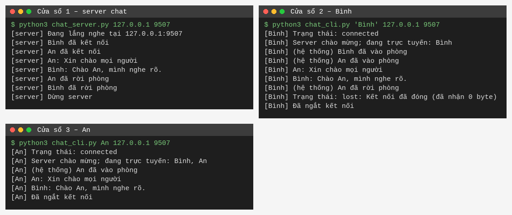

# Bài 5.4 – Lớp dịch vụ ChatClient bất đồng bộ (Python)

| Thông tin | Nội dung |
|---|---|
| Mã giả tương ứng | Mã giả 5.5 (Lớp dịch vụ ChatClient bất đồng bộ) |
| Mục giáo trình | 5.3.2 Ba cách tiếp cận (cách 3), 5.3.3 Ví dụ: lớp dịch vụ chat client, 5.4.5 Xử lý ngoại lệ trong tác vụ bất đồng bộ |
| Kế thừa | Mã giả 5.1 (khung JSON bất đồng bộ); SAFE_CONNECT_ASYNC = Mã giả 2.2 + AWAIT; giao thức chat của Mục 6.3.1 (phần `hello`, `msg`, `sys`, `welcome`) |
| Thư viện | Thư viện chuẩn: `asyncio` (`Lock`, `create_task`, `Queue`), `threading`, `json`, `struct` |

## Mục tiêu
Cài đặt lớp `ChatClient` theo cách tiếp cận (3) của Mục 5.3.2: lớp dịch vụ mạng giữ kết nối dài hạn, có vòng nhận chạy nền phát sự kiện `on_message`, thủ tục gửi tuần tự hóa bằng khóa `send_lock`, và thủ tục ngắt kết nối hủy vòng nhận trước khi đóng socket. Tầng giao diện (ở đây là giao diện dòng lệnh) chỉ đăng ký hai sự kiện và gọi các thủ tục của lớp, nên lớp kiểm thử được mà không cần cửa sổ.

## Tệp
- `chat_client.py` – lớp `ChatClient`: `connect`, `receive_loop`, `send_message`, `disconnect`, sự kiện `on_message`, `on_status`.
- `chat_cli.py` – giao diện dòng lệnh dùng `ChatClient`.
- `chat_server.py` – server chat tối giản đi kèm.
- `khung_json_async.py` – khung JSON bất đồng bộ (Mã giả 5.1), `safe_connect_async`.
- `demo.json` – kịch bản chạy minh họa (dùng với `tools/demo.py`).
- `ket_qua.txt`, `ket_qua.png` – kết quả thực thi thật.

## Cách chạy
```bash
# Cửa sổ 1 – server chat
python3 chat_server.py 0.0.0.0 9200
# Cửa sổ 2, 3 – hai người dùng
python3 chat_cli.py Bình 127.0.0.1 9200
python3 chat_cli.py An 127.0.0.1 9200
```
Mỗi dòng nhập được gửi thành một tin; `/quit` để ngắt kết nối; `/cho <giây>` tạm dừng đọc bàn phím (dùng trong kịch bản minh họa).

## Kết quả thực thi


Bình kết nối trước, An kết nối sau; tin của mỗi người được server chuyển tới cả hai (gồm cả người gửi). Khi An gõ `/quit`, `DISCONNECT` hủy vòng nhận trước rồi mới đóng socket, nên phía An kết thúc lặng lẽ (nhánh `Cancelled`), còn Bình nhận thông báo hệ thống "An đã rời phòng". Cuối kịch bản, server bị dừng trước: vòng nhận của Bình gặp kết nối đóng và báo `on_status("lost: ...")` (nhánh lỗi ngoài ý muốn), sau đó Bình được dừng bằng Ctrl+C.

## Ghi chú
- `cts` tương ứng với tác vụ vòng nhận: `CANCEL(c.cts)` là `recv_task.cancel()`, gây `CancelledError` tại điểm `await` của vòng nhận. `send_lock` là `asyncio.Lock`, `RUN_BACKGROUND` là `asyncio.create_task`.
- Vòng nhận bắt `JsonError` như dòng 23 của Mã giả 5.5; trong Python lỗi JSON sai là `ValueError` (lớp cha của `json.JSONDecodeError`), nên mọi lỗi của tác vụ nền đều thành sự kiện `on_status` (Mục 5.4.5).
- `send_message(room, text)` gửi `{"type":"msg","room":…,"text":…}` theo dòng 28–31; giao diện dòng lệnh luôn chọn phòng `chung`, và server tối giản phát lại tin với đúng trường `room` nhận được.
- Bàn phím được đọc trên một luồng phụ (daemon) và chuyển vào `asyncio.Queue`, nên tin đến vẫn được hiển thị trong lúc chờ người dùng gõ.
- Server chat đi kèm là bản tối giản viết bằng cùng ngôn ngữ: một phòng chung, chuyển tiếp `msg`, trả lời `ping`, lỗi 409 khi trùng tên. Server dùng một khóa gửi cho mỗi client thay cho hộp thư đi và tác vụ ghi riêng của Chương 6. Bản đầy đủ (nhiều phòng, tin riêng) thuộc Chương 6.
- Kiểm thử: Linux, Python 3.13.18.
