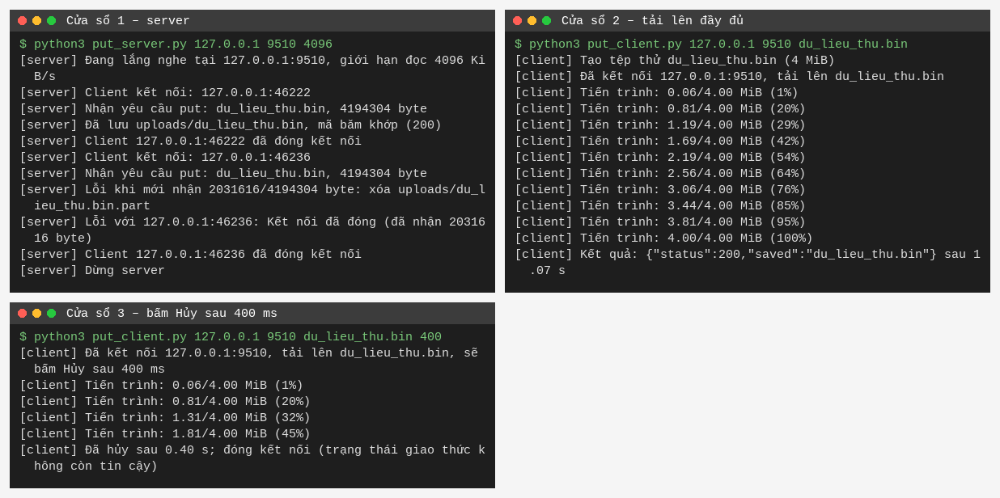

# Bài 5.5 – Tải tệp bất đồng bộ có báo cáo tiến trình và hủy (Python)

| Thông tin | Nội dung |
|---|---|
| Mã giả tương ứng | Mã giả 5.6 (Tải tệp bất đồng bộ có báo cáo tiến trình và hủy) |
| Mục giáo trình | 5.3.4 Ví dụ: tải tệp có báo cáo tiến trình và hủy; 5.4.1 Hủy tác vụ hợp tác |
| Kế thừa | Mã giả 3.10 (PUT_CLIENT), 3.9 (HANDLE_PUT – server đi kèm), 5.1 (khung JSON bất đồng bộ) |
| Thư viện | Thư viện chuẩn: `asyncio`, `hashlib`, `socket`, `json`, `struct` |

## Mục tiêu
Chuyển thủ tục gửi tệp của Mục 3.5.2 sang bất đồng bộ, giữ nguyên giao thức bốn bước (tiêu đề có SHA-256, trạng thái 100, nội dung, trạng thái 200/422), bổ sung hàm báo tiến trình tối đa khoảng 10 lần mỗi giây và tín hiệu hủy. Kịch bản minh họa tải một tệp 4 MiB hoàn chỉnh, sau đó tải lại và bấm Hủy giữa chừng để kiểm chứng phía server xóa tệp `.part`.

## Tệp
- `put_client.py` – `put_file_async` (Mã giả 5.6), hàm báo tiến trình, nút Hủy mô phỏng bằng hẹn giờ.
- `put_server.py` – server nhận tệp có kiểm tra mã băm (Mã giả 3.9), giới hạn tốc độ đọc.
- `khung_json_async.py` – khung JSON bất đồng bộ (Mã giả 5.1), `safe_connect_async`.
- `demo.json` – kịch bản chạy minh họa (dùng với `tools/demo.py`).
- `ket_qua.txt`, `ket_qua.png` – kết quả thực thi thật.

## Cách chạy
```bash
# Cửa sổ 1 – server, đọc tối đa 4096 KiB/s
python3 put_server.py 0.0.0.0 9100 4096
# Cửa sổ 2 – tải lên đầy đủ (tự tạo tệp thử 4 MiB nếu chưa có)
python3 put_client.py 127.0.0.1 9100 du_lieu_thu.bin
# Tải lên và bấm Hủy sau 400 ms
python3 put_client.py 127.0.0.1 9100 du_lieu_thu.bin 400
```
Tệp nhận được lưu trong thư mục `uploads/` cạnh server.

## Kết quả thực thi


Lần tải thứ nhất in tiến trình khoảng mỗi 100 ms và kết thúc với `{"status":200}` sau khoảng 1,1 s (server đọc 4096 KiB/s). Lần thứ hai bị hủy sau 400 ms: client đóng kết nối; vòng nhận của server gặp kết nối đóng trước khi đủ `size` byte nên xóa `uploads/du_lieu_thu.bin.part`, đúng như thiết kế khớp nhau của hai đầu giao thức ở Mục 5.3.4.

## Ghi chú
- Tín hiệu hủy `ct` tương ứng với `task.cancel()`: nút Hủy được mô phỏng bằng `loop.call_later(0.4, task.cancel)`; `CancelledError` phát sinh tại điểm `await` đang chờ (thường là `writer.drain()`), khối `finally` đóng tệp, rồi nơi gọi đóng kết nối (Mục 5.4.1).
- `SHA256_OF_FILE_ASYNC` và `READ_ASYNC` chạy trên luồng phụ bằng `asyncio.to_thread` vì asyncio không có thao tác đọc tệp bất đồng bộ; `SEND_ALL_ASYNC` là `write` + `drain`.
- Để quan sát được tiến trình trên loopback, server minh họa giới hạn tốc độ đọc (tham số `rate_kib`) và đặt bộ đệm nhận 64 KiB; client đặt bộ đệm gửi 64 KiB. Nếu không, hệ điều hành tự nới bộ đệm tới vài MiB và "số byte đã gửi" (đã vào bộ đệm gửi) chạy trước xa số byte server thực nhận; đây là khác biệt so với mã giả, chỉ phục vụ minh họa.
- Biến `sent` đếm số byte đã giao cho bộ đệm gửi (dòng 16 của Mã giả 5.6), không phải số byte server đã nhận; vì vậy mức 100% chỉ được báo sau khi server trả lời mã 200 (dòng 24–25). Lần tải bị hủy không bao giờ hiện 100%.
- Server dùng `HANDLE_PUT` của Mã giả 3.9: đổi `\` thành `/` rồi lấy tên tệp, từ chối `""`, `.`, `..`, `size` không phải số nguyên, `sha256` không đúng 64 ký tự hex (400); khối `CATCH ANY` xóa tệp `.part` với mọi lỗi khi nhận, kể cả khi tác vụ phiên bị hủy. Khung JSON sai hoặc không phải đối tượng nhận 400 "JSON sai" như Mã giả 3.7.
- Kịch bản tạo tệp thử `du_lieu_thu.bin` (4 MiB, nội dung ngẫu nhiên cố định) và thư mục `uploads/`; hai thứ này không được lưu kèm bài.
- Kiểm thử: Linux, Python 3.13.18.
