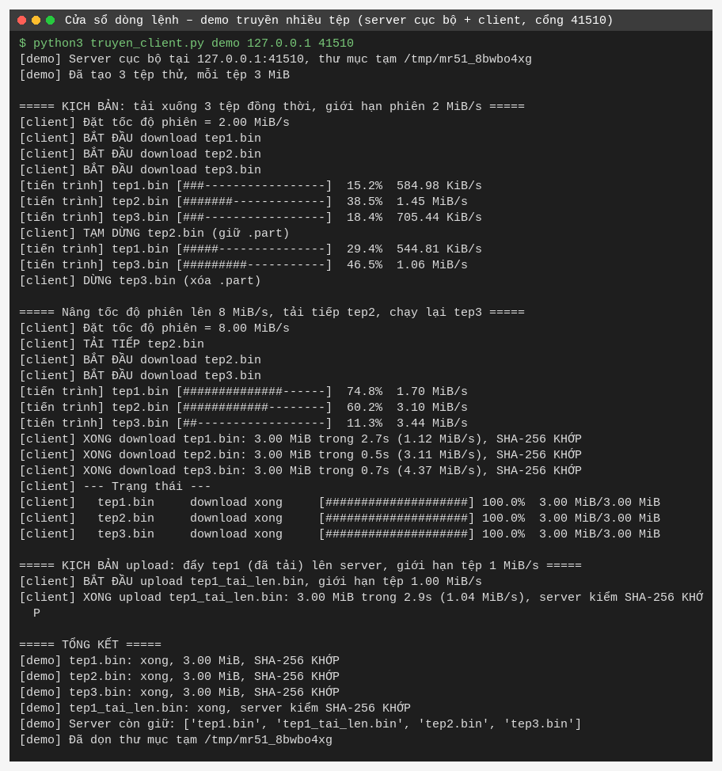

# Bài mở rộng MR5.1 – Truyền nhiều tệp đồng thời có điều khiển và giới hạn tốc độ (Python)

| Thông tin | Nội dung |
|---|---|
| Loại | **Bài mở rộng** – không có trong giáo trình, không có mã giả tương ứng |
| Liên hệ với giáo trình | Chương 5: Bài 5.5 (tải tệp có tiến trình và hủy), Bài 5.1 (khung bất đồng bộ); Chương 3: Bài 3.9/3.10 (gửi tệp có SHA-256), Bài 3.4 (HTTP `Range` – ý tưởng tải tiếp) |
| Thư viện | Thư viện chuẩn: `socket`, `threading`, `hashlib`, `struct`, `json`, `tempfile` |
| Bản ngôn ngữ khác | [C#](../../../csharp/Chuong05/BaiMR5.1_TruyenNhieuTep/), [Java](../../../java/Chuong05/BaiMR5.1_TruyenNhieuTep/), [Rust](../../../rust/Chuong05/BaiMR5.1_TruyenNhieuTep/), [Go](../../../go/Chuong05/BaiMR5.1_TruyenNhieuTep/) |

## Mục tiêu
Tải lên/tải xuống **n tệp lớn đồng thời** với đầy đủ điều khiển như một trình quản lý tải thật:
- **start / pause / resume / stop** cho từng tệp (pause giữ tệp `.part`, resume tải tiếp từ offset, stop xóa `.part`);
- **giới hạn tốc độ theo phiên** (thùng token dùng chung, đổi được lúc chạy, ví dụ `512K → 2M → 8M`) và **giới hạn theo từng tệp**;
- **tải tiếp (resume)** bằng offset + kiểm **SHA-256** ở cuối để bảo đảm toàn vẹn;
- in **thanh tiến trình** và **tốc độ đo được**.

## Giao thức
Một kết nối TCP cho mỗi lượt truyền (đơn giản, dễ tải tiếp). Mở đầu là một **khung điều khiển JSON có tiền tố độ dài 4 byte**, sau đó là **luồng byte nhị phân** của tệp từ `offset` tới hết:
- Tải xuống: client gửi `{"op":"download","name":…,"offset":OFF}`; server đáp `{"ok":true,"size":…,"sha256":…}` rồi gửi byte `[OFF..hết]`.
- Tải lên: client gửi `{"op":"upload","name":…,"offset":OFF,"size":…,"sha256":…}`; server đáp `{"ok":true}`, nhận byte ghi vào `name.part`, cuối cùng kiểm SHA-256, đổi tên thành `name`, đáp `{"ok":true,"sha256_ok":…}`.

Server **không** tự giới hạn tốc độ: client điều tiết bằng thùng token, TCP tự tạo áp lực ngược (server gửi chậm theo).

## Tệp
- `khung.py` – định khung JSON, thùng token (`ThungToken`), băm SHA-256, phân tích chuỗi tốc độ.
- `truyen_server.py` – server đa luồng, mỗi kết nối một lượt truyền.
- `truyen_client.py` – client: lớp `LuotTruyen`, `QuanLy` (điều khiển), giao diện dòng lệnh và vai `demo`.
- `demo.json`, `ket_qua.txt`, `ket_qua.png`.

## Cách chạy
Giao diện dòng lệnh (hai cửa sổ):
```bash
python3 truyen_server.py 0.0.0.0 41510 kho_server        # cửa sổ 1
python3 truyen_client.py client 127.0.0.1 41510 tai_ve   # cửa sổ 2, rồi nhập lệnh:
#   start tep1.bin                 (tải xuống)
#   speed 1M                       (đổi giới hạn phiên)
#   pause tep1.bin / resume tep1.bin / stop tep1.bin
#   start anh.bin upload 512K      (tải lên, giới hạn tệp 512 KiB/s)
#   status
```
Kịch bản tự động (tự dựng server cục bộ, tạo tệp thử rồi dọn sạch):
```bash
python3 truyen_client.py demo 127.0.0.1 41510
```
Trên Windows dùng `python`/`py`. Tái lập kết quả: `python3 tools/demo.py python/Chuong05/BaiMR5.1_TruyenNhieuTep`.

## Kết quả thực thi


Demo tạo 3 tệp 3 MiB, tải xuống đồng thời với giới hạn phiên 2 MiB/s. Trong pha chậm, `tep1` chạy hết và cho tốc độ ~1,1 MiB/s (bị điều tiết); `tep2` bị tạm dừng giữa chừng (giữ `.part`), `tep3` bị dừng hẳn (xóa `.part`). Sau khi nâng giới hạn lên 8 MiB/s, `tep2` tải tiếp từ offset và `tep3` chạy lại, cả hai hoàn tất nhanh (~4 MiB/s mỗi tệp). Cuối cùng một lượt **tải lên** với giới hạn tệp 1 MiB/s cho tốc độ ~1,0 MiB/s và server xác nhận **SHA-256 KHỚP**. Mọi tệp đều khớp mã băm; thư mục tạm được dọn sạch. Hai bản Python và Go in thông điệp giống nhau.

## Bài tập gợi ý
1. (Cơ bản) Đổi số tệp và kích thước trong vai `demo`, quan sát tổng thông lượng luôn bị chặn ở giới hạn phiên.
2. (Cơ bản) Thêm lệnh `speed-file <tên> <tốc_độ>` để đổi giới hạn riêng của một tệp lúc đang chạy.
3. (Trung bình) Thêm cơ chế thử lại có lùi thời gian khi kết nối rớt giữa chừng (kế thừa ý tưởng Bài 5.6/MR7.1).
4. (Trung bình) Gộp nhiều lượt truyền vào **một** kết nối TCP bằng cách ghép khung điều khiển + khung dữ liệu (multiplexing) thay vì mỗi tệp một kết nối.
5. (Nâng cao) Viết lại client bằng `asyncio` (một luồng, nhiều coroutine) và so sánh độ phức tạp với bản dùng luồng.

## Ghi chú
- Thùng token giới hạn **tổng** thông lượng của phiên; cách chia giữa các tệp phụ thuộc lịch luồng nên có thể không tuyệt đối đều (đã giảm "bùng" còn 0,25 giây để chia đều hơn).
- `pause` đóng kết nối và giữ `.part`; `resume` mở kết nối mới với `offset = kích thước .part`. Nhờ SHA-256 cuối cùng, dữ liệu ghép từ nhiều phiên vẫn được kiểm toàn vẹn.
- Tệp thử trong demo được tạo trong thư mục tạm của hệ điều hành và **xóa sau khi chạy**; không để lại tệp lớn trong kho mã.
- Kiểm thử: Linux, Python 3.13.18.

## Đọc thêm
- RFC 9110 §14 *HTTP Range Requests* (ý tưởng tải tiếp bằng offset).
- RFC 6234 *US Secure Hash Algorithms (SHA)* – SHA-256.
- Tài liệu `asyncio` (streams) và `socket` của Python; khái niệm *token bucket* trong điều tiết lưu lượng.

Mã nguồn của bài được viết mới cho kho này; tài liệu trên chỉ là nguồn tham khảo ý tưởng.
