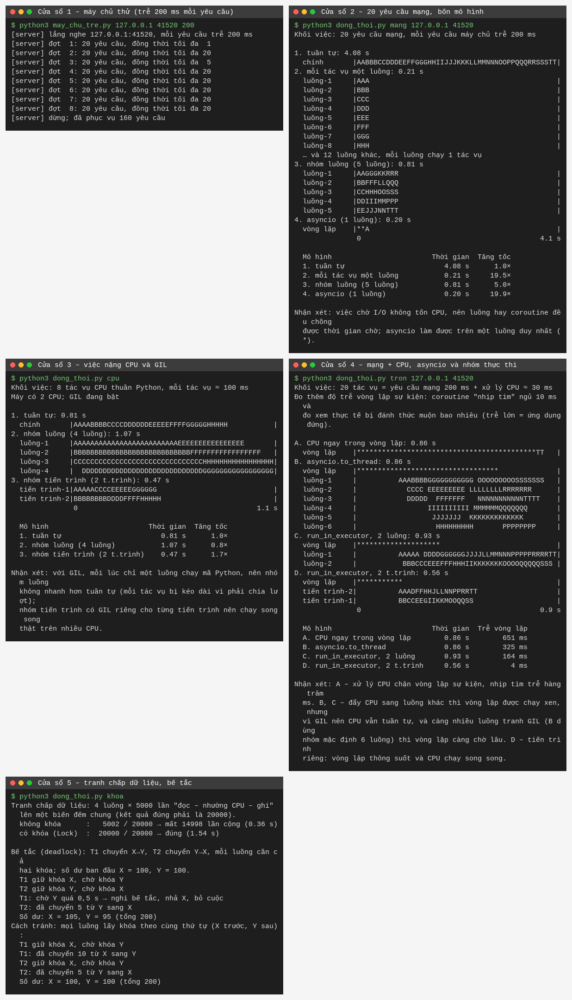

# Bài mở rộng MR5.2 – So sánh các mô hình đồng thời: tuần tự, luồng, nhóm luồng, asyncio, nhóm tiến trình (Python)

| Thông tin | Nội dung |
|---|---|
| Loại | **Bài mở rộng** – không có trong giáo trình, không có mã giả tương ứng |
| Liên hệ với giáo trình | Chương 5: Bài 5.1 (khung bất đồng bộ), Bài 5.2 (kiểm tra nhiều cổng đồng thời có giới hạn); Chương 6: Bài 6.1 (server đa luồng, nhóm luồng), Bài 6.2 (server bất đồng bộ) |
| Thư viện | Thư viện chuẩn: `socket`, `threading`, `concurrent.futures` (`ThreadPoolExecutor`, `ProcessPoolExecutor`), `asyncio` (`gather`, `to_thread`, `run_in_executor`) |
| Bản ngôn ngữ khác | [C#](../../../csharp/Chuong05/BaiMR5.2_MoPhongDongThoi/), [Java](../../../java/Chuong05/BaiMR5.2_MoPhongDongThoi/), [Rust](../../../rust/Chuong05/BaiMR5.2_MoPhongDongThoi/), [Go](../../../go/Chuong05/BaiMR5.2_MoPhongDongThoi/) |

## Mục tiêu
Cùng một khối việc, chạy bằng nhiều mô hình đồng thời khác nhau, đo thời gian thật và **vẽ biểu đồ Gantt bằng văn bản** cho thấy tác vụ nào chạy trên worker nào, vào lúc nào. Ba khối việc:

| Lệnh | Khối việc | Mô hình so sánh |
|---|---|---|
| `mang` | 20 yêu cầu TCP tới máy chủ thử, mỗi yêu cầu trễ 200 ms (chờ I/O) | 1. tuần tự; 2. mỗi tác vụ một luồng; 3. nhóm luồng 5 luồng; 4. `asyncio` một luồng |
| `cpu` | 8 tác vụ tính toán thuần Python, mỗi tác vụ ≈ 100 ms | 1. tuần tự; 2. nhóm luồng 4 luồng; 3. nhóm tiến trình (số CPU) |
| `tron` | 20 tác vụ = yêu cầu mạng 200 ms + xử lý CPU ≈ 30 ms | A. `asyncio`, CPU chạy ngay trong vòng lặp; B. `asyncio.to_thread`; C. `run_in_executor` với 2 luồng; D. `run_in_executor` với nhóm tiến trình – đo thêm **độ trễ vòng lặp sự kiện** |
| `khoa` | biến đếm chung, chuyển tiền giữa hai tài khoản | tranh chấp dữ liệu (race condition) và sửa bằng `Lock`; bế tắc (deadlock) và cách tránh bằng thứ tự lấy khóa |

## Kiến thức chính
- **Việc chờ I/O và việc nặng CPU khác nhau:** khi chờ mạng, CPU rảnh nên luồng hay coroutine đều chồng được thời gian chờ (20 × 200 ms ≈ 4 s → ≈ 0,2 s). Nhóm luồng 5 luồng chạy thành 4 đợt (≈ 0,8 s) – giới hạn đồng thời có chủ ý, như Bài 5.2.
- **`asyncio`:** một luồng, một vòng lặp sự kiện; trong biểu đồ, hàng “vòng lặp” có ký hiệu `*` (nhiều tác vụ cùng lúc trên một luồng).
- **GIL (Global Interpreter Lock):** trong CPython thông thường, mỗi lúc chỉ một luồng chạy mã Python. Vì vậy với việc CPU, nhóm luồng **không nhanh hơn** (thậm chí chậm hơn) tuần tự – trên biểu đồ, mỗi tác vụ bị kéo dài gấp nhiều lần vì phải chia lượt. Nhóm tiến trình có GIL riêng cho mỗi tiến trình nên chạy song song thật. (Python 3.13 có bản thử nghiệm *free-threaded* tắt GIL; chương trình in ra GIL đang bật hay tắt.)
- **Đừng chặn vòng lặp sự kiện:** xử lý CPU ngay trong coroutine làm vòng lặp “đứng” – coroutine nhịp tim (ngủ 10 ms) bị đánh thức muộn hàng trăm ms; với ứng dụng thật, mọi kết nối và giao diện khác đều đứng theo. Đẩy việc CPU/việc chặn sang `asyncio.to_thread` hoặc `loop.run_in_executor(nhóm, ...)`; với việc CPU thuần Python, chỉ nhóm tiến trình vừa giữ vòng lặp thông suốt vừa chạy song song.
- **Tranh chấp dữ liệu:** “đọc – làm việc khác – ghi” lên biến chung không được bảo vệ làm mất cập nhật; đoạn găng phải được bảo vệ bằng khóa.
- **Bế tắc:** hai luồng giữ khóa theo thứ tự ngược nhau thì chờ nhau mãi; cách tránh đơn giản nhất là mọi luồng lấy khóa theo **cùng một thứ tự**; chờ có hạn (`acquire(timeout=...)`) giúp phát hiện thay vì treo.

## Cấu trúc tệp
- `dong_thoi.py` – chương trình chính: ba khối việc `mang`, `cpu`, `tron` và các mô hình.
- `dong_ho.py` – ghi khoảng thời gian (`time.perf_counter`) và vẽ biểu đồ Gantt, bảng so sánh.
- `khoa.py` – tranh chấp dữ liệu và `Lock`; bế tắc và thứ tự lấy khóa.
- `may_chu_tre.py` – máy chủ thử `asyncio` trả lời sau một độ trễ giả lập; báo số yêu cầu và số kết nối đồng thời lớn nhất của mỗi “đợt”.
- `demo.json` – kịch bản chạy minh họa (dùng với `tools/demo.py`).
- `ket_qua.txt`, `ket_qua.png` – kết quả thực thi thật.

## Cách chạy
Trong thư mục bài (Windows dùng `python` hoặc `py` thay cho `python3`):
```bash
python3 may_chu_tre.py 127.0.0.1 9000 200       # cửa sổ 1: máy chủ thử, trễ 200 ms
python3 dong_thoi.py mang 127.0.0.1 9000        # cửa sổ 2
python3 dong_thoi.py cpu
python3 dong_thoi.py tron 127.0.0.1 9000
python3 dong_thoi.py khoa
```
Tái lập kết quả từ thư mục gốc của kho: `python3 tools/demo.py python/Chuong05/BaiMR5.2_MoPhongDongThoi`.

## Kết quả thực thi


Cách đọc biểu đồ: mỗi hàng là một worker; mỗi cột là 1/48 trục thời gian chung của cả khối việc (ghi ở cuối, ví dụ `4.1 s`); chữ cái là tác vụ đang chạy (A = tác vụ 1), `*` là nhiều tác vụ cùng lúc trên một worker. Lần chạy trong ảnh (Linux, 2 CPU):
- **mang:** tuần tự 4,08 s; mỗi tác vụ một luồng 0,21 s; nhóm 5 luồng 0,81 s (đúng 4 đợt: hàng `luồng-1` lần lượt chạy A, G, K, R); `asyncio` 0,20 s trên một luồng. Cửa sổ máy chủ xác nhận số kết nối đồng thời lớn nhất của mỗi đợt: 1, 20, 5, 20.
- **cpu:** tuần tự 0,81 s; nhóm 4 luồng 1,07 s (chậm hơn tuần tự vì GIL và chi phí chuyển luồng); nhóm 2 tiến trình 0,47 s (≈ 1,7 lần).
- **tron:** A 0,86 s, nhịp tim trễ tới 651 ms; B (`to_thread`, nhóm mặc định 6 luồng) 0,86 s, trễ 325 ms; C (2 luồng) 0,93 s, trễ 164 ms; D (2 tiến trình) 0,56 s, trễ chỉ 4 ms.
- **khoa:** không khóa còn 5002/20000 (mất gần 3/4 số lần cộng); có `Lock` đúng 20000. Bế tắc: T1, T2 mỗi bên giữ một khóa và chờ khóa kia; T1 chờ quá 0,5 s thì nhả khóa, nhờ đó T2 làm xong; khi lấy khóa theo thứ tự X trước Y, cả hai giao dịch đều xong, tổng số dư luôn là 200.

Thời gian đo thay đổi chút ít giữa các lần chạy và giữa các máy; quan hệ giữa các mô hình thì ổn định.

## Ghi chú
- Việc CPU dùng vòng lặp Python thuần (bộ sinh đồng dư tuyến tính) để luôn giữ GIL; một số hàm thư viện viết bằng C (ví dụ `hashlib` với dữ liệu lớn, `zlib`) tự nhả GIL nên chạy song song được trong luồng.
- Số vòng lặp CPU được hiệu chỉnh lúc chạy để mỗi tác vụ ≈ 100 ms (hoặc 30 ms) trên máy đang dùng.
- Nhóm tiến trình được “khởi động trước” (chạy một việc rỗng) để thời gian tạo tiến trình không tính vào phép đo. Trên Windows/macOS, tiến trình con được tạo bằng `spawn`, vì vậy mã khởi chạy phải nằm trong `if __name__ == "__main__":` (bài đã làm vậy).
- Ở mô hình tranh chấp, `time.sleep(0)` giữa lúc đọc và lúc ghi tượng trưng cho một thao tác chậm (gọi mạng, ghi nhật ký); không có nó, CPython ít khi chuyển luồng đúng giữa `v = c.value` và `c.value = v + 1`, lỗi vẫn tồn tại nhưng hiếm khi lộ ra – loại lỗi nguy hiểm nhất.
- Kiểm thử: Linux, Python 3.13.18 (GIL bật), máy 2 CPU.

## Bài tập gợi ý
1. Đổi kích thước nhóm luồng ở khối `mang` thành 2, 10, 20; dự đoán trước thời gian (≈ ⌈20 / n⌉ × 0,2 s) rồi đo lại. Ở cửa sổ máy chủ, số đồng thời tối đa thay đổi thế nào?
2. Tăng số yêu cầu lên 2000 (máy chủ trễ 200 ms): mô hình “mỗi tác vụ một luồng” và `asyncio` chạy thế nào? Đo bộ nhớ (`resource.getrusage` trên Linux) để so sánh chi phí của luồng và coroutine. Gợi ý: cần thêm `asyncio.Semaphore` để không mở quá nhiều socket một lúc.
3. Thay việc CPU bằng `hashlib.sha256(b"x" * 1_000_000).digest()` lặp nhiều lần; nhóm luồng có nhanh hơn không? Giải thích bằng việc `hashlib` nhả GIL.
4. Viết lại tranh chấp bằng `queue.Queue`: các luồng chỉ gửi “+1” vào hàng đợi, một luồng duy nhất cộng vào biến – không cần khóa (mô hình truyền thông điệp).
5. (Nâng cao) Nếu có bản Python *free-threaded* (`python3.13t`), chạy lại khối `cpu`: nhóm luồng nhanh hơn được không, và mô hình tranh chấp có lộ lỗi thường xuyên hơn khi bỏ `time.sleep(0)` không?

## Đọc thêm
- Tài liệu Python: [`asyncio` – Developing with asyncio](https://docs.python.org/3/library/asyncio-dev.html) (mục *Concurrency and Multithreading*, *Running Blocking Code*), [`asyncio.to_thread`](https://docs.python.org/3/library/asyncio-task.html#asyncio.to_thread), [`concurrent.futures`](https://docs.python.org/3/library/concurrent.futures.html), [*Python support for free threading*](https://docs.python.org/3/howto/free-threading-python.html).
- PEP 703 – *Making the Global Interpreter Lock Optional in CPython*, 2023.
- Claus Töpke, *Network Programming and Automation Essentials*, Packt, 2023, Chương 8 *Scaling Your Code* (đa tiến trình, đa luồng, coroutine trong Python và Go).
- Eric Chou, *Mastering Python Networking*, 4th ed., Packt, 2023, Chương 10 (asyncio).

Mã nguồn của bài được viết mới cho kho này; các tài liệu trên chỉ là nguồn tham khảo kiến thức.
