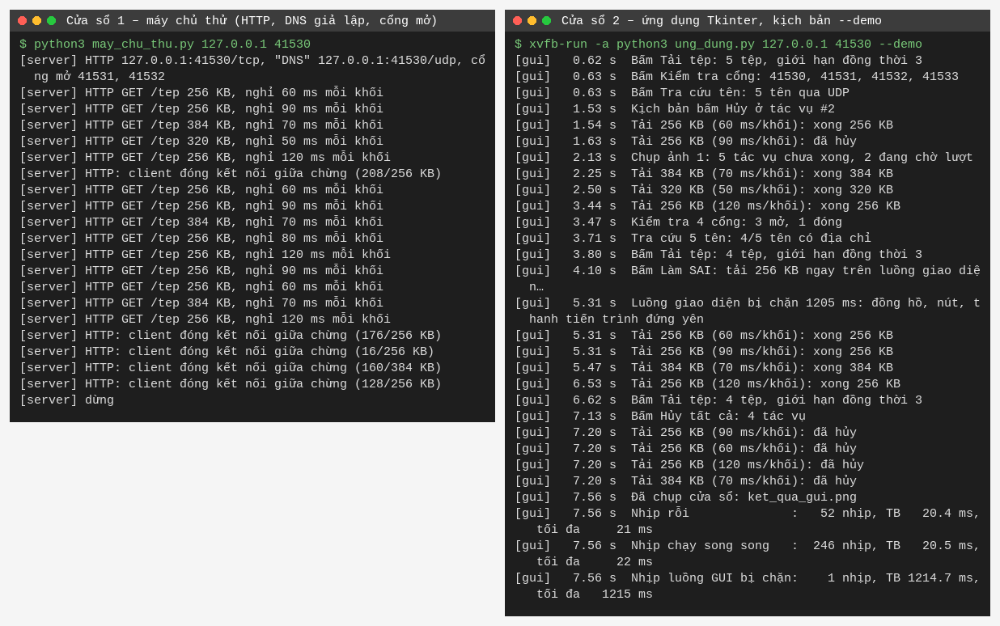
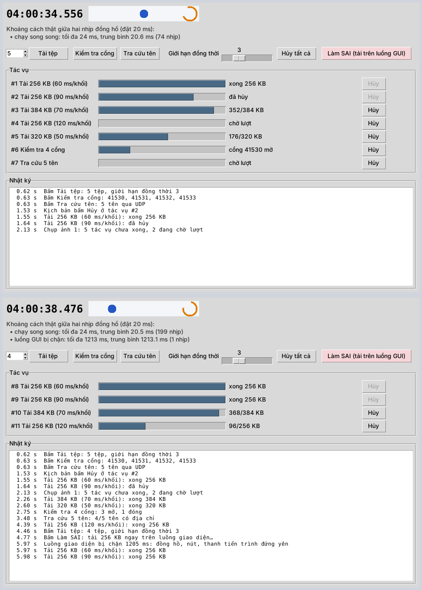

# Bài mở rộng MR5.3 – Giao diện luôn phản hồi khi nhiều tác vụ mạng chạy song song (Python, Tkinter)

| Thông tin | Nội dung |
|---|---|
| Loại | **Bài mở rộng** – không có trong giáo trình, không có mã giả tương ứng |
| Liên hệ với giáo trình | Chương 5: Bài 5.3 (giao diện bất đồng bộ), Bài 5.5 (tải tệp có tiến trình và hủy), Bài 5.2 (giới hạn đồng thời); Bài 1.2 (kiểm tra cổng), Bài 4.3 (tra cứu tên qua UDP); MR5.2 (các mô hình đồng thời) |
| Thư viện | Thư viện chuẩn: `tkinter`/`ttk`, `threading`, `queue`, `http.client`, `http.server`, `socket`; ImageMagick (`import`, `convert`) chỉ dùng để chụp ảnh trong kịch bản minh họa |
| Bản ngôn ngữ khác | [C#](../../../csharp/Chuong05/BaiMR5.3_GiaoDienDaTacVu/), [Java](../../../java/Chuong05/BaiMR5.3_GiaoDienDaTacVu/), [Rust](../../../rust/Chuong05/BaiMR5.3_GiaoDienDaTacVu/), [Go](../../../go/Chuong05/BaiMR5.3_GiaoDienDaTacVu/) |

## Mục tiêu
Một ứng dụng desktop chạy **nhiều tác vụ mạng cùng lúc** – tải tệp HTTP từ máy chủ thử với độ trễ khác nhau, kiểm tra cổng TCP, tra cứu tên qua máy chủ “DNS” giả lập trên UDP – mà **giao diện không bao giờ đứng**: đồng hồ (có mili giây) và hoạt hình chạy đều, mỗi tác vụ có thanh tiến trình và nút Hủy riêng, có nút Hủy tất cả và thanh trượt giới hạn số tác vụ chạy đồng thời. Nút **“Làm SAI”** chạy đúng việc tải tệp đó ngay trên luồng giao diện để thấy cả cửa sổ đứng bao lâu. Ứng dụng tự đo **khoảng cách thật giữa hai nhịp đồng hồ** (đặt 20 ms): luồng giao diện còn rảnh thì khoảng cách ≈ 20 ms, bị chặn thì tăng vọt.

## Kiến thức chính
- **Hai quy tắc của lập trình giao diện:** (1) chỉ luồng giao diện được chạm vào widget; (2) luồng giao diện không bao giờ chờ mạng hay tính toán lâu. Tk (và WinForms, WPF, Android, trình duyệt…) đều theo mô hình một luồng giao diện với vòng lặp sự kiện.
- **Luồng nền + hàng đợi an toàn luồng:** mỗi tác vụ chạy trên một `threading.Thread`; luồng nền chỉ `queue.put(...)` thông điệp (tiến trình, trạng thái, kết quả); luồng giao diện cứ 30 ms dùng `root.after()` lấy hết thông điệp ra và cập nhật widget.
- **Giới hạn đồng thời đổi được khi đang chạy:** `Limiter` dùng `threading.Condition`; tác vụ chưa tới lượt hiện “chờ lượt”; kéo thanh trượt thì các tác vụ đang chờ được đánh thức.
- **Hủy hợp tác:** mỗi tác vụ có một `threading.Event`; tác vụ kiểm tra cờ giữa hai khối dữ liệu, giữa hai cổng, giữa hai tên – vì vậy hủy có hiệu lực sau tối đa một bước (một khối 16 KB, một cổng, một tên). Tác vụ bị hủy khi còn đang chờ lượt thì không bao giờ mở kết nối.
- **Đo độ “mượt”:** hàm `tick()` đặt lại chính nó bằng `after(20)` và ghi khoảng cách thật giữa hai lần chạy, theo giai đoạn “rỗi”, “chạy song song”, “luồng GUI bị chặn”.

## Cấu trúc tệp
- `ung_dung.py` – ứng dụng Tkinter: dựng giao diện, nhịp đồng hồ và thống kê, nhận thông điệp từ hàng đợi, tạo/hủy tác vụ, nút “Làm SAI”; kịch bản `--demo`.
- `tac_vu.py` – phần không dùng Tk: `Limiter`, tải tệp HTTP có tiến trình, kiểm tra cổng, tra cứu tên qua UDP, ngoại lệ `Cancelled`.
- `may_chu_thu.py` – máy chủ thử cục bộ: HTTP `GET /tep?kb=..&tre=..` (gửi từng khối 16 KB, nghỉ `tre` ms sau mỗi khối), “DNS” giả lập trên UDP (100–400 ms, có một tên không tồn tại), hai cổng TCP mở.
- `demo.json` – kịch bản chạy minh họa (dùng với `tools/demo.py`).
- `ket_qua.txt`, `ket_qua.png` – nhật ký thật của máy chủ và ứng dụng; `ket_qua_gui.png` – hai ảnh chụp cửa sổ thật.

## Cách chạy
Cần Python có Tkinter (Windows, macOS: có sẵn trong bộ cài python.org; Ubuntu/Debian: `sudo apt install python3-tk`). Trong thư mục bài (Windows dùng `python` hoặc `py` thay cho `python3`):
```bash
python3 may_chu_thu.py 127.0.0.1 9000        # cửa sổ 1: máy chủ thử (dùng cổng 9000–9002)
python3 ung_dung.py 127.0.0.1 9000           # cửa sổ 2: ứng dụng; cổng 9003 để trống (đóng)
```
Thử: bấm **Tải tệp** (5 tệp), **Kiểm tra cổng**, **Tra cứu tên**; kéo thanh trượt giới hạn đồng thời; bấm **Hủy** ở một tác vụ; rồi bấm **Làm SAI** và quan sát đồng hồ, quả bóng đứng yên khoảng 1,2 s.

Kịch bản minh họa tự động không cần màn hình (Linux): `xvfb-run -a python3 ung_dung.py 127.0.0.1 9000 --demo`. Tái lập kết quả từ thư mục gốc của kho: `python3 tools/demo.py python/Chuong05/BaiMR5.3_GiaoDienDaTacVu`.

## Kết quả thực thi




Kịch bản `--demo` (giới hạn đồng thời 3): bấm Tải 5 tệp, Kiểm tra cổng, Tra cứu tên – 7 tác vụ; bấm Hủy tác vụ #2 khi nó đang tải (`đã hủy`, máy chủ ghi nhận client đóng kết nối giữa chừng). **Ảnh trên** chụp lúc 2,13 s: 5 tác vụ chưa xong, các thanh tiến trình đang chạy, 2 tác vụ “chờ lượt”. Kiểm tra cổng cho 3 cổng mở, 1 đóng; tra cứu tên cho 4/5 tên có địa chỉ (`khong-co.lab` → NXDOMAIN). Sau đó bấm Tải 4 tệp rồi bấm **Làm SAI**: luồng giao diện bị chặn 1205 ms. **Ảnh dưới** chụp ngay sau đó: dòng thống kê cho thấy khoảng cách lớn nhất giữa hai nhịp khi chạy song song chỉ 24 ms, còn khi luồng GUI bị chặn là 1213 ms; hai tệp #8, #9 vẫn tải xong ở luồng nền trong lúc cửa sổ đứng – kết quả của chúng chỉ hiện ra cùng lúc khi luồng giao diện được giải phóng. Cuối cùng bấm Tải 4 tệp rồi **Hủy tất cả**: 3 tác vụ đang tải dừng ngay, 1 tác vụ đang chờ lượt bị hủy mà không mở kết nối.

Thống kê cuối nhật ký: rỗi 51 nhịp, trung bình 20,5 ms, tối đa 21 ms; chạy song song 278 nhịp, trung bình 20,5 ms, tối đa 24 ms; luồng GUI bị chặn: một “nhịp” dài 1213 ms.

## Ghi chú
- Không gọi widget Tk từ luồng nền (kể cả `after()`): Tkinter không đảm bảo an toàn luồng; mọi cập nhật đi qua `queue.Queue`.
- Bộ giới hạn chỉ đảm bảo số tác vụ *đang chạy*; luồng của tác vụ chờ lượt vẫn được tạo (rẻ với vài chục tác vụ). Với hàng nghìn tác vụ nên dùng nhóm luồng (`ThreadPoolExecutor`) hoặc `asyncio` như Bài 5.3 và MR5.2.
- Thời gian chụp ảnh trong kịch bản minh họa (lệnh `import` chạy đồng bộ trên luồng giao diện) không được tính vào thống kê nhịp.
- Kiểm thử: Linux; ứng dụng chạy bằng Python 3.12.3 với Tk 8.6 (gói `python3-tk` của hệ thống) dưới Xvfb; máy chủ thử chạy bằng Python 3.13.18.

## Bài tập gợi ý
1. Đổi `TICK_MS` thành 5 ms và 100 ms; khoảng cách trung bình đo được có đúng như đặt không? Vì sao Tk không đảm bảo chính xác?
2. Cho thanh trượt giới hạn đồng thời = 1 rồi bấm Tải 5 tệp; trong lúc chạy kéo lên 8. Quan sát các tác vụ “chờ lượt” được khởi động cùng lúc.
3. Thêm cột “tốc độ” (KB/s) và “thời gian còn lại” cho mỗi tác vụ tải, tính ở luồng nền và gửi qua hàng đợi.
4. Viết lại phần chạy nền bằng `asyncio` trong một luồng riêng (như Bài 5.3), dùng `asyncio.run_coroutine_threadsafe` để gửi lệnh và `queue.Queue` để nhận kết quả; so sánh độ mượt.
5. (Nâng cao) Làm “Làm SAI” kiểu khác: chạy việc nặng CPU (MR5.2) trên một luồng nền thay vì luồng giao diện. Giao diện có còn mượt không? Giải thích bằng GIL và `sys.setswitchinterval`.

## Đọc thêm
- Tài liệu Python: [`tkinter` – Threading model](https://docs.python.org/3/library/tkinter.html#threading-model), [`queue`](https://docs.python.org/3/library/queue.html), [`threading.Event`, `threading.Condition`](https://docs.python.org/3/library/threading.html), [`http.client`](https://docs.python.org/3/library/http.client.html).
- RFC 9110 – *HTTP Semantics*, 2022 (§8.6 Content-Length).
- Claus Töpke, *Network Programming and Automation Essentials*, Packt, 2023, Chương 8 *Scaling Your Code*.

Mã nguồn của bài được viết mới cho kho này; các tài liệu trên chỉ là nguồn tham khảo kiến thức.
