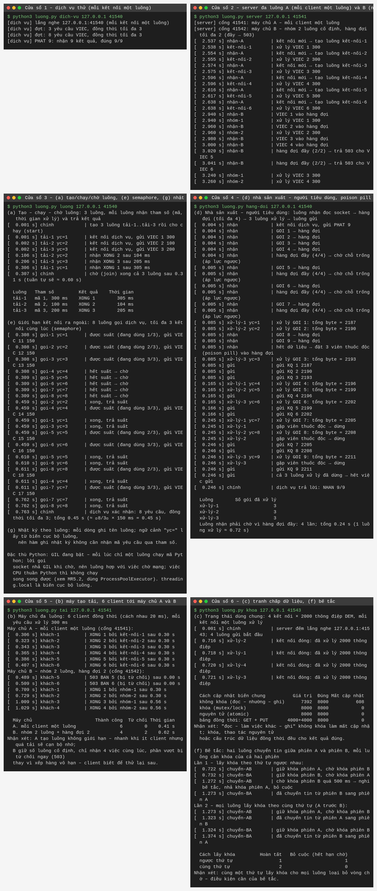

# Bài mở rộng MR5.4 – Luồng (thread) và đa luồng trong chương trình mạng (Python)

| Thông tin | Nội dung |
|---|---|
| Loại | **Bài mở rộng** – không có trong giáo trình, không có mã giả tương ứng |
| Liên hệ với giáo trình | Chương 5 (Bài 5.1–5.6); Chương 6 (Bài 6.1 server đa luồng, nhóm luồng; Bài 6.2) |
| Thư viện | Thư viện chuẩn: `socket`, `threading` (`Thread`, `Lock`, `BoundedSemaphore`, `local`), `queue.Queue`, `itertools.count` |
| Bản ngôn ngữ khác | [C#](../../../csharp/Chuong05/BaiMR5.4_LuongVaDaLuong/), [Java](../../../java/Chuong05/BaiMR5.4_LuongVaDaLuong/), [Rust](../../../rust/Chuong05/BaiMR5.4_LuongVaDaLuong/), [Go](../../../go/Chuong05/BaiMR5.4_LuongVaDaLuong/) |

## Mục tiêu
Đi từng bước vào chính **luồng** trong một chương trình mạng – từ tạo một luồng đến server đa luồng, đồng bộ hóa, đường ống nhà sản xuất – người tiêu dùng và bế tắc. Mọi dòng nhật ký đều ghi thời điểm và **tên luồng** để thấy luồng nào làm việc gì:

| Vai trò | Phần | Nội dung |
|---|---|---|
| `luong` | (a) | Tạo – chạy (`start`) – chờ (`join`) 3 luồng, truyền tham số, lấy kết quả; mỗi luồng gọi dịch vụ thử qua TCP |
| `server` + `tai` | (b) | Server A: **mỗi client một luồng**; server B: **nhóm 2 luồng cố định + hàng đợi giới hạn 2**, đầy thì trả `503 BAN` ngay. Máy tạo tải gửi 6 client cách nhau 20 ms |
| `khoa` | (c) | 4 kết nối × 2000 thông điệp `DEM`: bộ đếm **không khóa** (mất cập nhật, đếm được bao nhiêu), có `Lock`, “nguyên tử”, bảng dùng chung |
| `hang-doi` | (d) | **Nhà sản xuất – người tiêu dùng** trên một kết nối: 1 luồng nhận đọc socket → `queue.Queue(maxsize=4)` → 3 luồng xử lý → 1 luồng gửi; dừng êm bằng **viên thuốc độc** (poison pill) |
| `luong` | (e) | **Semaphore** giới hạn 3 kết nối ra ngoài cùng lúc cho 8 luồng; dịch vụ thử xác nhận “đồng thời tối đa 3” |
| `khoa` | (f) | **Bế tắc**: hai luồng chuyển tin giữa phiên A và B lấy khóa ngược thứ tự; phát hiện bằng chờ có hạn, sửa bằng thứ tự lấy khóa cố định |
| mọi vai trò | (g) | **Nhật ký theo luồng**: tên luồng + ngữ cảnh `yc=` lưu trong biến cục bộ luồng (`threading.local`) |

Bài khác [MR5.2](../BaiMR5.2_MoPhongDongThoi/): MR5.2 *so sánh các mô hình* (tuần tự, luồng, `asyncio`, tiến trình) trên cùng một khối việc; MR5.4 *dạy cách dùng luồng* trong chương trình mạng thật, với các mẫu thiết kế server và đồng bộ hóa.

## Liên hệ giáo trình
- **Chương 5 (Bài 5.1–5.6):** các bài bất đồng bộ dùng một vòng lặp sự kiện; luồng là cách làm đồng thời “cổ điển” mà các bài đó so sánh tới. Giới hạn đồng thời của Bài 5.2 (semaphore) xuất hiện lại ở (e) dưới dạng luồng.
- **Chương 6 (Bài 6.1):** server đa luồng và nhóm luồng – phần (b) chạy hai kiến trúc đó cạnh nhau và cho thấy khác biệt khi quá tải; **Bài 6.2** (server bất đồng bộ) là hướng đi tiếp theo, phối hợp với luồng ở [MR5.5](../BaiMR5.5_PhoiHopDaLuongBatDongBo/).

## Kiến thức chính
- **Luồng (thread)** là một dòng thực thi trong tiến trình, dùng chung bộ nhớ với các luồng khác. `threading.Thread(target=f, args=(...), name="tải-1")` tạo luồng; `start()` cho chạy; `join()` chờ kết thúc. `Thread` không trả giá trị – mỗi luồng ghi kết quả vào **ô riêng** của một danh sách (không cần khóa vì không ô nào bị hai luồng ghi); `concurrent.futures.ThreadPoolExecutor.submit()` trả `Future` có `result()` nếu muốn giá trị trả về.
- **Mỗi client một luồng** đơn giản, nhanh khi ít client, nhưng số luồng tăng theo tải – quá tải thì cạn bộ nhớ, chuyển ngữ cảnh nhiều. **Nhóm luồng cố định + hàng đợi có giới hạn** giữ tài nguyên ổn định; khi hàng đợi đầy, từ chối sớm (`put_nowait` → `queue.Full` → `503`) tốt hơn xếp hàng vô hạn.
- **Tranh chấp dữ liệu (race condition):** “đọc – làm việc khác – ghi” lên biến chung để luồng khác chen vào giữa → mất cập nhật. Sửa bằng **khóa** (`with lock:` quanh đúng đoạn găng), **thao tác nguyên tử**, hoặc **cấu trúc dữ liệu đồng thời**. Python không có kiểu số nguyên nguyên tử: bài dùng `next(itertools.count())` – lời gọi chạy trọn trong mã C khi giữ GIL nên không bị chen ngang (chi tiết cài đặt của CPython có GIL, không bảo đảm ở bản *free-threaded*); thư viện chuẩn cũng không có `dict` đồng thời nên bảng dùng một khóa riêng.
- **Nhà sản xuất – người tiêu dùng:** `queue.Queue` đã có sẵn khóa và biến điều kiện bên trong; `maxsize` tạo **áp lực ngược** – hàng đợi đầy thì luồng nhận phải chờ, không đọc thêm từ socket, bộ đệm TCP đầy dần và bên gửi tự chậm lại. Một luồng đọc và một luồng ghi trên cùng socket là an toàn. **Viên thuốc độc** (`None`) cho mỗi luồng xử lý một tín hiệu “hết việc” để dừng êm, không bỏ sót gói nào; khi cần dừng ngay thì dùng cờ `threading.Event`.
- **Semaphore** là bộ đếm “suất”: `acquire()` lấy một suất (hết thì chờ), `release()` trả lại – luôn trả trong `finally`. `BoundedSemaphore` báo lỗi nếu trả nhiều hơn lấy.
- **Bế tắc (deadlock)** cần đủ bốn điều kiện, trong đó có **vòng chờ**: T1 giữ A chờ B, T2 giữ B chờ A. `acquire(timeout=...)` giúp *phát hiện* thay vì treo; **thứ tự lấy khóa cố định** cho mọi luồng *loại bỏ* vòng chờ.
- **Biến cục bộ luồng** (`threading.local()`): mỗi luồng thấy bản sao riêng; hàm `log()` đọc ngữ cảnh `yc=` mà không cần nhận tham số (giống MDC của các thư viện ghi nhật ký).
- **GIL:** trong CPython thông thường mỗi lúc chỉ một luồng chạy mã Python; lời gọi socket nhả GIL khi chờ, nên luồng rất hợp với việc chờ mạng. Việc CPU thuần Python thì không song song được (xem MR5.2, dùng `ProcessPoolExecutor`).

## Tệp
- `luong.py` – chương trình chính: phân nhánh vai trò, phần (a), (e), (g).
- `nhat_ky.py` – nhật ký theo luồng: thời điểm, tên luồng, ngữ cảnh trong `threading.local`.
- `dich_vu.py` – dịch vụ thử (mỗi kết nối một luồng): `VIEC`, `PHAT`, `THONGKE`; đếm đồng thời tối đa.
- `may_chu.py` – (b) server A, server B và máy tạo tải.
- `khoa.py` – (c) tranh chấp dữ liệu, (f) bế tắc.
- `hang_doi.py` – (d) nhà sản xuất – người tiêu dùng, poison pill.
- `demo.json` – kịch bản chạy minh họa; `ket_qua.txt`, `ket_qua.png` – kết quả thực thi thật.

Giao thức dòng văn bản (mỗi kết nối một lệnh): `VIEC <mã> <ms>` → `XONG <mã>` (server B trả thêm tên luồng, hoặc `503 BAN <mã>`); `PHAT <n>` → n dòng `GOI <k> <dữ liệu>`, client trả n dòng `KQ <k> <tổng byte>`, dịch vụ trả `NHAN <đúng>/<n>`; `THONGKE` → `TK <số yêu cầu> <đồng thời tối đa>`. Năm bản ngôn ngữ dùng cùng giao thức nên chạy chéo được (ví dụ client Python với dịch vụ Java).

## Cách chạy
Trong thư mục bài (Windows dùng `python` hoặc `py` thay cho `python3`):
```bash
python3 luong.py dich-vu 127.0.0.1 9000     # cửa sổ 1: dịch vụ thử
python3 luong.py server  127.0.0.1 9001     # cửa sổ 2: server A ở 9001, server B ở 9002
python3 luong.py luong    127.0.0.1 9000    # (a), (e), (g)
python3 luong.py hang-doi 127.0.0.1 9000    # (d)
python3 luong.py tai      127.0.0.1 9001    # (b)
python3 luong.py khoa     127.0.0.1 9003    # (c), (f) – tự mở server đếm ở cổng này
```
Tái lập kết quả từ thư mục gốc của kho: `python3 tools/demo.py python/Chuong05/BaiMR5.4_LuongVaDaLuong` (cổng 41540–41543).

## Kết quả


Lần chạy trong ảnh (Linux, 2 CPU, Python 3.13.18, GIL bật):
- **(a)** ba luồng tham số 300, 100, 200 ms xong sau 0,31 s (tuần tự ≈ 0,60 s); luồng `tải-2` xong trước, bảng kết quả lấy đúng ô của từng luồng.
- **(b)** server A: 6/6 thành công trong 0,41 s, mỗi client một luồng `kết-nối-k`. Server B: `nhóm-1`, `nhóm-2` nhận VIEC 1, 2; VIEC 3, 4 vào hàng đợi; VIEC 5, 6 bị từ chối ngay (`503`, 0,00 s); VIEC 3, 4 xong sau 0,56 s; tổng 0,62 s.
- **(c)** không khóa còn 7392/8000 (mất 608 cập nhật); khóa, “nguyên tử”, bảng `GET+PUT` đều đúng 8000.
- **(d)** 9 gói qua 3 luồng xử lý (mỗi luồng 3 gói) trong 0,24 s so với ≈ 0,72 s nếu một luồng; luồng nhận phải chờ 4 lần vì hàng đợi đầy; dịch vụ xác nhận `NHAN 9/9`.
- **(e)** 8 lời gọi, dịch vụ xác nhận đồng thời tối đa 3, tổng 0,45 s = ⌈8/3⌉ × 150 ms.
- **(f)** lấy khóa ngược thứ tự: `chuyển-AB` chờ B quá 500 ms, nhả A, bỏ cuộc → `chuyển-BA` xong (1 hoàn tất, 1 bỏ cuộc); cùng thứ tự A trước B: cả hai hoàn tất.

Thời gian và số lần mất cập nhật thay đổi giữa các lần chạy (tùy lập lịch của hệ điều hành); quan hệ giữa các cách làm thì ổn định.

## Bài tập gợi ý
1. Ở (b), tăng số client lên 20 và số luồng nhóm B lên 4, hàng đợi 8; dự đoán trước số `503` và thời gian, rồi đo lại. Thêm client thử lại sau `503` với thời gian chờ tăng dần (exponential backoff).
2. Thay danh sách kết quả ở (a) bằng `ThreadPoolExecutor(3)` và `future.result()`; so sánh độ dài mã và cách lấy ngoại lệ từ luồng con.
3. Ở (c), bỏ `time.sleep(0)` trong bản không khóa: còn mất cập nhật không? Giải thích vì sao lỗi “hiếm khi lộ” lại nguy hiểm nhất.
4. Ở (d), thay viên thuốc độc bằng `threading.Event` để dừng *ngay* khi người dùng nhấn Ctrl+C: gói nào bị bỏ dở, làm sao báo cho dịch vụ?
5. Viết lại (f) với ba phiên A, B, C và ba luồng chuyển vòng (A→B, B→C, C→A); chứng minh thứ tự lấy khóa theo tên phiên vẫn loại bỏ bế tắc.

## Đọc thêm
- Tài liệu Python: [`threading` – Thread-based parallelism](https://docs.python.org/3/library/threading.html) (Thread, Lock, Semaphore, Thread-local data), [`queue` – A synchronized queue class](https://docs.python.org/3/library/queue.html), [`concurrent.futures`](https://docs.python.org/3/library/concurrent.futures.html), [`socketserver.ThreadingMixIn`](https://docs.python.org/3/library/socketserver.html), [*Python support for free threading*](https://docs.python.org/3/howto/free-threading-python.html).
- PEP 703 – [*Making the Global Interpreter Lock Optional in CPython*](https://peps.python.org/pep-0703/).

Mã nguồn của bài được viết mới cho kho này; các tài liệu trên chỉ là nguồn tham khảo kiến thức.
