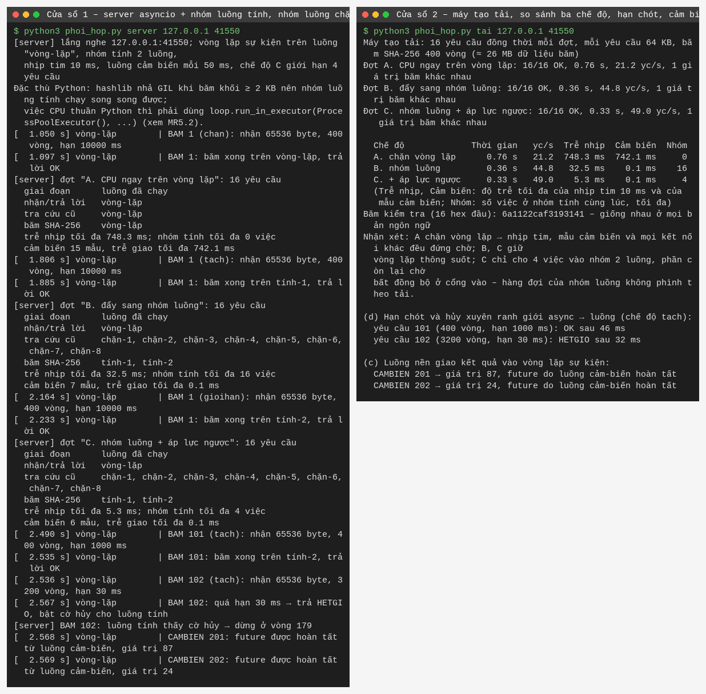

# Bài mở rộng MR5.5 – Phối hợp đa luồng và bất đồng bộ trong server mạng (Python)

| Thông tin | Nội dung |
|---|---|
| Loại | **Bài mở rộng** – không có trong giáo trình, không có mã giả tương ứng |
| Liên hệ với giáo trình | Chương 5 (Bài 5.1–5.6); Chương 6 (Bài 6.1, 6.2); MR5.4 |
| Thư viện | Thư viện chuẩn: `asyncio` (`start_server`, `to_thread`, `run_in_executor`, `wrap_future`, `wait_for`, `Semaphore`, `call_soon_threadsafe`), `concurrent.futures.ThreadPoolExecutor`, `threading`, `queue`, `hashlib` |
| Bản ngôn ngữ khác | [C#](../../../csharp/Chuong05/BaiMR5.5_PhoiHopDaLuongBatDongBo/), [Java](../../../java/Chuong05/BaiMR5.5_PhoiHopDaLuongBatDongBo/), [Rust](../../../rust/Chuong05/BaiMR5.5_PhoiHopDaLuongBatDongBo/), [Go](../../../go/Chuong05/BaiMR5.5_PhoiHopDaLuongBatDongBo/) |

## Mục tiêu
Một server `asyncio` (một luồng, một vòng lặp sự kiện) nhận yêu cầu `BAM` kèm 64 KB dữ liệu, phải **gọi một hàm thư viện cũ kiểu chặn** (20 ms) rồi **băm SHA-256** dữ liệu 400 vòng (việc CPU ≈ 17 ms). Bài cho thấy cách phối hợp vòng lặp với luồng ở cả hai chiều:

| Phần | Nội dung |
|---|---|
| (a) | Đẩy việc CPU sang **nhóm luồng tính riêng** (`ThreadPoolExecutor(2)`) bằng `loop.run_in_executor`/`submit` + `asyncio.wrap_future` – vòng lặp không bị chặn |
| (b) | Gọi **hàm chặn** an toàn từ mã async bằng `asyncio.to_thread` (nhóm luồng mặc định của vòng lặp, ở đây 8 luồng `chặn-k`) |
| (c) | Một **luồng hệ điều hành chạy nền** (`cảm-biến`) giao kết quả **vào** vòng lặp: mẫu định kỳ bằng `loop.call_soon_threadsafe`, và hoàn tất `asyncio.Future` khi vòng lặp nhờ đọc ngay (`CAMBIEN`) |
| (d) | **Hủy và hạn chót xuyên ranh giới:** `asyncio.wait_for` hủy coroutine → coroutine bắt `CancelledError`, bật `threading.Event` → luồng tính thấy cờ ở vòng kế tiếp và tự dừng |
| (e) | **Áp lực ngược** giữa phần async và nhóm luồng: `asyncio.Semaphore(4)` – yêu cầu thứ 5 trở đi chờ *bất đồng bộ* ở cổng vào |
| (f) | **Cách làm SAI:** làm việc CPU và gọi hàm chặn ngay trên vòng lặp; đo **nhịp tim 10 ms** (độ trễ tối đa) và độ trễ giao mẫu cảm biến cho ba chế độ A (chặn vòng lặp), B (đẩy sang nhóm luồng), C (B + áp lực ngược) |

Máy tạo tải gửi 16 yêu cầu đồng thời cho mỗi chế độ, in thông lượng và bảng so sánh; server in tên luồng đã chạy từng giai đoạn (nhận/trả lời, tra cứu cũ, băm).

## Liên hệ giáo trình
- **Chương 5 (Bài 5.1–5.6):** vòng lặp sự kiện, `await`, hủy hợp tác và hạn chót (Bài 5.6) – bài này mở rộng hủy/hạn chót sang việc chạy trên *luồng khác*; Bài 5.3 (giao diện không bị treo) là cùng nguyên tắc “đừng chặn vòng lặp”.
- **Chương 6 (Bài 6.1, 6.2):** server nhóm luồng và server bất đồng bộ – ở đây kết hợp cả hai: phần mạng bất đồng bộ, phần việc nặng trên nhóm luồng. Nối tiếp [MR5.4](../BaiMR5.4_LuongVaDaLuong/) (luồng, hàng đợi, semaphore) và [MR5.2](../BaiMR5.2_MoPhongDongThoi/) (đo trễ vòng lặp).

## Kiến thức chính
- **Vòng lặp sự kiện chỉ có một luồng:** mọi coroutine, callback, nhịp tim chạy xen kẽ trên luồng `vòng-lặp`. Một đoạn mã chạy lâu không `await` (vòng băm, `time.sleep`, gọi thư viện chặn) làm **mọi thứ khác đứng chờ** – chế độ A cho thấy nhịp tim trễ hàng trăm ms và mẫu cảm biến cũng bị giao muộn tương ứng.
- **async → luồng:** `await asyncio.to_thread(f, ...)` (nhóm mặc định) hoặc `await loop.run_in_executor(nhóm, f, ...)` (nhóm riêng). Tách **nhóm tính** (cỡ = số CPU) khỏi **nhóm chặn** (cỡ lớn hơn, vì luồng chủ yếu ngủ) để hàm chặn không chiếm chỗ của việc CPU và ngược lại. `hashlib` nhả GIL khi băm khối ≥ 2 KB nên hai luồng tính chạy song song thật; việc CPU **thuần Python** thì phải dùng `ProcessPoolExecutor` (xem MR5.2).
- **luồng → async:** đối tượng của asyncio (`Future`, `Queue`, `Event`) **không an toàn luồng** – từ luồng khác chỉ gọi `loop.call_soon_threadsafe(cb, ...)` (lên lịch một callback) hoặc `asyncio.run_coroutine_threadsafe(coro, loop)` (chạy coroutine, nhận `concurrent.futures.Future` để luồng chờ kết quả).
- **Hủy, hạn chót:** không thể “giết” một luồng đang chạy. `wait_for` hủy phía async; muốn luồng dừng thì truyền **cờ hủy** (`threading.Event`) và luồng tự kiểm tra định kỳ. Bộ đếm “nhóm tính tối đa” chỉ giảm khi luồng tính kết thúc *thật* (callback của `concurrent.futures.Future` → `call_soon_threadsafe`).
- **Áp lực ngược:** không giới hạn (chế độ B) thì mọi yêu cầu đổ vào hàng đợi của nhóm (16 việc); `asyncio.Semaphore` (chế độ C) giữ tối đa 4 việc ở nhóm, phần còn lại chờ ở cổng vào mà không chặn vòng lặp – bộ nhớ và độ trễ của từng việc có giới hạn; muốn từ chối sớm thì thêm hạn chờ ở cổng vào và trả 503 (bài tập).

## Tệp
- `phoi_hop.py` – chương trình chính: vai trò `server`, `tai`.
- `chung.py` – hằng số, giao thức, `bam()` (SHA-256 có cờ hủy), `tra_cuu_cu()` (hàm chặn giả lập), nhật ký.
- `may_chu.py` – server `asyncio`: ba chế độ, nhịp tim, luồng cảm biến, thống kê theo đợt.
- `tai.py` – máy tạo tải `asyncio`: 16 yêu cầu đồng thời mỗi đợt, bảng so sánh, thử hạn chót, `CAMBIEN`.
- `demo.json`; `ket_qua.txt`, `ket_qua.png` – kết quả thực thi thật.

Giao thức (mỗi kết nối một yêu cầu): `BAM <mã> <chan|tach|gioihan> <số_byte> <số_vòng> <hạn_ms>\n` + dữ liệu → `OK <mã> <16 hex đầu SHA-256>` hoặc `HETGIO <mã>`; `CAMBIEN <mã>` → `CAMBIEN <mã> <giá trị> <tên luồng>`; `DATLAI` → `OK`; `THONGKE <nhãn>` → `TK <trễ nhịp ms> <số mẫu> <trễ giao mẫu ms> <nhóm tính tối đa>`. Dữ liệu thử byte thứ i = i mod 251, nên giá trị băm `6a1122caf3193141` giống nhau ở mọi bản ngôn ngữ (client và server khác ngôn ngữ chạy chéo được).

## Cách chạy
Trong thư mục bài (Windows dùng `python` hoặc `py`):
```bash
python3 phoi_hop.py server 127.0.0.1 9000     # cửa sổ 1
python3 phoi_hop.py tai    127.0.0.1 9000     # cửa sổ 2
```
Tái lập: `python3 tools/demo.py python/Chuong05/BaiMR5.5_PhoiHopDaLuongBatDongBo` (cổng 41550).

## Kết quả


Lần chạy trong ảnh (Linux, 2 CPU, Python 3.13.18; máy đang có tải khác nên số đo dao động):

| Chế độ | Thời gian 16 yêu cầu | Trễ nhịp tối đa | Trễ giao mẫu cảm biến | Việc ở nhóm tính tối đa |
|---|---|---|---|---|
| A. chặn vòng lặp | 0,76 s | 748 ms | 742 ms | 0 (mọi thứ trên `vòng-lặp`) |
| B. đẩy sang nhóm luồng | 0,36 s | 32,5 ms | 0,1 ms | 16 |
| C. + áp lực ngược | 0,33 s | 5,3 ms | 0,1 ms | 4 |

- Bảng giai đoạn của server: ở A cả ba giai đoạn chạy trên `vòng-lặp`; ở B, C tra cứu cũ chạy trên `chặn-1…chặn-8`, băm trên `tính-1`, `tính-2`, còn vòng lặp chỉ nhận/trả lời.
- **(d)** yêu cầu 101 (hạn 1000 ms) trả `OK` sau 46 ms; yêu cầu 102 (3200 vòng, hạn 30 ms) trả `HETGIO` sau 32 ms, và server ghi “luồng tính thấy cờ hủy → dừng ở vòng 179” – luồng không băm hết 3200 vòng.
- **(c)** hai yêu cầu `CAMBIEN` nhận giá trị do luồng `cảm-biến` hoàn tất future.

Ở lần chạy khác (máy rảnh) B, C thường có trễ nhịp 1–5 ms; A luôn ≈ 16 × (20 + 17) ms ≈ 0,6 s vì 16 yêu cầu được xử lý liền nhau trên vòng lặp.

## Bài tập gợi ý
1. Trong chế độ `tach`, bỏ `to_thread` và gọi thẳng `tra_cuu_cu()` (chỉ băm được đẩy đi): trễ nhịp tối đa còn bao nhiêu? Hàm chặn 20 ms “nhỏ” có vô hại không?
2. Thêm hạn chờ ở cổng vào cho chế độ `gioihan`: chờ semaphore quá 100 ms thì trả `503` – client nhận bao nhiêu `503` với 16, 32, 64 yêu cầu?
3. Thay việc băm bằng một vòng lặp Python thuần (như MR5.2) rồi đo lại B: vì sao nhịp tim xấu đi? Đổi sang `ProcessPoolExecutor` – dữ liệu 64 KB phải được *chép* sang tiến trình con, chi phí bao nhiêu?
4. Cho luồng cảm biến dùng `asyncio.run_coroutine_threadsafe(coro, loop).result(timeout=1)` để hỏi vòng lặp “đang có bao nhiêu kết nối”; điều gì xảy ra nếu gọi `.result()` từ *chính* luồng vòng lặp?
5. Chạy với Python *free-threaded* (`python3.13t`) và thay việc băm bằng vòng lặp Python thuần: nhóm luồng có chạy song song được không?

## Đọc thêm
- Tài liệu Python: [*Developing with asyncio*](https://docs.python.org/3/library/asyncio-dev.html) (Concurrency and Multithreading, Running Blocking Code), [`asyncio.to_thread`](https://docs.python.org/3/library/asyncio-task.html#asyncio.to_thread), [`asyncio.run_coroutine_threadsafe`](https://docs.python.org/3/library/asyncio-task.html#asyncio.run_coroutine_threadsafe), [`loop.run_in_executor`](https://docs.python.org/3/library/asyncio-eventloop.html#asyncio.loop.run_in_executor), [`loop.call_soon_threadsafe`](https://docs.python.org/3/library/asyncio-eventloop.html#asyncio.loop.call_soon_threadsafe), [`asyncio.wait_for`](https://docs.python.org/3/library/asyncio-task.html#asyncio.wait_for), [`concurrent.futures`](https://docs.python.org/3/library/concurrent.futures.html), [`hashlib`](https://docs.python.org/3/library/hashlib.html) (ghi chú về nhả GIL).

Mã nguồn của bài được viết mới cho kho này; các tài liệu trên chỉ là nguồn tham khảo kiến thức.
